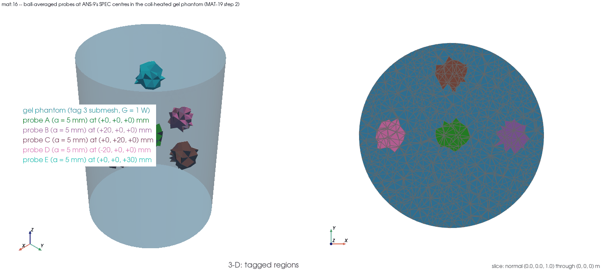

# `mat:16` — probe readouts at the benchmark's centres: what a probe log of the coil-heated gel phantom reports

Script: `examples/materials/16_probe_readouts_in_coil_phantom.py` (`EX-100`).
Gate: `tests/validation/test_mat19_probe_coil_phantom.py` (`MAT-19` step 2).

## 1. What this demonstrates

`mat:9` heats the coil-driven F-small gel phantom (`ANS-2`'s untuned 10 MHz loaded
birdcage, single-leg drive k = 0 = P1, 58 866 cells in the tag-3 phantom submesh,
P1 thermal, Robin on every face, CN + Rannacher, N = 40 to t\* = 1254 s) but reads
θ only at t\* and in 10 g balls. This example reads it the way a fibre-optic log
would: a **ball-averaged probe series** at the SPEC probe centres A–E of
`examples/ansys_benchmarks/ans9_coil_driven_gel_heating_10MHz/SPEC.md`, plus C′ (the
σ_y image of C), the whole-phantom ball Ω and a displaced control B⁺ (B moved
0.1 mm radially).

**What the probe reads.** Not a point: an integral of θ over the owned cells that
meet the ball (a = 5 mm, a fixture parameter), with one allreduce. The SPEC's row 4
accepts either the ball or the point. θ = T − T∞ is **per 1 W absorbed in the
phantom**, so every temperature here is a rise per watt, and it scales linearly
with absorbed power (one-way coupling, constant σ). It is not an absolute
temperature.

**Import, never restate.** The fixture is composed in step 2's order from
module-level names (`_run_heated`, `_transient`, `_probe_set`); every band and
record is imported. No gate module was edited.

**Identities re-asserted at their imported bands** (each printed beside the
`MAT-19` step 2 record):

- (S0) the imported bands and `_run_heated` are the gates' own objects;
- (A0) fixture identity (drive P1, 58 866 cells, V_sub within `V_BAND`), (M) every
  ball inside the phantom, snapshot 0 reads exactly 0.0;
- (R0) the re-run reproduces the gated θ\* to `E_BAND`;
- (A) the whole-phantom probe equals ∫θ/V_sub to `B_BAND` at n = 1 … 40;
- (U4) the n = 40 probe row is bitwise identical on every rank;
- (Σ) the σ_y mirror pair C / C′ at t\* within `C4_COVARIANCE_BAND`;
- (X1) the a-sweep's 5 mm column is the main series' B column.

**Negative controls (asserted).** (C1″) the displaced B⁺ differs from B by more than
`WIDTH_BAND` (record 4.3978e-03), so the width comparison is not blind to a
placement error; (f″) C differs from B by more than `F_CONTROL_FLOOR` (record
0.8018); (U3c) at -n 4, where the phantom submesh has ghost cells, a ghost-included
Ω misses the volume identity by more than `B_BAND` (record 2.6047e-02). At -n 2 the
phantom is owned by one rank (G_w = 0) and the script prints "inapplicable".

**Why two widths.** The phantom submesh is split across ranks only at -n 4. The flagged
run of record is -n 2: it asserts everything above except (W) and (U3c), and writes
an npz (under `/workspace/logs/ex100/`, hash-guarded against this script, the
step-2 module and `thermal/probe.py`). The control run is the same script at -n 4:
it asserts (W), the series agree with the -n 2 run at `WIDTH_BAND` (step-2 record
3.714e-11), and (U3c). A stale npz raises; it is never recomputed.

**Printed, not asserted.**

- the probe log: θ̄ and T = T∞ + θ̄ at n = 10 / 20 / 30 / 40 (313.5 / 627 / 940.5 /
  1254 s) for A–E and C′;
- (P4) ball/point − 1 at t\* against the SPEC row-4 point records;
- (P5) the placement sensitivity at B (≈ 4.4 % per mm);
- (P-a) the probe volume at B, a = 2.5 and 5 mm;
- ball volume offsets V_h/(4πa³/3) − 1, `max_imag_ratio`, the submesh partition line.

These read what a thermometer of finite sensing volume and placement tolerance would
see **on this fixture**. They claim nothing about a real probe's sensing volume,
thermal mass, self-heating or lead, and nothing about any `ANS-9` comparison.

Scope: one mesh, degree 1, ragged sheets (a record as in `MAT-19` step 2), 1 W
normalisation. No h-statement, no tissue, perfusion, duty cycle or container wall.

## 2. How to run it

```
./scripts/run_examples.sh -e mat:16 -n 2 -t 590
```

Needs the complex DolfinX build, which the runner sources for the `mat:` group.
Tier: **heavy** (≈ 4 min at -n 2). Verification goes through the logging harness with
`PYTHONPATH=/workspace/src:/workspace` (the script imports `tests.*`); add
`-e FEM_EM_SETUP_FIGURES=1` after `exec -T` to re-render the setup figure. Then run
the same line at `-n 4` for the control window ((W) and (U3c)).

## Setup figure



`examples/materials/figures/materials_16_probe_readouts_in_coil_phantom_setup.png`.
The figure is the tag-3 phantom submesh (58 866 cells), translucent, cut by the
z = 0 plane through the origin. The coloured cells are figure-only meshtags: cells
whose centroid lies inside each a = 5 mm ball at A–E; they never enter a solve.

## 3. How to analyze it, step by step

**Step 1 — the anchors.** The `[S0]`, `[A0]`, `[R0]`, `[A]`, `[U4]`, `[Sigma]` and
`[X1]` lines print each identity beside its step-2 record; the script asserts them
at the imported bands. `[part]` prints the submesh partition.

**Step 2 — the controls.** `[control]` lines: (C1″), (f″) and (U3c).

**Step 3 — the probe log.** `[log]` prints θ̄ (K per W) and T at the four SPEC times for
A–E and C′. Because θ is per absorbed watt, scale by the absorbed power for a rise.

**Step 4 — ball against point.** `[P4]` gives ball/point − 1 at t\*; `[P-a]` shows the
dependence on the ball radius at B.

**Step 5 — width.** At -n 4, `[W]` prints the series difference from the -n 2 run
and its per-probe maxima.

**Step 6 — ParaView.** Open
`examples/materials/paraview_output/materials_16_probe_readouts_in_coil_phantom_combined.xdmf`
(41 time steps: P1 `theta`, DG0 `q_h`, DG0 masks `probe_A_mask` … `probe_E_mask`,
`probe_Cprime_mask`, `probe_Bplus_mask`), colour by `theta`, apply Threshold on
`probe_B_mask` > 0.5 and play the 41 steps; Plot Over Time on a mask-thresholded
region gives the probe's cell-centroid footprint. The masks are display only, not the
probe's lattice weights. The series are in
`examples/materials/paraview_output/materials_16_probe_readouts_in_coil_phantom_series.csv`
and the probe table in
`examples/materials/paraview_output/materials_16_probe_readouts_in_coil_phantom_probes.csv`,
plotted in
`examples/materials/paraview_output/materials_16_probe_readouts_in_coil_phantom_series.png`.

## Related

- The same phantom heated without probes: `examples/materials/09_coil_driven_heating_phantom.md`.
- The probe on a lossy sphere against a closed form: `examples/materials/13_virtual_probe_in_gel_ball.md`.
- The benchmark whose probe centres are used: `examples/ansys_benchmarks/ans9_coil_driven_gel_heating_10MHz/SPEC.md`.
- The gate: `tests/validation/test_mat19_probe_coil_phantom.py` and the probe `src/fem_em_solver/thermal/probe.py`.
