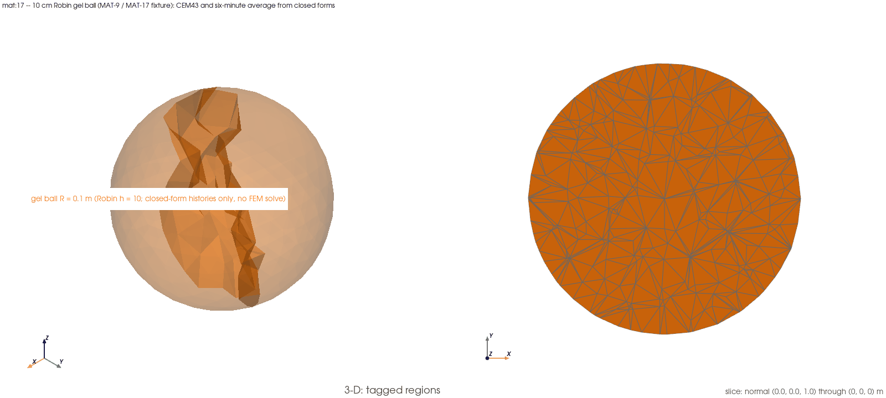

# `mat:17` — thermal dose and the six-minute average on closed-form histories

Script: `examples/materials/17_thermal_dose_duty_cycle.py` (`EX-104`)
Gates: `tests/validation/test_mat20_cem43_closed_form.py` (`MAT-20` step 1, `cem43`),
`tests/validation/test_mat20_running_average.py` (`MAT-20` step 2, `running_average`) and
`tests/validation/test_mat17_duty_cycle_closed_form.py` (`MAT-17` step 1, the duty-cycled closed form).

## 1. What this demonstrates

`mat:11` switches a uniform source 0/1 on `MAT-9`'s 10 cm Robin gel ball
(k = 0.6 W/m/K, Q = 2000 W/m³, ρc = 4.18e6 J/m³/K, h = 10 W/m²/K) and reads the
temperature; it explicitly claims nothing about a dose or a six-minute average.
This example asks what two post-processors report on the same history, case A
(P = 1200 s, D = 0.5), and checks each against a closed form:

- `fem_em_solver.thermal.dose.cem43`, the CEM43 thermal dose, exact on the
  piecewise-linear interpolant of a sampled history;
- `fem_em_solver.thermal.dose.running_average`, the trailing window mean, exact on
  the same interpolant.

**No FEM history is used anywhere.** The histories are linear ramps, `MAT-9`'s
step response re-based to 37 °C, and `MAT-17` case A's periodic closed form. The
ball mesh (2 571 cells at 0.02 m) exists for the setup figure and as the support of
a **closed-form field map**: the radial closed form evaluated at each P1 vertex's
radius. That map is *closed form evaluated at vertex radii — not an FEM history*;
nothing is assembled or solved. The same label sits inside both XDMF files as an
`Information` element.

Every band and helper is imported from the gate modules (`s1.BAR` = 1e-10 for the
dose, `s2.BAR` = 1e-12 for the window means), nothing is restated; the structural
checks (one ball across the three gate modules) are asserted at start-up. The
brentq / quad settings of (A2) and (B2) are copied from the gate with line citations
(settings, not bands).

**Part A — the gated operator identities, recomputed.** Each printed value is
compared to the gate-log string and the run asserts the digits are equal:

- (A1) three ramps × samplings 2 / 7 / 1000: the reference and the rectangle-sum
  digits equal the step 1 log, relative error ≤ 6.3e-16 (asserted ≤ 1e-10);
- (A2) `MAT-9`'s step response at N = 2¹⁸ (the gate's recorded selection, no
  selection loop): t₄₃ = 14087.0956163533 s, quad = 1.708516120835631e+05 equivalent s,
  operator 1.708516120820288e+05, relative 8.980e-12;
- (B1) integer-period window means on `D·θ_ss(0)`: 5.959e-15 / 8.139e-15 / 1.032e-14 /
  9.011e-15 (asserted ≤ 1e-12), window counts 4097 / 8193;
- (B2) the six-minute window maximum: brentq root 779.999309 s, t_max 779.882812 s
  (−0.398 samples) and 780.029297 s (+0.205 samples).

**Negative controls (asserted):** (Rc) the planted R swap misses (A1) by 1.3784 /
0.1937 / 1.3982; (Wc) a window of kP + P/2 misses (B1) by 1.957e-03 (k = 1) and
1.174e-03 (k = 2), each under its printed O(ripple) ceiling. Printed only: (Sc) no
split at 43 °C, 1.2973 / 0.1292 / 0.1096; (Pc) one-sample-short windows.

**Part B — the exposure story**, example-side assertions on exact premises:

- (S1) the six-minute maximum of the power schedule χ is 1 (|max − 1| = 0);
- (S2) the whole-period mean of χ is D (max |mean − D|/D = 0);
- (S1c, control) a 1.5 P window misses D by 0.333171 (ceiling 1/3);
- (J) behind the asserted premise min T = 43.039341 °C > 43, the centre's dose per
  period exceeds that of the average-power stand-in: 1296.61 against 1296.07
  equivalent s, margin +4.125e-04.

## 2. How to run it

```
./scripts/run_examples.sh -e mat:17 -n 2 -t 180
```

Needs the complex DolfinX build, which the runner sources for the `mat:` group
(nothing here needs complex numbers). Tier: **standard** (≈ 45 s wall at `-n 2`; the
ceiling is 180 s). Verification runs go through the logging harness with the
runner's emitted command (`./scripts/run_examples.sh -e mat:17 -n 2 -t 180 --dry-run`).
Add `-e FEM_EM_SETUP_FIGURES=1` after `exec -T` to re-render the setup figure.

## Setup figure



`examples/materials/figures/materials_17_thermal_dose_duty_cycle_setup.png` shows
`MAT-9`'s ball mesh (2 571 cells, one region: the gel ball, drawn translucent), with
the slice at z = 0. The mesh carries only the closed-form map; no solve ran on it.

## 3. How to analyze it, step by step

**Step 1 — the six-minute average of the power.** The source is on for 600 s, which
exceeds the 360 s window, so the six-minute mean of χ peaks at **1, full power**
(S1) while its whole-period mean is exactly D = 0.5 (S2): the six-minute average
reads **2.000 ×** the period average on this schedule. The two switch segments of
the sampled interpolant lose and gain Δt/2 each, so each period integrates to D·P
exactly; that is why a whole-period window hides the ripple to round-off (B1, S2),
and a window of 1.5 P does not (S1c, Wc).

**Step 2 — the six-minute average of the temperature.** The thermal mass
(τ₁ = 1.915501e4 s, P/τ₁ = 0.0626) flattens it. The centre's periodic state runs
6.182881 K (peak) / 6.039341 K (trough) / 6.111111 K (mean); the six-minute mean
of θ peaks at 6.1614 K at t = 779.883 s, **+0.82 %** above D·θ_ss(0), where the
power's six-minute mean read +100 %.

**Step 3 — CEM43 as the exact integral of the interpolant.** `cem43` integrates
R^(43−T) exactly on each linear piece, with R = 0.5 at and above 43 °C and 0.25
below, split at the crossing. The rectangle sum Σ R^(43−Tᵢ)Δtᵢ is printed beside it
and never asserted: 37.5 against 750.65 on the rise at 2 samples (A1). The record
digits come from the gate, not from here.

**Step 4 — Jensen at the centre, and where it fails.** Re-base to 37 °C (the gate's
re-basing: θ is unchanged and only the additive base moves). The centre then sits at
43.04–43.18 °C, on one side of the R switch, where 2^(T−43) is convex: the
duty-cycled dose per period (1296.61 equivalent s = 21.610 min, dose 1.0805
equivalent min per minute of elapsed time) exceeds the average-power stand-in
(1296.07 s = 21.601 min) by +4.125e-04 (J, asserted). CEM43's R switch makes the
integrand concave at 43 °C, so the reading flips sign near the mean-43 °C isotherm
(r ≈ 20 mm): the map's minimum per-vertex excess (Jc, printed only) is −3.698e-03 at
r = 0.0222 m, its maximum +1.681e-03. At the surface (r = R, D·θ_ss = 3.3333 K, the
R = 0.25 branch) the dose is 29.807 equivalent s per period.

**Step 5 — a bench gel accumulates nothing.** On `m17cf.T_INF` = 20 °C the centre dose
per period is 8.162e-08 equivalent s. CEM43 is a tissue metric; the 37 °C base is the
gate's re-basing, not a claim about any phantom. Continuous heating from rest over
`MAT-9`'s ten hours (chosen to cross 43 °C, not a protocol) accumulates
1.708516e+05 equivalent s = 2847.5 min.

**Step 6 — ParaView.** Open
`examples/materials/paraview_output/materials_17_thermal_dose_duty_cycle_map_combined.xdmf`
(seven P1 fields: `theta_mean_K`, `T_six_min_max_C`, `six_min_excess_pct`,
`cem43_duty_per_period_min`, `cem43_stand_in_per_period_min`, `jensen_excess`,
`above_43_mean`). Colour by `cem43_duty_per_period_min` on Slice z = 0; Contour
`above_43_mean` = 0.5 for the r ≈ 20 mm isotherm; colour by `jensen_excess` to see
the sign flip. Open
`examples/materials/paraview_output/materials_17_thermal_dose_duty_cycle_period_combined.xdmf`
and Play: `T_C` and `T_six_min_mean_C` at 17 frames, t = P + 75 j s. Open
`examples/materials/paraview_output/materials_17_thermal_dose_duty_cycle_centre_history.csv`
with the CSV reader in a Line Chart View and plot `chi_six_min_mean` against
`theta_six_min_mean_K` (4097 rows over the second period; `t_s` is absolute time).
All files are closed form evaluated at vertex radii — not an FEM history; the map
is a P1 interpolant of it and nothing is asserted on it.

**Not claimed:** a CEM43 limit, damage threshold, or IEC 60601-2-33 / six-minute SAR
compliance statement; tissue, perfusion, or the 37 °C base as a phantom
temperature; any FEM history or `MAT-20`'s FEM clause; `MAT-17` case B, a
coil-driven or SAR-shaped source, or a pulse sequence.

## Related

- The same ball and schedule, temperature only: `examples/materials/11_duty_cycled_gel_ball.md`.
- Duty-cycled coil heating of the gel phantom: `examples/materials/15_duty_cycled_coil_heating_phantom.md`.
- The gate modules: `tests/validation/test_mat20_cem43_closed_form.py`,
  `tests/validation/test_mat20_running_average.py`,
  `tests/validation/test_mat17_duty_cycle_closed_form.py`.
