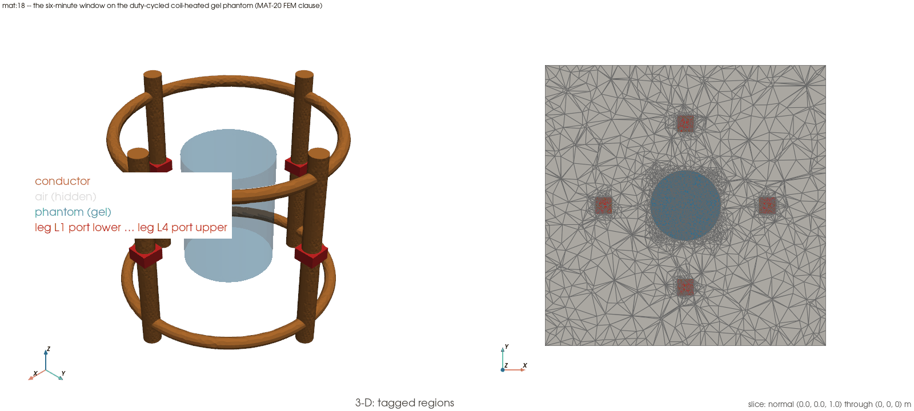

# `mat:18` — the six-minute window on an FEM heating history

Script: `examples/materials/18_six_minute_window_coil_heating.py` (`EX-110`)
Gate: `tests/validation/test_mat20_fem_history.py` (`MAT-20` step 2, FEM clause)

## 1. What this demonstrates

`mat:17` showed the six-minute window on closed forms only; `mat:15` ran the
coil-driven duty-cycled gel-phantom history but never windowed it. This example
joins them on `MAT-15` step 1's fixture (the F-small coil-driven gel phantom at
10 MHz, drive k = 0, G = 1 W / P₁, P = t\*/5 = 250.8 s, D = 0.5, t\* = 1254 s,
Δt = 31.35 s) and adds three things no earlier example has.

**Part A — windowing commutes with Duhamel on FEM data.** The trailing six-minute
mean (W = 360 s, 11.4833 samples, 29 valid windows, n = 12 … 40) of the duty run
equals the signed sum of the six-minute means of the ten switch-on (Heaviside)
runs. Both operators are linear, so the window of a sum is the sum of the
windows. Practical reading: window the per-switch building blocks once and any
on/off schedule on the same switch grid composes from them without re-windowing
(the example asserts only the gated schedule). Asserted at the imported bands,
each printed beside the gate's `MAT-20` step 2 W1 line
(`20261011T172810Z_MAT-20-step2-fem-W1.log`):

| quantity | band | this run | W1 record |
|---|---|---|---|
| (H0) Duhamel on the volume-mean series | `L_BAND` 1e-12 | 5.794e-14 | 5.689e-14 (:1968) |
| (FEM) window of duty vs sum of windowed H_m, 29 windows | `D_BAND` 1e-13 | 3.413e-14 | 3.434e-14 (:1969) |
| (FEM-2d) the 2-D call, duty column equal to the 1-D call | `D_BAND` | 3.476e-14, True | 3.444e-14, True (:1971) |

These are round-off readings, the same order as the gate's; the flagged and
unflagged runs differ at that level (5.3e-14 / 2.654e-14 / 2.644e-14 in the
control), as the gate's own re-runs do. All ten H_m volume means at t\* and the
duty means at n = 32 / 36 / 40 (0.466250330 / 0.584438780 / 0.568835514 K) print
equal to the W1 digits (`:1957–1967`), and the duty six-minute maximum is
5.270483664e-01 K at t = 1254.0 s against H_0's 1.004390808 K (`:1974`).

**Part A2 — the window of a field.** The 2-D `running_average` windows θ at every
P1 vertex. (Cm), asserted: the volume mean of the per-vertex six-minute field,
read through the gate's own `_series` reduction, equals the windowed volume-mean
series, 1.306e-14 ≤ `D_BAND` (exact on its premise: both maps are linear).

**Negative controls (asserted):** (Wc-FEM) the schedule shifted by P/2 misses
(FEM) by 1.326e-01 (record 1.326e-01, `:1972`); (Cm-c) the field window one
sample short (328.65 s) misses the W = 360 s series by 1.881e-02 (predicted
[5e-3, 6e-2]). Printed only: (Dc) dropping H_9 misses by 0.043296 (`:1973`).

**Power against temperature.** The source's own six-minute on-fraction peaks at
234.6 / 360 = 0.651667, which is 1.3033 × D; it is attained at several
windows (the script prints the first, n = 20, window [267.0, 627.0] s; n = 36 gives
the same value) and falls to 0.348333 at n = 40. The volume-mean θ's six-minute
peak is 0.5270 K against H_0's 1.0044 K, a ratio of 0.5247 ≈ D. The thermal mass
flattens what the power window reports: a six-minute power fraction of 0.65
overstates the temperature's by a factor of 1.3.

**Vertices that peak early.** The volume mean peaks at t\*, but a window ending
at the last on-phase end holds 234.6 s of on-time against 125.4 s for the window
ending at t\*, so vertices whose θ falls during the off phase can peak earlier.
Measured: 554 of 11 906 owned vertices (0.0465) have their six-minute mean peak
before t\*, none exactly at n = 36 (the rest of the early ones peak between);
11 352 peak at t\*. The map `theta_six_min_t_max_s` shows where. Per-vertex, the
maximum six-minute mean is 2.1237 K against a maximum θ(t\*) of 1.9856 K.

**Part B (printed only, nothing asserted).** If the tuned F-human series JSON is
present under `logs/mat15_s5/` (gitignored, written by `MAT-20` step 3 and never
regenerated here), the script recomputes through `cem43` and `running_average`
the 10 g ball-mean history: CEM43 1.846214193739186e-11 s (quad 1.846214193739185e-11 s),
six-minute peak 4.277005459539476e-02 K at 1254.0 s, dose 3.077024e-13 min, each
equal to `20261011T183717Z_MAT-20-step3-W2.log:52 / :57 / :62`. **All temperatures
are per 1 W at 20 °C**, so this CEM43 of ≈ 1.8e-11 s per accepted W (ruling
361-1) is a negligible dose, not a safety figure.

**Per-rank partition (rank-local control).** At `-n 2` the run prints
`per-rank (owned P1 dofs, owned+ghost columns): [(11906, 11906), (0, 0)]`: one
rank owns every phantom vertex and the other owns none. The per-vertex maxima are
guarded with `initial=-inf` for that rank; this is the partition that hung the
first attempt (empty-slice `np.max`).

**Not claimed:** a six-minute SAR or temperature limit, a CEM43 threshold, or
IEC 60601-2-33 compliance; tissue, perfusion or an absolute temperature; a
periodic steady state or any schedule other than the gated one; (Cm) as a gate
on anything but this script's own field window; Part B's dose as a gate.

## 2. How to run it

```
./scripts/run_examples.sh -e mat:18 -n 2 -t 590
```

Needs the complex DolfinX build, which the runner sources for the `mat:` group.
Tier: **heavy**, ≈ 214 s wall at `-n 2` (flagged run of record), ≈ 206 s
unflagged. Verification runs go through the logging harness; add
`-e FEM_EM_SETUP_FIGURES=1` after `exec -T` to re-render the setup figure. The
example runs at any width ≥ 1 because the per-vertex maxima are guarded for
ranks that own no phantom vertex.

Outputs, all in `examples/materials/paraview_output/`:

- `materials_18_six_minute_window_coil_heating_series_combined.xdmf`: P1
  `theta_K` (duty θ) and `theta_six_min_mean_K`, 29 frames at t_n = n·31.35 s,
  n = 12 … 40;
- `materials_18_six_minute_window_coil_heating_combined.xdmf`: P1
  `theta_duty_tstar_K`, `theta_six_min_mean_tstar_K`, `theta_six_min_max_K`,
  `theta_six_min_t_max_s` and DG0 `q_h_k0` (W/m³ at G = 1 W / P₁), all at
  t\* = 1254 s;
- `materials_18_six_minute_window_coil_heating_window_history.csv`: n = 0 … 40
  with `chi_step`, `chi_six_min_on_fraction`, the duty and H_0 volume means, the
  six-minute duty value a, the sum-of-H_m value b, `rel_residual` and H_0's
  six-minute value.

(The complex build writes `real_` / `imag_` splits of each field; the imaginary
parts are zero.)

## Setup figure



`examples/materials/figures/materials_18_six_minute_window_coil_heating_setup.png`.
The `GEO-18` gapped, sheeted four-leg birdcage on `ANS-2`'s phantom rung, as in
`mat:15`: conductor and port sheets shown, the gel phantom translucent, air
hidden, sliced at z = 0.

## 3. How to analyze it, step by step

**Step 1 — the identity.** Open the CSV and plot `six_min_duty_K` against
`six_min_sum_Hm_K` in a Line Chart View: the two curves coincide, and
`rel_residual` sits at 1e-14 for all 29 valid rows (blank before n = 12, where the
window is not yet full).

**Step 2 — the power window against the temperature window.** Plot
`chi_six_min_on_fraction` (peak 0.651667) beside `six_min_duty_K` (peak 0.5270 K,
or 0.5247 of H_0's 1.0044 K). The power fraction reaches 1.3033 × D; the
temperature's six-minute peak sits at ≈ D of H_0's. Thermal mass low-passes the
schedule.

**Step 3 — the field in time.** Open the series XDMF in ParaView, press Play and
colour by `real_theta_six_min_mean_K`; compare with `real_theta_K` to see the
window lag the instantaneous field.

**Step 4 — the early-peaking region.** Open the combined XDMF and apply a
Threshold on `real_theta_six_min_t_max_s` below 1254: the 4.65 % of vertices whose
six-minute mean peaks before t\* (the hot spot side and the Robin surface). A
zero count would also have been a reading; it is not zero here.

**Step 5 — what the dose line means.** Part B's CEM43 is per accepted W and per
1 W at 20 °C; the number is negligible by construction, and the guide makes no
safety statement.

## Related

- `examples/materials/17_thermal_dose_duty_cycle.md`
- `examples/materials/15_duty_cycled_coil_heating_phantom.md`
- `tests/validation/test_mat20_fem_history.py`
- `tests/validation/test_mat17_duty_cycle_coil_driven.py`
- `tests/validation/test_mat20_tuned_heating_dose.py`
