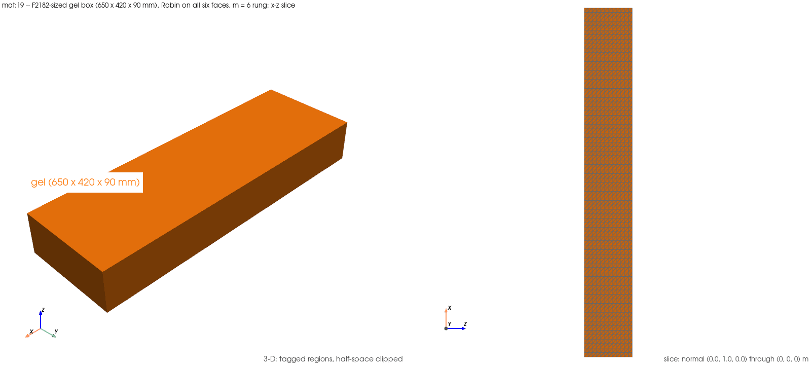

# `mat:19` — the F2182-sized gel box: a 90 mm slab at its centre, cooled through its two large faces

Script: `examples/materials/19_f2182_gel_box_slab_and_faces.py` (`EX-112`)
Gate: `tests/validation/test_mat21_box_fem.py` (`MAT-21` step 1), closed form `tests/validation/test_mat21_box_closed_form.py` (step 0).

## 1. What this demonstrates

`mat:10` shows a phantom-sized cylinder whose three dimensions are comparable. The
F2182-sized gel box is the opposite shape: 650 × 420 × 90 mm (half-widths A, B, C =
0.325, 0.21, 0.045 m), gel k = 0.6, ρc = 4.18e6, uniform q = 2000 W/m³, Robin h = 10 on
every face, so the Biot numbers hA/k, hB/k, hC/k are 5.42, 3.50 and 0.75. The comparand
is `MAT-21` step 0's triple Robin eigen-series, the product of three slab series. The
script re-runs the gate's m = 6 rung ((78, 48, 12) hexahedra split into 6 tetrahedra,
269 568 cells, P1) through the gate's module-level helpers, unchanged, and copies its CN
call; every band is imported, none restated, and records are printed beside readings and
never asserted by equality.

**Asserted** (imported bands only), each printed beside its record in
`20261013T142646Z_MAT-21-step1r-W1-steady.log:106-110` /
`20261013T142900Z_MAT-21-step1r-W2-transient.log:92-93`: (S1) finest interior ≤
`INTERIOR_BAND`; (S2) Gauss ≤ `S2_GAUSS_BAND`; (T) CN N = 40 at t* = 0.2 t_C = 2 821.5 s
interior ≤ `INTERIOR_BAND`; (E-cn) balance ≤ `E_BAND`. Example-side: (F0) six face tags
partition the 21 024 Robin facets (1 152 / 1 152 / 1 872 / 1 872 / 7 488 / 7 488, integer
counts on owned facets); (F1) the six face powers sum to q V_h within `S2_GAUSS_BAND`.

**Negative controls (asserted as misses):** (c1) the comparand at 2h, interior miss
0.59734 (record 5.9734e-01); (c2) Dirichlet z-roots at t*, miss 0.36135 (record 3.6135e-01);
(F1-c) the face partition with the −z face dropped, miss 0.39779 (predicted 0.39775),
about 4e8 times the band, so a tag set missing a face is caught.

**Three readings, printed and not asserted** — reasons, not claims:

1. *A slab at the centre, not at the sides.* The box is thin in z (Bi_z 0.75), so its
   centre column sees the 1-D Robin slab θ_slab(z) = q (C² − z²)/(2k) + q C/h, which is
   12.375 K at the centre against the box's 12.003947 K: the slab level is ≈ 3.1 % high
   all the way up the column (3.09 / 3.07 / 3.05 %), while its z-profile is right. The
   side walls are 3–5 face-heights away, so lateral cooling is a ≈ 3 % correction at the
   centre that grows toward the sides: slab/series − 1 is +3.5 % at x = 0.25A, +5.7 % at
   0.5A, +12.7 % at 0.7A, +42 % at 0.9A. The slab picture holds to 10 % only for
   |x| ≲ 0.65A and |y| ≲ 0.52B, and the share of the box volume within 5 % / 10 % of the
   slab is 0.117 / 0.298.
2. *Where the heat leaves.* The ±z faces (650 × 420 mm) carry 0.7956 of q V on 0.7392 of
   the area, because they are hotter: face-mean θ 7.160 K against 5.300 K (±y) and
   5.085 K (±x), and an all-face mean of 6.653 K = qV/(hA). The ±y and ±x pairs carry
   0.1262 and 0.0782. The series' own face integrals (128-point Gauss–Legendre per face)
   give 0.795501 / 0.126245 / 0.078249 and sum to the truncation product 0.9999953, so the
   FEM fractions agree to 0.03 % or better.
3. *Hours from steady.* The slowest time constant is τ₁ = 20 193 s ≈ 5.6 h, from
   γ₁ = 1.330018 / 1.232272 / 0.771359 per axis. At t* = 47 min the centre is at
   1.335697 K, 98.9 % of the adiabatic q t*/ρc = 1.35 K and only 0.1113 of its steady
   12.003947 K; it reaches 0.4592 at t_C, 0.588 at τ₁ and 0.938 at 3 τ₁. The FEM centre
   history (nine snapshots) follows the series to ≈ 0.1 % at t*. This is an explanation of
   the geometry's time scale, never an F2182 test-procedure statement.

Not claimed: F2182 compliance or any test-procedure statement; whether the phantom fits a
coil; a coil or SAR source; the duty cycle; the LSQ rate, degree 2, or any external check.

## 2. How to run it

```
./scripts/run_examples.sh -e mat:19 -n 2 -t 420
```

The runner sources the complex DolfinX build for the `mat:` group. Tier: **heavy**,
measured 90 s wall at `-n 2` with the setup figure and 80 s without. Verification runs go
through the logging harness with the runner's emitted command
(`./scripts/run_examples.sh -e mat:19 -n 2 -t 420 --dry-run`). Add
`-e FEM_EM_SETUP_FIGURES=1` after `exec -T` to re-render the setup figure.
Outputs: `examples/materials/paraview_output/materials_19_f2182_gel_box_slab_and_faces_combined.xdmf`
and `examples/materials/paraview_output/materials_19_f2182_gel_box_slab_and_faces_centre_lines.csv`.

## Setup figure



`examples/materials/figures/materials_19_f2182_gel_box_slab_and_faces_setup.png`.
The m = 6 gel box (650 × 420 × 90 mm, Robin on all six faces) cut at y = 0: the x–z
section shows how thin the box is.

## 3. How to analyze it, step by step

**Step 1 — compare FEM and series.** Open
`examples/materials/paraview_output/materials_19_f2182_gel_box_slab_and_faces_combined.xdmf`.
The complex build writes `real_` / `imag_` splits (the imaginary parts are zero). Colour
by `real_theta_steady_fem`, then compare `real_theta_steady_series` and
`real_theta_steady_fem_minus_series`: the difference is ≈ 1e-3 relative and sits at the
walls and corners.

**Step 2 — where the slab estimate holds.** Colour by `real_slab_over_series_minus_1`
with a range of [0, 0.1], and threshold `real_slab_within_10pct` ≥ 0.5: the surviving
region is a central block, wide in x, narrower in y, full height in z.

**Step 3 — the faces.** Extract the facet block (`face_tags`, 1/2 = ±x, 3/4 = ±y,
5/6 = ±z) and threshold each tag; the ±z blocks are the two large faces that carry
≈ 80 % of the heat.

**Step 4 — the centre lines.** Open
`examples/materials/paraview_output/materials_19_f2182_gel_box_slab_and_faces_centre_lines.csv`
in a Line Chart View and plot `theta_fem_K`, `theta_series_K` and `theta_slab_K` against
`s_over_L`, split by `line` (x, y, z). The z line is the slab with a 3 % offset; the x and
y lines leave it toward the walls. Compare `real_theta_tstar_fem` and
`real_theta_tstar_series` for the field at t* = 2 821.5 s, where the centre is still
near-adiabatic.

## Related

- `mat:10`: `examples/materials/10_finite_cylinder_robin_series.md`
- `mat:8`: `examples/materials/08_gel_ball_settling_time.md`
- Gate: `tests/validation/test_mat21_box_fem.py`
- Closed form: `tests/validation/test_mat21_box_closed_form.py`
- Cylinder gate: `tests/validation/test_mat15_finite_cylinder_fem.py`
