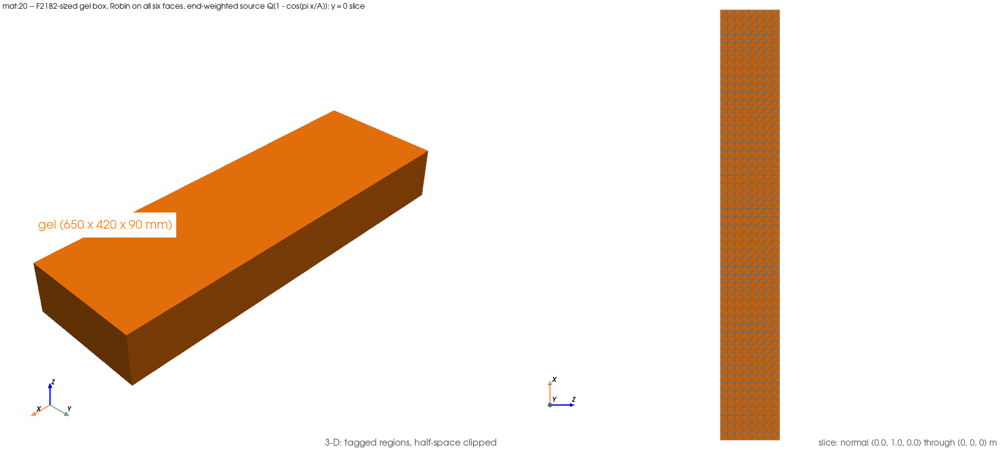

# `mat:20` — the F2182-sized gel box heated by an end-weighted source: UFL, DG0 and P2 hand-offs

Script: `examples/materials/20_f2182_gel_box_end_weighted_source.py` (`EX-119`)
Gate: `tests/validation/test_mat21_box_p2_source_fem.py` (`MAT-21` step 8, W2), with
`tests/validation/test_mat21_box_separable_fem.py` (the source's series) and
`tests/validation/test_mat21_box_dg0_source_fem.py` (the DG0 hand-off).

## 1. What this demonstrates

`mat:19` heats the 650 × 420 × 90 mm gel box with a uniform q. Here the source is
q(x) = Q [1 − cos(πx/A)], Q = 2000 W/m³: zero at the box centre and 2 Q at the ±x ends, the
shape of an end-ring SAR. It is handed to the thermal solver three ways on step 3's m = 4
rung ((52, 32, 8) hexahedra split into tetrahedra, 79 872 cells) at degree 2 (116 025 dofs):
as a UFL expression, as a DG0 cell average, and as a P2 nodal interpolant. The P2 form, the
one that carries forward, also runs by Crank–Nicolson (N = 40) to t* = 2 821.5 s. The script
copies the gate's solver calls and source lambda and imports every band and helper; records
live in an example-local dict and are printed beside the readings, never asserted by equality.

**Asserted** (imported bands only), each printed beside its record in
`20261016T033407Z_MAT-21-step8-W2-p2-source.log:82-94`: (Pdeg) 116 025 dofs on all four
solves; (S1-sep), (S1-dg0), (S1-p2s) steady interior ≤ `INTERIOR_BAND`; (S2-p2s) Gauss ≤
`S2_GAUSS_BAND`; (T-p2s) CN interior at t* ≤ `INTERIOR_BAND`; (E-p2s) CN balance ≤ `E_BAND`.
Example-side: (F0) six face tags partition the 9 344 Robin facets (512 / 512 / 832 / 832 /
3 328 / 3 328, integer counts on owned facets); (F1) the six face powers sum to
`source_power` within `S2_GAUSS_BAND` for the P2-source and the uniform runs.

**Negative controls (asserted as misses):** (c-p2s) the P2-source run against the *uniform*
series, interior miss 0.51239 (predicted 0.512, record 5.1239e-01; its ceiling is the two
closed forms' own difference); (cF) the face partition with the +x face dropped, miss
0.06973 (predicted in [0.04, 0.25], not measured before this run).

**Three readings, printed and not asserted:**

1. *The fields.* The P2 source reproduces step 6's UFL-source result to 1.17e-7 (interior,
   relative to the UFL run); the DG0 staircase differs by 3.39e-4. Against the separable
   series the interior errors are 3.49e-5 (P2) and 3.42e-4 (DG0), a factor ≈ 10: the DG0 cell
   average replaces the cosine by a piecewise constant, a first-order source error that the
   P2 solution space cannot absorb, while the P2 interpolant of a smooth cosine costs nothing
   measurable (a_p = 0.999999778, 1 − a_p = 2.2e-7, and the P2-versus-UFL difference is at
   the series' own floor).
2. *The hot-end profile.* Along the x centre line the cosine source puts the maximum, 16.19 K
   at |x| ≈ 0.79 A, near the ends but inside the Robin cooling; the centre is only
   2.7411 K (series 2.741147 K) against 12.00396 K for the uniform source, and
   θ(0.9A) = 14.9195 K (series 14.919189 K). Along the 129-point line P2 stays within
   1.4e-3 K of the series and DG0 within 5.7e-3 K of P2.
3. *Where the heat leaves.* The ±x pair's share of the heat rises from 0.0783 (uniform) to
   0.1395 (cosine); ±y falls from 0.1262 to 0.1187, and ±z from 0.7955 to 0.7419. Dropping
   the +x face alone leaves 7.0 % of the power unaccounted for.

Not claimed: a coil or EM SAR source, or whether a coil SAR can be P2-interpolated; the exact
series of the delivered DG0 source; any h-rate or other rung; F2182 compliance, perfusion, a
container wall, or an external check.

## 2. How to run it

```
./scripts/run_examples.sh -e mat:20 -n 2 -t 590
```

The runner sources the complex DolfinX build for the `mat:` group. Tier: **heavy** (ceiling
590 s), measured 107 s wall at `-n 2` with the setup figure and 103 s without. Verification
runs go through the logging harness with the runner's emitted command
(`./scripts/run_examples.sh -e mat:20 -n 2 -t 590 --dry-run`). Add
`-e FEM_EM_SETUP_FIGURES=1` after `exec -T` to re-render the setup figure.
Outputs: `examples/materials/paraview_output/materials_20_f2182_gel_box_end_weighted_source_combined.xdmf`
and `examples/materials/paraview_output/materials_20_f2182_gel_box_end_weighted_source_x_centre_line.csv`.

## Setup figure



`examples/materials/figures/materials_20_f2182_gel_box_end_weighted_source_setup.png`.
The m = 4 gel box (650 × 420 × 90 mm, Robin on all six faces) cut at y = 0; the source
q = Q [1 − cos(πx/A)] is analytic and lives in the fields, not in the mesh.

## 3. How to analyze it, step by step

**Step 1 — the source.** Open
`examples/materials/paraview_output/materials_20_f2182_gel_box_end_weighted_source_combined.xdmf`.
The complex build writes `real_` / `imag_` splits (the imaginary parts are zero). Colour by
`real_q_p2` on a y = 0 slice: zero at the centre, 2 Q at the ±x ends. `real_q_dg0` shows the
cell-average staircase.

**Step 2 — the temperature.** Colour by `real_theta_p2src_steady`, then compare
`real_theta_series_steady` and `real_theta_p2src_minus_series` (≈ 3.5e-5 relative in the
interior, at the walls and corners), and `real_theta_uniform_steady` for the uniform source.
`real_theta_tstar_p2src` and `real_theta_tstar_series` give the field at t* = 2 821.5 s.

**Step 3 — the DG0 staircase.** Colour `real_theta_dg0_minus_p2src` on the y = 0 slice, then
apply Plot Over Line along x: the difference is a few mK, patterned by the cell staircase and
largest where the cosine's curvature is largest.

**Step 4 — the faces.** Extract the facet block (`face_tags`, 1/2 = ±x, 3/4 = ±y, 5/6 = ±z)
and threshold each tag; the ±x blocks carry 0.1395 of the heat against 0.0783 for the
uniform source.

**Step 5 — the centre line.** Open
`examples/materials/paraview_output/materials_20_f2182_gel_box_end_weighted_source_x_centre_line.csv`
in a Line Chart View and plot `theta_p2src_K`, `theta_series_K`, `theta_dg0_K` and
`theta_uniform_K` against `x_over_A`: the cosine source is cool at the centre and peaks near
|x| ≈ 0.79 A; the uniform source is flat at the middle.

## Related

- `examples/materials/19_f2182_gel_box_slab_and_faces.md`
- `examples/materials/04_sar_heats_gel_ball.md`
- `tests/validation/test_mat21_box_p2_source_fem.py`
- `tests/validation/test_mat21_box_separable_fem.py`
- `tests/validation/test_mat21_box_dg0_source_fem.py`
