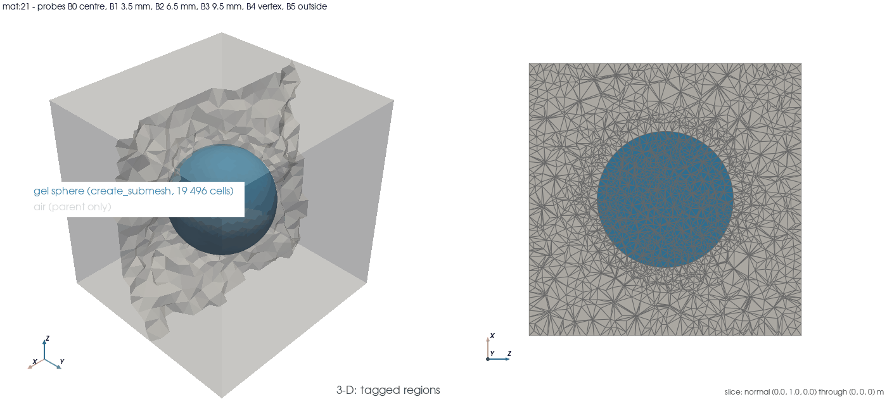

# `mat:21` — point probes read straight off the gel-ball submesh

Script: `examples/materials/21_point_probes_on_gel_ball_submesh.py` (`EX-121`)
Gates: `tests/post/test_submesh_owner_rule.py` (`POST-10` step 1) and
`tests/validation/test_mat10_sar_to_heat_sphere.py` (`MAT-10` step 1).

## 1. What this demonstrates

`mat:13` reads the heated gel ball through ball-averaged probes, and its "point
value" is a closed form. `mat:16` reads the tag-3 submesh only as owned-cell
integrals. This example is the first to read a FEM field **at points on a
`create_submesh` mesh**: `MAT-10`'s Robin-cooled gel sphere (19 496 cells, cut
from the 74 020-cell sphere-in-box EM mesh), heated by the FEM SAR
(R = 10 mm, σ = 0.57 S/m, 64 MHz, imposed field, h = 100 W/m²/K).

**Why the parent map is needed.** A `create_submesh` mesh carries no original
cell index (DolfinX 0.11 raises `Mixed topology unsupported.`). The owner rule
(`owner="lowest_original_cell"`: among the cells containing a point, the one
with the lowest original index) therefore takes
`parent=(parent_mesh, parent_cells)`, and keys each submesh cell by its
parent's original cell index. That index is the mesher's order, not the
partition's, so the rule picks the same cell at every MPI width
(`docs/planning/chunks/POST-10.md:21`). Without `parent` the call raises
`RuntimeError` on every rank, and the message names `parent=` and
`create_submesh`.

**When it matters.** A field that is discontinuous across cell faces (the DG0
heat source `q_h`, N1curl E) read at a vertex or facet: the value depends on
which of the incident cells owns the point. B4 below is a mesh vertex with 24
incident submesh cells, and `q_h` spreads by 0.944 W/m³ over them
(4.5e-04 of the value). **When it does not:** the continuous P1 temperature θ
at a generic point, which reads the same through `owner=None` and through the
rule (to round-off).

**Imported, never restated.** Every fixture helper and band comes from the two
gate modules by import (`POINTS`, `_fixture`, `_oracle`, `_dg0`,
`CLOSED_FORM_TOL`, `RULE` from POST-10; `P_BAND`, `A_BAND`, `B_BAND`, `C_BAND`,
`_sphere_submesh`, `_cell_average_dg0`, `_to_sub`, `_solve_lossy_sphere` from
MAT-10). No pytest fixture or `test_*` function is called and no band is new.

**Asserted.**
- **Part A, `POST-10`'s cube:** (S0) 288 kept cells; (K) owner integers equal
  the oracle minimum (P0–P5 `[217, 223, 126, 229, 132, -1]`, identical to the
  record); (I) bitwise agreement with the parent's `candidate_cells` rule;
  (N) N1curl `a + b×x` to ≤ 1e-12 (1.554e-15 at `-n 2`, 2.220e-15 at `-n 4`);
  (W) bitwise equal on every rank; (C1) oracle keep-set spreads 9 / 131 / 121;
  (C2) no `parent` raises `RuntimeError` on every rank; (C3) `parent` without
  the rule raises `ValueError`; (C4) a short `parent_cells` raises
  `ValueError` on every rank.
- **Part B, `MAT-10`'s ball:** (B) 4.010e-15 ≤ 1e-10; (P) 3.1923e-03 ≤ 1e-2;
  (A) 3.2464e-02 ≤ 0.11; (C) 1.135e-13 ≤ 1e-9; controls (a) 0.79323 and (b)
  1.0649 miss 0.11.
- **On the ball, at band 0 or `CLOSED_FORM_TOL`:** (I-q) `q_h` on the submesh
  against the parent `q_par` under `candidate_cells=keep`, owner integers equal
  and values bitwise equal; (I-o) the same for the planted original-index DG0,
  with value == `owner_original` at B0–B4; (O) B5 owner −1, invalid, zero
  claims on both calls; (N-ball) N1curl max error 2.220e-15; (W-ball) owner
  integers, `q_h`, θ and N1 values bitwise equal on every rank; (C2-ball) the
  ball submesh raises on every rank without `parent`.

**Printed, not asserted** (no gate sets a pointwise θ band). B0–B4 θ against
the closed form `robin_sphere_steady_temperature`:

| point | θ closed form [K] | θ_h[q_cf] | rel | θ_h[q_h] | rel |
| --- | --- | --- | --- | --- | --- |
| B0 centre | 0.122350 | 0.122421 | +5.8e-04 | 0.126822 | +3.66 % |
| B1 3.5 mm on x | 0.115537 | 0.115134 | −3.5e-03 | 0.119254 | +3.22 % |
| B2 6.5 mm off-axis | 0.098853 | 0.098646 | −2.1e-03 | 0.102161 | +3.35 % |
| B3 9.5 mm | 0.072159 | 0.071824 | −4.6e-03 | 0.074395 | +3.10 % |
| B4 vertex (r = 4.66 mm) | 0.110259 | 0.110207 | −4.8e-04 | 0.114156 | +3.53 % |

The q_cf column sits inside the predicted 1e-2; the q_h column sits in the
predicted +3 to +4 % (`MAT-10`'s mean-SAR leg).

One sentence on volume: a point probe and a 2 mm ball probe differ by 1.4 % at
the centre (ball/point − 1 = −1.38 %, −1.06 %, −1.45 % at B0 / B1 / B2), more
than the 1 % `P_BAND` and more than the steady quadratic profile's −1.09 %
prediction, so the two are not interchangeable at the 1 % level. This is
printed and not gated.

Scope: one steady imposed-field fixture (`MAT-10`), degree-1 θ, at `-n 2` and
`-n 4`. Not claimed: any pointwise θ accuracy, a real probe's tip volume or
self-heating, transient or coil-driven fields, a submesh of a submesh,
`candidate_cells` together with `parent=`, an h-rate or an external check.

## 2. How to run it

```
./scripts/run_examples.sh -e mat:21 -n 2 -t 300
```

Needs the complex DolfinX build, which the runner sources for the `mat:`
group. Run of record at `-n 2`: 22 s wall through the harness (EM solve
14.3 s). The `-n 4` control takes 18 s and prints the same owner integers (see
Step 2). Verification runs go through the logging harness with the runner's
emitted command (`./scripts/run_examples.sh -e mat:21 -n 2 -t 300 --dry-run`).
Add `-e FEM_EM_SETUP_FIGURES=1` after `exec -T` to re-render the setup figure.

## Setup figure



`examples/materials/figures/materials_21_point_probes_on_gel_ball_submesh_setup.png`.
The figure is the **parent** mesh (74 020 cells): the gel sphere (tag 1,
19 496 cells, the cells `create_submesh` cuts out) and the translucent air box
(tag 2, parent only), with the y = 0 slice on the right. The probes are
not drawn; the title names them.

## 3. How to analyze it, step by step

**Step 1 — the anchors.** The `[A]` lines are `POST-10`'s cube: owner
integers `[217, 223, 126, 229, 132, -1]` identical to the record
(`20261005T200223Z_POST-10-step1-W1-real.log:98`), N1curl 1.554e-15 (record
1.554e-15, `:99`). The `[B]` lines are `MAT-10`'s: q_cf 2002.088514 W/m³,
(P) 3.1923e-03 and (A) 3.2464e-02 reproduce the record digits
(`20260930T021802Z_MAT-10-step1-W1.log.gz`, `:161`, `:162`); (B) reads
4.010e-15 against the record's 2.807e-15 and (C) 1.135e-13 against 1.233e-13
(round-off level, both far inside their bands).

**Step 2 — the owner integers, across widths.** The probe points B0–B5 read
owner integers `[134, 1630, 13410, 5650, 742, -1]` at `-n 2` and at `-n 4`:
the printed `[B owner]` line, the `[A owner]` line and the `[B4]` vertex
coordinates are character-identical between
`docs/testing/logs/20261016T183402Z_EX-121.log` and
`docs/testing/logs/20261016T183433Z_EX-121-control-n4.log`. B4 is the
submesh vertex nearest (0, 0, 5 mm): (−1.28792668058831205e-04,
−5.70113724719696711e-04, 4.62583654241387286e-03), 0.694 mm from the target.
The comparison is read from the two printed lines, not asserted by either run.

**Step 3 — the vertex.** At B4 the 24 incident submesh cells carry `q_h` from
2076.413 to 2077.357 W/m³; the rule's value is 2076.843906 (the cell with
the lowest original index, 742), and the spread is 0.944 W/m³ (4.5e-04 of the
value, against a whole-ball range of 0.440 of q_cf). The DG0 `q_h` is nearly
uniform near the centre, so the wrong owner would cost 4.5e-04 here; the
planted original-index DG0 in Part A shows the full separation (spreads 9 /
131 / 121 in cell index).

**Step 4 — printed θ readings.** See the table in section 1. The `owner=None`
comparison for θ_h[q_h] reads max |diff| 3.553e-15 K at `-n 2` (relative
2.8e-14) and 0 at `-n 4`; the prediction was ≤ 1e-15 relative, which `-n 2`
misses by round-off.

**Step 5 — ParaView.** Open
`examples/materials/paraview_output/materials_21_point_probes_on_gel_ball_submesh_combined.xdmf`
(one state on the submesh): P1 `theta_q_cf`, `theta_q_h`, `theta_exact` (the
closed form interpolated) and `theta_error`, and DG0 `q_h` and
`owner_original_dg0`. Recipe: Probe Location with the B4 coordinates above,
colour by `q_h`, and read `owner_original_dg0` at the same point (742 at B4);
then move the probe a micron off the vertex and watch `q_h` jump between the
incident cells. The probe table is
`examples/materials/paraview_output/materials_21_point_probes_on_gel_ball_submesh_probes.csv`
(Table To Points on x_m, y_m, z_m: six rows B0–B5, with `owner_original`,
`valid`, `q_h`, the three θ columns, `ball_2mm` for B0–B2 and
`incident_spread_q_h` for B4).

## Related

- `examples/materials/13_virtual_probe_in_gel_ball.md`
- `examples/materials/16_probe_readouts_in_coil_phantom.md`
- `examples/materials/04_sar_heats_gel_ball.md`
- `tests/post/test_submesh_owner_rule.py`
- `tests/validation/test_mat10_sar_to_heat_sphere.py`
- `src/fem_em_solver/post/evaluation.py`
