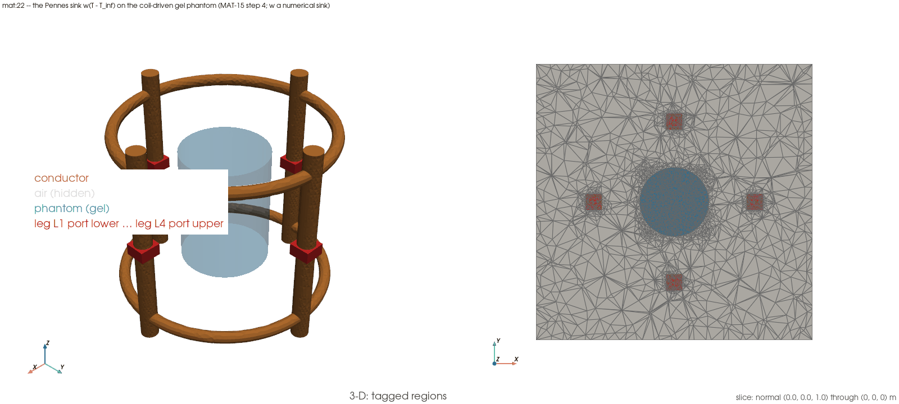

# `mat:22` — the Pennes sink w(T − T∞) on the coil-driven gel phantom: where the watt goes

Script: `examples/materials/22_pennes_sink_coil_driven_phantom.py` (`EX-125`)
Gate: `tests/validation/test_mat15_pennes_coil_driven.py` (`MAT-15` step 4).

## 1. What this demonstrates

`mat:6` and `mat:7` put the Pennes sink under a *uniform* source on a ball;
`mat:9`, `mat:15` and `mat:18` heat this phantom from the coil with no sink. This
example puts the sink under the **coil-driven** source: the non-uniform,
C4-rotated four-drive SAR of `ANS-2`'s untuned 10 MHz F-small birdcage (σ = 800 S/m,
the 0.0025 m phantom rung, 58 866 cells in the phantom submesh), each single-leg
drive normalised to G = 1 W deposited, P1 thermal with the gel constants and the
Robin wall. The sink is `solve_transient_conduction(..., perfusion_w_per_m3_k=w)`
at w = 24 / 240 / 2400 W/m³/K and the limit value w_ε = 1e-8, to t\* = 1254 s.

**Gel has no perfusion.** Every w here is a numerical sink term, not a gel or tissue
property; 240 and 2400 are `MAT-11`'s values and 24 is a tenth of the first. θ is
per deposited watt, not an absolute temperature.

**What the sink does.** w(T − T∞) removes heat in proportion to the local rise, so
it bites hardest where the coil heats most; the Robin wall acts only on the
surface. At t\* the heat budget (share of G·P_k, drive k = 0) is:

| w (W/m³/K) | storage | Robin wall | perfusion |
|---|---|---|---|
| 0 (step 1) | 76.5800 % | 23.4200 % | 0 |
| 24 | 76.0375 % | 23.346 % | 0.616559 % |
| 240 | 71.3248 % | 22.6943 % | 5.98092 % |
| 2400 | 37.6184 % | 17.4268 % | 44.9548 % |

The other drives differ in the fourth digit (C4 rotation of the same fixture).

**One lift, disclosed.** `_run_perfused()` returned only scalars, so the example had
no field to write. The gate gained one additive keyword, `return_fields=False`,
which (only when true) also returns `base` and the CN `results` keyed (k, w): about
eight lines, no print, band, key or test changed, and `perfused()` still calls
`_run_perfused()`. The gate was re-run green through the harness before the script
(54 passed with `tests/environment`, harness label `EX-125-mat15s4-regate`;
the `MAT15s4` digits equal W1's, with the P1 mean at k = 2 differing in the last
printed place, 1.152660000066 against 1.152660000060, and the (E) values at
round-off level, worst 8.603e-14 against 8.659e-14).

Asserted on every rank at the gate's imported bands, each printed beside
the `MAT-15` step 4 W1 harness log (`20261008T140322Z`):

- (F) fixture: 58 866 sub cells, (B), step-1 (E′), V_sub;
- (E′) with the sink, 4 drives × 3 w, worst 1.433e-14 (W1 ≤ 1.623e-14);
- (E) every one of 16 runs, worst 9.657e-14 (W1 8.659e-14);
- (L0) w_ε reproduces P1 per drive, 1.497e-12 … 1.528e-12 (W1 1.506e-12 … 1.526e-12).
  w_ε is non-zero on purpose: w = 0 takes the solver's unperfused branch, w_ε the sink
  path, and lands within ≈ w_ε t\*/(2ρc) ≈ 1.5e-12 of P1;
- (Mo) ⟨θ⟩ and the 10 g θ̄ strictly decreasing over P1, 24, 240, 2400;
- (C4) the 10 g θ̄ in cyclic pairs, worst 0.04887 %. C4 survives because w is uniform:
  the sink is linear in the local θ, so it cannot break the rotation symmetry the
  source already has;
- (R) the returned runs are the gate's: ⟨θ⟩ of the returned runs against the gate's
  means (worst 1.528e-12, at the w_ε comparison with P1) and (E′) recomputed
  (worst 1.433e-14, equal to the gate's);
- (Q-w) the solver's `perfused_power` equals the gate's ∫w θ^(n+½) dV: worst relative
  difference 0 over the 12 runs (the gate printed both but never asserted it);
- the records, each at 10^−(d−2) of its printed digits, W1 `log:line` in the log.

**Negative controls (asserted).** (d) the doubled source misses (E′) by 1.000000 (W1
1.000000). (P-ctl) dropping ∫wθ from the identity at w = 240 misses by
0.059809 … 0.059810, the perfused share. (L0-ctl) the same comparison as (L0) with
w = 24 in place of w_ε reads 3.434828e-03 … 3.434838e-03, 3.43e7 × the band.

**Printed, not asserted.** ⟨θ⟩(t\*)/P1 over drives 0.996565 / 0.966366 / 0.724055
(lumped predictions 0.996–0.998 / 0.955–0.975 / 0.68–0.77, all inside). The mean falls
further than the 10 g hot spot at w = 2400 (0.724 against 0.745); the hot spot
sits near the driven leg at the wall, where the Robin loss also acts (a reading of
the numbers, not a separate test). Nodal peak θ at k = 0: 4.45721 / 4.44575 / 4.34475 / 3.51255 K
at w = 0 / 24 / 240 / 2400, ratio 0.788061 (drafter's unlogged prediction
[0.70, 0.80], inside). Heat removed by the strongest sink, ⟨θ_P1⟩ − ⟨θ_2400⟩ at
k = 0: 0.318251 K (predicted 0.318251). max|Im θ| = 0.

Not claimed: any gel or tissue perfusion value, a Pennes closed form on the
cylinder, σ(T) or w(T), a tuned or copper coil, 64 / 128 MHz, quadrature drive,
absolute temperature, convergence, CEM43 dose, compliance, `ANS-9` or any external
check.

## 2. How to run it

```
./scripts/run_examples.sh -e mat:22 -n 2 -t 590
```

Needs the complex DolfinX build, which the runner sources for the `mat:` group.
Tier: **heavy**, ≈ 450 s wall at `-n 2` on the flagged run of record (449 s; the
gate body itself 434.6 s on a host running about 1.9× slow that night, against 231.7 s
in W1). Verification runs go through the logging harness; add
`-e FEM_EM_SETUP_FIGURES=1` after `exec -T` to re-render the setup figure.

Outputs, all in `examples/materials/paraview_output/`:

- `materials_22_pennes_sink_coil_driven_phantom_combined.xdmf` (and its
  `materials_22_pennes_sink_coil_driven_phantom_combined.h5`): drive k = 0 at t\*,
  P1 `theta_w0`, `theta_w24`, `theta_w240`, `theta_w2400`, `theta_removed_w2400`
  (= `theta_w0` − `theta_w2400`) and `sink_density_w2400` (= 2400·`theta_w2400`,
  W/m³ per watt deposited), and DG0 `q_h_k0` (W/m³ at G = 1 W / P₁);
- `materials_22_pennes_sink_coil_driven_phantom_sink_table.csv`: one row per
  (k, w) for w = 0, 24, 240, 2400 (16 rows): ⟨θ⟩, ratio to P1, 10 g θ̄, its ratio,
  and the three budget shares and `perfused_power_W` (blank at w = 0).

## Setup figure



`examples/materials/figures/materials_22_pennes_sink_coil_driven_phantom_setup.png`.
The `GEO-18` gapped, sheeted four-leg birdcage on `ANS-2`'s phantom rung:
conductor and port sheets shown, the gel phantom translucent, air hidden, sliced
at z = 0.

## 3. How to analyze it, step by step

**Step 1 — read the budget.** Open the CSV. Storage + wall + perfusion shares sum to
1 (that is (E′)); perfusion goes 0.617 % → 5.98 % → 44.95 % of the watt as w goes
24 → 240 → 2400, while the storage share falls from 76.58 % (step 1) to 37.62 %.
The ratio column gives the same story for the mean (0.9966, 0.9664, 0.7241) and for
the 10 g θ̄ (0.9969, 0.9692, 0.7448).

**Step 2 — the fields.** Open
`examples/materials/paraview_output/materials_22_pennes_sink_coil_driven_phantom_combined.xdmf`
and slice at z = 0. The complex build writes `real_` / `imag_` splits (imaginary parts
are zero). Show `real_theta_w0` beside `real_theta_w2400` on one fixed colour range
[0, 4.45721] K (the w = 0 nodal peak). Then `real_theta_removed_w2400`, where the sink
took the most, and `real_sink_density_w2400` against `real_q_h_k0`: the sink density
w·θ is a smeared copy of the temperature, the source is the sharp SAR pattern at the
driven leg.

**Step 3 — flatten the peak.** A Plot Over Line through the driven leg's hot spot
shows the sink pulling the peak down (nodal peak 4.457 → 3.513 K). At every w the
nodal peak falls by a smaller fraction than the mean (w = 2400: 0.788 against
0.724; w = 24: 0.99743 against 0.99657).

**Step 4 — the sink's power two ways.** The log's (Q-w) line is the solver's own
`perfused_power` against the gate's assembled ∫w θ^(n+½): they agree to the last
digit on all 12 runs.

## Related

- `examples/materials/09_coil_driven_heating_phantom.md`
- `examples/materials/06_perfusion_sink_robin_ball.md`
- `examples/materials/07_sar_heats_perfused_ball.md`
- `examples/materials/15_duty_cycled_coil_heating_phantom.md`
- `tests/validation/test_mat15_pennes_coil_driven.py`
- `tests/validation/test_mat15_coil_driven_heating_phantom.py`
- `src/fem_em_solver/thermal/transient.py`
