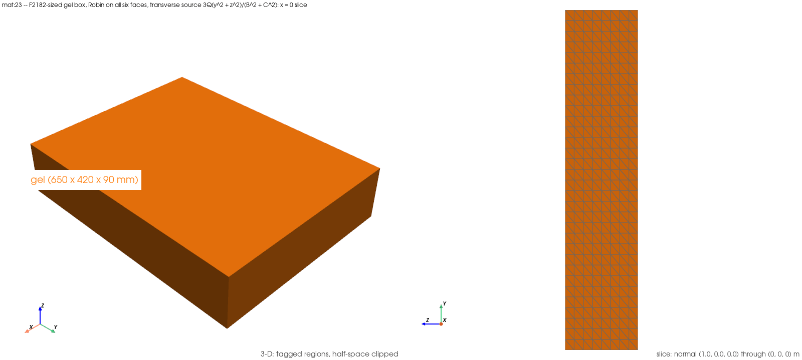

# `mat:23` — the F2182-sized gel box under the transverse eddy-SAR source 3Q(y² + z²)/(B² + C²)

Script: `examples/materials/23_f2182_gel_box_transverse_eddy_source.py` (`EX-129`)
Gate: `tests/validation/test_mat21_box_quadratic_fem.py` (`MAT-21` step 9, W2), with
`tests/validation/test_mat21_box_quadratic_closed_form.py` (the closed form's weights and terms).

## 1. What this demonstrates

`mat:19` heats the 650 × 420 × 90 mm gel box with a uniform q; `mat:20` varies q along x only.
Here q = 3Q(y² + z²)/(B² + C²) = Q [w_y (y/B)² + w_z (z/C)²], Q = 2000 W/m³, with
w_y = 2.868293 and w_z = 0.131707. The derivation (`docs/planning/chunks/MAT-21.md:1403–1410`):

- In an infinitely long prism along x in a uniform quasi-static B = (0, B_y, B_z)e^{jωt}, the
  field E = E_x(y, z) x̂ with E_x = jω(B_z y − B_y z) solves Faraday's law exactly for any
  cross-section, with n·E = 0 on every side wall.
- Under circular polarisation the two terms are in quadrature, so |E_x|² = ω²B₁²(y² + z²): the
  SAR is ∝ y² + z², and the weights fix at w_y : w_z = B² : C². The 90 mm axis carries 4.39 % of
  the power. The mean source is exactly Q, so the source power is 49.14 W as in `mat:19` / `mat:20`.
- **Not claimed:** this is the transverse shape of the long-body limit, not the box's own EM SAR.
  Near x = ±A the axial current must turn at the end faces, and at 64 / 128 MHz the wavelength in
  gel is comparable to the box. **No EM is solved and no coil is involved.**

The source runs through step 3's m = 4 rung ((52, 32, 8) hexahedra split into tetrahedra,
79 872 cells) at degree 2 (116 025 dofs), steady and by Crank–Nicolson (N = 40) to
t* = 2 821.5 s. The script copies the gate's solver calls and source, imports every band and
helper, and keeps the records in an example-local dict, printed beside the readings and never
asserted by equality. Comparands for the anchors use `QUAD_TERMS` = (80, 80, 40); the controls
and the uniform comparands use `SERIES_TERMS`.

**Asserted** (imported bands), each printed beside its record in
`20261016T171904Z_MAT-21-step9-W2-quadratic-fem.log:70–86`; run of record
`20261017T110217Z_EX-129.log`: (Pdeg) 116 025 dofs on all three solves (`:70`); (U) the uniform
control reproduces step 3's digits, whole 2.489307e-05 / interior 1.669359e-05 (`:51`);
(S1-quad) steady interior vs the quadratic series 7.219878e-05 ≤ `INTERIOR_BAND` (`:57`);
(S2-quad) Gauss 9.775e-14 ≤ `S2_GAUSS_BAND` (`:54`); (T-quad) CN interior at t* 2.694340e-04
(`:65`); (E-quad) CN balance 2.288e-13 ≤ `E_BAND` (`:67`; the gate's 2.285e-13 is a round-off
floor, band only). Example-side: (F0) six face tags partition the 9 344 Robin facets (512 / 512 /
832 / 832 / 3 328 / 3 328, integers on owned facets, `:72–78`); (F1) the six face powers sum to
`source_power` within `S2_GAUSS_BAND` for the quadratic (1.006e-13) and uniform (1.825e-13)
runs (`:79–80`).

**Negative controls, asserted as misses** (each backed by a gate record): (c-src) the quadratic
FEM against the uniform series 0.44856 (`:59`); (c-src′) the uniform FEM against the quadratic
series 0.51471 (`:60`); (c-z) the quadratic FEM against the no-z series 0.047893, 4.79 × the band,
no factor bar posed (`:61`); (c-src-T) CN against the uniform transient series 0.69562 (`:68`).
Example-side (cF): with the +y face dropped Σ P_f misses `source_power` by 0.11280 (`:81`;
predicted in [0.075, 0.20], not asserted beyond > `S2_GAUSS_BAND` and < 0.5); the same miss on
the uniform run is 0.063123.

**Readings, printed and not asserted:**

1. *The face-heat split moves to ±y* (`:83–86`). The ±y pair's share rises from 0.126246
   (uniform) to 0.225593 (predicted ≈ 0.25, range [0.15, 0.40]: in range); ±z falls from
   0.795501 to 0.704446, and ±x from 0.078253 to 0.069961.
2. *The y centre line* (`:89–91`), x = z = 0, 129 points: the maximum θ is 13.777439 K at
   |y|/B = 0.8240 (predicted in [0.75, 0.97]: in range), inside the Robin layer. θ(0) = 4.276604 K
   (series 4.276700 K) against 12.003960 K for the uniform source. P2 stays within 2.2291e-3 K of
   the series along the line.
3. *The centre probe* (`:93`): θ(0)/θ(0, 0.9B, 0) is 0.021927 at t* and 0.320634 steady, as
   computed from the gate's records. A probe at the centre reads ≈ 2.2 % of the side-wall rise
   after 47 min. This is a probe-placement reading only, with no compliance claim.
4. *The thin-axis term* (`:94`): max |θ_quad − θ_noz-series| over owned P1 dofs is 0.454201 K,
   beside (c-z) = 0.047893. The solve resolves the z² term, and the field
   `theta_quad_minus_noz_series` shows where it sits.

Not claimed: the box's own EM SAR (end-face current return, wavelength effects), any coil;
linear polarisation or another weight pair; a P2 / DG0 hand-off of this source (a quadratic is
exactly P2, so it would be an identity; `mat:20` shows the hand-offs); the product with an axial
cosine, any h-rate, another rung or degree 1; an absolute SAR or temperature for a real scanner
(Q = 2 000 W/m³ is the gate's normalisation); F2182 compliance or probe placement advice;
perfusion, a container wall, or an external check.

## 2. How to run it

```
./scripts/run_examples.sh -e mat:23 -n 2 -t 590
```

The runner sources the complex DolfinX build for the `mat:` group. Tier: **heavy** (ceiling
590 s), measured 164 s wall at `-n 2` (script total 159.7 s) with the setup figure. Verification
runs go through the logging harness with the runner's emitted command
(`./scripts/run_examples.sh -e mat:23 -n 2 -t 590 --dry-run`). Add
`-e FEM_EM_SETUP_FIGURES=1` after `exec -T` to re-render the setup figure.
Outputs: `examples/materials/paraview_output/materials_23_f2182_gel_box_transverse_eddy_source_combined.xdmf`
and `examples/materials/paraview_output/materials_23_f2182_gel_box_transverse_eddy_source_y_centre_line.csv`.

## Setup figure



`examples/materials/figures/materials_23_f2182_gel_box_transverse_eddy_source_setup.png`.
The m = 4 gel box (650 × 420 × 90 mm, Robin on all six faces) cut at x = 0, the plane that shows
the two transverse axes the source varies along; the source itself is analytic and lives in the
fields, not in the mesh.

## 3. How to analyze it, step by step

**Step 1 — the source.** Open
`examples/materials/paraview_output/materials_23_f2182_gel_box_transverse_eddy_source_combined.xdmf`.
The complex build writes `real_` / `imag_` splits (the imaginary parts are zero). Colour by
`real_q_quad` on an x = 0 slice: zero on the axis, largest in the ±y corners, with the y² term
dominant. It is a P1 interpolant of the polynomial, for display only.

**Step 2 — the hot side walls.** Colour `real_theta_quad_steady` on the x = 0 slice: the maximum
sits inside the ±y Robin layer (|y|/B ≈ 0.82), not at the centre. Compare `real_theta_quad_series_steady`
and `real_theta_quad_minus_series` (≈ 7.2e-5 relative in the interior).

**Step 3 — the centre line.** Apply Plot Over Line along y at x = z = 0 to `real_theta_quad_steady`
beside `real_theta_uniform_steady`: the uniform source is a flat dome, the quadratic source is a
valley at the centre with shoulders near ±0.82 B. The same curves, with the series, are in
`examples/materials/paraview_output/materials_23_f2182_gel_box_transverse_eddy_source_y_centre_line.csv`
(`theta_quad_K`, `theta_series_K`, `theta_uniform_K` against `y_over_B`) for a Line Chart View.

**Step 4 — the thin-axis term.** Colour `real_theta_quad_minus_noz_series` on the x = 0 slice:
the z² term's footprint is concentrated near the ±z faces; its peak is 0.454 K.

**Step 5 — the centre probe.** Compare `real_theta_tstar_quad` (t* = 2 821.5 s) with
`real_theta_quad_steady`, and `real_theta_tstar_quad_series` for the series: at t* the centre
holds ≈ 2.2 % of the side-wall rise, at steady state 32 %.

**Step 6 — the faces.** Extract the facet block (`face_tags`, 1/2 = ±x, 3/4 = ±y, 5/6 = ±z)
and threshold each tag; the ±y blocks carry 0.2256 of the heat against 0.1262 for the uniform
source.

## Related

- `examples/materials/20_f2182_gel_box_end_weighted_source.md`
- `examples/materials/19_f2182_gel_box_slab_and_faces.md`
- `tests/validation/test_mat21_box_quadratic_fem.py`
- `tests/validation/test_mat21_box_quadratic_closed_form.py`
