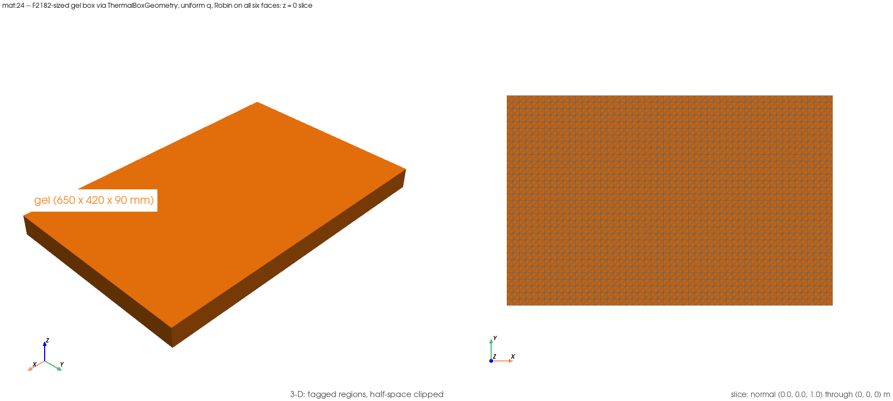

# `mat:24` — the F2182-sized gel box through `ThermalBoxGeometry` → `Study.temperature` → `Study.probe`, read at the six F2182 positions

Script: `examples/materials/24_f2182_gel_box_study_api_probes.py` (`EX-130`)
Gates: `tests/package/test_wf15_study_thermal_box.py` (`WF-15` step 5), `tests/package/test_wf15_study_probe_thermal.py`
(`WF-15` step 6) and `tests/validation/test_mat21_box_probe_points_fem.py` (`MAT-21` step 10, the six positions).

## 1. What this demonstrates

The physics is `mat:19`'s: the 650 × 420 × 90 mm gel box, uniform q = Q = 2000 W/m³, Robin cooling (k = 0.6,
h = 10, T∞ = 20) on all six faces, the m = 4 rung ((52, 32, 8) hexahedra split into 79 872 tetrahedra),
degree 1. What is new is the **delivery mechanism**. Every earlier box example (`mat:19`, `mat:20`, `mat:23`) calls
module helpers; none uses the package's own route. Here one `ThermalBoxGeometry(HALF, (52, 32, 8))` is handed to
`Study(geo, None, UniformHeatSource(Q))`, then `Study.temperature(RobinCooling(...))` gives the field and
`Study.probe([...ProbeBall...], cooling)` gives ball-averaged θ = T − T∞ at 13 volumes in one call. The output
that is new is a **probe table at the six named F2182 positions**: P0 centre, P1 / P2 the ±y walls, P3 / P4 the
±x walls, P5 the top face.

**Asserted** (imported bands; each printed beside its record in
`20261018T112154Z_WF-15-s5-W1-steady.log` and `20261018T123416Z_WF-15-s6-W2-box.log`); run of record
`20261018T214035Z_EX-130.log`:

- (S1-m4) through `Study.temperature`: 79 872 cells and 15 741 P1 dofs equal step 5's records; the whole-box L2
  against the series equals step 5's record at `.4e` (3.4599e-03, `:50`); interior 3.2236e-03 ≤ `INTERIOR_BAND`;
  Gauss 2.708e-13 ≤ `S2_GAUSS_BAND`.
- (I-rep) the θ inside `Study.probe(...).thermal` against `Study.temperature`'s: 1.184e-15 ≤ `L0_BAND` (`:63`;
  predicted 0 to 1e-15; the box branch re-solves on every call).
- (A-box) the whole-box ball: 2.495e-13 / 2.509e-13 on value / volume ≤ `B_BAND` (`:64`), equal to step 6's record.
- (R-box) the five step-6 balls against the exact ball mean θ_series(c) − Q a²/(10K): max 2.7066e-03 ≤
  `INTERIOR_BAND` (`:70`). Its c₀ ball is position P0.
- (V) all six positions valid on the owner route, every owner ≥ 0; (M) each inset centre keeps its ball inside the box.

**Negative controls, asserted as misses:** (c-wall) h doubled at c₀ misses by 0.35712, equal to step 6's record,
ceiling < 1 (`:82`; step 5's interior record 0.38048); (c-half) a ball centred on the +y wall holds only half its
nominal volume, |V/V_nom − 1| = 0.4995 (predicted 0.5, range [0.45, 0.55]: in range; asserted > `INTERIOR_BAND`
and < 1).

**Readings, printed and not asserted (rule (e)):**

1. *The six point values* (`:53–59`) against the uniform series, P1 FEM: P0 12.0074 K (series 12.0039, e_p 2.9e-4); the
   four side walls 6.26494 vs 6.23665 K at ±y (e_p 4.536e-3) and 6.17850 vs 6.15039 K at ±x (4.571e-3); the top face
   8.73759 vs 8.73397 K (4.2e-4). Max e_p 4.571e-03 (predicted ≈ 3e-3, range [1e-4, 1e-2]: in range). The ±y and ±x
   pairs are mirror-equal in the printed digits.
2. *The inset ball means* (`:72–78`). A ball centred on a wall averages only the gel half, so each wall ball is moved
   inward by its radius a = 0.0135 m until it touches the wall from inside, and its mean is read against the exact
   ball mean. Max rel 3.2372e-03 (predicted ≤ 5e-3: in range); volume ratios 0.9982–1.0017. A near-wall ball reads
   θ ≈ 7.41 K where the wall point reads 6.26 K: the gradient across a 13.5 mm probe is large near a Robin face.
3. *(c-mv)* (`:80`): the ball mean at c₀ sits 6.0750e-02 K below the point series, 5.06e-3 relative: a probe radius
   of 13.5 mm already costs half a percent at the box centre.

Not claimed: transient or duty probes on the box (no exact ball mean is posed there), the quadratic source, the YAML
route, a real probe's volume or self-heating, an h-rate, EM, a coil, a container wall or perfusion, compliance or an
external check. The (R-box) and (c-wall) digits of step 6 were recorded in the real build; here they are produced in
the complex build, where they agree, and the example asserts only the bands.

## 2. How to run it

```
./scripts/run_examples.sh -e mat:24 -n 2 -t 180
```

The runner sources the complex DolfinX build for the `mat:` group. Tier: **standard** (ceiling 180 s), measured
21 s wall at `-n 2` (script total 18.2 s) with the setup figure. Verification runs go through the logging harness
with the runner's emitted command (`./scripts/run_examples.sh -e mat:24 -n 2 -t 180 --dry-run`). Add
`-e FEM_EM_SETUP_FIGURES=1` after `exec -T` to re-render the setup figure.
Outputs: `examples/materials/paraview_output/materials_24_f2182_gel_box_study_api_probes_combined.xdmf` and
`examples/materials/paraview_output/materials_24_f2182_gel_box_study_api_probes_probe_table.csv`.

## Setup figure



`examples/materials/figures/materials_24_f2182_gel_box_study_api_probes_setup.png`.
The m = 4 gel box (650 × 420 × 90 mm, Robin on all six faces) cut at z = 0, the plane that contains P0 to P4; the
top-face position P5 sits on the z = +45 mm face above it. The source is uniform and lives in the field, not the mesh.

## 3. How to analyze it, step by step

**Step 1 — the field.** Open
`examples/materials/paraview_output/materials_24_f2182_gel_box_study_api_probes_combined.xdmf`. The complex build
writes `real_` / `imag_` splits (the imaginary parts are zero). Colour `real_theta_study_steady` on a z = 0 slice: a
dome peaking at 12.0 K at the centre, falling to ≈ 6.2 K at the side walls.

**Step 2 — the series and the difference.** Compare `real_theta_series_steady` and `real_theta_minus_series`
(≈ 3.2e-3 relative in the interior).

**Step 3 — where the probes sit.** Threshold `real_probe_balls` ≥ 0.5 over `real_theta_study_steady`: index 1 is the
centre ball, 2 / 3 the ±y inset balls, 4 / 5 the ±x inset balls, 6 the top-face inset ball. Then apply Plot Over
Line along y at x = z = 0: the ±y balls sit at |y| = 0.1965 m, one radius inside the wall.

**Step 4 — the wall control.** Colour `real_theta_wall_2h` (the field with h doubled, the (c-wall) run) beside
`real_theta_study_steady`: doubling h lowers the rise at the centre ball by ≈ 36 % (the (c-wall) miss, 0.35712).

**Step 5 — the table.** `examples/materials/paraview_output/materials_24_f2182_gel_box_study_api_probes_probe_table.csv`
holds, per position: the point θ_h and series, e_p, the inset centre, the ball mean, the exact ball mean, the relative
difference and the volume ratio.

## Related

- `examples/materials/19_f2182_gel_box_slab_and_faces.md`
- `examples/mri/25_study_transient_duty_and_wall.md`
- `tests/package/test_wf15_study_thermal_box.py`
- `tests/package/test_wf15_study_probe_thermal.py`
- `tests/validation/test_mat21_box_probe_points_fem.py`
