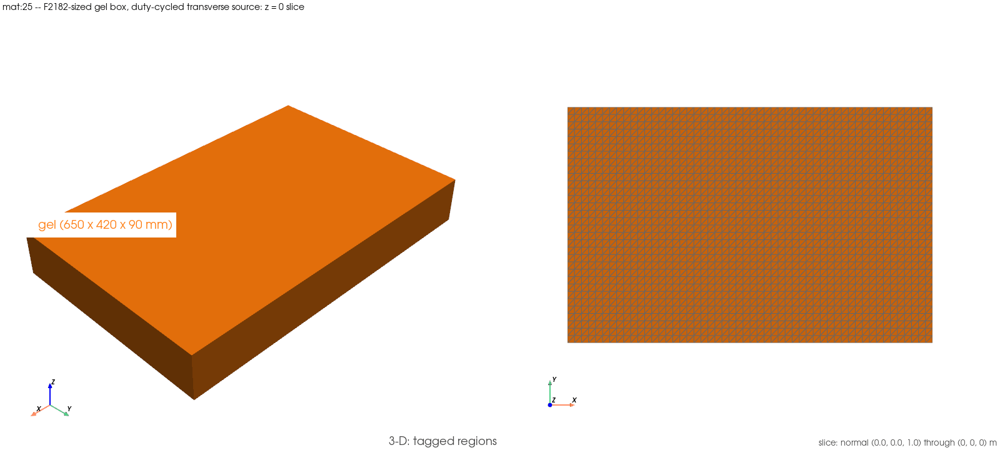

# `mat:25` — the F2182-sized gel box under the duty-cycled transverse eddy-SAR source: temperature histories at the six F2182 probe points

Script: `examples/materials/25_f2182_gel_box_duty_probe_histories.py` (`EX-131`)
Gates: `tests/validation/test_mat21_box_quadratic_duty_fem.py` (`MAT-21` step 11, W2),
`tests/validation/test_mat21_box_probe_points_fem.py` (`MAT-21` step 10, the six points on the owner
route) and `tests/validation/test_mat21_box_quadratic_duty_closed_form.py` (step 11, W1, the
ten-run closed form).

## 1. What this demonstrates

`mat:23` heats the 650 × 420 × 90 mm gel box with the transverse source
q = 3Q(y² + z²)/(B² + C²) continuously; `mat:11` duty-cycles a uniform source on a ball and reads
its centre. Here the box source is switched by step 2's schedule
`11111000011110000111100001111000011110000` (ten switches at HALF_T = 282.15 s, duty 0.5, CN
N = 40, Δt = 70.5375 s, to t* = 2 821.5 s) on step 3's m = 4 rung at degree 2 (116 025 dofs), and
θ(t_n) is read at the six named F2182 probe points (centre, ±y wall, ±x wall, top face) at every CN
grid time n = 0 … 40. The reading goes through the owner route
(`evaluate_vector_field_parallel(..., owner="lowest_original_cell")`) on snapshots of the CN run.
Each FEM history is shown beside the ten-run closed form and beside the χ ≡ 1 run with its series.

The script copies the gate's three CN calls (the pytest fixture cannot be called) and adds
`snapshot_steps` on the χ ≡ 1 and duty runs only; snapshots are copies and change no arithmetic.
Every band and helper is imported; records live in an example-local dict, printed beside the
readings and never asserted by equality.

**Asserted** (imported bands), each printed beside its record in
`20261018T124640Z_MAT-21-step11-W2-quadratic-duty-fem.log` (G11) and
`20261018T111612Z_MAT-21-step10-W2a-points-n2.log` (G10); run of record
`20261018T214758Z_EX-131.log`: (Pdeg) 116 025 dofs on the uniform, steady and three CN solves;
(U) the uniform control reproduces step 3's digits, whole 2.489307e-05 / interior 1.669359e-05;
(V) the six probes valid on the owner route, owner integers 34782 / 39774 / 30103 / 34938 /
34636 / 74718, equal to G10's; (Pt) the steady pointwise error at the six points, 2.255e-05 /
1.839e-05 / 1.839e-05 / 4.439e-05 / 4.439e-05 / 1.616e-04 ≤ `INTERIOR_BAND` (G10 records equal to
the digit); (S0) the census passes and the schedule string equals step 2's; (R36) the default run
reproduces P36 (interior 2.694340e-04, whole 4.310154e-04); (D′-quad) χ ≡ 1 vs default
3.049e-15 ≤ `D_BAND` (G11 record 3.025e-15, round-off class); (T-qduty) the duty CN interior vs the
duty closed form 2.543310e-04 ≤ `INTERIOR_BAND` (G11 record equal); (E-qduty) balance 2.288e-13 on
all three CN runs (a round-off floor, band only).

**Example-side identities, exact by construction:** (H40) the n = 40 snapshot `np.array_equal` the
run's own final temperature, AND-reduced over ranks, on both runs, so the history ends on the gated
field; (H≡) the duty and χ ≡ 1 snapshots coincide while both sources are on, n = 1 … 4 reading
0 / 0 / 0 / 1.800e-15 ≤ `D_BAND`; (D0-h) the one-tensor closed form at one switch is
`np.array_equal` the public transient at the six points for every n = 1 … 40, which extends W1's
(D0) to the grid.

**Negative controls, asserted as misses:** backed — (c-step) the duty CN against the continuous
series 0.50333 (G11 record 0.50333, 50.3 × the band); (c-u-pt) the quadratic FEM against the
uniform series at six points 0.6437 / 0.7462 / 0.7462 / 0.7036 / 0.7036 / 0.6418; (c-z-pt) against
the no-z series 0.1188 / 0.0214 / 0.0214 / 0.1403 / 0.1403 / 0.1403 (no factor bar posed; the
ceiling is 2.14 × the band at ±y). Predicted, separation only asserted — (cH) the duty and χ ≡ 1
snapshots at n = 8, the end of the first off-phase: 0.5083 (predicted 0.50, range [0.40, 0.60]:
in range).

**Readings, printed and not asserted:**

1. *The histories* (duty FEM, K, at n = 4k, closed form in brackets in the log). At t* the duty
   rise is 0.03456 K at the centre, 1.2854 K at ±y, 0.026213 K at ±x and 0.048718 K at the top
   face. The χ ≡ 1 rise is 0.063442, 2.6488, 0.048397 and 0.10042 K.
2. *Errors against the closed form.* Per probe, max over n of |θ_h − θ_cf|, duty / χ ≡ 1:
   centre 2.281e-05 / 2.393e-05 K; ±y 1.214e-03 / 1.072e-03 K; ±x 3.933e-05 / 6.968e-05 K; top
   1.687e-04 / 1.988e-04 K. All inside the predicted ≤ 1.5e-3 K, range
   [1e-6, 5e-3]. Relative error at t*: 1.971e-04 (centre), 2.534e-04 (±y), 1.499e-03 (±x),
   8.302e-04 (top) against the prediction ≤ 1e-3, range [1e-6, 3e-3]. **The ±x probes miss the
   ≤ 1e-3 prediction (1.499e-03) and sit inside the range**; a printed-prediction miss, no status
   effect (item brief §6).
3. *Duty drop at t*,* θ_duty/θ_χ1 per probe, FEM against the W1 closed form
   (`20261018T124327Z_MAT-21-step11-W1-closed-form.log`): centre 0.54476 / 0.54466, ±y 0.48530 /
   0.48560, ±x 0.54162 / 0.54159, top 0.48517 / 0.48572. The top probe's gap to the W1 record,
   1.14e-03, **misses the predicted ≤ 1e-3** (the others are 1.75e-04, 6.27e-04, 4.77e-05); a
   printed-prediction miss, reported here, no status effect.
4. *Warming while the source is off.* The drafter's physics (no logged backing) predicted a
   sawtooth at ±y and the top face and a monotone rise at the centre and ±x. The count of local
   maxima agrees: 5 at n = 4, 12, 20, 28, 36 for the ±y and top probes; 0 for the centre and ±x
   probes, which keep rising through every off-phase (centre 0.00073323 K at n = 4, 0.002153 K at
   n = 8, 0.0042673 K at n = 12).
5. *How far from steady.* θ_χ1(t*)/θ_steady is 0.01483 (centre), 0.24322 (±y), 0.02655 (±x) and
   0.03210 (top).

Not claimed: width invariance (step 10's (W) is provenance only), pointwise history accuracy as a
gate, other duty fractions, a periodic state, dose or the six-minute window; the box's own EM SAR,
a coil, perfusion, a container wall; F2182 compliance or probe advice; any external check.

## 2. How to run it

```
./scripts/run_examples.sh -e mat:25 -n 2 -t 590
```

The runner sources the complex DolfinX build for the `mat:` group. Tier: **heavy** (ceiling
590 s), measured 189 s wall at `-n 2` (script total 186.8 s) with the setup figure. Verification
runs go through the logging harness with the runner's emitted command
(`./scripts/run_examples.sh -e mat:25 -n 2 -t 590 --dry-run`). Add
`-e FEM_EM_SETUP_FIGURES=1` after `exec -T` to re-render the setup figure.
Outputs under `examples/materials/paraview_output/`:
`materials_25_f2182_gel_box_duty_probe_histories_history_combined.xdmf`,
`materials_25_f2182_gel_box_duty_probe_histories_combined.xdmf` and
`materials_25_f2182_gel_box_duty_probe_histories_probe_histories.csv`.

## Setup figure



`examples/materials/figures/materials_25_f2182_gel_box_duty_probe_histories_setup.png`.
The m = 4 gel box (650 × 420 × 90 mm, Robin on all six faces) cut at z = 0, the plane that holds
five of the six probes (the top-face probe sits on z = C); the source and its schedule are
analytic and live in the solve, not in the mesh.

## 3. How to analyze it, step by step

**Step 1 — the animation.** Open
`examples/materials/paraview_output/materials_25_f2182_gel_box_duty_probe_histories_history_combined.xdmf`
(41 frames, t = n × 70.5375 s, P1 `real_theta_duty` and `real_theta_chi1` in K; the complex
build writes `real_` / `imag_` splits and the imaginary parts are zero). Slice at z = 0 and play:
the χ ≡ 1 field rises smoothly, the duty field climbs in four-step bursts and relaxes in the
four-step gaps, with the ±y side layers moving most.

**Step 2 — the end state.** Open
`examples/materials/paraview_output/materials_25_f2182_gel_box_duty_probe_histories_combined.xdmf`
(single state, t* = 2 821.5 s). `real_theta_duty_tstar` is the final duty field,
`real_theta_duty_series_tstar` the closed form interpolated to P1, and
`real_theta_duty_minus_series_tstar` their difference (≈ 2.5e-4 relative in the interior).
`real_theta_quad_steady` is the steady field for the same source.

**Step 3 — the probe curves.** Load
`examples/materials/paraview_output/materials_25_f2182_gel_box_duty_probe_histories_probe_histories.csv`
(246 rows: n, t_s, probe, x_m, y_m, z_m, `theta_duty_fem_K`, `theta_duty_closed_K`,
`theta_chi1_fem_K`, `theta_chi1_series_K`, chi). Plot Data over the CSV: a Line Chart View of
`theta_duty_fem_K` against `t_s` per probe shows the ±y and top sawtooth and the monotone centre
and ±x curves; `theta_duty_closed_K` lies on top of it at the plot scale.

**Step 4 — mark the probes.** Apply Table To Points to the same CSV with x_m, y_m, z_m as the
coordinates (filter to one n) and show it with the z = 0 slice: five probes lie in the plane, the
top-face probe above it.

## Related

- `examples/materials/23_f2182_gel_box_transverse_eddy_source.md`
- `examples/materials/11_duty_cycled_gel_ball.md`
- `examples/materials/21_point_probes_on_gel_ball_submesh.md`
- `tests/validation/test_mat21_box_quadratic_duty_fem.py`
- `tests/validation/test_mat21_box_probe_points_fem.py`
- `tests/validation/test_mat21_box_quadratic_duty_closed_form.py`
