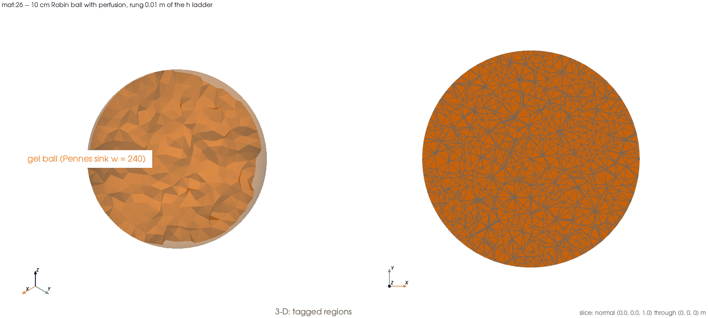

# `mat:26` — the P1 error on the perfused Robin ball falls at rate ≈ 2.06 in h

Script: `examples/materials/26_perfusion_ball_h_convergence_rate.py` (`EX-149`)
Gate: `tests/validation/test_mat11_perfusion_sphere.py` (`MAT-11`, gate (ii)
`test_p1_ladder_interior_rate_and_balance`); the thermal solver is `MAT-9`'s
with the perfusion term of `MAT-11`.

## 1. What this demonstrates

`mat:6` (`EX-69`) is the one-rung twin: it solves the same 10 cm Robin ball
(k = 0.6 W/m/K, q = 2000 W/m³, h = 10 W/m²/K, arterial = ambient = 20 °C,
perfusion w = 240 W/m³/K, m R = 2) on one mesh and prints one error. This
example runs the gate's whole mesh ladder, 0.02 / 0.01 / 0.005 m (2 571 /
19 463 / 151 548 cells), and prints how the error against the Pennes closed
form falls with the effective mesh size h = (V_h / N)^(1/3).

P1 elements interpolate a smooth solution with an error O(h²) in L2, and the
Pennes ball is smooth (a sinh(mr)/(mr) profile), so a least-squares line of
log error against log h should have slope ≈ 2. The ladder gives
**2.060** (pairwise 2.068 and 2.052), about 1.21 times the gate's floor of 1.7.
The whole-ball metric includes the curved-boundary layer, where the faceted
mesh differs from the sphere (the volume ratio V_h/V is 0.9856 / 0.9964 /
0.9991) — a geometry error that also shrinks with h. The **interior** metric
(cells with midpoint |x|² < 0.81 R²) excludes that layer and isolates the
element error; the gate's band on it (1 %) is read at 0.01 m, where it is
1.83e-03.

Everything is imported by name from the gate module: the ladder `LADDER`, the
bands `RATE_FLOOR`, `INTERIOR_BAND`, `BALANCE_BAND`, the fixture constants and
the helpers `_ball`, `_errors`, `_balance`, `_centre_surface`, `_theta`,
`_interior_indicator`, `_max_abs_imag`. Nothing is restated and no gate or
`src/` file is edited. Errors are on θ = T − T∞, never on T.

Asserted, each as the gate writes it:

- (iii) the power balance |convected + perfused − source|/source
  `<= BALANCE_BAND` (1e-9) on every rung;
- (ii) the least-squares whole-ball rate `>= RATE_FLOOR` (1.7);
- (i) the interior relative L2 error at 0.01 m `<= INTERIOR_BAND` (1e-2);
- (c-w0), the gate's control (a): with the perfusion argument omitted
  (`MAT-9`'s field), the interior error at 0.01 m against the perfused closed
  form is `> INTERIOR_BAND`, and `perfused_power` is exactly 0.0.

Printed only, never gated: the w = 0 whole-ball error on all three rungs and
its fitted rate. The prediction, made before the run, was a plateau (rate
≈ 0), because a model error does not converge away with h; the run read
1.0712 / 1.0916 / 1.0968 and a rate of −0.017. Perfusion takes 0.5098 of the
8.37 W source on the finest rung.

Scope: P1 only, steady only, one w. It does not show degree 2, a transient, a
coil-driven source, rank independence, or any tissue property.

## 2. How to run it

```
./run_examples.sh -e mat:26 -n 2 -t 420
```

Needs the complex DolfinX build, which the runner sources for the `mat:`
group. Tier: **heavy** ceiling, but the run takes ≈ 15 s wall at `-n 2`
(harness elapsed 17 s). Verification runs go through the logging harness with
the runner's emitted command (`./run_examples.sh -e mat:26 -n 2 -t 420
--dry-run`). Add `-e FEM_EM_SETUP_FIGURES=1` after `exec -T` to re-render the
setup figure.

## Setup figure



`examples/materials/figures/materials_26_perfusion_ball_h_convergence_rate_setup.png`.
The figure shows the 0.01 m rung of the ladder (19 463 cells, one region,
tag 1, drawn translucent). The slice is at z = 0. The whole outer surface
carries the Robin condition; there is no air region.

## 3. How to analyze it, step by step

The numbers below are from
`docs/testing/logs/20261024T170646Z_EX-149.log` (Status 0, 17 s), and equal
the gate's complex-build records
(`docs/testing/logs/20261001T004409Z_MAT-11-cx-W2.log`).

**Step 1 — the rungs.** `[rung]` prints, per resolution, the cell count
(2 571 / 19 463 / 151 548, all equal to the records), the whole-ball error
(1.058e-02 / 2.642e-03 / 6.503e-04), the interior error (9.32e-03 /
1.8285e-03 / 4.72e-04) and the balance (3.9e-15 / 1.7e-15 / 3.8e-15, against a
band of 1e-9). The centre θ_h approaches the closed form's 5.5394 K from
above (5.587 / 5.551 / 5.543) and the surface mean its 3.2668 K.
`max|Im θ_h|` is 0.0 in the complex build.

**Step 2 — the rate.** `[rate]` fits the line through the three
(log h, log error) points: 2.060, which meets the floor of 1.7. Each halving
of h cuts the error by about 4.1, the O(h²) signature.

**Step 3 — the control.** With w = 0 the solve is a different model, and the
error against the perfused closed form is 1.1055 at 0.01 m, about 111 times the
band. Across the ladder it does not shrink (1.07 / 1.09 / 1.10, rate −0.017):
refining the mesh cannot repair a missing sink, which is why the perfused
rate is a statement about the discretisation and not about agreement in
general.

**Step 4 — ParaView.** Open
`examples/materials/paraview_output/materials_26_perfusion_ball_h_convergence_rate_finest_combined.xdmf`
(finest rung, 151 548 cells). Arrays: `theta_h` (P1, θ = T − T∞),
`theta_closed_form` (P1 interpolant of the Pennes closed form) and `interior`
(DG0, 1 where the cell midpoint has |x|² < 0.81 R²). Colour by `theta_h`, and
use a Calculator on `theta_h - theta_closed_form` to see the error, then
Threshold on `interior` to see that it concentrates in the outer layer.

## Related

- The one-rung twin: `examples/materials/06_perfusion_sink_robin_ball.md`.
- The field-side rate example: `examples/magnetostatics/07_domain_l2_convergence_rate.md`.
- The gate module: `tests/validation/test_mat11_perfusion_sphere.py`.
