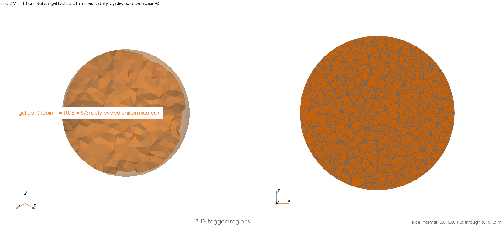

# `mat:27` — backward Euler under a switched source converges at order ≈ 1.00; Crank–Nicolson's 2 falls outside that band

Script: `examples/materials/27_duty_cycle_time_step_rate.py` (`EX-151`)
Gate: `tests/validation/test_mat17_duty_cycle_fem.py` (`MAT-17` step 2, gate (ii)
`test_ii_be_rate_and_iii_balance`), on the `MAT-9` ball.

## 1. What this demonstrates

`mat:8` (`EX-74`) prints the time-step rates of backward Euler (BE) and
Crank–Nicolson (CN) on a *constant* source. `mat:11` (`EX-85`) shows the duty
cycle at a single Δt. This example is the missing combination: the time-step
ladder under a **switched** source. The fixture is `MAT-9`'s 10 cm gel ball
(0.01 m mesh, 19 463 cells, P1, Robin h = 10 W/m²/K, Bi = 5/3) under case A's
schedule, source on for the first half of each 1200 s period, to
t_end = 14 100 s, the middle of cycle 11's off phase. The ladder is
Δt = 300 / 150 / 75 / 37.5 / 18.75 s (N = 47 … 752).

The rate is a **self-difference** rate: d_i is the whole-ball relative L2
distance between the solutions at Δt_i and Δt_i/2, and the rate is the slope of
log d against log Δt. It needs no exact solution, and so no spatial error
enters it.

Why the switch must fall on a step boundary: every Δt divides the 600 s
phases, so χ(t_mid) is exactly 0 or 1 on every step. A switch inside a step
would be a first-order quadrature error of its own and would cap even CN at
order 1. The census (S0) checks this: Σ χₙ Δtₙ equals the on-time, 7 200 s, to
1e-12 on every run (read 0.000e+00).

Why CN's first pair reads 2.298, above 2: the Rannacher start-up (two
half-steps of BE) and a pre-asymptotic first rung; the pairs settle to 2.034
and 2.005.

Everything is imported by name from the gate module (`m17`): `BE_DTS`,
`BE_RATE_BAND`, `BALANCE_BAND`, `INTERIOR_BAND`, `P_A`, `D_A`, `T_END_A`,
`ON_TIME_A`, `_ball`, `_chi`, `_n`, `_run`, `_census`, `_exact_duty`; and from
`MAT-13`'s module (`m13`) `_rel_diff` and `_interior_error`. The gate's own
`_ladder` is not called: it uses `MAT-9`'s `_rel_diff`, which takes `float()` of
a complex value and raises in the complex build. The loop is written out with
every call the gate makes. `m13._rel_diff` is `MAT-9`'s formula with `np.real`
before the square root (same `QDEG`, same `T_INF`). No gate or `src/` edit.

Asserted:

- (S0) Σ χₙ Δtₙ = on-time on every run (inside `m17._census`);
- (iii) every BE and CN run's balance ≤ `BALANCE_BAND` (1e-9);
- (ii) the BE least-squares rate within `BE_RATE_BAND` (0.9, 1.2);
- (c-CN) the CN + Rannacher rate on the same ladder lies **above**
  `BE_RATE_BAND[1]`. The band is an order-1 statement and a second-order
  scheme must fall outside it. The gate prints this rate and does not assert
  it; the example asserts only "outside the band, above".

Printed only: per-run N, Δt, wall and balance; per-pair d and pairwise rates;
the BE N = 752 interior error against the closed form, beside `INTERIOR_BAND`.

Not shown: no spatial rate (that is `mat:26`), no coil source, no case B
ladder, no CEM43 dose.

## 2. How to run it

```
./run_examples.sh -e mat:27 -n 2 -t 420
```

Needs the complex DolfinX build, which the runner sources for the `mat:`
group. Tier: heavy ceiling; the run takes ≈ 31 s wall at `-n 2` (harness
elapsed 33 s). Verification runs go through the logging harness with the
runner's emitted command (`--dry-run`). Add `-e FEM_EM_SETUP_FIGURES=1` after
`exec -T` to re-render the setup figure.

## Setup figure



`examples/materials/figures/materials_27_duty_cycle_time_step_rate_setup.png`.
The figure shows the 0.01 m mesh (19 463 cells, one region, tag 1, drawn
translucent). The slice is at z = 0. The whole outer surface carries the Robin
condition; there is no air region.

## 3. How to analyze it, step by step

The numbers below are from `docs/testing/logs/20261024T171609Z_EX-151.log`
(Status 0, 33 s, complex build), and equal the gate's real-build records
(`docs/testing/logs/20261003T171113Z_MAT-17-step2-W1b.log`).

**Step 1 — the BE ladder.** `[run]` and `[ladder]` print N = 47 / 94 / 188 /
376 / 752 and the self-differences d = 2.6051e-03 / 1.3085e-03 / 6.5583e-04 /
3.2832e-04, each equal to the records at the printed digits. The pairwise rates
are 0.993 / 0.997 / 0.998 and the least-squares rate is **0.996**, inside
(0.9, 1.2). Halving Δt halves the difference: first order, the signature of BE
even with a source that switches.

**Step 2 — the CN control.** The same loop with θ = 0.5 and two Rannacher
half-steps gives d = 1.0722e-04 / 2.1810e-05 / 5.3259e-06 / 1.3269e-06, pairwise
2.298 / 2.034 / 2.005 and a least-squares rate of **2.104**. That is 0.904 above
the band's top of 1.2. Had the θ or start-up arguments not reached the solve,
this would read ≈ 1.

**Step 3 — balance.** The worst power balance is 9.321e-14 (BE) and 2.290e-13
(CN), against a band of 1e-9. The schedule is inside the balance.

**Step 4 — the closed form.** The finest BE run (N = 752) has an interior
relative L2 error of 1.8819e-03 against the duty-cycle closed form at t_end
(record 1.8819e-03, band 1e-2; printed only). This is the spatial floor of the
0.01 m mesh, which a smaller Δt cannot lower.

**Step 5 — ParaView.** Open
`examples/materials/paraview_output/materials_27_duty_cycle_time_step_rate_finest_combined.xdmf`
(finest BE run). Arrays: `theta_h` (P1, θ = T − T∞) and `theta_closed_form`
(P1 interpolant of the closed form at t_end). Colour by `theta_h`, and use a
Calculator on `theta_h - theta_closed_form` to see the error, which is largest
near the faceted surface. The ladder table is in
`examples/materials/paraview_output/materials_27_duty_cycle_time_step_rate_ladder.csv`.

## Related

- Constant-source twin, rates printed: `examples/materials/08_gel_ball_settling_time.md`.
- The duty cycle at one Δt: `examples/materials/11_duty_cycled_gel_ball.md`.
- The spatial rate: `examples/materials/26_perfusion_ball_h_convergence_rate.md`.
- The gate module: `tests/validation/test_mat17_duty_cycle_fem.py`.
