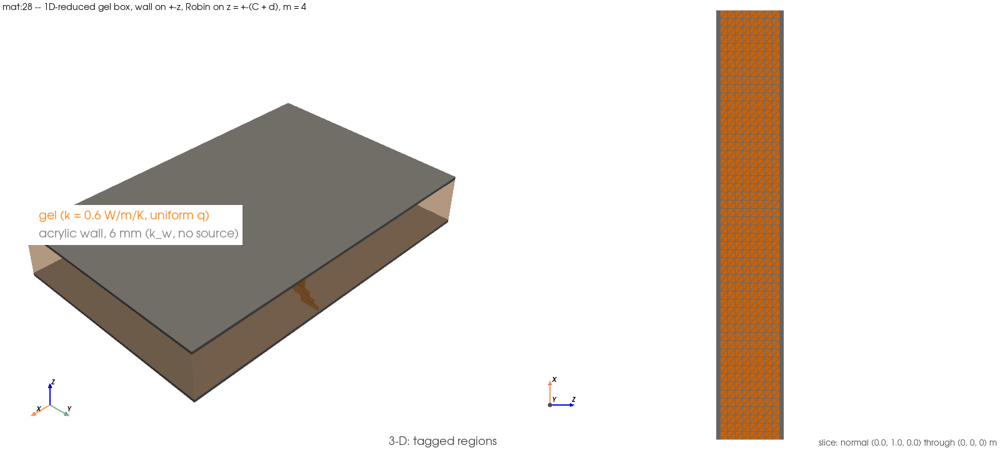

# `mat:28` — the gel box with a meshed acrylic wall: the wall as cells, converging at order 2 to the two-layer slab, and the bare slab missing

Script: `examples/materials/28_gel_box_meshed_acrylic_wall.py` (`EX-159`)
Gate: `tests/validation/test_mat21_wall_fem.py` (`MAT-21` step 20 / P48b, §9 item 670)

## 1. What this demonstrates

`mat:12` puts a spherical wall on the gel ball and `mat:14` folds a wall into h_eff with no wall cells. No earlier
example **meshes a container wall on the box**. Here the F2182-sized gel box (A, B, C) = (0.325, 0.21, 0.045) m,
k = 0.6, uniform q = 2000 W/m³, gets a 6 mm acrylic wall (nominal k_w = 0.19 W/m/K) as tetrahedral cells with a DG0
conductivity field and no source. The mesh is `create_box` over the outer box, then every rank's geometry (owned and
ghost nodes) is remapped piecewise-linearly so grid planes fall exactly on the gel faces.

**Why the reduced geometry is exactly 1D.** The gate's gated case has the wall on ±z only, Robin cooling on
z = ±(C + d) only, and the four side faces left untagged (natural Neumann), with A, B ≫ C. Nothing then depends on
x or y, so the solution is item 660's two-layer slab: a parabola through the gel, a straight line through each wall,
and a Robin film outside. The example solves it at m = 2 / 4 / 6 and compares to
`two_layer_slab_steady_temperature` interpolated into P2.

**Why a massless wall equals h_eff.** In steady state the flux through a thin layer is constant, so the wall adds a
series resistance d/k_w to the film 1/h: h_eff = (1/h + d/k_w)⁻¹ = 7.6 W/m²/K here. That is what `mat:14` uses. The
wall cells here carry the same resistance without any h_eff, which is why the meshed result must match the series.

**What the bare-box control proves.** The same centre rise is also compared to the bare Robin slab at h with *no*
wall. If that were within the interior band, the wall would be invisible to the gates and the convergence figure
would prove nothing about it. It misses by 22.97 %, 23× the band.

**Asserted** (bands imported from the gate chain, never restated; run of record
`20261028T033215Z_EX-159.log`, complex build, `-n 2`, elapsed 28 s harness / 23.9 s in script):

- (V) gel and wall volumes against analytic at the rule-(f) bar `max(1e-12, 50·N·ε)`: worst 1.7e-12 against a bar of
  1.7e-10 or larger, on every rung and on the six-wall box.
- (S1) whole-domain rel L2 LSQ rate 1.9896 (record 1.9896; pairwise 1.9870, 1.9947) ≥ `RATE_BAR` = 1.7; finest
  gel-interior rel L2 1.190636e-03 (record 1.190636e-03) ≤ `INTERIOR_BAND` = 1e-2. Centre θ_h 15.217105264 K against
  the two-layer 15.217105263 K.
- (E) heat balance |∮hθ − qV_gel|/(qV_gel): worst 2.632e-14 over the rungs (record ≤ 2.7e-14) ≤ `E_BAND` = 1e-9.
- (c-h), asserted miss: the bare slab at h (12.375 K) misses the FEM centre by 2.2967e-01 (record 2.2967e-01).

The complex-build figures equal the real-build records of
`20261027T200231Z_MAT-21-step20-W1-fem.log` at the printed digits; there is no real / complex divergence.

**Readings, printed and not asserted.**

1. *The six-wall box* (m = 4, 145 152 cells). The meshed six-wall centre rise is 14.533850 K (record 14.5339); the
   bare gel box at h_eff on the same gel grid gives 14.600107 K (record 14.6001); the triple series gives 14.595239 K
   at h_eff and 12.003947 K at h. Balance 1.735e-15. **Lateral wall conduction is not tested**: this is a print, and no
   gate stands behind the six-wall figure beyond volume and balance.
2. *ε_w.* The h_eff-only miss, bare-at-h_eff over six-wall minus one, is +4.5588e-03; the wall's Biot number
   h·d/k_w is 0.31579.
3. *Cells and seconds.* W1 rungs: 14 976 / 119 808 / 404 352 cells in 5.4 / 5.3 / 8.7 s.

k_w and ρ_w c_w are **nominal** (a citation for PMMA is owed, dashboard W3). Not claimed: the six-wall box as a gate,
any transient, a PMMA property, or `MAT-21` movement.

## 2. How to run it

```
./scripts/run_examples.sh -e mat:28 -n 2 -t 300
```

The runner sources the complex DolfinX build for the `mat:` group. Tier: **standard**, measured 28 s wall at `-n 2`
(script total 23.9 s) with the setup figure. Verification runs go through the logging harness with the runner's
emitted command (`./scripts/run_examples.sh -e mat:28 -n 2 -t 300 --dry-run`, logged as
`20261028T033211Z_EX-159-dry-run.log`). Add `-e FEM_EM_SETUP_FIGURES=1` after `exec -T` to re-render the setup figure.
Output: `examples/materials/paraview_output/materials_28_gel_box_meshed_acrylic_wall_combined.xdmf`.

## Setup figure



`examples/materials/figures/materials_28_gel_box_meshed_acrylic_wall_setup.png`.
The m = 4 reduced box (52 × 32 × 12 cells) cut at y = 0: the gel (translucent) between two 6 mm wall slabs on ±z. The
Robin faces are z = ±(C + d); the side faces are insulated.

## 3. How to analyze it, step by step

**Step 1 — the field.** Open
`examples/materials/paraview_output/materials_28_gel_box_meshed_acrylic_wall_combined.xdmf`. The complex build writes
`real_` / `imag_` splits (imaginary parts are zero). Colour `real_theta_h` on a y = 0 slice: a dome of 15.2 K at the
centre falling through the gel and the wall.

**Step 2 — the conductivity.** Colour `real_k_field_DG0` (cell-wise): 0.6 inside the gel, 0.19 in the two wall slabs.
`CellTags` carries the same split as 1 / 2 for thresholding.

**Step 3 — the series and the error.** Compare `real_theta_two_layer_series` and plot `real_theta_error` over a line
along z at x = y = 0. The whole-domain rel L2 at m = 4 is 2.708294e-03 (printed in the run log), so expect
errors at the 1e-3 relative level; where they peak is for you to read off the plot.

**Step 4 — the wall's effect.** Plot `real_theta_h` over z: the drop across each wall slab is the linear segment
between z = C and C + d, equal to flux × d/k_w, which h_eff folds into the film.

## Related

- `examples/materials/12_gel_ball_in_container_wall.md`
- `examples/materials/14_coil_driven_phantom_in_container_wall.md`
- `examples/materials/24_f2182_gel_box_study_api_probes.md`
- `tests/validation/test_mat21_wall_fem.py`
