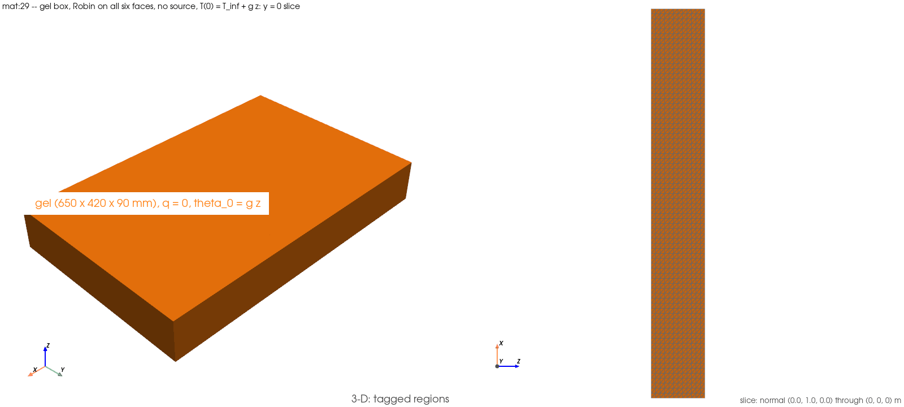

# `mat:29` — the gel box relaxing from a pre-equilibration gradient: the drift an F2182 measurement subtracts, against the triple Robin series

Script: `examples/materials/29_gel_box_initial_gradient_drift.py` (`EX-161`)
Gate: `tests/validation/test_mat21_initial_gradient_fem.py` (`MAT-21` step 19 / P47b′, §9 item 676)

## 1. What this demonstrates

Every earlier gel-box example (`mat:19`, `mat:24`, `mat:25`) starts from a *uniform* temperature. This is the first
that starts a transient from a **spatial field**, with the source off. The F2182-sized box
(A, B, C) = (0.325, 0.21, 0.045) m, k = 0.6, ρc = 4.18e6, h = 10, is cooled by Robin on all six faces and begins at
θ₀ = g z with g = 10 K/m, that is T(0) = T∞ + g z. The finest rung of `MAT-21` step 1 (m = 6, 78 × 48 × 12 cells,
269 568 tetrahedra) is advanced by Crank–Nicolson, N = 40 steps plus two backward-Euler half-steps, to
t\* = 0.2 t_C = 2821.5 s, and compared with `robin_box_initial_gradient_temperature`, the triple Robin eigen-series.

**Why F2182 requires equilibrium.** A temperature-sensor measurement of a heated phantom reads rise above a baseline.
If the phantom was not left to equilibrate, the baseline is not flat: the leftover gradient relaxes by conduction
and Robin cooling while the RF heats, and the reading carries a drift that has nothing to do with the RF. A
measurement protocol subtracts that drift; this example computes what there is to subtract.

**What a 1 K / 90 mm gradient leaves at t\*.** g C = 0.45 K at the top face at t = 0. At t\* the series gives
0.146779 K at the top-face probe P5 and the FEM 0.146994 K (rel +1.464e-3): about a third of the initial offset is
still there after 0.2 t_C. For scale, the steady, *sourced* centre-line value `MAT-21` step 10 prints for P5 is
3.127848 K; the ratio 0.047 compares two different things (a decaying leftover against a source-driven steady rise)
and is a scale, not a transient rise.

**Why the mid-plane values are not zero on this mesh.** θ₀ = g z is odd under z → −z, so the exact solution
vanishes on z = 0. `create_box`'s tetrahedra are, however, *not* mapped onto themselves by the mirror z → −z; they
are mapped onto themselves by the **point reflection** through the centre, and θ₀ is odd under that too. The exact
discrete identity is therefore θ_h(−p) = −θ_h(p): the four wall values P1…P4 are ±9.870e-4 K (y) and ±9.413e-4 K (x),
an O(h²) record of the missing mirror symmetry, while their pair sums and the centre value vanish to rounding
(2026-10-27 18:00 ruling, item 676). No z-mirror symmetry is claimed.

**Asserted** (bands imported from the gate chain, never restated; run of record `20261028T034336Z_EX-161.log`,
complex build, `-n 2`, 34 s harness / 31.0 s in script). Item 676's records, real build, are in
`20261028T003056Z_MAT-21-step19-W1-fem-r2.log:59–69`:

- (I) interior rel L2 at t\* against the series: 7.543166e-03 (log `:48`; gate record 7.543166e-03) ≤
  `INTERIOR_BAND` = 1e-2.
- (E) source-free balance, normalised by the initial stored energy: 4.067e-15 over 41 (half-)steps (`:49`; record
  4.106e-15) ≤ `E_BAND` = 1e-9, with ∫Q = 0.
- (Sym′) |P1 + P2| / g C = 1.026e-13, |P3 + P4| / g C = 8.684e-14, |P0| / g C = 3.947e-14 (`:62`; records
  7.895e-14, 6.316e-14, 7.895e-15) ≤ `SYM_BAR` = 1e-10.
- (c-Dz), asserted miss: the series with Dirichlet-z roots misses the same FEM field by 2.9493 (`:50`; record
  2.9493) against `INTERIOR_BAND` = 1e-2.

The interior, balance and (c-Dz) readings equal the real-build records at the printed digits; the (Sym′) and
balance values differ in the last digit at the 1e-13 / 1e-15 rounding level, which is a difference reported and
not asserted. There is no real / complex divergence, and max |Im θ| = 0.

**Readings, printed and not asserted.** Whole-domain rel L2 8.181649e-3; the P5 drift 0.146994 K beside the
series 0.146779 K (`:57`); the initial state is the exact P1 interpolant of g z (7.8e-15) with ∫θ₀ dV / (g C V) =
−8.9e-17; CN solve 10.8 s.

Not claimed: a measured phantom gradient, a source, or a z-mirror symmetry. Related: `mat:24`, `mat:25`.

## 2. How to run it

```
./scripts/run_examples.sh -e mat:29 -n 2 -t 300
```

The runner sources the complex DolfinX build for the `mat:` group. Tier: **standard**, measured 34 s wall at `-n 2`
(script total 31.0 s) with the setup figure. Verification runs go through the logging harness with the runner's
emitted command (`./scripts/run_examples.sh -e mat:29 -n 2 -t 300 --dry-run`, logged as
`20261028T034332Z_EX-161-dry-run.log`). Add `-e FEM_EM_SETUP_FIGURES=1` after `exec -T` to re-render the setup
figure. Output: `examples/materials/paraview_output/materials_29_gel_box_initial_gradient_drift_combined.xdmf`.

## Setup figure



`examples/materials/figures/materials_29_gel_box_initial_gradient_drift_setup.png`.
The m = 6 box (78 × 48 × 12 cells) cut at y = 0: one gel region, no source, Robin on every face; the initial
temperature varies linearly in z.

## 3. How to analyze it, step by step

**Step 1 — the initial state.** Open
`examples/materials/paraview_output/materials_29_gel_box_initial_gradient_drift_combined.xdmf`. The complex build
writes `real_` / `imag_` splits (imaginary parts are zero). Colour `real_theta_0` on a y = 0 slice: a linear ramp
from −0.45 K at the bottom face to +0.45 K at the top.

**Step 2 — the relaxed field.** Colour `real_theta_t_star`: the ramp has flattened toward the faces, and the top
face holds about 0.147 K. Compare `real_theta_series_t_star`.

**Step 3 — the error.** Plot `real_theta_error` along z at x = y = 0. The interior rel L2 is 7.5e-3; read off where
the error peaks.

**Step 4 — the mid-plane.** Plot `real_theta_t_star` on z = 0: it is not exactly zero (≈ 1e-3 K at the walls),
and it is antisymmetric under (x, y) → (−x, −y) to rounding. That is the point-reflection identity above.

## Related

- `examples/materials/24_f2182_gel_box_study_api_probes.md`
- `examples/materials/25_f2182_gel_box_duty_probe_histories.md`
- `tests/validation/test_mat21_initial_gradient_fem.py`
