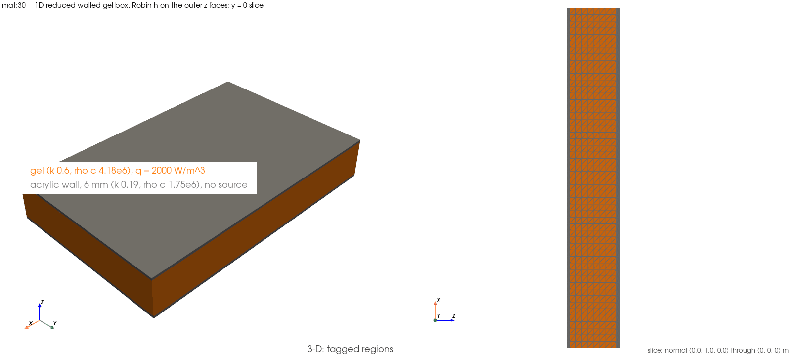

# `mat:30` — the walled gel box heating up: the acrylic wall's heat capacity in the transient, against the two-layer slab series

Script: `examples/materials/30_gel_box_wall_heat_capacity_transient.py` (`EX-162`)
Gate: `tests/validation/test_mat21_wall_transient_fem.py` (`MAT-21` step 20c / P48c, §9 item 682)

## 1. What this demonstrates

`mat:28` shows the 6 mm acrylic wall in **steady state**, where the wall enters only through its conductance: the
steady rise sees k_w and d (the h_eff shortcut, 1/h_eff = 1/h + d/k_w) and nothing else. In a **transient** the wall
also carries a heat capacity ρ_wc_w = 1.7493e6 J/m³/K, which has to be charged before the gel's heat reaches the
outside air, so the rise is delayed and an h_eff (massless-wall) model reads too high.

This example steps the F2182-sized gel box (A, B, C) = (0.325, 0.21, 0.045) m, k = 0.6, ρc = 4.18e6, h = 10,
q = 2000 W/m³ inside a 6 mm wall (k_w = 0.19) by Crank–Nicolson (θ = 0.5, two backward-Euler start-up half-steps,
Δt = t\*/40, 320 steps) at m = 4 (119 808 tetrahedra, 52 × 32 × 12 cells, 2 wall layers per side). Snapshots at
t\* = 0.2 T_C = 2821.5 s and t₂ = 1.6 T_C = 22 572 s are compared with `two_layer_slab_transient_temperature`
(400 modes).

**Why the slab series is exact for the 3D FEM.** Item 670's reduction puts the walls on the two z faces only; the x
and y faces are the box's own boundary and, with the source and initial state uniform in x, y, carry no flux
difference, so the 3D problem is the 1D two-layer slab problem. The FEM field and the series answer the same
mathematical problem, which is why 1e-3-level agreement is a discretisation statement, not a model one. The
six-wall box has lateral conduction and no closed form; it is not claimed here.

**The control.** The same FEM field against the series with ρ_wc_w × 1e-9 (a massless wall of the same conductance)
misses by 2.06e-2 at t₂, 13.9× the FEM's own 1.48e-3 error. That is the size of the error a phantom builder who
replaced the wall by h_eff would carry in the transient.

**Nominal values.** `K_W` = 0.19 and `RHO_C_W` = 1190 × 1470 are nominal PMMA handbook values with the citation
owed (dashboard W3). The identity tested here (FEM = the exact series for the same coefficients) does not depend on
their values.

**Asserted** (bands imported from the gate chain, never restated; run `20261028T093706Z_EX-162.log`, complex
build, `-n 2`, 142 s harness / 138.9 s in script, CN solve 21.3 s). Item 682's records, real build, are in
`20261028T021107Z_MAT-21-step20c-W1-fem.log:52–57`:

- (V) volumes: gel 2.507e-13, wall 2.724e-13 (log `:46`; records the same) ≤ `_vol_bar(n)` = 1.330e-09.
- (E) max per-step balance 2.373e-13 over 321 (half-)steps (`:47`; record 2.350e-13) ≤ `E_BAND` = 1e-9.
- (T) gel-interior rel L2 against the two-layer series: 2.244928e-03 at t\* (`:48`) and 1.483557e-03 at t₂ (`:50`),
  both equal to the records, ≤ `INTERIOR_BAND` = 1e-2.
- (c-m), asserted: the massless-wall series misses the FEM at t₂ by 2.059306e-02 against 2 × 1.484e-03 =
  2.967e-03 (`:52`; separation 13.88×, record 13.9×).

The gate records are equal at the printed digits except the balance, which differs in the last digit (rounding
level); there is no real / complex divergence, and max |Im θ| = 0.

**Readings, printed and not asserted** (`:49`, `:51`). Centre θ at t\*: FEM 1.330815144 K, two-layer series
1.327311508 K (rel +2.640e-03), massless-wall series 1.338774894 K, so ignoring the wall capacity overstates the
rise by +8.6365e-03. At t₂: FEM 7.958737121 K, series 7.945611514 K (rel +1.652e-03), massless 8.090989721 K
(+1.8297e-02). For orientation, `mat:28`'s *steady* bare-gel-box-at-h_eff centre record is 14.6001 K — a steady
value, not a t\* rise (no bare transient series exists in the gate chain).

Not claimed: the six-wall box transient, a cited PMMA ρc, a measured phantom. Related: `mat:28`, `mat:29`, `mat:25`.

## 2. How to run it

```
./scripts/run_examples.sh -e mat:30 -n 2 -t 480
```

The runner sources the complex DolfinX build for the `mat:` group. Tier: **heavy** (the window exceeds 180 s
budget class), measured 142 s wall at `-n 2` with the setup figure. Verification runs go through the logging
harness with the runner's emitted command (`./scripts/run_examples.sh -e mat:30 -n 2 -t 480 --dry-run`, logged as
`20261028T093703Z_EX-162-dry-run.log`). Add `-e FEM_EM_SETUP_FIGURES=1` after `exec -T` to re-render the setup
figure. Output: `examples/materials/paraview_output/materials_30_gel_box_wall_heat_capacity_transient_combined.xdmf`.

## Setup figure



`examples/materials/figures/materials_30_gel_box_wall_heat_capacity_transient_setup.png`.
The m = 4 box cut at y = 0: gel (tag 1) between two acrylic layers (tag 2) on the z faces only; Robin h on the
outer z faces.

## 3. How to analyze it, step by step

**Step 1 — the early field.** Open
`examples/materials/paraview_output/materials_30_gel_box_wall_heat_capacity_transient_combined.xdmf`. The complex
build writes `real_` / `imag_` splits (imaginary parts are zero). Colour `real_theta_t_star` on a y = 0 slice:
≈ 1.33 K at the centre, falling across the wall.

**Step 2 — the late field.** Colour `real_theta_t2`: ≈ 7.96 K at the centre; compare `real_theta_series_t2`.

**Step 3 — the error.** Plot `real_theta_error_t2` along z at x = y = 0. The interior rel L2 is 1.5e-3; read off
where it peaks (near the interface, where the DG0 material jump sits).

**Step 4 — the wall's heat capacity.** The centre values above: the massless-wall series is 0.9 % high at t\* and
1.8 % high at t₂. The steady state would show none of it.

## Related

- `examples/materials/28_gel_box_meshed_acrylic_wall.md`
- `examples/materials/29_gel_box_initial_gradient_drift.md`
- `examples/materials/25_f2182_gel_box_duty_probe_histories.md`
- `tests/validation/test_mat21_wall_transient_fem.py`
