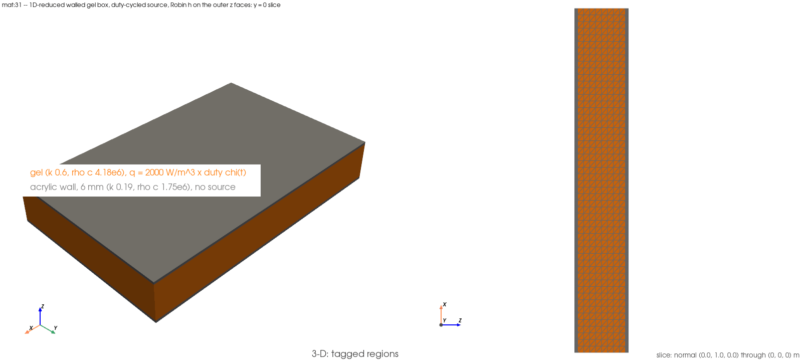

# `mat:31` — the walled gel box under a duty-cycled source: the acrylic wall's heat capacity when the heating switches on and off, against the duty-cycled two-layer slab series

Script: `examples/materials/31_gel_box_wall_duty_cycled_transient.py` (`EX-164`)
Gate: `tests/validation/test_mat21_wall_duty_fem.py` (`MAT-21` step 21b / P49b, §9 item 688)

## 1. What this demonstrates

`mat:30` steps the walled gel box with the source on from t = 0. Here the **same source is switched on and off**:
period P = 0.5 t\* = 1410.75 s (exactly 20 Crank–Nicolson steps), duty D = 0.5 (10 steps on), through the
solver's `source_schedule`. The box is the F2182-sized gel box (A, B, C) = (0.325, 0.21, 0.045) m, k = 0.6,
ρc = 4.18e6, h = 10, q = 2000 W/m³ (while on) inside a 6 mm acrylic wall (k_w = 0.19, ρc_w = 1.7493e6) on the z
faces only (item 670's 1D reduction, so the two-layer slab series is exact for the 3D FEM), m = 4 (119 808
tetrahedra), Δt = t\*/40, 320 steps (two backward-Euler start-up half-steps, then θ = 0.5). Snapshots at t\* =
2821.5 s and t₂ = 8 t\* = 22 572 s are compared with `two_layer_slab_duty_cycle_temperature` (400 modes).

**What `source_schedule` does.** The multiplier χ(t) is evaluated at each (half-)step midpoint (`transient.py:39–41`,
`:319`). Because P is exactly 20 steps, every midpoint is cleanly inside an on or an off phase, and the census
Σχ·Δt equals the analytic on-time D·t₂ exactly: 161 on and 160 off (half-)steps, relative difference 0.

**Why the walled duty series is the step response superposed phase by phase** (item 689, `MAT-17`'s pattern): the
problem is linear, so the on/off source is a sum of shifted constant-source responses. The series' raw jump at a
switch is its truncation residual (the 400-mode sum), not a physical jump (the 10:30 ruling of item 689); the
snapshots here sit on a step boundary and the comparison is to the series value there.

**The control.** The continuous-source series (`mat:30`'s) is a different answer: it sees the source on for all of
t\*, so it misses the duty-cycled FEM by 0.507 at t\* — 298.5× the FEM's own 1.70e-3 error.

**Nominal values.** `K_W` = 0.19 and `RHO_C_W` = 1190 × 1470 are nominal PMMA handbook values with the citation
owed (dashboard W3). The identity tested (FEM = the exact series for the same coefficients) does not depend on
their values.

**Asserted** (bands imported from the gate chain, never restated; run `20261030T201705Z_EX-164.log`, complex build,
`-n 2`, 191 s harness / 188.3 s in script, CN solve 18.7 s). Item 688's records, real build, are in
`20261028T172612Z_MAT-21-step21b-W1.log:52–60`:

- (Sch) P = 20 Δt and D·P = 10 Δt to 1e-12: true (log `:47`).
- (V) volumes: gel 2.507e-13, wall 2.724e-13 (`:46`; records the same) ≤ `_vol_bar(n)` = 1.330e-09.
- (E) max per-step balance 2.254e-13 over 321 (half-)steps (`:48`; record 2.269e-13) ≤ `E_BAND` = 1e-9.
- (S0) census 11 286.000000 s against D·t₂ = 11 286.000000 s: relative 0 (`:49`; record 0) ≤ `S0_BAND` = 1e-12.
- (T) gel-interior rel L2 against the duty series: 1.697155e-03 at t\* (`:50`) and 1.447368e-03 at t₂ (`:52`), both
  equal to the records, ≤ `INTERIOR_BAND` = 1e-2.
- (c-c), asserted: the continuous-source series misses the FEM at t\* by 5.066571e-01 against 2 × 1.697e-03 =
  3.394e-03 (`:54`; separation 298.53×, record 298.5×).

All records equal at the printed digits (the balance differs in the third digit, rounding level); there is no
real / complex divergence, and max |Im θ| = 0.

**Readings, printed and not asserted** (`:50–53`). Centre θ at t\*: FEM 0.661673131 K, duty series 0.659441298 K
(rel +3.384e-03), continuous-source series 1.327311508 K (+1.013 vs the duty series), massless-wall duty series
0.666844311 K, so ignoring the wall capacity under the duty cycle overstates the rise by +1.1226e-02. At t₂: FEM
3.937390665 K, duty series 3.930539409 K (rel +1.743e-03), continuous 7.945611514 K (+1.022), massless-wall
4.003593543 K (+1.8586e-02). The massless-wall duty series' interior miss is printed, not a gate: 3.077364e-02 at t\*
and 2.064029e-02 at t₂ (records 3.077e-02 / 2.064e-02).

Not claimed: the six-wall box transient, a cited PMMA ρc, a CEM43 dose on the walled box, a Δt rate, a measured
phantom.

## 2. How to run it

```
./scripts/run_examples.sh -e mat:31 -n 2 -t 480
```

The runner sources the complex DolfinX build for the `mat:` group. Tier: **heavy** (the window exceeds the 180 s
budget class), measured 191 s wall at `-n 2` with the setup figure. Verification runs go through the logging harness
with the runner's emitted command (`./scripts/run_examples.sh -e mat:31 -n 2 -t 480 --dry-run`, logged as
`20261030T201333Z_EX-164-dry-run.log`). Add `-e FEM_EM_SETUP_FIGURES=1` after `exec -T` to re-render the setup
figure. Output: `examples/materials/paraview_output/materials_31_gel_box_wall_duty_cycled_transient_combined.xdmf`.

## Setup figure



`examples/materials/figures/materials_31_gel_box_wall_duty_cycled_transient_setup.png`.
The m = 4 box cut at y = 0: gel (tag 1) between two acrylic layers (tag 2) on the z faces only; Robin h on the
outer z faces; the source switches with period 0.5 t\*, duty 0.5.

## 3. How to analyze it, step by step

**Step 1 — the early field.** Open
`examples/materials/paraview_output/materials_31_gel_box_wall_duty_cycled_transient_combined.xdmf`. The complex
build writes `real_` / `imag_` splits (imaginary parts are zero). Colour `real_theta_t_star` on a y = 0 slice:
≈ 0.66 K at the centre, falling across the wall; compare `real_theta_duty_series_t_star`.

**Step 2 — the late field.** Colour `real_theta_t2`: ≈ 3.94 K at the centre (half the continuous-source 7.96 K,
as the duty is 0.5); compare `real_theta_duty_series_t2`.

**Step 3 — the error.** Plot `real_theta_error_t2` along z at x = y = 0. The interior rel L2 is 1.4e-3.

**Step 4 — the wall's heat capacity under a duty cycle.** The massless-wall duty series is 1.1 % high at t\* and
1.9 % high at t₂ at the centre; the continuous-source answer is about 100 % high at the centre.

## Related

- `examples/materials/30_gel_box_wall_heat_capacity_transient.md`
- `examples/materials/25_f2182_gel_box_duty_probe_histories.md`
- `examples/materials/11_duty_cycled_gel_ball.md`
- `examples/implants/17_implant_heating_transient_duty.md`
- `tests/validation/test_mat21_wall_duty_fem.py`
