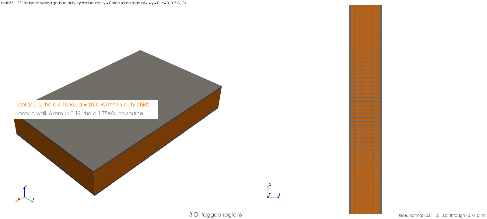

# `mat:32` — the thermal dose in the walled gel box: CEM43 and the six-minute mean on FEM point histories, against the duty-cycled two-layer slab series

Script: `examples/materials/32_gel_box_wall_thermal_dose.py` (`EX-166`)
Gate: `tests/validation/test_mat21_wall_duty_dose_fem.py` (`MAT-21` step 23 / P50b, §9 item 708)

## 1. What this demonstrates

`mat:31` compares the walled gel box's *field* with the duty-cycled series. This example turns the same
Crank–Nicolson history into the quantities a safety reader asks for: the **CEM43 dose** and the **maximum
six-minute running mean** of the temperature rise, at three points on the box axis — centre (z = 0), near the wall
(z = 0.9 C) and the gel–acrylic interface (z = C) — where the wall's heat capacity matters. The box is item 670's
1D-reduced walled box (6 mm acrylic on the z faces only, so the two-layer slab series is exact for the 3D FEM), the
F2182-sized gel (A, B, C) = (0.325, 0.21, 0.045) m, m = 4 (119 808 tetrahedra), Δt = t\*/40, 320 CN steps to
t₂ = 8 t\* = 22 572 s, period 0.5 t\*, duty 0.5. Snapshots are held at every step (321) and read at the three
points through the owner-route point evaluation.

**What (Q-wf) is.** It is an *identity of `cem43` on a history*, not a dose-accuracy claim: the FEM history's
`cem43` is compared with a quadrature of the same piecewise-linear history, so it tests the dose arithmetic (worst
relative difference 5.1e-16 against the bar 1e-10) and says nothing about whether the history is right. The window
check (Win-wf) is the same kind of identity for the six-minute mean (rel ≤ 6e-15 against 1e-12). Whether the
*history* is right is the interior L2 against the series at 4 t\* (1.29e-3, band 1e-2). The R-swap control (the
CEM43 R factors swapped) misses by 5.9e4 … 1.6e6, so the dose check can fail.

**Why the near-wall gap has the other sign.** The FEM-versus-series dose table is printed, not gated. At the centre
and interface the FEM dose is above the series (peak +0.84 % and +0.62 %), at the near-wall point it is below it
(8.406e-09 s against 8.502e-09 s, −1.12 %). The sign follows the sign of the temperature gap at that point (the FEM
centre θ sits above the series, as `mat:31` records, and the near-wall FEM history below it); the dose, steeply
nonlinear in temperature, magnifies each gap by its sign (max |Δθ| is 6.9e-3, 1.19e-2 and 6.6e-3 K, yet the
equal-mean doses differ by 1.8 %, 2.4 % and 1.3 %). No cause beyond that is claimed: it is a record of one rung and
one Δt, not a convergence statement.

**The controls, asserted.** (c-mass) A wall with no heat capacity (ρc_w × 1e-9) misses the FEM's interface dose by
1.0479e-01 — 1.05e+09 × `DOSE_BAR`; the module's own record is 1.0479e-01 and the ceiling the gate chain quotes is
1.05e-01, so the bar sits far below the miss. (c-cont) The continuous-source series misses the duty-cycled FEM at
4 t\* by 5.0626e-01, 50.63 × `INTERIOR_BAND` (record 5.063e-01).

**Fixture limits.** A 1D-reduced box (z walls only, no lateral conduction), one mesh rung (m = 4), one Δt. The doses
are at a 20 °C gel's scale: the hottest point reaches 28.04 °C (equal-mean scale), far below `T_REF` = 43 °C, so
CEM43 here is of order 1e-8 … 3e-6 s. This is **not** a thermal-damage statement, not a dose accuracy, not a rate,
and the wall's k_w and ρc_w remain nominal handbook values.

**Asserted** (bands imported from the gate chain, never restated; run `20261101T211827Z_EX-166.log`, complex
build, `-n 2`, 117 s harness / 114.1 s in script, CN solve 18.8 s, point reads 31.7 s). 44 gates, none red
(`:69`). Item 708's records, real build, are in `20261101T104306Z_MAT-21-step23-W1.log:56–77`.

- (E) max balance 2.248e-13 (`:47`; record 2.25e-13) ≤ `E_BAND` = 1e-9.
- (S0) Σχ·Δt = 11 286.000000 s, rel 0 ≤ `S0_BAND` = 1e-12; 161 on / 160 off (`:47`).
- every point valid; max T < `T_REF` (`:49–59`).
- (T) interior rel L2 at 4 t\*: 1.291199e-03 (`:48`; record 1.291e-03) ≤ `INTERIOR_BAND` = 1e-2.
- (Q-wf), (Win-wf), t_max range and bracket at each point and both scales (`:49–60`).
- (c-mass) 1.0479e-01 > 1e-10 (`:61`); (c-cont) 5.062594e-01 > 1e-2 (`:62`).

**Printed, not gated** (`:63–65`): FEM against series dose, peak scale, centre / near-wall / interface: 1.953219e-08
/ 8.405992e-09 / 7.011837e-09 s against 1.936945e-08 / 8.501542e-09 / 6.968556e-09 s; equal-mean: 2.790406e-06 /
4.419601e-07 / 2.969149e-07 s against 2.741941e-06 / 4.528524e-07 / 2.930690e-07 s. Every six-minute maximum lands at
t = 22 148.77 s, FEM and series alike (peak scale 4.005254 / 3.278509 / 3.118149 K against 3.998931 / 3.288243 /
3.113772 K). max|Im θ| = 0.

**Disclosed.** The body of item 708's `wall_dose` pytest fixture is written out in `main()`, not called (its
helpers and bands are imported by name); `np.real` is taken of each integral and series value because the `mat:`
group sources the complex build; the example adds one assertion beyond the gate (max|Im θ| ≤ 1e-12) and compares the
two control figures with the gate's quoted ceilings.

Not claimed: a dose band, a dose accuracy, a rate, the six-wall box, a cited PMMA ρc, a measured phantom, a
compliance or thermal-damage statement.

## 2. How to run it

```
./scripts/run_examples.sh -e mat:32 -n 2 -t 480
```

The runner sources the complex DolfinX build for the `mat:` group. Tier: **heavy** (the window exceeds the 180 s
budget class), measured 117 s wall at `-n 2` with the setup figure. Verification runs go through the logging harness
with the runner's emitted command (`--dry-run`, logged as `20261101T211824Z_EX-166-dry-run.log`). Add
`FEM_EM_SETUP_FIGURES=1` inside the container command to re-render the setup figure. Output:
`examples/materials/paraview_output/materials_32_gel_box_wall_thermal_dose_combined.xdmf`.

## Setup figure



`examples/materials/figures/materials_32_gel_box_wall_thermal_dose_setup.png`.
The m = 4 box cut at y = 0: gel (tag 1) between two acrylic layers (tag 2) on the z faces only; Robin h on the outer
z faces; the source switches with period 0.5 t\*, duty 0.5. The dose is read on the axis at z = 0, 0.9 C and C.

## 3. How to analyze it, step by step

**Step 1 — the early field.** Open
`examples/materials/paraview_output/materials_32_gel_box_wall_thermal_dose_combined.xdmf`. The complex build
writes `real_` / `imag_` splits (imaginary parts are zero). Colour `real_theta_4_t_star` on a y = 0 slice and compare
`real_theta_duty_series_4_t_star`; `real_theta_error_4_t_star` is their difference (interior rel L2 1.29e-3).

**Step 2 — the late field.** Colour `real_theta_t2`: the field at the end of the history the doses integrate.

**Step 3 — read the table.** In the log, compare the peak-scale and equal-mean doses across the three points: the
dose rises steeply toward the centre because CEM43 is exponential in temperature, while the six-minute mean (4.0 K
centre, 3.1 K at the interface at peak scale) differs by far less.

**Step 4 — what the controls say.** The massless-wall series changes the interface dose by 10.5 %; the
continuous-source series changes the 4 t\* field by 51 %. Ignoring the wall's heat capacity, or the duty cycle,
changes the answer by orders of magnitude more than the FEM-versus-series gap.

## Related

- `examples/materials/17_thermal_dose_duty_cycle.md`
- `examples/materials/18_six_minute_window_coil_heating.md`
- `examples/materials/30_gel_box_wall_heat_capacity_transient.md`
- `examples/materials/31_gel_box_wall_duty_cycled_transient.md`
- `examples/implants/18_implant_thermal_dose.md`
- `tests/validation/test_mat21_wall_duty_dose_fem.py`
