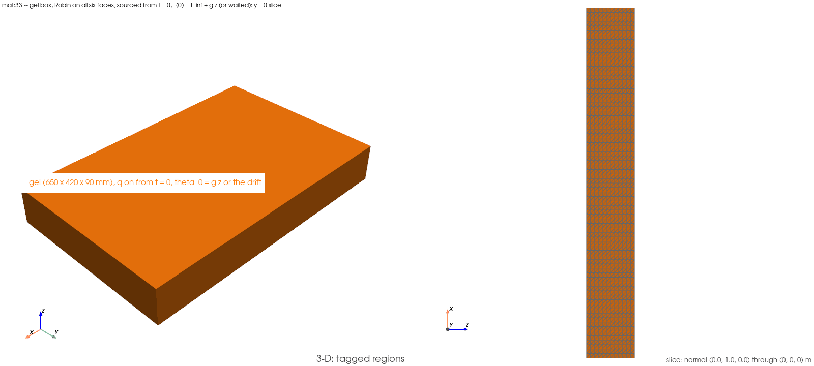

# `mat:33` — what skipping the F2182 wait costs: the gel box's initial gradient biasing the sourced rise, against the triple Robin series

Script: `examples/materials/33_gel_box_pre_equilibration_bias.py` (`EX-169`)
Gate: `tests/validation/test_mat21_pre_equilibration_fem.py` (`MAT-21` step 26 / P52, §9 item 720), with the closed form of `tests/validation/test_mat21_pre_equilibration_closed_form.py` (step 24 / P51, §9 item 712)

## 1. What this demonstrates

`mat:29` lets the leftover gradient relax with the source off. No earlier example switches a source on *after* a wait. Here the F2182-sized
box (A, B, C) = (0.325, 0.21, 0.045) m, k = 0.6, ρc = 4.18e6, h = 10, q = 2000 W/m³, Robin on all six faces, is run three times on the
finest rung of `MAT-21` step 1 (m = 6, 78 × 48 × 12 cells, 269 568 tetrahedra; Crank–Nicolson, N = 40 plus two backward-Euler half-steps, to
t\* = 0.2 t_C = 2821.5 s), the source on from t = 0 in each:

- the **reference**, from uniform T∞;
- **t_w = 0**, from T∞ + g z with g = 10 K/m (the wait skipped);
- **t_w = T_C**, from T∞ plus the drift series evaluated at t = T_C = 14 107.5 s on the mesh (the wait kept).

**The superposition.** The problem is linear, so θ(t; t_w) = θ_drift(t + t_w) + θ_sourced(t): the sourced rise from uniform temperature, plus
the leftover gradient advanced by the wait. The closed form is the sum of two series, `robin_box_transient_temperature` and
`robin_box_initial_gradient_temperature` (the triple Robin eigen-series). The bias at a point is θ_drift(t\* + t_w) / θ_sourced(t\*).

**Why only P5 reads a bias at all.** The drift is odd in z. Five of P37's six probe points lie in the mid-plane z = 0 where the exact drift is
zero, so the closed-form bias there is exactly 0; only the top-face probe P5 reads one. The FEM values at the five mid-plane points are not
zero: `create_box`'s tetrahedra are mapped onto themselves by the point reflection through the centre, not by the z-mirror, so the
discrete field satisfies θ_h(−p) = −θ_h(p) and the wall values are a ±1e-3 K O(h²) record, while the pair sums and the centre vanish to
rounding. That is the (Sym′) identity below, not a bias.

**A sensitivity, not a typical error.** g = 10 K/m (a 1 K gradient over the 90 mm height) is the fixture's choice. The ≈ 13.7 % bias at P5
with the wait skipped is what that gradient does at that point, a sensitivity of the sourced rise to the starting state; it is not a typical
error of a real protocol and not a recommended wait. This is not a statement of F2182's wording.

**Asserted** (bands imported from the gate chain, never restated; run of record `20261101T223957Z_EX-169.log`, complex build, `-n 2`, 74 s
harness / 72.0 s in script, series interpolations 33.5 s; gate record `20261101T150646Z_MAT-21-P52-W1.log`, real build):

- (I) interior rel L2 at t\* against the superposition: 1.125097e-03 at t_w = 0 and 9.076702e-04 at t_w = T_C (gate 1.125097e-03 /
  9.076702e-04) ≤ `INTERIOR_BAND` = 1e-2.
- (E) balance 2.809e-12 (reference), 2.663e-12 (t_w = 0), 2.583e-12 (t_w = T_C) ≤ `E_BAND` = 1e-9, with `source_power` = 49.14 W, identical on
  all three runs.
- (Sym′) on the drift part (run minus reference), max over |P1 + P2|, |P3 + P4|, |P0| / g C: 6.316e-14 at t_w = 0 and 3.947e-14 at t_w = T_C
  ≤ `SYM_BAR` = 1e-10 (gate ≤ 3.947e-14).
- (c-ref), asserted: the reference's interior error 9.071528e-04 reproduces step 1's record to |Δ| = 4.353e-11 ≤ `STEP1_T_BOUND` = 1e-10.
- (c-Dz), asserted: the series with Dirichlet-z roots misses the t_w = 0 field by 6.7596e-02 > `INTERIOR_BAND` (gate 6.7596e-02).

(I), (c-ref) and (c-Dz) equal the gate's real-build records at the printed digits. (E) and (Sym′) differ at round-off on the complex build: the closing
window `20261102T013021Z_EX-169-close.log` (Status 0, 74 s) reads (E) 2.809e-12 / 2.665e-12 / 2.582e-12 and (Sym′) 3.158e-14 / 5.526e-14, against the
gate's (E) 2.808e-12 / 2.667e-12 / 2.585e-12 and (Sym′) 3.158e-14 / 3.947e-14. max |Im θ| = 0.

**Printed, not asserted: the bias at P5.** FEM beside P51, at t_w = 0: +1.368568e-01 against +1.368767e-01; at t_w = T_C: +3.136953e-03
against +3.162635e-03. P51's closed-form column at P5, for t_w = 0, 0.5, 1, 2 / λ₁ (1/λ₁ = 3648.9 s): +1.368767e-01, +8.384669e-02,
+5.152806e-02, +1.947006e-02. The five mid-plane rows are the FEM's symmetry floor against a closed-form 0 (≈ 9e-4 relative at t_w = 0).

**(Dec) is not asserted.** P51's parked decay gate would read the bias as a single exponential in the wait. A single exponential is not
available from the full series at this age: the first odd mode dominates only asymptotically. What holds is (Dec∞), on the first odd mode, in
the gate chain; it is not exercised here and nothing in this example is a (Dec) pass.

Not claimed: a recommended wait, F2182's wording, a measured gradient, a dose. Related: `mat:29`, `mat:25`.

## 2. How to run it

```
./scripts/run_examples.sh -e mat:33 -n 2 -t 300
```

The runner sources the complex DolfinX build for the `mat:` group. Tier: **standard**, measured 74 s wall at `-n 2` with the setup figure.
Verification runs go through the logging harness with the runner's emitted command
(`./scripts/run_examples.sh -e mat:33 -n 2 -t 300 --dry-run`, logged as `20261101T223949Z_EX-169-dry-run.log`). Add
`-e FEM_EM_SETUP_FIGURES=1` after `exec -T` to re-render the setup figure. Output:
`examples/materials/paraview_output/materials_33_gel_box_pre_equilibration_bias_combined.xdmf`.

## Setup figure



`examples/materials/figures/materials_33_gel_box_pre_equilibration_bias_setup.png`.
The m = 6 box (78 × 48 × 12 cells) cut at y = 0: one gel region, the source on in every run, Robin on every face.

## 3. How to analyze it, step by step

**Step 1 — the two starts.** Open `examples/materials/paraview_output/materials_33_gel_box_pre_equilibration_bias_combined.xdmf`. The complex
build writes `real_` / `imag_` splits (imaginary parts are zero). The fields are `theta_tw0_t_star`, `theta_twC_t_star`,
`theta_superposition_tw0`, `theta_superposition_twC`, `theta_error_tw0` and `theta_error_twC`.

**Step 2 — the rise.** Colour `real_theta_twC_t_star` on a y = 0 slice: the sourced rise, 1.07 K to 1.34 K, symmetric about z = 0 within 3e-3 K.
Colour `real_theta_tw0_t_star`: the same rise with a tilt toward +z, the surviving gradient.

**Step 3 — the bias.** Subtract the two in the slice: the difference is the leftover drift, odd in z, largest on the top face (≈ 0.147 K at
t\* with the wait skipped, 3.4e-3 K after T_C).

**Step 4 — the error.** Plot `real_theta_error_tw0` and `real_theta_error_twC` along z at x = y = 0; the interior rel L2 is 1.1e-3 and 9.1e-4.

## Related

- `examples/materials/29_gel_box_initial_gradient_drift.md`
- `examples/materials/25_f2182_gel_box_duty_probe_histories.md`
- `tests/validation/test_mat21_pre_equilibration_fem.py`
