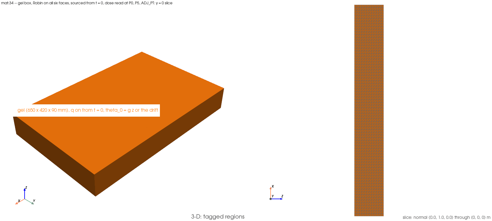

# `mat:34` — what skipping the F2182 wait costs in thermal dose: the FEM histories of the sourced gel box against the series

Script: `examples/materials/34_gel_box_wait_in_dose.py` (`EX-171`)
Gate: `tests/validation/test_mat21_pre_equilibration_dose_fem.py` (`MAT-21` step 29 / P56, §9 item 736), with the closed-form dose of `tests/validation/test_mat21_pre_equilibration_dose_closed_form.py` (step 27 / P55, §9 item 727)

## 1. What this demonstrates

`mat:33` stops at temperature: with the wait skipped, the sourced rise at the top-face probe P5 is biased by ≈ 13.7 % at t\*. No example puts that
bias in a dose. Dose is not linear in the drift. CEM43 integrates R^(43 − T) over the history with R = 0.5 above 43 °C and 0.25 below, so a
temperature offset enters as a factor 4^(T − 43) (a factor 2^(T − 43) above 43 °C): a linear bias in temperature becomes a nonlinear one in
dose, about 2.5 times larger at this fixture. Here the gel starts at 20 °C and rises a degree or so, far below 43 °C; the dose is a sensitivity
read on that scale, in seconds of CEM43, not a statement about tissue.

The three runs of `mat:33` are made again on the same box, the finest rung of `MAT-21` step 1 (m = 6, 78 × 48 × 12 cells, 269 568 tetrahedra;
Crank–Nicolson, N = 40 plus two backward-Euler half-steps, to t\* = 0.2 t_C), the source on from t = 0 in each: the **reference** from uniform
T∞; **t_w = 0** from T∞ + g z with g = 10 K/m (the wait skipped); **t_w = T_C** from T∞ plus the drift series at T_C (the wait kept). Each run
now keeps the per-step history at three points read as one fixed batch, P0 (the centre), P5 (the top-face probe) and ADJ_PT, and the CEM43 dose of
each history is formed from the 41 step values and printed beside the closed-form dose of item 727.

**A sensitivity, not a recommended wait.** g = 10 K/m (1 K across the 90 mm height) at a 20 °C gel is the fixture's choice. The numbers say what
that gradient does to a dose in this model; they are not a typical error of a real protocol, not a recommended wait, not F2182's wording and not
a thermal-damage statement.

**Asserted** (bands imported from the gate chain, never restated; gate record `20261101T224626Z_MAT-21-step29-W1.log`, real build, `-n 2`; the run
of record is the `EX-171` closing window, complex build, `-n 2`; the figures below are the flagged `EX-171-figure` window's, 106 s, Status 0):

- (I) interior rel L2 at t\* against the superposition: 1.125097e-03 at t_w = 0 and 9.076702e-04 at t_w = T_C, ≤ `INTERIOR_BAND` = 1e-2
  (gate 1.125097e-03 / 9.076702e-04, equal at the printed digits).
- (E) balance 2.809e-12 (reference), 2.664e-12 (t_w = 0), 2.584e-12 (t_w = T_C) ≤ `E_BAND` = 1e-9, `source_power` = 49.14 W identical on all three
  (gate ≤ 2.808e-12; the last digit differs at round-off on the complex build).
- (Sym′) on the drift part at P0–P4: worst 5.526e-14 g C at t_w = 0 and 2.368e-14 g C at t_w = T_C ≤ `SYM_BAR` = 1e-10 (gate ≤ 4.737e-14 g C; round-off
  differs on the complex build).
- (Q-wf) `cem43` against the quadrature `_q_check_g` at `DOSE_BAR` = 1e-10 on nine histories (three runs at P0, P5, ADJ_PT): worst rel 2.710e-16
  (gate worst 2.710e-16).
- (c-dose), asserted: the t_w = 0 FEM dose at P5, 1.280187e-10 s, misses the reference run's 9.538156e-11 s by 3.4217e-01 > `DOSE_BAR` (gate record
  3.4217e-01).
- (c-ref), asserted: the reference's interior error 9.071528e-04 reproduces step 1's record to |Δ| = 4.353e-11 ≤ `STEP1_T_BOUND` = 1e-10.

max |Im θ| = 0.

**Printed, not asserted: the dose bias.** The `[TABLE]` rows give, at P0, P5 and ADJ_PT and for each run: the FEM dose, the series dose on the
same 41-row grid and on the 161-row grid, the signed FEM-vs-series gap, D / D_ref − 1 for the FEM and for both series, and the temperature bias
b at t\* (the history's last value against the reference's) for the FEM and for the series. Read the dose bias at P5 beside its temperature bias:
FEM D / D_ref − 1 = +3.421741e-01 against b = +1.368568e-01 (the series: +3.403563e-01 on 41 rows against +1.368767e-01), a factor ≈ 2.5.
At ADJ_PT the FEM reads +3.517432e-01 against b = +1.343872e-01. After the wait (t_w = T_C) the dose bias at P5 is +6.409001e-03 against b = +3.136953e-03. The FEM-vs-series dose gap, signed, on the 41-row grid, one rung and one Δt, no rate: P0 +9.262e-04, P5 +3.310e-03, ADJ_PT −7.068e-03 (t_w = 0). At ADJ_PT the gap changes sign against P5; `MAT-21` step 30
(§9 item 742) attributes that to P1 interpolation between mesh planes at this rung. This example does not re-diagnose it.

Not claimed: a dose band, a rate, a recommended wait, F2182's wording, a measured gradient. Related: `mat:33`, `mat:32`.

## 2. How to run it

```
./scripts/run_examples.sh -e mat:34 -n 2 -t 300
```

The runner sources the complex DolfinX build for the `mat:` group. Tier: **standard**, `-n 2`. Verification runs go through the logging harness
with the runner's emitted command (`./scripts/run_examples.sh -e mat:34 -n 2 -t 300 --dry-run`). Add `-e FEM_EM_SETUP_FIGURES=1` after `exec -T` to
re-render the setup figure. Output:
`examples/materials/paraview_output/materials_34_gel_box_wait_in_dose_combined.xdmf`.

## Setup figure



`examples/materials/figures/materials_34_gel_box_wait_in_dose_setup.png`.
The m = 6 box (78 × 48 × 12 cells) cut at y = 0: one gel region, the source on in every run, Robin on every face.

## 3. How to analyze it, step by step

**Step 1 — the three rises.** Open `examples/materials/paraview_output/materials_34_gel_box_wait_in_dose_combined.xdmf`. The complex build
writes `real_` / `imag_` splits (imaginary parts are zero). The fields are `theta_ref_t_star`, `theta_tw0_t_star` and `theta_twC_t_star`.

**Step 2 — the tilt.** Colour `real_theta_tw0_t_star` on a y = 0 slice: the sourced rise with a tilt toward +z, the surviving gradient.
`real_theta_twC_t_star` is nearly symmetric about z = 0; `real_theta_ref_t_star` is the symmetric rise.

**Step 3 — the bias.** Subtract `real_theta_ref_t_star` from `real_theta_tw0_t_star`: the drift at t\*, odd in z, largest on the top face. Its
ratio to the reference at P5 is the temperature bias b the table prints.

**Step 4 — the dose.** The dose integrates the history, not the final field: the table's D / D_ref − 1 at P5 is the nonlinear image of b over the
whole 41-step rise, which is why it exceeds b.

## Related

- `examples/materials/33_gel_box_pre_equilibration_bias.md`
- `examples/materials/32_gel_box_wall_thermal_dose.md`
- `tests/validation/test_mat21_pre_equilibration_dose_fem.py`
