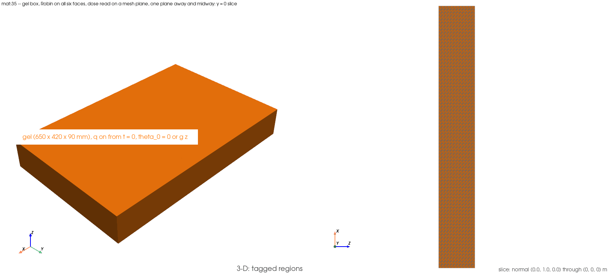

# `mat:35` — a dose read between two mesh planes is the interpolant's: the FEM dose of the sourced gel box on a mesh plane, one plane away and midway

Script: `examples/materials/35_gel_box_dose_between_mesh_planes.py` (`EX-173`)
Gate: `tests/validation/test_mat21_pre_equilibration_dose_plane.py` (`MAT-21` step 30 / P57, §9 item 742), with the FEM gate `tests/validation/test_mat21_pre_equilibration_dose_fem.py` (step 29, item 736) and the closed-form dose of `tests/validation/test_mat21_pre_equilibration_dose_closed_form.py` (step 27, item 727)

## 1. What this demonstrates

`mat:32` and `mat:34` print the FEM-vs-series dose gap at probes, and `mat:34` notes that the gap at ADJ_PT has the opposite sign to the one at P5.
Neither says where a probe sits against the mesh. This example makes that the subject. A CEM43 dose at a point is `cem43` on a history of
temperatures read from a P1 field at that point; between two mesh planes a P1 field is linear in z, so the value read is the linear interpolant of the two
plane values, not the series' value at the probe. Where the series is curved in z, those differ in sign and size.

The box is the finest rung of `MAT-21` step 1 (m = 6, 78 × 48 × 12 cells, 269 568 tetrahedra; Δz = C / 6 = 7.5 mm; Crank–Nicolson, N = 40 plus two
backward-Euler half-steps, to t\* = 0.2 t_C), the source on from t = 0. Two runs: the **reference** from uniform T∞ and **t_w = 0** from T∞ + g z with
g = 10 K/m. Each keeps the per-step history at three heights read as one fixed batch: `PLANE_PT` on a mesh plane (z = 5 C / 6), `ADJ_PT` one off-plane
height, and `MID_PT` midway between that plane and z = C. The dose of each history is printed beside the closed-form dose and beside the dose of the
series' own P1 interpolant between the two bracketing planes (z = 37.5 mm and 45 mm).

**Asserted** (bands imported from the gate chain, never restated; gate record `20261102T014720Z_MAT-21-step30-W1.log`, real build, `-n 2`; the run of record
is the `EX-173` closing window, complex build, `-n 2`; the digits below are the flagged `EX-173-figure` window's, `20261102T120845Z_EX-173-figure.log`,
Status 0, 73 s):

- (I) interior rel L2 at t\* against the superposition at t_w = 0: 1.125097e-03 ≤ `INTERIOR_BAND` = 1e-2 (gate 1.125097e-03).
- (E) balance 2.809e-12 (reference) and 2.664e-12 (t_w = 0) ≤ `E_BAND` = 1e-9, `source_power` = 49.14 W identical (the last digit moves at round-off between
  windows; read the bound).
- (Q-wf) `cem43` against the quadrature `_q_check_g` at `DOSE_BAR` = 1e-10 on all six histories (two runs at three heights): worst rel 3.880e-16 in the flagged
  window.
- (Grid) `PLANE_PT`'s z on a mesh plane and `MID_PT`'s midway, each ≤ `PLANE_BOUND` = 1e-12 of C (flagged window: 1.542e-16 C each; Δz / (C / 6) − 1 = 8.882e-16).
- (c-rep), asserted: `ADJ_PT`'s FEM doses reproduce item 736's at `REPRO_BOUND` = 1e-6: relative 3.208e-07 (reference) and 1.981e-07 (t_w = 0).
- (c-plane), asserted: the t_w = 0 dose at `PLANE_PT`, 1.422631e-10 s, misses the reference's 1.047364e-10 s by 3.5830e-01 > `DOSE_BAR` (gate record 3.5830e-01).

max |Im θ| = 0.

**Printed, not asserted: the signed gap at three heights.** FEM dose / series dose − 1 on the 41-row grid, beside the series' own P1 interpolant's gap
(the dose of the linear interpolant of the two plane histories, against the series at the probe), one rung and one Δt, no rate:

| height | reference | t_w = 0 | interpolant gap (ref / t_w = 0) | gap less the plane's (ref / t_w = 0) |
|---|---|---|---|---|
| `PLANE_PT` (on a plane) | +2.044e-03 | +3.402e-03 | 0 | 0 |
| `ADJ_PT` | −3.748e-03 | −7.068e-03 | −5.742e-03 / −1.039e-02 | −5.792e-03 / −1.047e-02 |
| `MID_PT` (midway) | −4.077e-03 | −7.621e-03 | −6.061e-03 / −1.093e-02 | −6.121e-03 / −1.102e-02 |

What the attribution rests on: **one rung, one Δt,** and an interpolant's gap that matches the off-plane differences (the gap less the plane's) to ≈ 1 %
(−5.742e-03 against −5.792e-03; −1.093e-02 against −1.102e-02; each of the four pairs differs by ≤ ≈ 1 %). On the plane the FEM history is the value
at a node and the gap is positive on both runs; one plane away and midway the sign flips, and the series' own interpolant shows the same flip. FEM dose divided by the interpolant's
dose less one is +2.0e-03 to +3.4e-03 at all three heights, nearly the plane's own gap.

**What is not addressed:** what sets the positive on-plane gap (+2.044e-03 and +3.402e-03). It is a record here. A dose at a point is `cem43` on a history read
through P1, so a sign at a probe is not by itself a solver error. Not claimed: a dose band, a rate, a recommended probe height, a cause for the on-plane gap.
Related: `mat:32`, `mat:34`.

## 2. How to run it

```
./scripts/run_examples.sh -e mat:35 -n 2 -t 300
```

The runner sources the complex DolfinX build for the `mat:` group. Tier: **standard**, `-n 2`. Verification runs go through the logging harness
with the runner's emitted command (`./scripts/run_examples.sh -e mat:35 -n 2 -t 300 --dry-run`). Add `-e FEM_EM_SETUP_FIGURES=1` after `exec -T` to
re-render the setup figure. Output:
`examples/materials/paraview_output/materials_35_gel_box_dose_between_mesh_planes_combined.xdmf`.

## Setup figure



`examples/materials/figures/materials_35_gel_box_dose_between_mesh_planes_setup.png`.
The m = 6 box (78 × 48 × 12 cells) cut at y = 0: one gel region, the source on in both runs, Robin on every face.

## 3. How to analyze it, step by step

**Step 1 — the two rises.** Open `examples/materials/paraview_output/materials_35_gel_box_dose_between_mesh_planes_combined.xdmf`. The complex build
writes `real_` / `imag_` splits (imaginary parts are zero). The fields are `theta_ref_t_star` and `theta_tw0_t_star`.

**Step 2 — the planes.** Cut a y = 0 slice and show the cell edges: the mesh has 12 layers in z, so planes sit Δz = 7.5 mm apart. `PLANE_PT` (x = y = 0, z = 37.5 mm) is on a plane, the plane below the top face's; `MID_PT` is at 41.25 mm, halfway to the top face.

**Step 3 — the read.** In each cell the P1 field is linear in z. Probe `real_theta_ref_t_star` along the vertical line x = y = 0 from 37.5 to 45 mm:
the straight segment is what a history at `MID_PT` is read from; the series at that height differs from it by the sub-cell offset the gate's printed ½ s (Δz − s) T″ estimates (s the distance to the lower plane).

**Step 4 — the dose.** The dose integrates the 41-step history, so the table's interpolant gap is the nonlinear image of that sub-cell offset
over the whole rise. It is the same offset at every step, which is why it is nearly independent of the run.

## Related

- `examples/materials/34_gel_box_wait_in_dose.md`
- `examples/materials/32_gel_box_wall_thermal_dose.md`
- `tests/validation/test_mat21_pre_equilibration_dose_plane.py`
