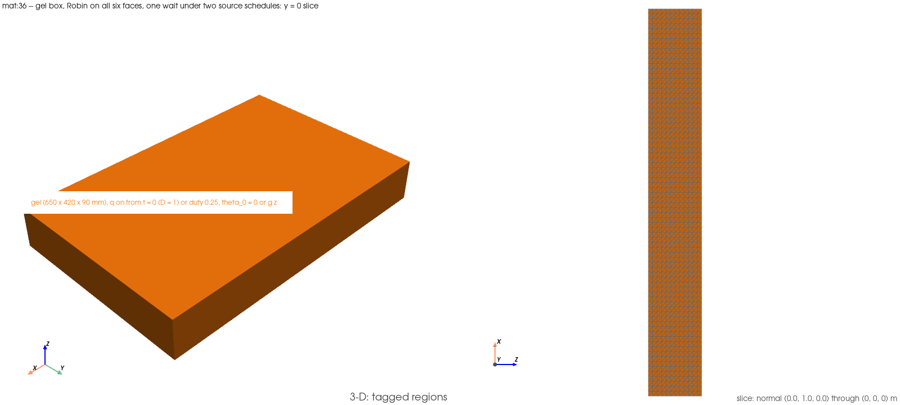

# `mat:36` — the same skipped wait under two schedules: the FEM dose of the sourced gel box at D = 1 and D = 0.25, reference against t_w = 0

Script: `examples/materials/36_gel_box_wait_across_schedules.py` (`EX-176`)
Gate: `tests/validation/test_mat21_pre_equilibration_duty_dose_fem.py` (`MAT-21` step 33 / P60, §9 item 747) for D = 0.25, with the FEM gate `tests/validation/test_mat21_pre_equilibration_dose_fem.py` (step 29, item 736) for D = 1; closed forms in `tests/validation/test_mat21_pre_equilibration_duty_dose_closed_form.py` (step 32, item 753) and `tests/validation/test_mat21_pre_equilibration_dose_closed_form.py` (step 27, item 727)

## 1. What this demonstrates

`mat:34` prices the skipped F2182 wait in CEM43 dose with the source on for the whole run (D = 1). Nothing compares that price across source schedules.
This example makes one such comparison: the same t_w = 0 start (the leftover gradient g z, g = 10 K/m) against the same reference (uniform T∞),
once under the continuous source and once under the D = 0.25 schedule of item 753 (11 on-steps of 41, the schedule string
`11100000011000000110000001100000011000000`, 705.375 s on in t\* = 2821.5 s, exactly one fourth).

The box is the finest rung of `MAT-21` step 1 (m = 6, 78 × 48 × 12 cells, 269 568 tetrahedra; Crank–Nicolson, N = 40 plus two backward-Euler half-steps).
Four runs: reference and t_w = 0 at D = 1, reference and t_w = 0 at D = 0.25. Each keeps the per-step history at P5 (the top-face probe) and `ADJ_PT` as one fixed batch.
The dose of each history is printed beside the closed-form dose.

A dose at D = 0.25 is **far smaller in absolute terms**: at P5 the reference dose falls from 9.538156e-11 s to 5.034932e-11 s (a factor ≈ 0.528), and the
t_w = 0 dose from 1.280187e-10 s to 6.947503e-11 s (≈ 0.543). The doses are tiny because the box stays far below 43 °C. So only the ratio
D(t_w = 0) / D_ref − 1 is compared across the schedules, and the ratio says how large the skipped wait is *relative to that schedule's own dose*. It does not say that
D = 0.25 is more dangerous in absolute dose (it is not, the absolute dose is smaller), and it does not say anything about any duty other than these two.

**Asserted** (bands imported from the gate chain, never restated; gate records `20261102T120219Z_MAT-21-step33-W1.log`; the run of record is the `EX-176` closing window,
complex build, `-n 2`; the digits below are the flagged `EX-176-figure` window's, `20261102T193939Z_EX-176-figure.log`, Status 0, 253 s; round-off terms are quoted as bounds):

- (I) interior rel L2 at t\* against the superposition: D = 1 t_w = 0 1.125097e-03; D = 0.25 reference 9.470800e-04; D = 0.25 t_w = 0 2.706223e-03; each ≤ `INTERIOR_BAND` = 1e-2 (gate 9.470800e-04 / 2.706223e-03).
- (E) balance ≤ `E_BAND` = 1e-9 on all four runs (flagged window: all four below 3e-12; read the bound), `source_power` = 49.14 W identical within each schedule.
- (S0) `_census` at `S0_BAND` = 1e-12 on both D = 0.25 runs (sum of χ·Δt 705.375 s against on-time 705.375 s) and the recorded multipliers equal the schedule string.
- (Q-wf) `cem43` against the quadrature `_q_check_g` at `DOSE_BAR` = 1e-10 on all eight histories: worst rel below 4e-16 in the flagged window.
- (c-dose), asserted: at each schedule the t_w = 0 dose at P5 misses the reference's by more than `DOSE_BAR`: D = 1, 3.4217e-01; D = 0.25, 3.7986e-01 (gate record 3.7986e-01).
- (c-cont), asserted: the continuous superposition misses (I) on the D = 0.25 t_w = 0 run by 7.4919e-01 > `INTERIOR_BAND` (gate ceiling 7.4919e-01): the duty sum, not the continuous one, is the comparand.

max |Im θ| = 0.

**Printed, not asserted: one wait, two schedules.** FEM D / D_ref − 1 beside the series', 41-row grid, one rung and one Δt, no rate:

| point | D | D_ref FEM (s) | D(t_w = 0) FEM (s) | FEM D / D_ref − 1 | series D / D_ref − 1 |
|---|---|---|---|---|---|
| P5 | 1 | 9.538156e-11 | 1.280187e-10 | +3.421741e-01 | +3.403563e-01 |
| P5 | 0.25 | 5.034932e-11 | 6.947503e-11 | +3.798604e-01 | +3.772126e-01 |
| `ADJ_PT` | 1 | 1.008673e-10 | 1.363467e-10 | +3.517432e-01 | +3.562631e-01 |
| `ADJ_PT` | 0.25 | 5.103933e-11 | 7.096430e-11 | +3.903847e-01 | +3.957192e-01 |

Read by hand from the table: going from D = 1 to D = 0.25 raises the FEM ratio by 3.769e-02 at P5 (0.3798604 − 0.3421741; the series 3.686e-02) and by 3.864e-02 at `ADJ_PT`
(the series 3.946e-02), that is by ≈ 11 % of the ratio itself at both points on both the FEM and the series. The FEM and the series carry the same sign of
this change at both points. The FEM-less-series ratio differs in sign between the points (P5 +1.818e-03 at D = 1 and +2.648e-03 at D = 0.25; `ADJ_PT` −4.520e-03 and −5.335e-03), the
mesh-plane effect of `mat:35`, here recorded and not re-diagnosed.

What the ratio does tell you: at this fixture the same leftover gradient costs a larger *fraction* of the dose under the duty-cycled source (FEM D / D_ref − 1 at P5 +3.798604e-01 at D = 0.25 against +3.421741e-01 at D = 1, closing log `[TABLE]`),
and the reference dose there is smaller (D_ref at P5 5.034932e-11 s against 9.538156e-11 s, same rows). Why the fraction is larger is a reading, not measured: the closing log prints no temperature bias. What it does not tell you: a rate, a recommended wait, a dose band, or any behaviour at another duty, another Δt, another rung or another g. **One rung, one Δt, this fixture's g.**
Related: `mat:33`, `mat:34`, `mat:35`.

## 2. How to run it

```
./scripts/run_examples.sh -e mat:36 -n 2 -t 480
```

The runner sources the complex DolfinX build for the `mat:` group. Tier: **heavy**, `-n 2`. Verification runs go through the logging harness
with the runner's emitted command (`./scripts/run_examples.sh -e mat:36 -n 2 -t 480 --dry-run`). Add `-e FEM_EM_SETUP_FIGURES=1` after `exec -T` to
re-render the setup figure. Output:
`examples/materials/paraview_output/materials_36_gel_box_wait_across_schedules_combined.xdmf`.

## Setup figure



`examples/materials/figures/materials_36_gel_box_wait_across_schedules_setup.png`.
The m = 6 box (78 × 48 × 12 cells) cut at y = 0: one gel region, the source on from t = 0 (D = 1) or on the 0.25 schedule, Robin on every face.

## 3. How to analyze it, step by step

**Step 1 — the four rises.** Open `examples/materials/paraview_output/materials_36_gel_box_wait_across_schedules_combined.xdmf`. The complex build
writes `real_` / `imag_` splits (imaginary parts are zero). The fields are `theta_d1_ref_t_star`, `theta_d1_tw0_t_star`, `theta_d25_ref_t_star` and `theta_d25_tw0_t_star`.

**Step 2 — the schedule.** The closing log carries doses, not rises: by arithmetic from its `[TABLE]`, the D = 0.25 reference dose is 0.528 of the D = 1 reference at P5 (5.034932e-11 / 9.538156e-11 = 0.5279) and 0.506 at `ADJ_PT` (5.103933e-11 / 1.008673e-10 = 0.5060), not a fourth. That the D = 0.25 rise at t\* is smaller than the D = 1 rise, and is not a fourth of it, is a reading, not measured: the duty sum is a signed sum of delayed rises. Probe both reference fields along x = y = 0.

**Step 3 — the leftover gradient.** Subtract each reference from its t_w = 0 field: the difference is the drift part, the same linear-in-z gradient decaying under both schedules, as the superposition says.

**Step 4 — the dose.** The dose integrates the 41-step history. The same drift reads as a larger fraction of the smaller D = 0.25 dose, which is what the table's ratio shows: FEM D / D_ref − 1 is +3.798604e-01 against +3.421741e-01 at P5 and +3.903847e-01 against +3.517432e-01 at `ADJ_PT` (D = 0.25 against D = 1). That the dose's nonlinearity in temperature is the cause is a reading, not measured.

## Related

- `examples/materials/33_gel_box_pre_equilibration_bias.md`
- `examples/materials/34_gel_box_wait_in_dose.md`
- `examples/materials/35_gel_box_dose_between_mesh_planes.md`
- `tests/validation/test_mat21_pre_equilibration_duty_dose_fem.py`
