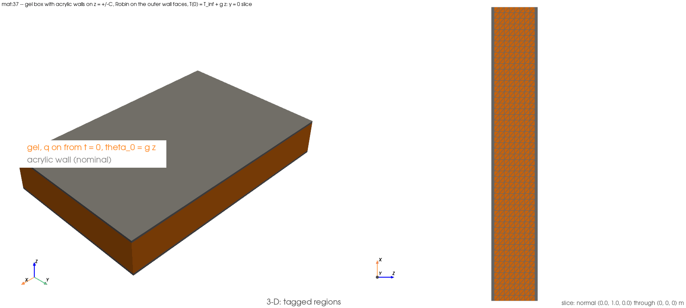

# `mat:37` — the skipped wait inside the walled box: what the wall's heat capacity adds to the drift

Script: `examples/materials/37_gel_box_wall_pre_equilibration_bias.py` (`EX-180`)
Gate: `tests/validation/test_mat21_wall_pre_equilibration_fem.py` (`MAT-21` step 36 / P63, §9 item 805), with the closed form of `tests/validation/test_mat21_wall_pre_equilibration_closed_form.py` (P62, §9 item 788) and item 682's two-layer series in `tests/validation/test_mat21_wall_transient_fem.py`

## 1. What this demonstrates

`mat:33` shows the skipped F2182 wait in the wall-free box. `mat:28`, `mat:30` and `mat:31` show the walled box with the source alone. None shows the
leftover gradient inside the wall. Here item 682's 1D-reduced walled box (the gel box with an acrylic wall of thickness d on z = ±C, Robin
h = 10 W/(m² K) on the outer wall faces, rung m = 4: 52 × 32 × 12 cells, 119 808 tetrahedra; Crank–Nicolson, N = 40 plus two backward-Euler
half-steps, Δt = 70.5375 s, to t\* = 2821.5 s) is run three times with the source on from t = 0:

- **R0**, the reference, from θ₀ = 0;
- **R1**, the wait skipped (t_w = 0): θ₀ = g z on every cell, gel and wall, g = 10 K/m (g C = 0.45 K);
- **R3**, R1 with the wall's ρc scaled by `MASSLESS` = 1e-9, a massless wall.

**What the comparand does and does not say.** P62's comparand for R1 is the h_eff drift `_drift_1d` plus item 682's two-layer series. It
treats the wall as a massless resistance *in the drift*: the wall's thickness and conductivity enter through h_eff, its heat capacity does not.
R3 is the case where that treatment is exact up to discretisation, because the meshed wall carries no heat capacity and *is* the resistance.
This example measures what the comparand leaves out on R1: the **FEM drift part** (R1 − R0) against `_drift_1d`, and R1 against R3, both
FEM against FEM.

(I) on R1 holds at 0.81 of the band on this fixture (8.105518e-03 against 1e-2, the ratio by arithmetic), **under a continuous source**. Under
a D = 0.25 duty cycle the same term was measured red (`20261104T061055Z_MAT-21-P65-W1.log`). Whether the comparand needs a wall-capacity term is
a question for the 11-04 weekly; this example does not settle it.

**One rung, one Δt, this fixture's g.** The wall's k and ρc are nominal PMMA values, citation owed (W3). The numbers below are records on this
fixture, not rates, and not a recommended wait.

**Asserted** (bands imported from the gate chain, never restated; run of record `20261104T104403Z_EX-180.log`, complex build, `-n 2`, 58 s
harness / 42.7 s in script; gate record `20261104T060527Z_MAT-21-P63-W1b.log`, item 805):

- (I) R1 interior rel L2 against `_drift_1d` + the two-layer series: 8.105518e-03 ≤ `INTERIOR_BAND` = 1e-2 (item 805: 8.105518e-03).
- (I-mw) R3 interior rel L2 against its exact comparand: 2.284679e-03 ≤ 1e-2 (item 805: 2.284679e-03).
- (E) balance 2.353e-13 (R0), 2.341e-13 (R1), 3.161e-13 (R3) ≤ `E_BAND` = 1e-9, with `source_power` = 49.14 W identical on all three.
- The unique-z precondition: worst relative 2.654e-15 ≤ `PRE_BAR` = 1e-13.
- R0's control reproduces item 682's t\* interior record, 2.244928e-03, to |Δ| = 1.008e-10 ≤ `REPRO_BOUND` = 5e-10.
- (c-wf), asserted: P51's wall-free series at H misses R1 by 2.1130e-02 > `INTERIOR_BAND` (item 805: 2.1130e-02).
- max |Im θ| = 0 on all three runs.

(I), (I-mw), the control and (c-wf) equal item 805's real-build records at the printed digits; (E) differs at round-off (item 805: 2.370e-13,
2.344e-13, 3.185e-13).

**Printed, not asserted: the wall-capacity term.** Drifts are R1 − R0 in kelvin, at t\*:

| point | FEM drift (R1 − R0) | `_drift_1d` | FEM − `_drift_1d` | R1 − R3 |
|---|---|---|---|---|
| P5 | +1.828983e-01 | +1.611619e-01 | +2.174e-02 | −6.931e-02 |
| `ADJ_PT` | +1.828894e-01 | +1.674396e-01 | +1.545e-02 | −5.664e-02 |
| P0 | +7.105427e-15 | 0 | +7.105e-15 | −1.042e-02 |

All entries equal item 805's real-build values at the printed digits (P0's drift entries are round-off, 7.105427e-15 here against item 805's
−1.776357e-14; both are zero to rounding). By arithmetic on the table, the term FEM − `_drift_1d` is 0.1349 of `_drift_1d` at P5 (0.02174 /
0.1611619) and 0.0923 at `ADJ_PT` (0.01545 / 0.1674396).

**What the R1 − R3 column is.** It is a difference of two full temperatures, so it carries the wall capacity's effect on the sourced rise as
well as on the drift. At P0 the drift is zero to rounding (the first row's FEM drift is 7.1e-15 K) yet R1 − R3 reads −1.042e-02 K. The column is
therefore not the drift's wall-capacity term; the FEM − `_drift_1d` column is the nearer reading of that, and it is also a record with no
comparand behind it. No band is set on either.

Not claimed: the D = 0.25 case (P65, open), a wall-capacity comparand, a rate, a recommended wait, a cited PMMA ρc.

## 2. How to run it

```
./scripts/run_examples.sh -e mat:37 -n 2 -t 480
```

The runner sources the complex DolfinX build for the `mat:` group. Tier: **heavy** by the weekly's label; measured 58 s harness wall at `-n 2`
(42.7 s in script, three solves of 5.8–6.0 s each). Verification runs go through the logging harness with the runner's emitted command. Add
`-e FEM_EM_SETUP_FIGURES=1` after `exec -T` to re-render the setup figure. Output:
`examples/materials/paraview_output/materials_37_gel_box_wall_pre_equilibration_bias_combined.xdmf`.

## Setup figure



`examples/materials/figures/materials_37_gel_box_wall_pre_equilibration_bias_setup.png`.
The m = 4 walled box cut at y = 0: the gel region and the acrylic wall layers on z = ±C.

## 3. How to analyze it, step by step

**Step 1 — the fields.** Open `examples/materials/paraview_output/materials_37_gel_box_wall_pre_equilibration_bias_combined.xdmf`. The complex build
writes `real_` / `imag_` splits (imaginary parts are zero). The fields are `theta_R0_t_star`, `theta_R1_t_star`, `theta_R3_t_star` and
`theta_comparand_R1` (the P62 comparand, interpolated to the output space).

**Step 2 — the drift.** Subtract `real_theta_R0_t_star` from `real_theta_R1_t_star` on a y = 0 slice: the leftover drift, odd in z, largest at the
top face. Along z at x = y = 0 its P5-region reading is the +1.8e-01 K in the table.

**Step 3 — the comparand.** Subtract `real_theta_comparand_R1` from `real_theta_R1_t_star`: the error that (I) measures, 8.1e-03 relative in the
interior. Compare the same difference for R3 against its own comparand, 2.3e-03.

**Step 4 — the massless wall.** Subtract `real_theta_R3_t_star` from `real_theta_R1_t_star` and compare it with Step 2: it is nonzero at P0, where
the drift is zero, which is the point of the note above.

## Related

- `examples/materials/28_gel_box_meshed_acrylic_wall.md`
- `examples/materials/30_gel_box_wall_heat_capacity_transient.md`
- `examples/materials/31_gel_box_wall_duty_cycled_transient.md`
- `examples/materials/33_gel_box_pre_equilibration_bias.md`
- `tests/validation/test_mat21_wall_pre_equilibration_fem.py`
