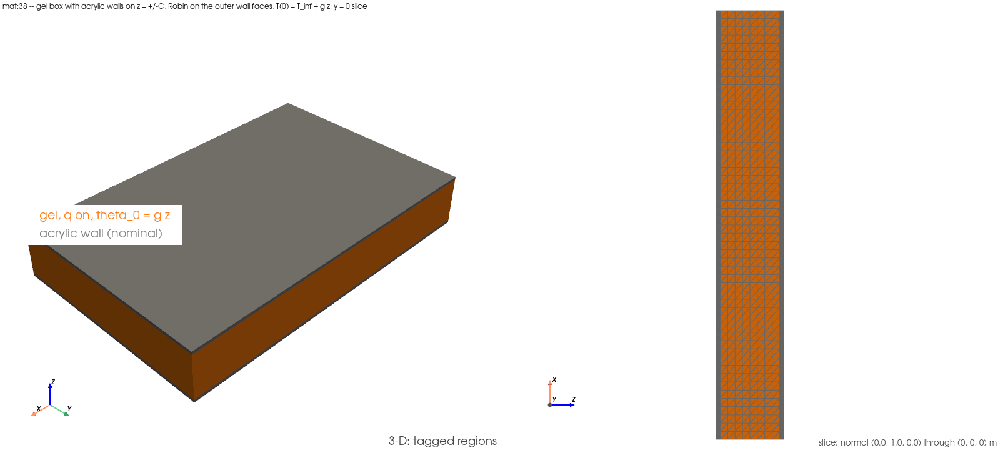

# `mat:38` — the drift through a wall with heat capacity: the composite comparand against the FEM

Script: `examples/materials/38_gel_box_wall_capacity_drift.py` (`EX-183`)
Gate: `tests/validation/test_mat21_wall_capacity_drift_fem.py` (`MAT-21` step 38 / P69, §9 item 836), with the composite closed form of `tests/validation/test_mat21_wall_capacity_drift_closed_form.py` (P67) and item 682's two-layer series in `tests/validation/test_mat21_wall_transient_fem.py`

## 1. What this demonstrates

`mat:37` shows the drift inside the walled box against P62's comparand, which treats the wall as a massless resistance (`_drift_1d`). P62's comparand
carries the wall's thickness and conductivity through h_eff and leaves its heat capacity out. P67's two-layer composite slab carries the wall's heat
capacity. This example runs item 836's fixture (item 682's 1D-reduced walled box: acrylic wall on z = ±C, Robin h = 10 W/(m² K) on the outer wall faces,
m = 4, 119 808 tetrahedra; Crank–Nicolson with two backward-Euler half-steps, Δt = 70.5375 s, t\* = 2821.5 s, T_C = 14 107.5 s) three times:

- **R0**, from θ₀ = 0, source on from t = 0, to t\*;
- **R1**, t_w = 0: θ₀ = g z on every cell, gel and wall, g = 10 K/m (g C = 0.45 K), to t\*;
- **R2**, t_w = T_C: θ₀ = g z, source off on [0, T_C), then on, to T_C + t\* (240 steps, 200 of them off).

R1 and R2 are compared with item 682's series `s_w` plus the composite drift at t\* / T_C + t\*, and with the massless comparand for the same two runs.

**The point, from the measured values.** On R1 the composite brings (I) from 8.105518e-03 (massless comparand) to 2.639057e-03; by arithmetic on those
two numbers, a factor of 3.07. On R2 the two comparands are already close: 2.415575e-03 (massless) against 2.258920e-03 (composite). On this fixture the
composite brings R1's (I) to ≈ 1.18 × the FEM's own floor, R0's 2.244928e-03 (1.176 in the log), and R2's to 1.006 ×.

**One rung, one Δt, this fixture's g.** The wall's k and ρc are nominal PMMA values, citation owed (W3). The numbers below are records on this fixture,
not rates, not a recommended wait, and not a statement about the six-wall box or the D = 0.25 dose.

**Asserted** (bands imported from the gate chain, never restated; run of record `20261106T015820Z_EX-183.log`, complex build, `-n 2`, 38 s harness /
35.3 s in script):

- (I) interior rel L2 against the composite: R1 2.639057e-03, R2 2.258920e-03, both ≤ `INTERIOR_BAND` = 1e-2. Item 836's real-build records are
  2.639057e-03 / 2.258920e-03; equal at the printed digits.
- (E) balance 2.371e-13 (R0), 2.328e-13 (R1), 2.156e-13 (R2) ≤ `E_BAND` = 1e-9, with `source_power` = 49.14 W identical on all three.
- (S0) on R2: 1.612e-16 ≤ `S0_BAND` = 1e-12.
- The unique-z precondition: worst relative 1.338e-15 ≤ `PRE_BAR` = 1e-13.
- R0's control reproduces item 682's t\* interior record, 2.244928e-03, to |Δ| = 1.008e-10 ≤ `REPRO_BOUND` = 5e-10.
- (c-ser), asserted: the series alone (no drift) misses R1 by 1.053822e-01 > `INTERIOR_BAND`. The script's label says the size was *predicted* at about
  0.17 from the P69 pointwise ratio (the composite / series ratio at P5 and `ADJ_PT`); the measured interior L2 is 0.105. The prediction was of a different
  quantity (a pointwise ratio at two points, not an interior L2), and it was wrong in size; the assertion only needs "above the band" and holds by a factor of 10.5.
- max |Im θ| = 0 on all three runs.

(E) differs from item 836's real-build values at round-off (the brief names item 836's worst as ≤ 2.370e-13); everything else asserted equals its record.

**Printed, not asserted.** Drifts are Rk − R0 in kelvin, at t\* (R1) and T_C + t\* (R2):

| run | point | FEM drift | composite | FEM − composite |
|---|---|---|---|---|
| R1 | P5 | +1.828983e-01 | +1.819866e-01 | +9.117e-04 |
| R1 | `ADJ_PT` | +1.828894e-01 | +1.865695e-01 | −3.680e-03 |
| R1 | P0 | 0 | 0 | 0 |
| R2 | P5 | +6.721520e-03 | +7.017981e-03 | −2.965e-04 |
| R2 | `ADJ_PT` | +6.729312e-03 | +7.201509e-03 | −4.722e-04 |
| R2 | P0 | +1.777806e-05 | 0 | +1.778e-05 |

By arithmetic on the table, the composite is within 0.5 % of the FEM drift at R1's P5 (0.0009117 / 0.1828983) and 2.0 % at `ADJ_PT`; the residual is
signed and changes sign between the two points. R2's drift is 3.7 % of R1's at P5 (0.006721520 / 0.1828983). R2's P0 entry is 1.8e-05 K, not
round-off, while the composite there is exactly zero; no band is set on any of these. The R1 P0 FEM entry reads 0 in this window.

Not claimed: the six-wall box, a rate, a recommended wait, a cited PMMA ρc, the D = 0.25 dose.

## 2. How to run it

```
./scripts/run_examples.sh -e mat:38 -n 2 -t 480
```

The runner sources the complex DolfinX build for the `mat:` group. Tier: **heavy** by the weekly's label; measured 38 s harness wall at `-n 2`
(35.3 s in script; solves of 4.2 s, 4.1 s and 14.8 s). Verification runs go through the logging harness with the runner's emitted command. Add
`-e FEM_EM_SETUP_FIGURES=1` after `exec -T` to re-render the setup figure. Output:
`examples/materials/paraview_output/materials_38_gel_box_wall_capacity_drift_combined.xdmf`.

## Setup figure



`examples/materials/figures/materials_38_gel_box_wall_capacity_drift_setup.png`.
The m = 4 walled box cut at y = 0: the gel region and the acrylic wall layers on z = ±C.

## 3. How to analyze it, step by step

**Step 1 — the fields.** Open `examples/materials/paraview_output/materials_38_gel_box_wall_capacity_drift_combined.xdmf`. The complex build writes
`real_` / `imag_` splits (imaginary parts are zero). The fields are `theta_R1_t_star` and `theta_comparand_R1` (series plus composite drift,
interpolated to the output space).

**Step 2 — the error (I) measures.** Subtract `real_theta_comparand_R1` from `real_theta_R1_t_star` on a y = 0 slice: the interior relative L2 of
that difference is 2.639057e-03.

**Step 3 — where it sits.** The largest differences in the drift table are at `ADJ_PT` (−3.680e-03 K on R1); compare with the R0 floor,
2.244928e-03 relative (R0's own interior miss against the series, the FEM's floor on this fixture).

## Related

- `examples/materials/33_gel_box_pre_equilibration_bias.md`
- `examples/materials/37_gel_box_wall_pre_equilibration_bias.md`
- `examples/materials/28_gel_box_meshed_acrylic_wall.md`
- `tests/validation/test_mat21_wall_capacity_drift_fem.py`
