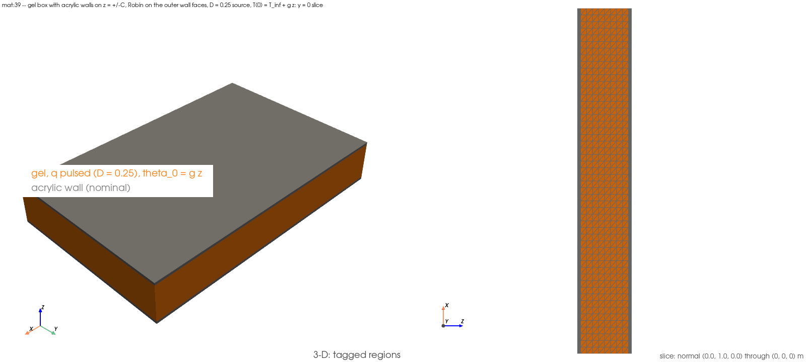

# `mat:39` — the D = 0.25 dose under the capacitive wall: closed form and FEM

Script: `examples/materials/39_gel_box_wall_capacity_dose.py` (`EX-186`)
Gate: `tests/validation/test_mat21_wall_capacity_duty25_dose_closed_form.py` (`MAT-21` step 39 / P70, §9 item 834) for the closed form, and `tests/validation/test_mat21_wall_pre_equilibration_duty25_dose_fem.py` (P68, §9 item 835) for the FEM

## 1. What this demonstrates

`mat:38` shows the drift through a wall with heat capacity and says plainly that the D = 0.25 dose is not its claim. This page is that claim: the CEM43 thermal dose
(`cem43`) under the duty cycle D = 0.25 (schedule `11100000011000000110000001100000011000000`, 41 multipliers: 40 steps and the two startup half-steps) on item 682's 1D-reduced walled gel box
(acrylic wall on z = ±C, Robin on the outer wall faces, m = 4, 119 808 tetrahedra, Crank–Nicolson with two backward-Euler half-steps, Δt = 70.5375 s,
t\* = 2821.5 s), started from the drifted initial state θ₀ = g z (g = 10 K/m) with the wait t_w = 0.

Two halves on one page.

- **The closed form (numpy, P70's helpers).** The walled uniform sum for D = 0.25 plus the composite (capacitive-wall) drift, at P5 (z = C), `ADJ_PT` (0.9 C) and
  P0 (z = 0), for t_w ∈ {0, T_C}. The massless-wall form (`_drift_1d`) and P64's six-face h_eff form sit beside it.
- **The FEM (P68's run body, written out here).** The reference run (θ₀ = 0) and the t_w = 0 run (θ₀ = g z), both under D = 0.25 to t\*, every snapshot read at
  P5 and `ADJ_PT`.

**The point, from the measured values.** At P5 with t_w = 0 the composite-drift dose is 7.219294348e-11 s and the massless-wall dose is 6.959751148e-11 s; the wall's
heat capacity raises the dose by ≈ 3.7 % (+3.7292e-02 in the log). The FEM dose at P5 is 7.253626e-11 s: +4.2225e-02 over the massless form, +4.7556e-03 over the
composite. By arithmetic on those two, 1.037292 × 1.0047556 = 1.04222, so on this fixture the wall's heat capacity carries ≈ 3.7 of the ≈ 4.2 % FEM-versus-massless
gap, and the rest, ≈ 0.48 %, is the size of the FEM's own point error (the interior floor on this fixture is 1.85e-03 relative, the reference run's (I)).

**Split of the drift.** On `T_GRID` at P5 and `ADJ_PT` the geometry term (six-face versus z-only h_eff) is at most 1.961e-04 K at t_w = 0, and the capacity term
(composite versus z-only) at most 3.684e-02 K: by arithmetic, ≈ 188 × larger. At t_w = T_C they are 5.345e-06 K and 3.567e-03 K.

**One rung, one Δt, 1D-reduced.** The wall's k and ρc are nominal PMMA values, citation owed (W3). The numbers are records on this fixture, not rates, not a
recommended wait, and not a statement about the six-wall box or a tissue dose.

**Asserted** (all gates collected first: 51 collected; bands imported from the gate chain, never restated; run of record the closing `EX-186` harness log, complex build, `-n 2`):

- P70's anchors, through its helpers: the vectorised `_drift_cap_z` against the scalar `_drift_cap` ≤ 1e-12; (Q-d) worst 3.581e-16 ≤ `DOSE_BAR` = 1e-10 with the R-swap
  control's least miss 6.1904e+06; (Win-d) worst 1.470e-15 ≤ `AVG_BAR` = 1e-12; (D50-cf) worst 4.441e-16 ≤ `DOSE_BAR` with the drop-run-0 control's least miss
  5.1492e-01 (all > 1e-10, asserted).
- The control (factor 1, the gate's own band): the massless-wall dose misses the composite dose at P5, t_w = 0, by 3.5951e-02 > `DOSE_BAR`.
- FEM (I) on the t_w = 0 run against the composite drift: 5.513765e-03 ≤ `INTERIOR_BAND` = 1e-2 (P68's record, equal at the printed digits); the reference run's
  (I) is 1.849599e-03. The control, the continuous comparand on the t_w = 0 run, misses by 7.4785e-01 > `INTERIOR_BAND`.
- (E) below 3e-13 on both runs (a round-off term, quoted as a bound), ≤ `E_BAND` = 1e-9, `source_power` 49.14 W identical; (S0) the census sum χΔt equals the on-time exactly on both runs.
- (Q-wf) `cem43` against `_q_check_g`'s quadrature at `DOSE_BAR` on all four histories (worst below 1e-15, a round-off bound); the FEM t_w = 0 dose misses the reference run's at P5 by 4.6009e-01.
- The unique-z precondition below 1e-14 (round-off bound), ≤ `PRE_BAR` = 1e-13; max |Im θ| = 0.

**Printed, not asserted.**

| point | D_ref (s) | D(0) (s) | D(T_C) (s) | D(0)/D_ref − 1 | D(T_C)/D_ref − 1 |
|---|---|---|---|---|---|
| P5 | 4.962978e-11 | 7.219294e-11 | 5.030160e-11 | +4.546295e-01 | +1.353663e-02 |
| `ADJ_PT` | 5.051870e-11 | 7.360929e-11 | 5.121991e-11 | +4.570702e-01 | +1.388012e-02 |
| P0 | 5.280312e-11 | 5.280312e-11 | 5.280312e-11 | 0 | 0 |

Same quantity for the six-face h_eff form at P5: D(0)/D_ref − 1 = +4.023270e-01, D(T_C)/D_ref − 1 = +9.700252e-03; the z-only form: +4.023337e-01 and +9.706384e-03.
FEM / composite − 1 at P5 reads +4.7556e-03 here; P70's brief quotes +4.7555e-03 against P65's rounded 7.253626e-11 s (a last-digit rounding of the same ratio). I0h, the
t_w = 0 run against the h_eff comparand, reproduces P68's 2.942439114e-02.

Not claimed: the six-wall box, a dose band, a recommended wait, a cited PMMA ρc, a tissue dose.

## 2. How to run it

```
./scripts/run_examples.sh -e mat:39 -n 2 -t 480
```

The runner sources the complex DolfinX build for the `mat:` group. Tier: **heavy** by the weekly's label; the script takes ≈ 30 s at `-n 2` (solves of ≈ 8 s each, the
closed-form half is numpy). Verification runs go through the logging harness with the runner's emitted command. Add `-e FEM_EM_SETUP_FIGURES=1` after `exec -T` to
re-render the setup figure. Output:
`examples/materials/paraview_output/materials_39_gel_box_wall_capacity_dose_combined.xdmf`.

## Setup figure



`examples/materials/figures/materials_39_gel_box_wall_capacity_dose_setup.png`.
The m = 4 walled box cut at y = 0: the gel region (pulsed source, θ₀ = g z) and the acrylic wall layers on z = ±C.

## 3. How to analyze it, step by step

**Step 1 — the fields.** Open `examples/materials/paraview_output/materials_39_gel_box_wall_capacity_dose_combined.xdmf`. The complex build writes `real_` / `imag_`
splits (imaginary parts are zero). The fields are `theta_tw0_t_star` (the t_w = 0 run at t\*) and `theta_comparand_tw0` (the walled D = 0.25 sum plus the composite
drift).

**Step 2 — the error (I) measures.** Subtract `real_theta_comparand_tw0` from `real_theta_tw0_t_star` on a y = 0 slice: the interior relative L2 of that difference
is 5.513765e-03.

**Step 3 — the dose.** The dose is a history integral, so the field at t\* is not enough: the printed table is the history at three heights through `cem43`. Compare the
D(0) column of the table with the FEM dose at P5, 7.253626e-11 s.

## Related

- `examples/materials/38_gel_box_wall_capacity_drift.md`
- `examples/materials/37_gel_box_wall_pre_equilibration_bias.md`
- `examples/materials/35_gel_box_dose_between_mesh_planes.md`
- `examples/materials/36_gel_box_wait_across_schedules.md`
- `tests/validation/test_mat21_wall_capacity_duty25_dose_closed_form.py`
- `tests/validation/test_mat21_wall_pre_equilibration_duty25_dose_fem.py`
