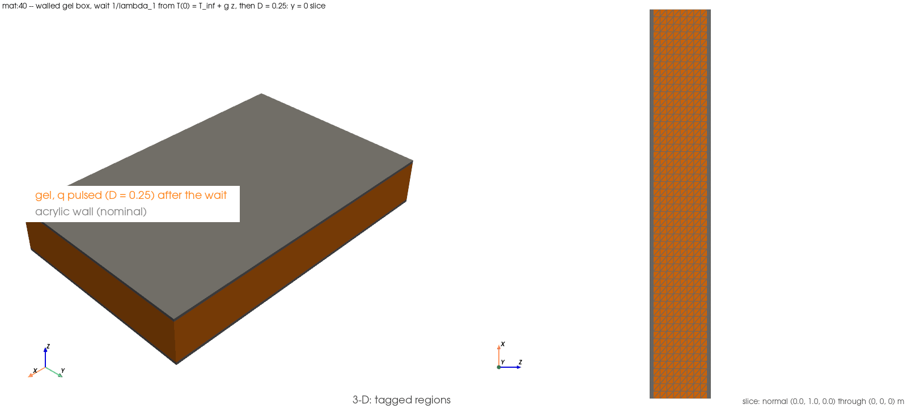

# `mat:40` — the D = 0.25 dose against the wait, with the wall's heat capacity: closed form and one FEM point

Script: `examples/materials/40_gel_box_wall_capacity_dose_vs_wait.py` (`EX-189`)
Gate: `tests/validation/test_mat21_wall_capacity_dose_sweep_closed_form.py` (`MAT-21` step 41 / P73, §9 item 875) for the closed form, and `tests/validation/test_mat21_wall_pre_equilibration_duty25_dose_fem.py` with its `FEM_EM_MAT21_P74_WAIT` knob (`MAT-21` step 41b / P74, §9 item 885) for the FEM

## 1. What this demonstrates

`mat:39` shows the D = 0.25 dose under the capacitive wall at the waits t_w ∈ {0, T_C}, with the FEM at t_w = 0 only. This page shows how that dose moves **across the wait**: the CEM43
dose (`cem43`) at D = 0.25 on item 682's 1D-reduced walled gel box (acrylic wall on z = ±C, Robin on the outer wall faces, m = 4, 119 808 tetrahedra, Δt = 70.5375 s, t\* = 2821.5 s),
started from the drifted state θ₀ = g z (g = 10 K/m) and left to relax with the source off for t_w ∈ {0, 0.5, 1, 2}/λ₁ before the pulsed source starts (λ₁ the composite's slowest odd
rate; 1/λ₁ = 4340.767431 s). The composite drift (the wall's heat capacity in) sits beside the massless-wall drift (`_drift_1d`). One FEM point, at t_w = 1/λ₁, closes the page.

Two halves.

- **The closed form (numpy, P73's helpers).** The composite-drift dose, the massless-wall dose and their ratio at P5 (z = C), `ADJ_PT` (0.9 C) and P0 (z = 0, the odd drift's node), at the four waits.
- **The FEM (P74's run, written out here).** The reference run (θ₀ = 0) and `tw1`: (a) a 62-step source-off wait of 70.012378 s steps from θ₀ = g z, then (b) the D = 0.25 call from (a)'s end temperature.
  Every snapshot of the reference run and of (b) is read at P5 and `ADJ_PT`.

**The point, from the measured values.** At P5 the composite-drift dose over the massless-wall dose, minus one, reads +3.7292e-02, +2.6602e-02, +1.9908e-02 and +1.0069e-02 at t_w = 0, 0.5, 1 and
2 /λ₁. At `ADJ_PT` the same ratio reads +2.9425e-02, +2.4685e-02, +1.8969e-02 and +9.8366e-03. So the wall's heat capacity adds ≈ 3.7 % to the P5 dose at the start and the excess shrinks as the drift decays:
by arithmetic on those four numbers, the excess at 2/λ₁ is ≈ 0.27 of the one at t_w = 0 (1.0069 / 3.7292). The composite-drift dose itself falls with the wait at P5 and `ADJ_PT`, one sign
(decreasing) at all three steps, each step's |ΔD|/D being 1.5031e-01, 8.0575e-02 and 7.7715e-02 at P5; at P0, the odd drift's node, the dose is constant in the wait, max |D/D(0) − 1| = 0.

At t_w = 1/λ₁ the FEM dose at P5 is 5.642660e-11 s, beside the closed form's 5.639897e-11 s: FEM / series − 1 = +4.8995e-04, against +4.756e-03 at t_w = 0 (P68's record, printed beside).
By arithmetic, 1.019908 × 1.00048995 = 1.020408, which is the log's FEM / massless − 1 of +2.0408e-02: at that wait the wall's heat capacity carries ≈ 1.99 of the ≈ 2.04 % gap between the FEM and the massless-wall form.

**FEM against the closed form (I).** The interior relative L2 of the tw1 run at t\* against the composite drift evaluated at t\* + 1/λ₁ is 4.712673e-03, ≤ `INTERIOR_BAND` = 1e-2 (item 885 pre-registered
[1.8e-03, 5.6e-03]). The reference run's (I) reproduces P68's 1.849599e-03.

**One rung, one Δt, 1D-reduced.** The wall's k and ρc are nominal PMMA values, citation owed (W3). The numbers are records on this fixture, not rates, not a recommended wait or thickness, not a
statement about the six-wall box or a tissue dose.

**Asserted** (all gates collected first: 85 collected; bands imported from the gate chain, never restated; run of record the closing `EX-189` harness log, complex build, `-n 2`):

- P73's anchors, through its helpers: (Lim) the t_w = 0 dose equals P70's construction at the three points (relative miss 0, band `B1_BAND` = 1e-12) and reproduces P70's printed digits; (Mono) as above; (Q-d) worst 3.581e-16
  ≤ `DOSE_BAR` = 1e-10 with the R-swap control's least miss 6.1904e+06; (Win-d) worst 1.470e-15 ≤ `AVG_BAR` = 1e-12.
- The control (factor 1, the gate's own band): the massless-wall dose misses the composite dose at P5 at every wait, by 3.5951e-02, 2.5912e-02, 1.9520e-02 and 9.9685e-03, all > `DOSE_BAR`.
- FEM: (I) as above; (E) below 2e-13 on the reference run and on both tw1 calls (a round-off term, quoted as a bound), ≤ `E_BAND` = 1e-9; the hand-off, max |snapshot 0 of (b) − T(a)| = 0 K ≤ 1e-12;
  (S0) the census sum χΔt equals the on-time exactly, and (a)'s multipliers are all 0; (Q-wf) `cem43` against `_q_check_g`'s quadrature below 6e-16 on all four histories (a round-off bound), ≤ `DOSE_BAR`;
  the unique-z precondition below 1e-14, ≤ `PRE_BAR` = 1e-13; max |Im θ| = 0.
- Controls: (c-tw) tw1 against the t_w = 0 comparand misses (I) by 2.5314e-01 > `INTERIOR_BAND`; (c-D) the FEM dose at P5 at t_w = 1/λ₁ misses P68's t_w = 0 record 7.253626e-11 s by 2.2209e-01 > `DOSE_BAR`.

**Printed, not asserted.** The composite-drift dose by wait (D_ref is the dose with no drift):

| point | D_ref (s) | D(0) (s) | D(0.5/λ₁) (s) | D(1/λ₁) (s) | D(2/λ₁) (s) |
|---|---|---|---|---|---|
| P5 | 4.962978e-11 | 7.219294e-11 | 6.134160e-11 | 5.639897e-11 | 5.201591e-11 |
| `ADJ_PT` | 5.051870e-11 | 7.360929e-11 | 6.276671e-11 | 5.759450e-11 | 5.301030e-11 |
| P0 | 5.280312e-11 | 5.280312e-11 | 5.280312e-11 | 5.280312e-11 | 5.280312e-11 |

D(t_w)/D_ref − 1 at P5 reads +4.546295e-01, +2.359837e-01, +1.363937e-01 and +4.807859e-02. The massless-wall doses at P5 are 6.959751e-11, 5.975210e-11, 5.529808e-11 and 5.149739e-11 s.
The FEM reference-run dose at P5 is 4.967923e-11 s (tw1 / reference − 1 = +1.358188e-01).

The thickness side table, the gate heading's reading, printed only (t_w = 0, wall thickness d): d = 0.5 D_WALL (0.0030 m) gives a P5 dose of 7.074996e-11 s, −1.998791e-02 against the base wall; d = 2 D_WALL (0.0120 m) gives
7.495126e-11 s, +3.820758e-02. Its λ₁ column reads 2.463043e-04, 2.303740e-04 and 2.061913e-04 /s for d = 0.5, 1, 2 D_WALL. No thickness is recommended.

Not claimed: the six-wall box, a dose band, a recommended wait or thickness, a cited PMMA ρc, a tissue dose.

## 2. How to run it

```
./scripts/run_examples.sh -e mat:40 -n 2 -t 480
```

The runner sources the complex DolfinX build for the `mat:` group. Tier: **heavy** by the weekly's label; the script takes ≈ 30 s at `-n 2` (three solves of ≈ 5–8 s each; the closed-form half is
numpy). Verification runs go through the logging harness with the runner's emitted command. Add `-e FEM_EM_SETUP_FIGURES=1` after `exec -T` to re-render the setup figure. Output:
`examples/materials/paraview_output/materials_40_gel_box_wall_capacity_dose_vs_wait_combined.xdmf`.

## Setup figure



`examples/materials/figures/materials_40_gel_box_wall_capacity_dose_vs_wait_setup.png`.
The m = 4 walled box cut at y = 0: the gel region (pulsed source after the wait, θ₀ = g z) and the acrylic wall layers on z = ±C.

## 3. How to analyze it, step by step

**Step 1 — the fields.** Open `examples/materials/paraview_output/materials_40_gel_box_wall_capacity_dose_vs_wait_combined.xdmf`. The complex build writes `real_` / `imag_`
splits (imaginary parts are zero). The fields are `theta_tw1_t_star` (the tw1 run at t\*) and `theta_comparand_tw1` (the walled D = 0.25 sum plus the composite
drift at t\* + 1/λ₁).

**Step 2 — the error (I) measures.** Subtract `real_theta_comparand_tw1` from `real_theta_tw1_t_star` on a y = 0 slice: the interior relative L2 of that difference
is 4.712673e-03.

**Step 3 — the dose.** The dose is a history integral, so the field at t\* is not enough: the printed tables are the histories at three heights through `cem43`. Compare the
D(1/λ₁) column at P5, 5.639897e-11 s, with the FEM dose there, 5.642660e-11 s.

## Related

- `examples/materials/39_gel_box_wall_capacity_dose.md`
- `examples/materials/38_gel_box_wall_capacity_drift.md`
- `examples/materials/36_gel_box_wait_across_schedules.md`
- `examples/materials/37_gel_box_wall_pre_equilibration_bias.md`
- `tests/validation/test_mat21_wall_capacity_dose_sweep_closed_form.py`
- `tests/validation/test_mat21_wall_pre_equilibration_duty25_dose_fem.py`
