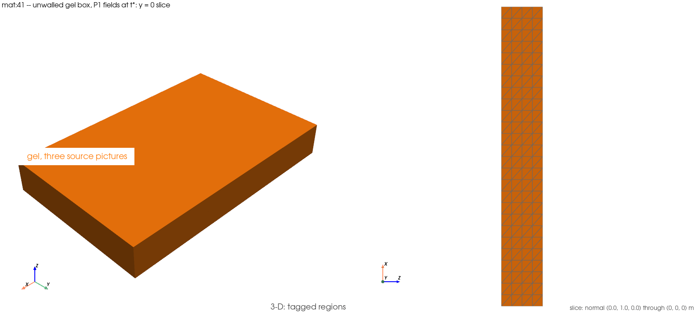

# `mat:41` — entry 59's readout points under three closed-form SAR pictures, per deposited watt

Script: `examples/materials/41_gel_box_readout_points_three_sar_pictures.py` (`EX-192`)
Gate: `tests/validation/test_mat21_wall_uniform_source_probe_points_closed_form.py` (`MAT-21` step 42 / P75, §9 item 876), `tests/validation/test_mat21_eddy_source_probe_points_closed_form.py` (step 44 / P80, §9 item 913) and `tests/validation/test_mat21_end_source_probe_points_closed_form.py` (step 45 / P81, §9 item 921)

## 1. What this demonstrates

`mat:23` shows the eddy source's FEM and `mat:25` its duty-cycled FEM at the six F2182 probe points, with the uniform series as a control. Neither shows C6's 18-point lattice (the one that holds c\*),
the end-weighted source at the probes, or entry 52's SAR10g shape beside the closed-form ball shapes. This page does. It is a closed-form page: there is no solve. The case is the **unwalled six-face gel box,
continuous source, at t\* = 2 821.5 s**. The box is a tetrahedral `create_box` mesh (26, 16, 4 cells, 9 984 tetrahedra, step 3's m = 2) that carries three P1 fields: the uniform series (P75's U3), P36's eddy source (P80)
and step 6's end-weighted source (P81), each interpolated from its series. All 24 readout points (the six probes and the 18 lattice points) are mesh vertices.

**One watt in all three.** The three sources deposit the same watt, P_dep = 49.140000 W (the (P-eq) gate, |ratio − 1| = 0 for both the eddy and the end-weighted source), so each column is θ(t\*) **per deposited gel watt**.
Entry 59 is per accepted watt (θ_acc = θ · P_gel / P_acc); entry 59's own figures are not on the page (P76 reads them after 11-10).

**How far apart the pictures sit at the six probes** (θ per W at t\*, K/W, from the `[TABLE-6]` lines of the closing log):

| probe | U3 | eddy | end | eddy / U3 | end / U3 |
|---|---|---|---|---|---|
| P0 centre | 0.02718146 | 0.001291536 | 0.000504627 | 0.04751531 | 0.01856511 |
| P1 / P2 ±y wall | 0.02160819 | 0.053883 | 0.0003831722 | 2.493637 | 0.01773273 |
| P3 / P4 ±x wall | 0.02160517 | 0.000983462 | 0.04279895 | 0.04551975 | 1.980959 |
| P5 top face | 0.02182225 | 0.002039414 | 0.0003894897 | 0.09345574 | 0.01784828 |

So the uniform picture is the largest of the three at the centre and the top face; the eddy picture is the largest at the ±y walls, ≈ 2.5 times the uniform one; the end-weighted picture is the largest at the ±x walls,
≈ 2.0 times the uniform one, and ≈ 0.018 of it elsewhere. At a probe the largest picture over the smallest is ≈ 53.9 (P0), ≈ 140.6 (P1 / P2), ≈ 43.5 (P3 / P4) and ≈ 56.0 (P5), hand arithmetic on the table's columns, so the readout point decides which picture a measured value is nearest.
The ±y and ±x pairs agree with each other by symmetry (the table prints identical values for P1 / P2 and for P3 / P4).

**The lattice.** C6's 18 points sit at mid-depth (c = 0) on a 3 × 6 grid of x ∈ {−105, 0, +105} mm by dz ∈ {±50, ±150, ±250} mm, where dz is the box's long axis. The lattice rows of the closing log
(`[TABLE-18]`) print, for each label, the three θ per W at t\*, the eddy and end-weighted 10 g-ball mean shapes over their value at c\* (`x-105mm dz-50mm`), and entry 52's SAR10g / SAR10g(c\*).
Reading the printed columns: the uniform θ/W is flat across the lattice (0.02717682 to 0.02718147); the eddy θ/W has essentially no dz dependence, 0.02077881 to 0.02078249 at x = ±105 mm and 0.00129117 to 0.001291536 at x = 0;
the end-weighted θ/W rises with |dz|, from 0.00356031 at dz = ±50 mm to 0.04714028 at dz = ±250 mm at x = ±105 mm, a factor of ≈ 13.24 (0.04714028 / 0.00356031, hand arithmetic on two log values).
The end-weighted ball-mean shape reads 1, 7.582 and 15.06 at dz = ±50, ±150 and ±250 mm; the eddy ball-mean shape reads 1 at x = ±105 mm and 0.006439 at x = 0 for every dz.
The x+0mm column ratios dz-50 / dz-250 and dz-150 / dz-250 are 0.0664 and 0.5035 for the end-weighted ball mean and 1.0000 and 1.0000 for the eddy ball mean; entry 52's SAR10g on the same column reads
0.1040 / 0.6388 on the − side and 0.0945 / 0.6266 on the + side.

**Entry 52's shape is printed beside the closed-form ball shapes, and none is fitted to it.** On the x = 0 column entry 52 rises with |dz| as the end-weighted shape does; on the x = −105 mm column it falls with |dz|
(1, 0.8367, 0.5726 at dz = −50, −150, −250 mm) where the end-weighted shape rises and the eddy shape is flat. The page reads no more into that: it is a side-by-side print, not a fit and not a statement of which
picture entry 59 follows.

**Asserted** (all gates collected first: 29 collected; bands imported from the gate chain, never restated; run of record the closing `EX-192` harness log, complex build, `-n 2`):

- P80's gates re-asserted on the page through its helpers: (P-eq); (Q2-p) the unit-weight member is P75's U3 bitwise; (Rep-s) the six θ_s(t\*) strings equal `p80.THETA_TSTAR`; (Lim) the 1000 T_C transient against the quadratic steady
  value, 4.872e-16 ≤ `B1_BAND` = 1e-12; (Ball) the closed-form 10 g-ball mean against the cubature, 3.150e-16 ≤ `B1_BAND`; (K-lat) 18 lattice matches in entry 52's log with the c\* token custody; the controls (c-u) (eddy / U3 misses 1
  by at least 0.9065 > `INTERIOR_BAND` = 1e-2) and (c-ball) (the shell mean for the ball misses by at least 4.2927e-03 > `B1_BAND`).
- P81's gates re-asserted the same way: (P-eq); (Q2-s) bitwise; (Rep-s) on step 6's own scalar calls; (Lim) 6.772e-16; (Lin) the superposition PROFILES + FLIPPED = 2 UNIFORM, 3.657e-15; (Ball) 3.944e-14; the controls (c-u)
  (end / U3 misses 1 by at least 0.9810), (c-e) (end / eddy misses 1 by at least 0.6093) and (c-ball) (at least 1.5229e-04).
- Example-side: **(V-pt)** at the 24 readout vertices each P1 field, read through `evaluate_vector_field_parallel(owner="lowest_original_cell")` (the six probes as one batch, the 18 lattice points as another), equals its series
  within `B1_BAND` relative: worst 1.124e-15 (U3), 1.226e-14 (eddy), 1.297e-15 (end). The comparison is relative, not bitwise, because the node batch differs from the point batch.
- **(cV), the control:** at six z-edge midpoints (z = 0.01125 m at P0 … P4, C − 0.01125 m at P5) the P1 field misses its series, so (V-pt) is not trivial: relative miss 5.765e-03 … 2.653e-02 (U3), 4.141e-03 … 7.758e-02 (eddy),
  5.741e-03 … 2.278e-02 (end), all > `B1_BAND`. The control has no ceiling: P1 is not exact on a curved θ.
- max |Im θ| = 0.

**Printed, not asserted.** The two tables above; the x+0mm column profile; tie sets within 1e-4 relative of the maximum (U3: the twelve dz = ±50, ±150 mm points; eddy: the eight x = ±105 mm points at dz = ±50, ±150 mm; end: the
six dz = ±250 mm points), never an exact argmax. The normaliser is per deposited gel watt.

Not claimed: which picture entry 59 follows, a fitted or mixed source, any entry-59 / entry-60 figure, a dose band, a compliance figure, a 10 g-averaged θ.

## 2. How to run it

```
./scripts/run_examples.sh -e mat:41 -n 2 -t 480
```

The runner sources the complex DolfinX build for the `mat:` group. Tier: **heavy** by the weekly's label; the closing log reads 4.9 s in-script at `-n 2` (the closed forms are numpy; the three P1 interpolations take 1.1 s).
Verification runs go through the logging harness with the runner's emitted command. Add `-e FEM_EM_SETUP_FIGURES=1` after `exec -T` to re-render the setup figure. Output:
`examples/materials/paraview_output/materials_41_gel_box_readout_points_three_sar_pictures_combined.xdmf`.

## Setup figure



`examples/materials/figures/materials_41_gel_box_readout_points_three_sar_pictures_setup.png`.
The (26, 16, 4) tetrahedral box cut at y = 0: one gel region, the mesh the three per-watt fields live on.

## 3. How to analyze it, step by step

**Step 1 — the fields.** Open `examples/materials/paraview_output/materials_41_gel_box_readout_points_three_sar_pictures_combined.xdmf`. The complex build writes `real_` / `imag_` splits (imaginary parts are zero).
The fields are `theta_U3_per_W_t_star`, `theta_eddy_per_W_t_star` and `theta_end_per_W_t_star`: θ(t\*) per deposited watt for the uniform, eddy and end-weighted source.

**Step 2 — the pictures at the probes.** Probe the centre (0, 0, 0) and the ±x wall (A, 0, 0): the eddy field reads 0.001291536 and 0.000983462 K/W there, the end-weighted field 0.000504627 and 0.04279895 K/W,
the uniform field 0.02718146 and 0.02160517 K/W. Slice at z = 0 and colour by the end-weighted field to see the |dz| rise along x.

**Step 3 — the vertex identity.** At the 24 readout vertices the P1 field equals the series (V-pt); half way along a z edge it does not, by 4e-03 to 8e-02 relative (cV). Compare the P1 field at z = 0.01125 m with the
series to see the interpolation error that the vertex identity hides.

## Related

- `examples/materials/19_f2182_gel_box_slab_and_faces.md`
- `examples/materials/20_f2182_gel_box_end_weighted_source.md`
- `examples/materials/23_f2182_gel_box_transverse_eddy_source.md`
- `examples/materials/25_f2182_gel_box_duty_probe_histories.md`
- `examples/ansys_benchmarks/ans11_f_clinical_1p5t_box_loaded_64MHz/11_f_clinical_1p5t_box_loaded_64MHz.md`
- `tests/validation/test_mat21_wall_uniform_source_probe_points_closed_form.py`
- `tests/validation/test_mat21_eddy_source_probe_points_closed_form.py`
- `tests/validation/test_mat21_end_source_probe_points_closed_form.py`
