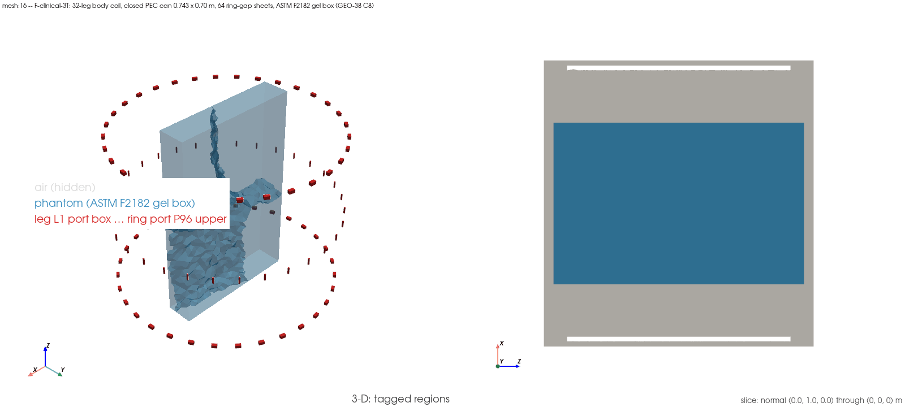

# `mat:42` — the field-strength lever on the heating: P83's prediction beside C39's reading, per accepted watt (EX-194)

A record page: it makes **no solve and builds no mesh**. A user asks how much more the
gel heats at 3 T than at 1.5 T per accepted watt. `MAT-21` step 46 (P83) wrote the
closed-form pictures before entry 60 ran: every picture is mirror-even, so the
prediction is the accepted-power share alone, 3.693500, with a shape factor of 1.
`GEO-38` C39 then read the two FEM heating windows, `xl` entry 59 (1.5 T, 64 MHz, node
C = 193.5996 pF) and entry 60 (3 T, 128 MHz, node C = 44.0525 pF). This page sets the
prediction, the measurement and their quotient on one page, beside the SAR lever.

**What these numbers are.** They are degree-1 internal records, per accepted watt, each
side at its own root and its own c\* (the SAR10g lattice argmax, a mirror pair), not a
thermal or box-wide maximum. **The 3 T side uses the 1.5 T gel's thermal constants**
(C31, `20261105T181050Z_GEO-38-C31-W0r.log:128`): only the EM source changes, so this is
the field-strength lever on one gel, not a 3 T gel claim. There is no tissue, compliance,
absolute, dose-band or external claim, and no `ANS` thermal case.

## 1. What this demonstrates

Every digit below is a print of the closing window `EX-194`
(`docs/testing/logs/…_EX-194.log`), or arithmetic on those prints.

- **C39's table, reproduced to the digit (R39).** The page re-derives C39's 22 ratios
  (11 readouts × 2 senses) through the C46 reader's own `side` / `ratios`, and each at
  `.6e` equals the string in C39's closing log
  (`20261111T103037Z_GEO-38-C39-W1-n1.log`, table header `:211`, rows `:212–233`). The
  ccw rows (K per accepted W; `cem43` in s):

  | readout | 1.5 T | 3 T | ratio |
  |---|---|---|---|
  | ball θ | 1.617780e-03 | 6.520224e-03 | 4.030354 |
  | hotspot point θ | 1.611905e-03 | 6.516151e-03 | 4.042515 |
  | probe P0 centre | 1.591340e-04 | 1.317955e-03 | 8.282045 |
  | probe P1 +y wall | 4.445003e-03 | 1.272564e-02 | 2.862909 |
  | probe P2 −y wall | 4.110246e-03 | 1.213484e-02 | 2.952340 |
  | probe P3 +x wall | 7.476681e-04 | 2.939765e-03 | 3.931912 |
  | probe P4 −x wall | 8.068177e-04 | 3.087193e-03 | 3.826383 |
  | probe P5 top face | 2.497948e-04 | 2.365388e-03 | 9.469324 |
  | `cem43` per P_acc | 4.014034e-11 | 4.027561e-11 | 1.003370 |
  | `cem43` excess over t\*·R^(43−T_INF) | 4.441540e-14 | 1.796812e-13 | 4.045471 |
  | running mean (360 s) max | 1.507841e-03 | 6.095555e-03 | 4.042572 |

  The cw rows are printed in full by the run.
- **The prediction beside the measurement (ccw).** P83's power share is 3.6934995
  (`20261110T103343Z_MAT-21-P83-W1.log:51`). Measured / predicted: hotspot point
  4.042515 / 3.693500 = **1.094495**; ball 1.091202; 360 s window 1.094510; `cem43`
  excess 4.045471 / 3.693500 = 1.095295 (P83's own excess ratios are 3.7001, 3.6985,
  3.6944 and 3.7001 for its four pictures).
- **The shape parts.** The heating's shape part (measured / share) is 1.094495. The SAR's
  shape part, P83's three BALL rows (all equal), is 1.110448. The page names both and
  attributes the difference to nothing; any mechanism is the weekly's to pose.
- **The heating lever against the SAR lever.** The SAR lever (C33) is 4.101440; the ccw
  hotspot heating ratio over it is **0.985633**, equal to the hotspot ratio over
  (share × SAR shape part). So the heating lever sits between the power share and the SAR
  lever.
- **The cw rows have no P83 comparand.** P83's share is the ccw partition; the cw arm is
  heated at ccw's c\*, and cw's f₃/f₁.₅ is 4.2876 (ccw 3.6935). The cw hotspot, ball and
  360 s window ratios are 4.539718, 4.513717 and 4.546034, printed without a comparand.
- **`cem43` is not a lever.** The per-P_acc ratio is 1.003370 (ccw) and 1.003048 (cw): a
  `cem43` per accepted watt is the 1 W history's dose, about D0 plus an excess, not a
  scalable per-watt dose.

Gates (78, all green in the closing window): (X) both `xl` logs parse to one block each,
node strings equal the node constants, probe names equal `c46._probes()`, C39's real table
is found once with 22 rows, P83's rows are found with counts 1 / 4 / 4 / 3; (D)
`check_block` green on both sides under both senses (the worst (D-scale) error is 0.750 of
its half-unit bound); (R39) 22 of 22 strings equal; (Share) the ccw f₃/f₁.₅ from entries
59 / 60's P61 tokens equals P83's 3.6934995 at a relative 1.048e-09 (bound 1.389e-08);
(P83-Q) P83's four THETA rows are the share, at relative 1.831e-07, 4.442e-08, 2.715e-08
and 2.479e-08 inside bounds 4.558e-07, 5.920e-07, 3.512e-07 and 4.586e-07.

Negative controls (asserted in the same run):

- (N-sense) the cw factor ratio in place of the ccw one makes (Share) miss by a relative
  0.1608 against the bound 1.389e-08;
- (N-plant) one digit planted in the 4th significant place of entry 60's ccw ball token
  makes (R39) miss on the ccw ball row alone (a relative 2.994e-04), while all 31 (D)
  checks on the planted copy stay green: (R39) sees what (D) cannot;
- (N-swap) the sides swapped miss C39's strings on all 22 rows, and `check_block` of entry
  60 against entry 59's node string has (Node) red.

## Setup figure



`examples/materials/figures/materials_42_f_clinical_box_heating_field_strength_lever_setup.png`
is a byte-identical copy of `mesh:16`'s committed render
(`examples/meshing/figures/meshing_16_f_clinical_3t_coil_astm_box_setup.png`) of the 3 T
twin of the build; the 1.5 T twin is `mesh:15`. This page parses logs and draws nothing
and builds no mesh, so the figure was not rendered here. It is geometry only and carries
no field, power, SAR or temperature value.

## 2. How to run it

```
./scripts/run_examples.sh -e mat:42 -n 1 -t 30
```

The `mat:` group sources the complex DolfinX build (the C46 reader imports dolfinx through
P61). The run takes a few seconds (smoke tier) and writes nothing. Related pages:
`mat:41`, `mri:41`, `ans:11`, `mesh:15`, `mesh:16`.

## 3. How to analyze it, step by step

1. Read the `[PASS]` / `[FAIL]` lines: each gate prints its comparand and bound.
2. Read the C39 table block, then the P83 lines: measured / predicted is the heating's
   shape part (≈ 1.09), beside the SAR's (≈ 1.11).
3. Read the heating-over-SAR line: 0.985633, so the heating lever is just under the SAR
   lever.
4. Read the cw lines for what they are not: no comparand, since the cw arm is heated at
   ccw's c\*.

## Not claimed

A 3 T gel (the 1.5 T constants stand at both field strengths), which closed-form picture
the heating follows or a fitted source, a thermal or box-wide maximum, a dose band,
`cem43` as a lever, a decision rule or any `ANS` thermal case, degree 2, tissue,
compliance, an absolute figure or an external claim.
