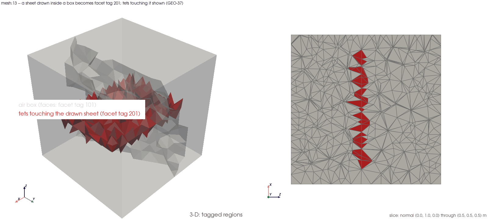

# `mesh:13` — a sheet drawn inside a box becomes an integration surface

Guide for `examples/meshing/13_interior_sheet_surface_integral.py` (`EX-101`).
Written to be followed without the source open.

## 1. What this demonstrates

For the user who will draw a port as a literal 2D sheet in an external CAD tool
(Phase 9 (9b), "ports as literal 2D sheets"): a rectangle drawn **inside** a
volume arrives in DolfinX as a native interior facet tag, and `dS` over that
tag meets closed forms. The fixture is `GEO-37`'s: a unit box with one
0.8 × 0.6 rectangle embedded at z = 0.47, tagged as dim-2 physical group `201`;
the six box faces are tagged `101`; mesh size `h = 0.08`.

The CAD recipe, in words and code:

```python
box = occ.addBox(0, 0, 0, 1, 1, 1)
rect = occ.addRectangle(x, y, z, w, h)
occ.fragment([(3, box)], [(2, rect)])     # embeds the face in the volume mesh
occ.synchronize()
gmsh.model.addPhysicalGroup(2, [rect_surface], 201)   # one dim-2 group per sheet
```

`occ.fragment` is what makes the face part of the volume mesh. An unembedded
face's triangles are not tet facets, and nothing can integrate over them
(`GEO-37` step 1's trap). The model is then read with the project shim
`_model_to_mesh`.

**The one line a multi-rank user must not miss:** build the mesh with
`GhostMode.shared_facet`. The example passes
`dolfinx.mesh.create_cell_partitioner(GhostMode.shared_facet, 2)` and asserts
the mesh carries ghost cells before it assembles any `dS`. An unghosted `-n 4`
assembly on this fixture hung in `GEO-37` step 2 — stated here as a record, not
reproduced; the example has no unghosted leg.

### What is asserted

Every band, closed form and fixture helper is **imported** from the `GEO-37`
modules (`STRIP_BAND` from `tests/validation/test_ops61_exact_strip_ports.py`;
`I1_CF` … `I4_CF` from `tests/mesh/test_geo37_interior_dS.py`; the fixture from
`tests/mesh/probe_geo37_interior_facet.py`; `QD` and `_assemble` from
`tests/mesh/probe_geo37_interior_dS.py`). The planted fields' coefficients
(`g = 2 + 3x + 5y`, DG0 side values 1 below / 3 above the sheet) are inputs,
written as the probe writes them; the closed forms come from `I2_CF` / `I3_CF`.

| Anchor | Statement | `-n 2` | `-n 4` |
| --- | --- | --- | --- |
| (G) | ghost cells exist before any `dS` | 592 | 1162 |
| (T) | facet-tag set is `[101, 201]`; owned tag-201 count = gmsh's triangle count | 192 = 192 | 192 = 192 |
| (A) | ∫ 1 `dS(201)` vs `I1_CF`, within `STRIP_BAND` | +8.9e-16 | +2.2e-16 |
| (F) | ∫ g('+') `dS(201)` vs `I2_CF` | +2.2e-16 | +2.2e-16 |
| (F) | ∫ (u('+') + u('-')) `dS(201)` vs `I3_CF` | +8.9e-16 | +2.2e-16 |
| (I) | ∫ 1 `ds(101)` vs `I4_CF` | +2.0e-15 | +1.1e-15 |
| (V) | validator raises `missing required port tags: [999]` | yes | yes |

`validate_required_port_tags_exist` and `PortDefinition` are used **only as a
tag-presence check**; no port is built or claimed.

### Negative controls

- **(c1) asserted — an absent tag integrates to zero silently.** `dS(999)`
  assembles to exactly `0.0` with no error, a 100 % miss against `I1_CF`. This
  is why (V) exists: the assembly does not raise, the validator does. Validate
  tags before integrating.
- **(c2) asserted — one dropped facet leaves the band.** Re-tagging 201 with
  one owned facet removed gives −4.48e-3 (`-n 2`) / −5.07e-3 (`-n 4`) against
  `I1_CF`; one facet's share is `1/N_gmsh` ≈ 5.2e-3, millions of times the band.
- **(c3) printed, not asserted — `('+')` is a cell-order side, not a geometric
  one.** ∫ u('+') `dS(201)` reads 0.9747 at `-n 2` and 1.0695 at `-n 4`:
  inside [0.48, 1.44] but different between the two runs. A sheet's orientation
  must come from the user (an integration line, the (9b) convention), never
  from DolfinX's `'+'` side.

### Three reading rules

1. **Reduce owned facets before counting.** The unfiltered rank-local tag-201
   sum is printed beside the owned sum: 210 vs 192 at `-n 2`, 247 vs 192 at
   `-n 4`. The excess is ghost-side copies of the same facets.
2. **An absent tag integrates to zero silently** (c1) — validate tags first.
3. **A one-sided integral depends on the partition** (c3).

### Scope — not claimed

Not a port (no port operator, voltage functional, S-parameter or orientation);
not a STEP import (the face is drawn in gmsh in-process; `U12`, the STEP with a
named port face, is BLOCKED because Gmsh's STEP writer drops the names and the
embedded face); no unghosted multi-rank run and no explanation of why that leg
hangs; real build only; one planar rectangle, h = 0.08.

## Setup figure



*Left:* the unit box. The facet group is one dimension below what the figure
draws, so the figure shows a **display-only** cell tagging: the tets that have a
facet in tag `201` (red, both sides of the sheet) against the rest (grey,
translucent). *Right:* the `y = 0.5` slice (normal `(0, 1, 0)`), showing the
serrated band of tets that conform to the plane z = 0.47. These display tags
never enter an integral. Regenerate with `FEM_EM_SETUP_FIGURES=1`.

## 2. How to run it

```
./run_examples.sh -e mesh:13
```

Real DolfinX build; tier **standard**. Add `-n 4` for the ghosted control width
(the partition then runs along the sheet, where ghosting is load-bearing). The
script needs `/workspace` on `PYTHONPATH` beside `src` because it imports from
`tests.*`. On record (0.11 image): 10 150 cells, 192 sheet triangles; in-script
4.0 s at `-n 2` (6 s harness wall) and 0.8 s at `-n 4` (3 s harness wall).

Exit status 0 means every assertion above and both controls held.

## 3. How to analyze it, step by step

**Step 1 — read the tag inventory.** `[T] reduced facet-tag set = [101, 201]`
and `owned tag-201 count = 192 vs N_gmsh = 192`. A missing 201 means the face
was not embedded by `occ.fragment`; a count off gmsh's is a facet-distribution
defect on the ghosted import.

**Step 2 — read the relative errors.** `[A]`, `[F]`, `[I]` are relative to the
imported closed forms and must sit at machine precision (≤ `STRIP_BAND`).
Compare the two widths at the band, never bitwise.

**Step 3 — read the controls.** `[c1]` is `0.0`; `[c2]` is a few 1e-3 away from
the closed form; `[c3]` differs between widths by design.

**Step 4 — open the mesh in ParaView.** Open
`examples/meshing/paraview_output/meshing_13_interior_sheet_surface_integral_combined.xdmf`.
Select the facet block and Threshold `mesh_tags` on 201 to see the sheet.
Colour the cell block by `rank` to see where the partition cuts the sheet, then
by `u_side` with a slice through y = 0.5; `g_planted` is the P1 linear field.

**Step 5 — what a deviation means.** (A)/(F) red with (I) green contradicts the
`GEO-37` step-2 record: a finding for the review, not an example fix. A hang
before output at `-n ≥ 2` means an unghosted `dS`; check (G) first.

## Related

- `examples/meshing/04_two_torus_port_sheet.md` (`mesh:4`) — the cut /
  sliver-pair sheet route this replaces for drawn sheets.
- `tests/mesh/test_geo37_interior_dS.py` — the gate module (closed forms).
- `tests/mesh/probe_geo37_interior_dS.py` — the `dS` probe.
- `tests/mesh/probe_geo37_interior_facet.py` — the fixture.
- `src/fem_em_solver/ports/definitions.py` — the tag validator.
