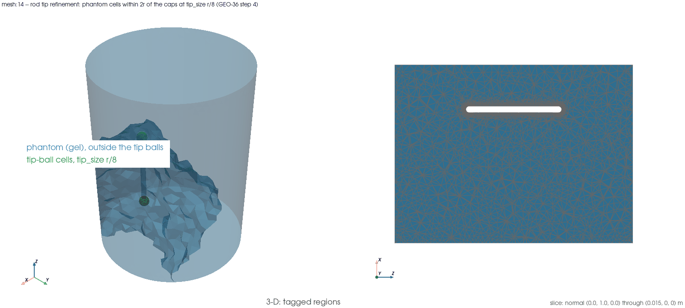

# `mesh:14` — refine the mesh at an implant tip; the CAD does not move

Guide for `examples/meshing/14_implant_tip_refinement.py` (`EX-102`).
Written to be followed without the source open.

## 1. What this demonstrates

For the Phase 7 user who wants a finer mesh at a lead or rod tip without
touching the geometry. The fixture is `GEO-36` step 4's, imported: the
four-port F-small birdcage with a 1 mm-radius, 32 mm tip-to-tip capped rod cut
from the phantom, at the 1 g phantom rung. The script builds it three times,
coarse to fine, at `tip_size` unset (= r/4), r/(4√2) and r/8. No solve.

The recipe, in one call (h in metres, 0 < h ≤ r/4, unset = r/4):

```python
implant_rod = {"radius": r, "length": L, "centre": c, "axis": a, "tip_size": h}
```

`h` is the `VIn` of the Ball mesh-size field placed round each cap centre. The
Ball radius is fixed at 2r; there is no ball-radius knob.

### What is asserted

Every band, record, rung and helper is **imported** from
`tests/mesh/test_birdcage_implant_rod_tip.py` and the modules it imports; the
script prints the gate's own `[GEO-36 step 4]` lines through the imported
`_summarise`. Two inputs are restated as cited literals: the refusal values of
(c1) and the conductor cell tag `1`.

| Anchor | Statement | Reading (`-n 2`) |
| --- | --- | --- |
| (N) | unset cells vs `ROD_1G_RUNG_CELL_RECORD`, within `CELL_COUNT_BAND` | 252 118 / 252 118 = 1.000000 |
| (A0) | CAD masses, OCC wall area, wall centroid equal the unset build's; `tip_size_m` = request | True at all three rungs; wall area 2.0106192982974677e-4 m² |
| (A1) | phantom CAD mass vs `_phantom_minus_rod()` within `CAD_ANALYTIC_BAND` | 1.110e-16 at every rung |
| (A3) | OCC wall area vs `_rod_area()` | 0 at every rung |
| (A4) | meshed wall area ratio inside `TERMINAL_AREA_BAND` | 0.996254 / 0.996674 / 0.996934 |
| (A5) | census set, census sum, tag 402 exterior and on the phantom, 0 interior | True; tag 402 4 958 / 6 256 / 8 790 |
| (A6) | wall centroid within `EXACT * ROD_LENGTH` | 1.7e-18 |
| (D) | N1curl degree 2 = 2E + 2F, degree 1 = E, exactly | d2 1 620 748 / 1 775 954 / 2 200 500; d1 302 002 / 331 014 / 410 054 |
| (G) | N_ball strictly increasing | 11 938 / 32 826 / 93 132 |

### Negative control

- **(c1) asserted — an out-of-range `tip_size` is refused before gmsh starts.**
  `tip_size` = r/3 (coarser than the r/4 cap) and 0.0 each raise `ValueError`
  naming `implant_rod`, in 0.000 s, on every rank, and `gmsh.isInitialized()` is
  False afterwards. A knob without validation would mesh instead.
- **(G) doubles as the blind-knob control.** A knob that never reached the Ball
  field would leave N_ball flat; it grows 2.75× and 7.80×.
- **(c2) printed, not asserted — the refinement is local.** Air cells 99 975 /
  99 849 / 99 881; phantom cells 109 724 / 133 796 / 199 748 (+22 % / +82 %).
- **(c3) printed — a user who forgets the knob gets the r/4 build:** (A0) reads
  `tip_size_m` = r/4 = 2.5e-4 m for the unset build.

### Three reading rules

1. **The CAD is identical at every rung**, so a volume or area change between
   rungs is a meshing effect, never a geometry one ((A0)).
2. **N_ball grows ≈ as (r/4 ÷ h)³**, and so do the dofs a solve would pay. Measured
   against the cubic model: 2.7497 vs 2.828 at r/(4√2), 7.8013 vs 8.000 at r/8
   (printed, not asserted: no band for the ratio exists).
3. **The refinement grades past the 2r radius.** The near-T1 point (2.5 mm from a
   cap centre) refines too: mean edge 6.983e-4 / 6.422e-4 / 5.082e-4 m on
   11 / 19 / 26 cells.

### What it costs

Printed by the script, read from the `-n 2` run's own log; no solve time is
named here (the solve pricing is the weekly's).

| rung | cells | N_ball | E | F | N1curl d1 | N1curl d2 | build s |
| --- | --- | --- | --- | --- | --- | --- | --- |
| unset (r/4) | 252 118 | 11 938 | 302 002 | 508 372 | 302 002 | 1 620 748 | 72.04 |
| r/(4√2) | 276 088 | 32 826 | 331 014 | 556 963 | 331 014 | 1 775 954 | 71.96 |
| r/8 | 342 072 | 93 132 | 410 054 | 690 196 | 410 054 | 2 200 500 | 84.11 |

Cells grow ×1.0951 and ×1.3568 against unset. The r/8 build (342 072 cells)
exceeds the 320 000 `ROD_CELL_GUARD_W2_PRINTED`, so a solve-example guard of
that size would trip at r/8. Mean ball-cell edge ÷ `tip_size_m` is 1.3590 /
1.3765 / 1.3779.

### Scope — not claimed

No solve: no eta_rod, tip SAR or E-field. No h-convergence statement of any
quantity: the ratio against (r/4 ÷ h)³ is a printed cell-count reading, not a
rate. (A2) and the flag-off leg of (A5) need the off (no-rod) build and remain
the gate's. Unset = explicit r/4 integer equality is the gate's (W1), cited,
not re-run. Not claimed: the kept-cells build, a ball-radius knob, r/16,
F-human, the complex build. Real build only.

## Setup figure



*Left:* the phantom (translucent blue) with the cells inside the 2r balls round
each cap centre (green). *Right:* the y = 0 slice through the rod centre, with
the rod cut out as a white slot and the mesh refining toward its wall. The
figure is drawn on a **display-only phantom submesh** (the 4 mm balls would
otherwise be a few pixels at the 0.2 m domain); its tags never enter an
assertion. Regenerate with `FEM_EM_SETUP_FIGURES=1`.

## 2. How to run it

```
./scripts/run_examples.sh -e mesh:14
```

Real DolfinX build (never source complex mode); tier **heavy** (three serial
gmsh builds). The script needs `/workspace` on `PYTHONPATH` beside `src`
because it imports from `tests.*`. On record (0.11 image): 252 118 / 276 088 /
342 072 cells; in-script total 234.8 s at `-n 2` (239 s harness wall, with the
setup figure). Add `-n 4` as a width control: gmsh meshes serially on rank 0,
so every reduced integer must be width-invariant, while the facet-area sum
(A4) is compared at the band, not bitwise.

Exit status 0 means every assertion above and (c1) held.

## 3. How to analyze it, step by step

**Step 1 — read the three `[GEO-36 step 4] build …` lines.** Cells, census,
E, F and the N1curl dof counts per rung; `tip_size_m` echoes the request.

**Step 2 — read the anchor lines.** `[N]` is 1.000000; each rung's line
shows (A0) True, (A1) and (A3) at machine zero, (A4) near 0.997, (D) True.

**Step 3 — read `[headline]` and `[cost]`.** The N_ball ratios against the
cubic model, then cells, dofs and build seconds per rung.

**Step 4 — read `[c1]` and `[c2]`.** Both refusals say `True` and gmsh is
untouched; air is flat while phantom grows.

**Step 5 — open the meshes in ParaView.** Open
`examples/meshing/paraview_output/meshing_14_implant_tip_refinement_unset_combined.xdmf`
and
`examples/meshing/paraview_output/meshing_14_implant_tip_refinement_r8_combined.xdmf`
side by side (the third rung is
`examples/meshing/paraview_output/meshing_14_implant_tip_refinement_r4rt2_combined.xdmf`).
Threshold `in_tip_ball` = 1, colour by `mean_edge` on a log scale, and slice
through y = 0. Select the facet block and Threshold on tag 402 to see the rod
wall.

**Step 6 — what a deviation means.** (N), (A0), (A1), (A3)–(A6), (D) or (G) red
contradicts `GEO-36` step 4's green gate at the same width: a divergence
finding for the review, not an example fix. (c1) not raising is an
`io/mesh.py` regression.

## Related

- `examples/implants/03_rod_in_birdcage_tip_sar.md` — the solve on this fixture
  at the default r/4 tip.
- `examples/meshing/03_birdcage_graded_conductors.md` and
  `examples/meshing/05_region_resolution_policy.md` — conductor and region
  grading.
- `tests/mesh/test_birdcage_implant_rod_tip.py` and
  `tests/mesh/test_birdcage_implant_rod.py` — the gate modules.
- `src/fem_em_solver/io/mesh.py` — the generator.
