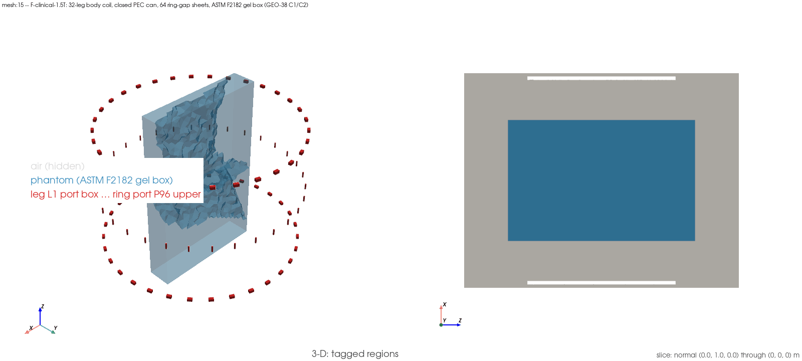

# `mesh:15` — the F-clinical-1.5T body coil with the ASTM F2182 gel box, in ParaView

Script: `examples/meshing/15_f_clinical_coil_astm_box.py` (`EX-117`)
Gates: `tests/validation/test_geo38_f_clinical_box.py` (`GEO-38` step 2) and
`tests/validation/test_geo38_f_clinical_build.py` (`GEO-38` step 1a)

## 1. What this demonstrates

`GEO-38` gates a **clinical-scale** fixture: a 32-leg birdcage at
`ring_radius` 0.355 m, rungs 0.45 m long between ring centrelines, a closed
PEC can (`shield_radius` 0.3725 m, length 0.954285714 m)
— Ø 0.745 m; the length is the generator's 2·z_extent
(`20261015T171259Z_GEO-38-s1a-W2-r2-a2.log:12106`; corrected 2026-10-18,
§9 item 543) — conductors meshed as **holes** (`as_hole=True`, the
Leontovich route: the coil is a void in the picture, with no tag-1 cells),
64 ring-gap sheets, and the 0.42 x 0.09 x 0.65 m ASTM F2182 gel box
(`phantom_box`, `table_offset_m` 0) as the load. The gate proves the sheets
and the box are right. This example puts the whole fixture in ParaView, with
the 64 sheets and the box interface as facet tags, and makes two box
readings the gate does not.

**Modelling choices.** The fixture is the operator's directive of
2026-10-14; its modelling choices (rung length as ring-centreline
separation, the closed PEC can, 4 mm leg boxes) are the 2026-10-15 03:00
and 10:30 rulings, **ratified by the 2026-10-17 weekly**
(`PROJECT_PLAN.md:4733–4737`, "`GEO-38`'s modelling choices (the closed PEC
can, the corner refusal, the 4 mm leg-box dx) … all ratified"; commit
`169a81b4`). The 64-sheet census (2 x N_legs) is the human operator's
2026-10-15 ruling, which `GEO-38`'s Done-when now carries ("port census =
**64**", the `GEO-38` §7 row). The full list is on
[the clinical coil fixtures page](../../docs/guide/clinical_coil_fixtures.md).

### It asserts, it does not merely render

Every anchor is imported from the gate modules and recomputed on this run's
mesh through the imported helpers (owned facets and cells only, reduced; no
UFL `dS`). Nothing is restated except the four record digits in the
example-local `REC`, each commented with its log line.

- (T1) owned facets of every sheet tag = the generator's own
  `ring_sheet_gmsh_triangles`, on all 64 sheets (total 2 882);
- (T2) each sheet's area = chord x w at `STRIP_BAND`;
- (B1) the tag-3 tet volume = Lx x Ly x Lz; (B2) its vertex extents;
- (V1) the CAD partition; (V2) the can against pi R_s^2 x 2 z_e at
  `CAD_ANALYTIC_BAND`;
- (K) the census: tag 3 present, no tag 1, the counts sum to the global cell
  count;
- integer records exact: tag-2 cells 1 061 834, tag-3 cells 33 372,
  N_gmsh total 2 882 (`20261015T185056Z_GEO-38-s2-W3-n4.log:11898-11899`).
  The **total cell count is printed, not asserted** (the gate itself printed
  it, `GEO-38` item 470's (A0)): 1 149 150, relative +1.5549e-03 against
  `F_CLINICAL_R1_CELL_RECORD`.

### Two readings the gate does not make

- **(F) The box surface.** The tag-3 / tag-2 interface is recovered with
  `_interface_facet_tags` under a new facet tag (400, asserted unused by the
  sheets). Its 7 708 owned facets sum to 2(LxLy + LyLz + LxLz) = 0.7386 m^2
  at `STRIP_BAND`, each facet is classified onto exactly one of the six
  planes (unclassified 0, multi-claimed 0), and the three face-pair sums
  (2LyLz, 2LxLz, 2LxLy) each read exact. The box touches only air, so every
  box facet is on this interface; a facet shared with another tag would be a
  generator finding.
- **(R3) The box's reach.** The farthest owned tag-3 vertex from the axis
  equals `phantom_box_circumradius_m` (0.214767 m) to the digit: a
  planar-faced box's corner is a mesh vertex. Printed beside it: the radial
  clearance R - r_box - r_leg = 134.233 mm to the rung surface, and the can
  clearance R_s - `leg_box_corner_radius_m` = 5.6851 mm against the
  `DESIGN_CORNER_CLEARANCE_M` design value 5.0 mm.

### Negative controls (asserted in the same run)

- **(c1)** the gate's: one P33 facet dropped reads 43 against N_gmsh - 1 = 43
  and the area misses chord x w by 7.07e-03 > `STRIP_BAND`;
- **(cF)** a face missing: the five faces other than y = +Ly/2 sum to a
  total that misses the surface formula by 3.696e-01, which is LxLz / total
  exactly, far above `STRIP_BAND`;
- **(cG)** local copies are not facets. Summed over local copies (owned +
  ghost) the box interface has 7 942 facets against 7 708 owned (234 ghost
  copies) and its area reads 0.7609627 against 0.7386000 m^2 (+3.03e-02).
  **This control is conditional by design**: it is asserted only if the
  partition holds a ghost copy of a box facet, otherwise the run prints "no
  ghost copy on this partition". At `-n 4` it did hold ghost copies (the
  gate's own sheet count, printed beside, is 2 887 local copies vs 2 882
  owned, excess 5). This is why every count in the example is owned-only and
  reduced.

### Scope

**A mesh, not a solve.** No port gate, S-matrix, tuning, resonance, B1 or
SAR. Nothing about the degree-1 column, degree-2 price, the census ruling, a
scanner-specific claim or an ASTM F2182 compliance test. `GEO-38`
does not move. This differs from `mesh:12` in scale, shield, conductor route
(hole, not solid) and load shape (box, not cylinder), and from `mat:19` in
that the box sits inside a coil.

## Setup figure



*Left:* air (tag `2`) hidden, the gel box (tag `3`) translucent blue, the
32 leg boxes (tags `101`-`132`) and the 64 ring-sheet box halves (red, tags
`133`-`196` lower, `233`-`296` upper) on their rings. The conductors are
**holes** (the Leontovich route), so the coil is drawn as a void between
those red boxes; the closed PEC can is the outer boundary of the air and is
not drawn. *Right:* the `y = 0` slice through the axis (normal `(0, 1, 0)`),
so the box's 0.65 m length sits between the two rings; mesh edges are off
(1.15 M cells). Rendered once with `FEM_EM_SETUP_FIGURES=1`.

## 2. How to run it

```
./scripts/run_examples.sh -e mesh:15 -n 4 -t 600
```

The run of record predates the 2026-10-17 ratification, so its header still
prints 'provisional'.

Heavy tier, `-n 4`, real DolfinX build (the meshing group), mesh only. The
measured wall time was 324 s through the harness (build 315.1 s, of which
gmsh 290.9 s; figure 6.4 s; XDMF write 0.1 s; summed peak RSS 2.586 GiB),
against `GEO-38` step 2's own 339 s at `-n 4`. gmsh is serial on rank 0, so
width buys only the post-gmsh distribution; `-n 4` is also the one width
where owned and local-copy facet counts differ, which is what (cG) shows.
Never run it beside another heavy window: a loaded host cost the gate's
`-n 2` build an extra 160 s.

## 3. How to analyze it, step by step

**Step 1 — read the census.** The printed census carries tag 2 (air, 1 061
834), tag 3 (the box, 33 372), no tag 1 (the coil is a hole), leg boxes
`101`-`132` at 28-32 cells each, and the ring-port halves `133`-`196` /
`233`-`296`. Total 1 149 150 cells (printed; the gate's own record line, not
asserted here).

**Step 2 — read the sheets.** (T1) 64/64 sheets match the generator's facet
count (44..46 each, total 2 882); (T2) the worst sheet area is 2.220e-15
from chord x w (`STRIP_BAND` 1e-9).

**Step 3 — read the box.** (B1) the tag-3 volume 2.457e-02 m^3 equals
0.65 x 0.42 x 0.09 to 1.1e-16; (B2) its extents are exactly +-0.21, +-0.045,
+-0.325 m; this is the gate's own reading reproduced.

**Step 4 — read the can and the partition.** (V1) 4.780e-11 and (V2)
2.220e-16, the gate's values to the digit. The box fills 5.91 % of the can.

**Step 5 — read the two new box readings.** (F) the surface 0.7386 m^2 at
1.1e-16 with all six faces classified; (R3) the reach, 0.214767 m, equal to
the exported circumradius; the rung clearance and can clearance are printed
there.

**Step 6 — read the controls.** (c1), (cF) separate by many orders of
magnitude above `STRIP_BAND`; (cG) shows why owned-only counting is the rule.

**Step 7 — open the mesh in ParaView.** `File -> Open ->`
`examples/meshing/paraview_output/meshing_15_f_clinical_coil_astm_box_combined.xdmf`
(with its `meshing_15_f_clinical_coil_astm_box_combined.h5`).

- Threshold `CellTags` at `3` for the gel box; `2` for air; `101`-`132` the
  leg boxes; `133`-`196` / `233`-`296` the ring-sheet box halves.
- The same file's facet block carries `mesh_tags`: `243`-`306` for the 64
  reconstructed ring sheets, and `400` for the six faces of the box
  interface. Threshold `mesh_tags` to isolate them.
- Colour the DG0 `cell_diameter` on a `y = 0` slice to see the graded
  sizing around the sheets and the leg boxes against the coarse fill.

**Step 8 — what a deviation means.** Nothing is solved, so every failure is
geometry or tagging: a sheet count off from the generator's is a tagging
defect; (F) red is a box interface that is not the six exact faces (a
fragment finding); (R3) red is a mismatch between the exported circumradius
and the mesh; a record miss with the gate re-run green is an example/test
divergence — journal it, never re-record from this side.

## Related

- `examples/meshing/12_birdcage_f_human_rung.md` — the 16-leg, 0.15 m rung
  (no shield, solid conductors, cylinder phantom).
- `examples/materials/19_f2182_gel_box_slab_and_faces.md` — the same gel box
  alone, thermal, no coil.
- `examples/meshing/13_interior_sheet_surface_integral.md` — owned interior
  sheet facets integrated on a smaller fixture.
- `tests/validation/test_geo38_f_clinical_box.py`
- `tests/validation/test_geo38_f_clinical_build.py`
