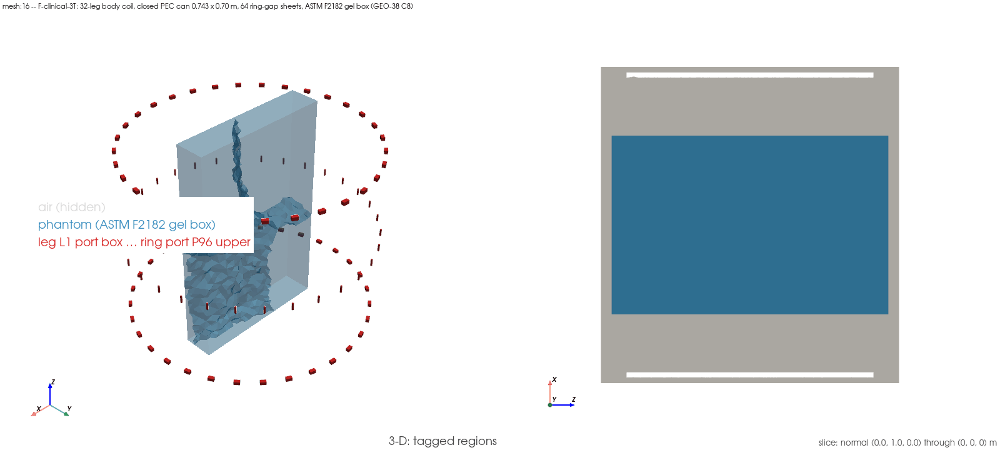

# `mesh:16` — the F-clinical-3T body coil with the ASTM F2182 gel box, in ParaView

Script: `examples/meshing/16_f_clinical_3t_coil_astm_box.py` (`EX-133`)
Gates: `tests/validation/test_geo38_f_clinical_3t.py` (`GEO-38` C8),
`tests/validation/test_geo38_f_clinical_box.py` (`GEO-38` step 2) and
`tests/validation/test_geo38_f_clinical_build.py` (`GEO-38` step 1a)

## 1. What this demonstrates

`mesh:15` is the 1.5 T clinical twin. This is the 3 T one: a 32-leg birdcage
at `ring_radius` 0.352 m (rung Ø 0.704 m), legs spanning 0.58 m, a closed PEC
can Ø 0.743 m x 0.70 m, conductors meshed as **holes** (the Leontovich route:
the coil is a void in the picture, with no tag-1 cells), 64 ring-gap sheets
and the 0.42 x 0.09 x 0.65 m ASTM F2182 gel box (`table_offset_m` 0) as the
load. The gate that proves it is `GEO-38` C8's box window at `-n 4`
(`20261018T171406Z_GEO-38-C8-W3-box-n4.log`); this example reproduces that
record on its own run, puts the mesh in ParaView with the 64 sheets and the
box interface as facet tags, and adds two readings nobody had made: the can's
**diameter and length read off the mesh's vertices**, and the box's clearance
to the can's end caps.

**Provenance.** The fixture is the human operator's directive of 2026-10-14.
The 3 T table is from the MRM source named under "Sources" on
[the clinical coil fixtures page](../../docs/guide/clinical_coil_fixtures.md).
The modelling choices (rung length as ring-centreline separation, the closed
PEC can, 4 mm leg boxes) were **ratified by the 2026-10-17 weekly**. Ruling
(b): 0.58 m is the leg span, the chosen parameter is `coil_length`, and
`leg_spacing` (0.5157142858 m) keeps the 1.5 T overhang. Ruling (c): the can
is closed, and the resulting 25 mm cap clearance is named for the weekly.

**How the 3 T box is built.** Never by typing a 3 T value. The script swaps
the box module's own bound name `_f_clinical_kwargs` for C8's
`_f_clinical_3t_kwargs` with `unittest.mock.patch.object`, around the single
`_box_kwargs()` call (the swap C8's box test makes), then asserts the swap
took (`coil_length` = `RUNG_LENGTH_3T_M`, `shield_radius` = C8's 3 T value, no
`phantom_radius`) *before* the roughly five-minute build.

### It asserts, it does not merely render

Every anchor is imported from the gate modules and recomputed on this run's
mesh through the imported helpers (owned facets and cells only, reduced; no
UFL `dS`). Nothing is restated except three record integers in the
example-local `REC`, each commented with its log line.

- (T1) owned facets of every sheet tag = the generator's own
  `ring_sheet_gmsh_triangles`, on all 64 sheets (44..46 each, total 2 886);
- (T2) each sheet's area = chord x w at `STRIP_BAND` (worst 3.775e-15, the
  gate's value);
- (B1) the tag-3 tet volume = Lx x Ly x Lz; (B2) its vertex extents;
- (V1) the CAD partition (8.460e-11, the gate's value); (V2) the can against
  pi R_s^2 x 2 z_e at `CAD_ANALYTIC_BAND`;
- (K) the census: tag 3 present, no tag 1, the counts sum to the global cell
  count;
- (Tab) C8's own `_assert_3t_table` called verbatim: shield Ø 0.743 and
  length 0.70, rung Ø 0.704, leg span 0.58 at `IDENTITY_BAND`; 32 legs, 64
  ports; leg-box corner 0.363814913104 m at 1e-12 (this run |diff|
  1.609e-13); box size (0.42, 0.09, 0.65). The gate's `_RECORD` dict is
  set for the call and **restored after it**;
- integer records exact: tag-2 cells 973 728, tag-3 cells 33 540, N_gmsh
  total 2 886 (`20261018T171406Z_GEO-38-C8-W3-box-n4.log:11901-11902`). The
  **total cell count is printed, not asserted** (the gate never asserts
  `F_CLINICAL_3T_BOX_CELL_RECORD`): 1 061 517, relative 0.0000e+00.

### Readings the gate does not make

- **(F) The box surface**, as `mesh:15`: the tag-3 / tag-2 interface (facet
  tag 400, asserted unused by the sheets) has 7 708 owned facets summing to
  2(LxLy + LyLz + LxLz) = 0.7386 m^2 at 1.1e-16, every facet on exactly one of
  six planes, the three face-pair sums exact.
- **(R3) The box's reach**: the farthest owned tag-3 vertex from the axis is
  0.214767315949 m, equal to `phantom_box_circumradius_m` to the digit. Printed:
  rung clearance R - r_box - r_leg = 131.233 mm (134.233 mm at 1.5 T) and can
  clearance R_s - `leg_box_corner_radius_m` = 7.6851 mm against the 5.0 mm
  `DESIGN_CORNER_CLEARANCE_M`.
- **(Sc) The can read off the mesh.** Over the vertices of all owned cells
  (every tag), `MPI.MAX`-reduced: 2 max hypot(x, y) = 0.743000000000 m
  (rel 2.220e-16 against `SHIELD_DIAMETER_3T_M`) and 2 max |z| =
  0.700000000000 m (rel 0 against `SHIELD_LENGTH_3T_M`). The length is the
  generator's 2 z_extent, read here from vertices, not from the diagnostics.
  Printed beside it: the 1.5 T can length, 0.954285714 m
  (`can_length_m` of the 1.5 T table), the number that `mesh:15`'s guide once
  got wrong.
- **(Zc) The cap clearance.** z_cap (the (Sc) half-length, 0.35 m) minus the
  largest owned tag-3 |z| (0.325 m) is 25.000000 mm, equal to
  (`SHIELD_LENGTH_3T_M` - Lz)/2 at rel 0. The 1.5 T value is 152.1429 mm; the
  box fills 8.10 % of the 3 T can against 5.91 % at 1.5 T.

### Negative controls (asserted in the same run)

- **(c1)** the gate's: one P33 facet dropped reads 45 against N_gmsh - 1 = 45
  and the area misses chord x w by 6.434e-02 > `STRIP_BAND` (the gate's value);
- **(cF)** a face missing: the five faces other than y = +Ly/2 miss the surface
  formula by 3.696e-01, which is LxLz / total exactly;
- **(cG)** local copies are not facets. Summed over local copies the box
  interface has 7 902 facets against 7 708 owned (194 ghost copies) and its
  area reads 0.7573403 against 0.7386000 m^2 (+2.537e-02). **Conditional by
  design**: asserted only if the partition holds a ghost copy of a box facet,
  otherwise the run prints "no ghost copy on this partition". At `-n 4` it did
  (the sheets' own excess is 4, 2 890 local copies vs 2 886 owned), which is
  why every count here is owned-only and reduced;
- **(cZ)** the cap clearance taken over **all** owned vertices instead of tag 3
  reads 0.000000 mm (the can's own cap vertices sit at z_cap) and misses
  25 mm by exactly 1.000, 100 %, the ceiling for a clearance. It shows that
  the tag restriction in (Zc) is what carries the reading.

### Scope

**A mesh, not a solve.** No port gate, S-matrix, tuning, resonance at 128 MHz,
B1 or SAR. Nothing about the `-n 1` / `-n 2` widths (`GEO-38` C8b), the
degree-1 or degree-2 price of the 3 T twin, a scanner-specific claim, an ASTM
F2182 compliance test, or the closed can as the physical shield. That the XDMF
opens in ParaView is the human operator's standing question, not claimed.
`GEO-38` does not move.

## Setup figure



*Left:* air (tag `2`) hidden, the gel box (tag `3`) translucent blue, the 32
leg boxes (tags `101`-`132`) and the 64 ring-sheet box halves (red, tags
`133`-`196` lower, `233`-`296` upper) on their rings. The conductors are
**holes** (the Leontovich route), so the coil is drawn as a void between those
red boxes; the closed PEC can is the outer boundary of the air and is not
drawn. *Right:* the `y = 0` slice through the axis (normal `(0, 1, 0)`), so the
box's 0.65 m length sits between the two rings with the air gap to each cap;
mesh edges are off (1.06 M cells). Rendered once with `FEM_EM_SETUP_FIGURES=1`.

## 2. How to run it

```
./scripts/run_examples.sh -e mesh:16 -n 4 -t 600
```

Heavy tier, `-n 4`, real DolfinX build (the meshing group), mesh only,
≈ 6 minutes; the run of record measured 315 s through the harness (build
304.6 s, of which gmsh 281.1 s; figure 6.6 s; XDMF write 0.2 s; summed peak
RSS 2.473 GiB; script elapsed 311.6 s), against `GEO-38` C8's own 312.6 s
build at `-n 4`. Run it only on a quiet host, never beside another heavy
window: gmsh is serial on rank 0 and a loaded host costs minutes. `-n 4` is
C8 W3's width and the one where owned and local-copy facet counts differ,
which (cG) shows.

## 3. How to analyze it, step by step

**Step 1 — read the census.** Tag 2 (air, 973 728), tag 3 (the box, 33 540),
no tag 1 (the coil is a hole), leg boxes `101`-`132` at 28-32 cells each, and
the ring-port halves `133`-`196` / `233`-`296`. Total 1 061 517 cells
(printed beside `F_CLINICAL_3T_BOX_CELL_RECORD`, not asserted).

**Step 2 — read the table.** The `[GEO-38 C8] 3T table (mesh:16)` line is
C8's own printout: shield Ø 0.743, length 0.70, rung Ø 0.704, span 0.58, corner
clearance 7.6851 mm, and the three cap clearances: phantom ends 25.00 mm, leg
ends 60.00 mm, ring tubes 88.14 mm.

**Step 3 — read the sheets.** (T1) 64/64 sheets match the generator's facet
count; (T2) the worst sheet area is 3.775e-15 from chord x w.

**Step 4 — read the box.** (B1) the tag-3 volume 2.457e-02 m^3 equals
0.65 x 0.42 x 0.09 exactly; (B2) its extents are exactly +-0.21, +-0.045,
+-0.325 m.

**Step 5 — read the can.** (V1) 8.460e-11 and (V2) 0 are the gate's values
to the digit; (Sc) reads the can's Ø and length off the vertices, 0.743 and
0.70 m.

**Step 6 — read the clearances.** (Zc) 25.000000 mm to each cap, against
152.1429 mm at 1.5 T; (R3) the reach 0.214767 m; the rung clearance
131.233 mm and the can clearance 7.6851 mm are printed there.

**Step 7 — read the controls.** (c1), (cF), (cZ) separate by many orders of
magnitude above `STRIP_BAND` (cZ at the 100 % ceiling); (cG) shows why
owned-only counting is the rule.

**Step 8 — open the mesh in ParaView.** `File -> Open ->`
`examples/meshing/paraview_output/meshing_16_f_clinical_3t_coil_astm_box_combined.xdmf`
(with its `meshing_16_f_clinical_3t_coil_astm_box_combined.h5`).

- Threshold `CellTags` at `3` for the gel box; `2` for air; `101`-`132` the
  leg boxes; `133`-`196` / `233`-`296` the ring-sheet box halves.
- The same file's facet block carries `mesh_tags`: `243`-`306` for the 64
  reconstructed ring sheets, and `400` for the six faces of the box
  interface. Threshold `mesh_tags` to isolate them.
- Colour the DG0 `cell_diameter` on a `y = 0` slice to see the graded sizing
  around the sheets and the leg boxes against the coarse fill.

**Step 9 — what a deviation means.** Nothing is solved, so every failure is
geometry or tagging: a sheet count off from the generator's is a tagging
defect; (F) red is a box interface that is not the six exact faces (a
fragment finding); (R3) red is a mismatch between the exported circumradius
and the mesh; (Sc) red is outer vertices that are not on the can the
generator reports; a record miss with the gate re-run green is an
example/test divergence, journal it and never re-record from this side.

## Related

- `examples/meshing/15_f_clinical_coil_astm_box.md` — the 1.5 T twin (Ø 0.745 m
  can, box 152 mm from each cap).
- [`docs/guide/clinical_coil_fixtures.md`](../../docs/guide/clinical_coil_fixtures.md)
  — the fixture table and its sources.
- `tests/validation/test_geo38_f_clinical_3t.py`
- `tests/validation/test_geo38_f_clinical_box.py`
- `tests/validation/test_geo38_f_clinical_build.py`
