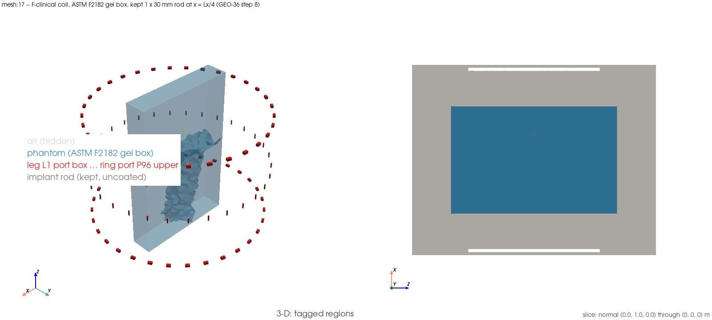

# `mesh:17` — the kept 1 x 30 mm rod inside F-clinical's ASTM F2182 gel box, in ParaView

Script: `examples/meshing/17_f_clinical_rod_in_astm_box.py` (`EX-137`)
Gate: `tests/validation/test_geo36_rod_f_clinical.py` (`GEO-36` step 8, item 530,
commit `c07031df`; the fixture's box is `GEO-38` step 2's)

## 1. What this demonstrates

`mesh:15` shows the clinical-scale coil and the standard's gel box with no
implant; `mesh:14` shows tip refinement on a rod outside any coil. This
example puts an implant inside the standard's box in a clinical-scale coil:
the kept, uncoated insulated-geometry rod (`implant_rod`, r = 1 mm,
l = 30 mm, cell tag 403, wall facet tag 402) in the 0.42 x 0.09 x 0.65 m gel
box (tag 3) of the 32-leg, 64-sheet, closed-PEC-can fixture with conductors
as holes. It builds exactly the configuration whose `GEO-36` step 8 gates
(G0)-(G10) went green at `-n 4`
(`20261019T200702Z_GEO-36-rodbox-W1-n4.log`), from the gate's own
`g36._kwargs()` — no centre, size or radius is typed in the example.

**This example demonstrates only that green `-n 4` build.** It claims nothing
about a solve, a tip field, SAR, an ASTM F2182 placement, or the `-n 2`
width. `GEO-36` and `GEO-38` do not move.

**Where the rod is, and why that is not an ASTM claim.** The rod sits at
+x by Lx/4 = 0.105 m in C2's coil frame (the box's 0.65 m axis is the coil
axis z; Lx = 0.42 m is horizontal; Ly = 0.09 m is the gel depth), with its
axis along z (review ruling 7, 2026-10-18). That is a **modelling choice**;
the guide, the gate and the example make no ASTM F2182 placement claim. The
frame is a trap the gate paid for: the literal "quarter of the width from a
wall" read in the y direction, centre (0, 0.105, 0), is accepted by the
cylinder-phantom test but lies 61 mm outside the box depth — see (cB). Step
6's centre (0.015, 0, 0) is another rod's, see (cR).

**Why kept and uncoated.** With conductors as holes (`as_hole=True`), a rod
is meshed as cells only when `keep_cells` is true and there is no
`coat_radius`; a coated rod or a hole rod under `as_hole` is refused
(`GEO-36` (G10)). The kept rod is tag 403 inside the tag-3 gel, separated by
the 402 wall.

### It asserts, it does not merely render

Every anchor is the gate's, recomputed on this run's mesh from the imported
fixture, helpers and bands (owned facets and cells only, reduced; the only
UFL `dS` is the gate's own `_interior_facet_check`). The only example-local
digits are the five records in `REC`, each commented with its line in the
`GEO-36` W1 log.

- (G0) the cell count is under `F_CLINICAL_ROD_CELL_GUARD` before any facet
  is read; (G1) rod CAD mass = kept mass = V_rod and the OCC wall area =
  A_rod; (G2) CAD(403) = V, CAD(3) = L^3 - V, sum = L^3; (G3) owned tag-3 +
  tag-403 tet volumes = L^3 and the tag-3 extents are the box; (G4) CAD
  groups + conductor = the can — all within `STRIP_BAND`;
- (G5) the 402 wall: 4 954 owned facets, none exterior, all interior between
  one tag-3 and one tag-403 cell, dS(402)/A_rod = 0.996243 inside
  `TERMINAL_AREA_BAND`;
- (G6) the OCC wall centroid at the rod centre to `EXACT` x l; (G7) census
  clean, tags 3 and 403 present, tags 1 and 404 absent,
  `implant_spheroid_cad` None; (G8) 64 / 64 ring sheets with owned facets =
  N_gmsh (44..46 each, total 2 882) and area = chord x w;
- the integer records, exact: tag-2 cells 1 063 136, tag-3 cells 85 122,
  tag-403 cells 14 834, the 402 triple 4 954 / 4 954 / 4 954, N_gmsh total
  2 882 (`20261019T200702Z_GEO-36-rodbox-W1-n4.log:12004, :12011, :12014`).
  The **total cell count is printed, not asserted**: 1 217 025, equal to the
  gate's W1 (`:12002`).

### Readings the gate does not make

- **(F) / (R3) the box surface and its reach, with the rod inside.** As
  `mesh:15`: the tag-3 / tag-2 interface (facet tag `BOX_IFACE` = 400) has
  7 706 owned facets summing to 2(LxLy + LyLz + LxLz) = 0.7386 m^2, each
  facet classified onto exactly one of six planes (unclassified 0,
  multi-claimed 0), the three face-pair sums exact, and the farthest tag-3
  vertex from the axis equals `phantom_box_circumradius_m` (0.214767 m), all
  at relative 0. The rod's wall is between tags 3 and 403, so it is not on
  this interface.
- **(Cap) the rod's placement read off the mesh vertices.** For every owned
  tag-403 vertex the example computes its distance d to the segment
  `_rod_centre()` +- (l/2) z-hat and reduces the maximum of d/r - 1 over
  ranks. It reads **6.883e-15** against the bound `STRIP_BAND` (1e-9): no
  mesh vertex of the rod lies outside the exact capsule. Printed beside it:
  the max |d/r - 1| over the owned 402-wall vertices, 6.883e-15 (over all
  of them, and over the lateral ones only), the tag-403 vertex extents x in
  [0.104, 0.106], y in [-0.001, 0.001], z in [-0.016, 0.016] m, and the
  wall clearance Lx/2 - max x over 403 vertices = **104.0000 mm**, equal to
  Lx/2 - (x_rod + r) because a vertex lies on the +x generator. The rod is
  a **capsule**: a 30 mm cylinder (the "length" is between the cap
  centres, the normaliser's "rod cap centre" at z = -0.015) with
  hemispherical caps of radius r, so its tip-to-tip extent is 32 mm and the
  z extent of +-0.016 m is expected; that is why the placement test is the
  distance to the segment, not to a cylinder.

### Negative controls (asserted in the same run)

- **(N1r)** C2's comparand L^3 misses CAD(3) by V / (L^3 - V) = 4.006372e-06,
  4.006e+03 x `STRIP_BAND` (the gate's W1, `:12007`);
- **(N2r)** the pre-repair conductor reading (+ V_rod) misses (G4) by
  2.365686e-07, 237 x `STRIP_BAND` (`:12010`);
- **(cB) a mis-placed rod is never built.** The pure normaliser, called
  before the build on every rank with the y-misread centre (0, 0.105, 0),
  raises `ValueError` "implant_rod is not strictly inside the phantom_box"
  (rod cap centre (0.0, 0.105, -0.015) against size_m (0.42, 0.09, 0.65));
  the same call with `_rod_centre()` returns it. The breach
  |c_y - off| + r - Ly/2 = 6.100000e-02 m, equal to the gate's `:68`;
- **(cR)** the (Cap) test evaluated against step 6's centre (0.015, 0, 0)
  puts no 403 vertex inside: min d/r - 1 = **88.000000**, the predicted
  (0.09 - r)/r - 1 with axes 0.09 m apart, against `STRIP_BAND` — a
  distance, no ceiling;
- **(cF)** five box faces miss (F) by LxLz / total = 3.696e-01.

### Scope

**A mesh, not a solve.** No PEC or sigma condition on the rod, tip field,
tip ratio, SAR, heating or transfer function; no ASTM F2182 compliance or
placement; no coated or hole rod; no other placement; no refinement; no
`-n 2` claim; no solve price (U2 = 8 327 394 is cited from the gate's W1,
`:12017`, never recomputed here); no external check. That the XDMF opens in
ParaView is the human operator's standing question, not claimed here.

## 2. How to run it

```
./scripts/run_examples.sh -e mesh:17 -n 4 -t 600
```

Heavy tier, `-n 4`, real DolfinX build (the meshing group), mesh only,
about 8 minutes. The run of record took 466 s through the harness: build
453.0 s (gmsh 425.97 s, under the 450 s stop rule the run of record armed
with `FEM_EM_GMSH_STOP_RULE=1`), setup figure 7.3 s, XDMF write 0.2 s,
summed peak RSS 2.633 GiB; the gate's own W1 build was 444.4 s at `-n 4`.
gmsh is serial on rank 0, so width buys only the post-gmsh distribution.
Run it only on a quiet host, never beside another heavy window.

## Setup figure



*Left:* air (tag `2`) hidden, the gel box (tag `3`) translucent blue, the
leg boxes and the 64 ring-sheet box halves (red) on their rings, the
conductors being holes. *Right:* the `y = 0` slice (normal `(0, 1, 0)`)
through the rod's plane; mesh edges off. **The rod is 2 mm wide and 32 mm long in a
0.65 m box and is not resolved at this view**; it is not re-rendered at a
larger scale, and the irregular lighter patch inside the translucent box in
the left panel is not read as the rod (the rod's size is established by
(G1)-(G6) and (Cap), not by the picture). Rendered once with
`FEM_EM_SETUP_FIGURES=1`.

## 3. How to analyze it, step by step

**Step 1 — read the census.** Tag 2 (air) 1 063 136, tag 3 (the gel box,
rod excluded) 85 122, tag 403 (the rod) 14 834, no tag 1 (the coil is a
hole), leg boxes `101`-`132` at 28-32 cells, ring-port halves `133`-`196` /
`233`-`296`. Total 1 217 025 cells, equal to the gate's W1 count.

**Step 2 — read the rod's CAD.** (G1) rod mass 9.843656981248e-08 m^3 = V_rod
at 4.441e-16, wall area 2.010619298297e-04 m^2 = A_rod at 0; (G2) the gel
CAD mass 2.456990156343019e-02 = L^3 - V_rod at 0.

**Step 3 — read the wall.** (G5) 4 954 owned 402 facets, all interior
between tags 3 and 403; the meshed wall area is 0.996243 of the CAD area
(a faceted cylinder is slightly smaller, inside `TERMINAL_AREA_BAND`).
(N4r, printed) tag-403 meshed volume / V_rod = 0.986659.

**Step 4 — read the sheets and the can.** (G8) 64 / 64 sheets match the
generator's facet counts (total 2 882), worst area 2.442e-15; (G4) CAD
groups + conductor = can to 6.457e-11.

**Step 5 — read the new placement reading.** (Cap) 6.883e-15, the wall
clearance 104.0000 mm; (cR) 88.000000 says the same readout puts step 6's
centre 88 radii away.

**Step 6 — read the controls.** (N1r) 4.0e3 x and (N2r) 237 x above
`STRIP_BAND`; (cB) refused with a breach of 61 mm; (cF) 0.3696.

**Step 7 — open the mesh in ParaView.** `File -> Open ->`
`examples/meshing/paraview_output/meshing_17_f_clinical_rod_in_astm_box_combined.xdmf`
(with `examples/meshing/paraview_output/meshing_17_f_clinical_rod_in_astm_box_combined.h5`).

- Threshold `CellTags` at `403` for the rod, `3` for the gel, `2` for air,
  `101`-`132` the leg boxes, `133`-`196` / `233`-`296` the ring-sheet box
  halves.
- The facet block carries `mesh_tags`: `243`-`306` for the 64 reconstructed
  ring sheets, `400` for the six faces of the box interface, `402` for the
  rod wall. Threshold `mesh_tags` to isolate them.
- Colour the DG0 `cell_diameter` on a `y = 0` slice to see the graded
  sizing around the sheets and the rod against the coarse fill; zoom to
  x = 0.105 m, z = 0 to find the rod.

**Step 8 — what a deviation means.** Nothing is solved, so every failure is
geometry or tagging. A gate anchor or `REC` integer red is an example/test
divergence or drift of `main` since `c07031df` — journal it, never
re-record from this side. (Cap) red with (G1)-(G6) green is a mesh vertex
outside the CAD capsule, a generator finding. A control inside its band is
a blind sum or a mislabelled comparand.

## Related

- `examples/meshing/15_f_clinical_coil_astm_box.md`
- `examples/meshing/14_implant_tip_refinement.md`
- `examples/implants/03_rod_in_birdcage_tip_sar.md`
- `examples/implants/10_sigma_rod_in_tuned_f_human_tip_sar.md`
- `tests/validation/test_geo36_rod_f_clinical.py`
- `tests/validation/test_geo38_f_clinical_box.py`
