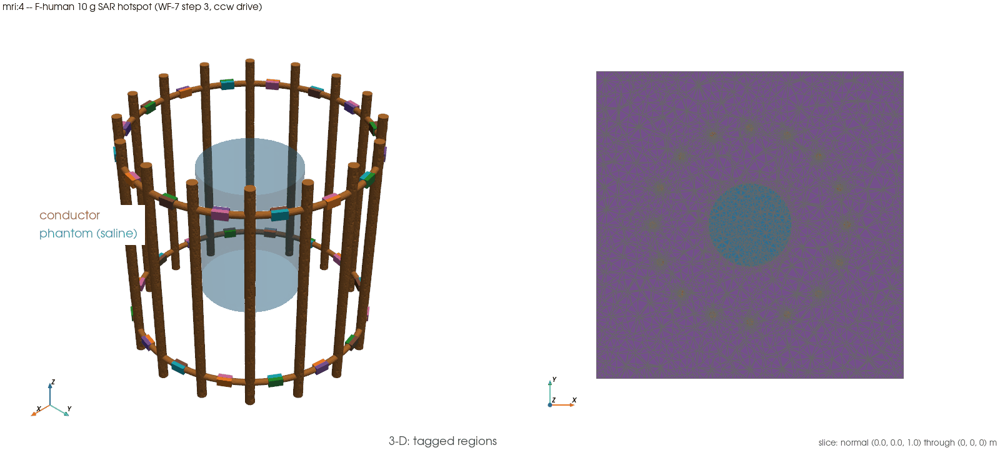

# `-e mri:4` — the 10 g SAR hotspot at human scale

Guide for `examples/mri/04_f_human_sar10g_hotspot.py` (`EX-62`).
Written to be followed without the source open.

## 1. What this demonstrates

**No example in the corpus solves a human-scale coil for a safety
quantity.** `mri:3` / `ans:2` average 10 g SAR on the 4-leg F-small
birdcage, but under one drive; `ports:15` drives the 16-leg F-human rung in
quadrature but reads only `|B1+|`; `mesh:12` builds the F-human rung without
solving it. This example is the missing picture: a ccw/cw quadrature drive
on the refined F-human phantom (`WF-7` step 2's `_build_ring_quadrature_case`,
imported), a nine-point candidate lattice (3 radii × 3 axial offsets) for
the local 10 g SAR maximum `c*`, and the C16 / mirror symmetry identities
read off the 10 g SAR itself rather than off `|B1+|`.

```
SAR(x) = sigma(x)|E(x)|^2 / (2 rho)                        pointwise
SAR_10g(c) = <ball of radius a10 centred at c, ccw drive>  mass-averaged
```

**Import, never restate** (`ANS-1`). Every band, tag and constant --
`C4_COVARIANCE_BAND`, `EXACT_IDENTITY_RTOL`, `PHANTOM_CELL_TAG`,
`PHANTOM_RHO_KG_PER_M3`, `QUADRATURE_DEGREE`, `TEN_GRAM_KG` -- comes from
`tests/validation/test_wf7_f_human_sar10g_hotspot.py`'s own import chain.
Nothing here is re-implemented.

**Rule (a) additive lift, disclosed** (the `EX-53`/`EX-61` precedent). The
gate module's `sar10g_case` pytest fixture is module-scoped and cannot be
called from a plain script. Its body is lifted verbatim to a module-level
`build_sar10g_case(comm)`; the fixture keeps its `FEM_EM_WF7_STEP3` env skip
and becomes a one-line delegate:

```python
@pytest.fixture(scope="module")
def sar10g_case():
    if not _step3_on():
        pytest.skip(...)
    return build_sar10g_case(MPI.COMM_WORLD)
```

No existing test's behaviour changed -- the fixture returns exactly what it
returned before, plus additive-only return keys (`mesh`, `cell_tags`,
`sigma`, `e_ccw`, `rho_field`, `centre`, `z_c`, `radius`, `half_height`,
`a10`, `az_ref`, `coords`, `key_star`, `c_star`, `sar_star`, `control_sar`,
`control`, `control_worst`, `phantom_cells`, `cells`, `case`, `build_s`,
`rss_after_sweep`, `rss_final`, `t_window`) that an external caller needs
and were not exposed before. The gate module was re-run green from `main`
in this slot -- see §3's harness log citation below.

### What it asserts

| anchor | what it is | band / record |
|---|---|---|
| **(i)** | coverage identity: whole-phantom ball power/mass vs the tagged integral | both `<= EXACT_IDENTITY_RTOL` = 1e-10 |
| **(ii)** | worst of the 15 C16 images of `c*`'s 10 g SAR | `<= C4_COVARIANCE_BAND` = 5.0% |
| **(iii)** | cw-at-mirror(`c*`) vs ccw-at-`c*` | `<=` the same 5.0% band |
| **(iv)** | every averaging ball (lattice + C16 + mirror + control) contained, 1 mm clear | asserted |
| **negative control** | single-drive P17 spread over `c*` and its three C4 images | `> C4_COVARIANCE_BAND` (asserted) |

All bands and tags come from the gate module; none is stated here.
**Printed, never gated:** `c*` = r 45 mm, z = z_c; the nine-ball location
table; the whole-phantom mean SAR; step 2's `|B1+|` C16/mirror readings on
the same refined mesh; the PRICE line.

**Scope.** One phantom, one fixture, 64 MHz, degree 1. No compliance and no
absolute SAR claim; degree 1 at human scale carries the 5.50% order caveat
(`WF-7` step 0b, and 0d's full-set reprint).

## Setup figure



`examples/mri/figures/mri_04_f_human_sar10g_hotspot_setup.png` (548 KiB).
Rendered right after `build_sar10g_case` returns the built mesh
(`FEM_EM_SETUP_FIGURES=1`) -- the gate's own mesh and cell tags, not a
re-derivation. The conductor (tag 1) draws by the class-colour rule, the
surrounding air (tag 2) is hidden, and the saline phantom
(`PHANTOM_CELL_TAG` = 3) is translucent. **What it actually shows** (checked
against the image, not assumed): the 3-D panel and the `z = z_c` slice
picture the 16-leg F-human rung and phantom; only "conductor" and "phantom
(saline)" resolve in the legend. The F-human rung's per-leg port-sheet tags
(`101`-`148`, `217`-`248` -- roughly ninety of them, the 16-port sheet
convention this rung uses, unlike the 4-leg birdcage's eight) are neither
named in `region_names` nor hidden, so every one prints `=?` in the run's own
`[setup-figure]` line -- a far larger instance of the same partly-unresolved
legend gap `ports:17`/`ports:19` already disclose, not a new defect class.
The slice is normal to `z` through `z = z_c` (the phantom's measured axial
centre, not `z = 0`) so it cuts the phantom at the height the coverage /
lattice geometry references. The nine lattice sites and `c*` are not mesh
regions and are not drawn in this figure (they appear as `LatticeBall` /
`CStar` threshold fields in the ParaView output, §4 step 9).

## 2. How to run it

Needs the complex DolfinX build and `-n 8` (heavy tier, record width); the
runner sources the complex build for the `mri:` group automatically.

```
./run_examples.sh -e mri:4 -n 8 -t 900
```

Through the logging harness, as every verification run must be:

```
scripts/testing/run_and_log.sh EX-62 "./run_examples.sh -e mri:4 -n 8 -t 900"
```

If the runner fails with `permission denied … /var/run/docker.sock`, run its
inner command verbatim (never piped, never subshell-wrapped — see
`docs/testing/known-issues.md` 2026-09-20 entry).

## 3. What it read on the run that landed it

**Re-recorded 2026-10-11 (`GEO-35` 2b-ii part 1): leg port boxes dropped; the
boxed figures are in `docs/planning/chunks/GEO-35.md`.** The block below is
`docs/testing/logs/20261012T021003Z_GEO-35-s2bii-W2-mri4.log`
(`FEM_EM_SETUP_FIGURES=1`), Status 0, **345 s** harness / 342.9 s in-example
at `-n 8`. Every figure equals its pre-registered 2b-i `dropped` reading
(`20261010T111003Z_GEO-35-s2bi-W2.log:10800–10836`) at the printed digits. The
superseded boxed block (`20260926T095026Z_EX-62.log`, 301 s: 537546 cells /
22594 phantom cells, build 132.20 s, window 292.69 s, power rel 9.392e-14,
mass rel 1.297e-13, worst C16 0.4904% at `R_7`, mirror 0.0502%, P17 control
96.4015% = 19.2803x the band = 196.6x the ccw worst, `SAR10g(c*)`
2.085815849e-04 W/kg, 18.618 GiB) is kept here as a record only.

```
[gate reproduced] 532935 cells (22822 phantom cells), build 139.87 s, window 337.75 s at -n 8

[containment] 29 balls checked, 1 mm clear (ASSERTED):
    worst excess -4.920661e-03 m (<= 0.0 means contained)

[anchor i] coverage ball radius 108.1429 mm (clear of the conductor: < 140.0 mm):
    power rel 1.965e-14, mass rel 1.645e-13 (ASSERTED both <= EXACT_IDENTITY_RTOL 1e-10)

[anchor ii] worst of the 15 C16 images: 0.3373% at R_3 (ASSERTED <= C4_COVARIANCE_BAND 5.0%)

[anchor iii] mirror 0.0234% (ASSERTED <= 5.0%)

[negative control] single-drive P17 10 g SAR spread over c* and its three C4 images:
    96.4033% (ASSERTED > C4_COVARIANCE_BAND 5.0%); 19.2807x the band,
    285.8x the ccw worst (0.3373%)

[c*] r 45 mm, z = z_c+0 mm (44.135, 8.779, 0.000) mm, SAR10g(c*) 2.079992000e-04 W/kg

[PRICE] build 139.87 s, window 337.75 s wall at -n 8; summed ru_maxrss
    18.308 GiB after the sweep, 18.308 GiB at the end

All asserted anchors hold. Total elapsed 342.9 s.
```

**Reproduced to the 2b-i reading's printed digit**: `c*` location,
`SAR10g(c*)` = `2.079992000e-04` W/kg (the move from the boxed value is
2.792e-03), C16 worst `0.3373%` at `R_3`, mirror `0.0234%`, negative control
`96.4033%` / `285.8x` the ccw worst, mass identity `1.645e-13`, mesh cell
counts (532935 / 22822), whole-phantom mean SAR `1.735495022e-04` W/kg, and
the nine-ball table. **One printed difference, not asserted, at the round-off
floor** (`EXACT_IDENTITY_RTOL` = 1e-10): the coverage power identity read
`1.965e-14` here against 2b-i's `1.121e-14` — both **≈4 orders of magnitude
inside the 1e-10 budget**, an MPI-reduction-order round-off jitter of the kind
already recorded for `GEO-34` step 1b′'s reciprocity digit (2026-09-26).

The rule (a) gate re-run, same commit, same slot:
`docs/testing/logs/20260926T095603Z_EX-62.log`, `-n 8`,
`FEM_EM_WF7_STEP3=1`, **4 passed in 285.45 s** (Status 0, 287 s harness-wall).

**Censuses, both before any file was written.** Docrefs (through the
logging harness both sides): `20260926T094635Z_EX-62.log` (`dead=0 guide=0
stale=10 exit=2`) → `20260926T100107Z_EX-62.log` (`dead=0 guide=0 stale=10
exit=2`, guide pass 56 → 57 runnable examples) — predicted `examples` 56 →
57, matched, `stale` unchanged. Setup-figure census (`EX-57`):
`examples=56 ok=33 missing=23 broken=0` → `examples=57 ok=34 missing=23
broken=0` (post logged, `20260926T100108Z_EX-62.log`) — predicted
`examples`/`ok` +1, `broken` 0, matched. **Deviation, disclosed:** the
pre-read for this second census was a bare (non-harness) call, not through
`run_and_log.sh` — still before any file was written, but not durably
logged; noted for the review. `OPS-59` (b) identity,
`tests/unit/test_doc_reference_exit_codes.py`:
`20260926T100123Z_EX-62.log`, **20 passed in 7.90 s** (run after `git add`ing
the PNG) — the new setup figure is admitted by the census-derived rule with
no manual pin edit needed.

## 4. How to analyze it, step by step

1. **Read the fixture line first.** `-n 8` — every assertion fires at this
   width; the gate itself is a fixed `-n 8` window (`FEM_EM_WF7_STEP3=1`).
2. **Read the containment line.** All lattice + C16 + mirror + control balls
   (30 in the gate's own run) sit inside the measured phantom with 1 mm
   clear — asserted before any SAR reading is trusted.
3. **Read anchor (i).** The whole-phantom ball's power and mass reproduce
   the tagged integral to round-off (`~1e-13`, budget `1e-10`) — the same
   discrete integral written two ways, so this is a coverage identity, not
   an accuracy claim.
4. **Read anchor (ii).** The worst of the fifteen C16 images of `c*` sits
   well inside the 5.0% band (the gate read 0.3373% at `R_3`) — the
   quadrature-driven field is, to that tolerance, C16-symmetric about the
   coil axis at the SAR maximum, not just at `|B1+|` (step 2's claim).
5. **Read anchor (iii).** The cw drive's mirror image of `c*` agrees with
   the ccw drive at `c*` to the same band (the gate read 0.0234%) — the
   two circular-polarisation senses are mirror images of each other, as the
   fixture's construction predicts.
6. **Read the negative control.** A single leg (P17) alone, not the
   quadrature superposition, produces a 10 g SAR spread over the same four
   sites of order 100% (the gate read 96.40% = 19.28x the band, 285.8x the
   ccw worst) — confirming the C16 agreement in step 4 is a property of the
   *quadrature drive*, not an artefact of the mesh or the averaging
   operator.
7. **Read the nine-ball table and `c*`.** The argmax over 3 radii × 3 axial
   offsets sits at r = 45 mm, z = z_c (the largest radius tried, centre
   height) — the SAR maximum is at the phantom's outer edge nearest the
   coil, not buried inside it.
8. **Open the CSV**
   (`examples/mri/paraview_output/mri_04_f_human_sar10g_hotspot_lattice.csv`)
   — the nine-ball table: `r_m`, `dz_m`, `x_m`/`y_m`/`z_m`, `sar10g_w_per_kg`,
   `mass_kg`, `wall_s`, `is_c_star`.
9. **Open the combined XDMF**
   (`examples/mri/paraview_output/mri_04_f_human_sar10g_hotspot_combined.xdmf`)
   in ParaView. Colour by `SAR` (W/kg, the ccw-drive pointwise field, phantom
   physical density). Threshold `LatticeBall` (1-9) to see the nine
   candidate sites; threshold `CStar` (1) to see the argmax alone. Threshold
   `CellTags` (`PHANTOM_CELL_TAG`) to see the balls sitting inside the
   phantom.
10. **What a deviation means.** Anchor (i) off round-off → a defect in
    `mass_averaged_sar`'s cell coverage — known-issues entry, stop, never
    widen `1e-10`. Anchor (ii) or (iii) outside 5.0% → report, never re-band
    in this slot (`ANS-1`/`§9` rule (e) territory — a review decision).
    Negative control landing *inside* the band → the quadrature drive has
    lost its C16 symmetry entirely (a much larger regression) — stop
    immediately. Mesh cell count differing from the gate's own printed
    reading → `build_sar10g_case` is not running the fixture's construction
    — every reading belongs to a different fixture and nothing above is
    comparable.

## 5. Scope and caveats — read before quoting a number

* **No C95.3 / IEC compliance claim, no absolute SAR against anything
  external.** Every anchor here is a symmetry identity on one fixture, one
  mesh, degree 1.
* **Degree 1 at human scale carries the 5.50% order caveat** (`WF-7` step
  0b, and 0d's full-set reprint) — not remeasured here.
* **One phantom, one fixture, 64 MHz.** No sweep, no convergence claim, no
  homogeneity claim.
* **The nine-point lattice is a fixed, pre-registered candidate set** (3
  radii × 3 axial offsets at a single azimuth) — not a resolution sweep, not
  a claim that the true continuum maximum sits exactly at a lattice node.

## Related

- The gate this example calls into:
  `tests/validation/test_wf7_f_human_sar10g_hotspot.py` (`WF-7` step 3).
- One-drive 10 g SAR on the 4-leg F-small birdcage:
  `examples/mri/03_birdcage_mass_averaged_sar.py` (`mri:3`, `EX-53`).
- The quadrature drive's `|B1+|` C16/mirror identities on the same refined
  F-human mesh: `tests/validation/test_wf7_f_human_b1_quadrature.py`
  (`WF-7` step 2).
- The F-human rung built but not solved: `examples/meshing/12_birdcage_f_human_rung.py`
  (`mesh:12`).
- Why no C95.3 or absolute-SAR claim is made: PROJECT_PLAN.md §2.
