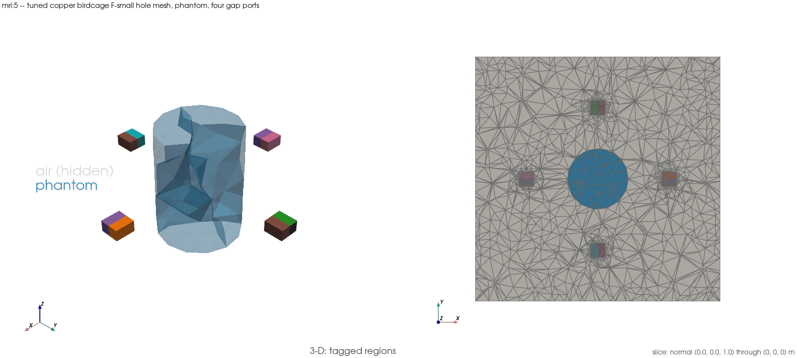

# `-e mri:5` — where the tuned birdcage's 1/Q goes: Q two ways, loaded and unloaded

Script: `examples/mri/05_birdcage_q_loaded_unloaded.py` (`EX-78`)
Gates: `tests/validation/test_wf5_q_two_ways.py` (`WF-5` step 1),
`tests/validation/test_wf5_loading.py` (`WF-5` step 2)

## 1. What this demonstrates

The tuned F-small copper birdcage on `ANS-7`'s Route A hole mesh (80 181
cells, degree 1, tracked κ, copper by Leontovich) resonates at f₀ ≈ 63.98 MHz.
`ans:7` and `ports:19` read its Q off the susceptance slope of the input
admittance. This example also forms Q = ω₀W/P from the field's own stored
energy and loss, solves the same coil unloaded (phantom σ = 0, ε_r kept), and
shows where the 1/Q goes.

- Stored energy at f₀ is ≈ half magnetic (W_m 0.4998), ≈ a quarter in the
  three C-terminated sheets (0.2462) and ≈ a quarter in C₁ (0.2464), with the
  electric share under 1 % (W_e 0.0074).
- Q from energy over loss equals the Y_in-slope Q: loaded 920.010 against
  919.037, unloaded 2283.280 against 2279.420.
- The loaded 1/Q = 1.086944e-3 splits 59.7 % phantom (6.489692e-4) and 40.3 %
  copper (4.379752e-4). Removing σ removes exactly the phantom's share
  (Δ(1/Q)_slope 6.4939e-4 against Π 6.4898e-4), while f₀ moves only
  Δf₀/f₀ = −4.523479e-6 (second order, printed only).
- Maps: the combined XDMF holds |E| loaded vs unloaded, the phantom loss
  density and the copper loss per adjacent cell.

Everything is imported from the gate modules and nothing is restated; the
fields come from wrapping `ans7._route_a_solve` around each `_budget` call
(the gate's own capture pattern), restored in `finally` on every rank. No gate
or `src/` edit.

Asserted (imported bands; every value reproduces the `WF-5` record to the
printed digits):

- global cells 80 181 == tracked `n_cells`;
- (A0) loaded secant f₀ 63 982 288.790145 Hz and Q_slope,L 919.0373774 reproduce
  `rows_route_a.cu` to 1.2e-16 / 1.4e-13 ≤ `RECORD_RTOL` (1e-8);
- loaded |Q_field − Q_slope|/Q_slope = 1.0586e-3 ≤ `B_Q_FROZEN` (3e-3); loaded
  identity 1.5e-11 ≤ `DISCRETE_IDENTITY_RTOL` (1e-6);
- (A1) P_phantom,U = 0.0; (A2) unloaded identity 3.7e-13 ≤ 1e-6;
- (A3) unloaded Q two ways 1.6934e-3 ≤ `B_Q_U_FROZEN` (2e-3);
- (A4) |Δ(1/Q)_slope − Π|/Π = 6.3012e-4 ≤ B_Δ = 6.3743e-3;
- map sums: phantom density × volume, and copper loss per cell (loaded and
  unloaded), each reproduce P_phantom,L and P_surf to ≤ 3e-15 (DG0 partition of
  unity: a consistency check, not physics).

**Negative control (asserted only as "> band"):** dropping W_sheets from the
budget misses the loaded Q by 0.24536 (band 3e-3), the unloaded Q by 0.24491
(band 2e-3) and Π′ against Δ(1/Q)_slope by 0.24567 (band 6.37e-3) — each
saturates near the sheet share, ≈ 0.246.

Printed, not gated: the energy shares loaded and unloaded, the 1/Q partition,
Π_ph beside `STEP1_PI_PH["cu"]` (6.489692e-4), Δf₀/f₀.

Not claimed: the PEC column, phantom resolution (never passed), absolute Q,
tuning, h-convergence, AED.

## 2. How to run it

```
./run_examples.sh -e mri:5 -n 4 -t 300
```

Needs the complex DolfinX build, which the runner sources for the `mri:`
group. Tier: **standard**. Run at `-n 4` only: the records are `-n 4` digits.
The run takes ≈ 88 s wall (mesh 26 s, 11 sweep solves 42 s, two budgets 13 s),
≈ 2.4 GiB summed RSS. Verification runs go through the logging harness with the
runner's emitted command (`./scripts/run_examples.sh -e mri:5 -n 4 -t 300
--dry-run`). Add `-e FEM_EM_SETUP_FIGURES=1` after `exec -T` to re-render the
setup figure.

## Setup figure



`examples/mri/figures/mri_05_birdcage_q_loaded_unloaded_setup.png`. The figure
shows the F-small birdcage hole mesh with air hidden, the phantom translucent,
the four gap-port sheets, and the z-slice through the coil mid-plane.

## 3. How to analyze it, step by step

**Step 1 — the fixture and (A0).** `[fixture]` confirms 80 181 cells and the
tracked κ; `[A0]` shows the fresh loaded secant f₀ and Q reproduce the
tracked row to the printed digits.

**Step 2 — where the energy sits.** `[energy]` loaded and unloaded: half
magnetic, a quarter in the terminated sheets, a quarter in C₁, W_e < 1 %.
Removing σ barely changes the shares.

**Step 3 — Q two ways.** `[Q_L]` and `[A3]` print Q from energy over loss next
to Q from the slope, each beside the `WF-5` record.

**Step 4 — the 1/Q partition.** `[1/Q]` splits the loaded 1/Q into phantom and
copper; `[A4]` shows the slope's Δ(1/Q) on unloading equals the field's Π, and
`[loading]` that Δf₀/f₀ is second order.

**Step 5 — the control.** `[control]` shows that a budget missing W_sheets
misses all three bands by ≈ 25 %.

**Step 6 — ParaView.** Open
`examples/mri/paraview_output/mri_05_birdcage_q_loaded_unloaded_combined.xdmf`.
It holds CG1 `E_magnitude_loaded` and `E_magnitude_unloaded`, DG0
`phantom_loss_density_W_per_m3`, and DG0
`coil_surface_loss_per_cell_W_loaded` / `coil_surface_loss_per_cell_W_unloaded`
(W per adjacent cell, not a density). Nothing in the file is asserted beyond
the printed map sums.

## Related

- The tuned birdcage and its resonance curve: `ans:7`
  (`examples/ansys_benchmarks/ans7_tuned_copper_birdcage_driven_sweep/07_tuned_copper_birdcage_driven_sweep.md`),
  `examples/ports/19_birdcage_tuned_resonance_curve.md`.
- The copper loss map: `examples/ports/18_birdcage_copper_leontovich.md`.
- The gate modules: `tests/validation/test_wf5_q_two_ways.py`,
  `tests/validation/test_wf5_loading.py`.
