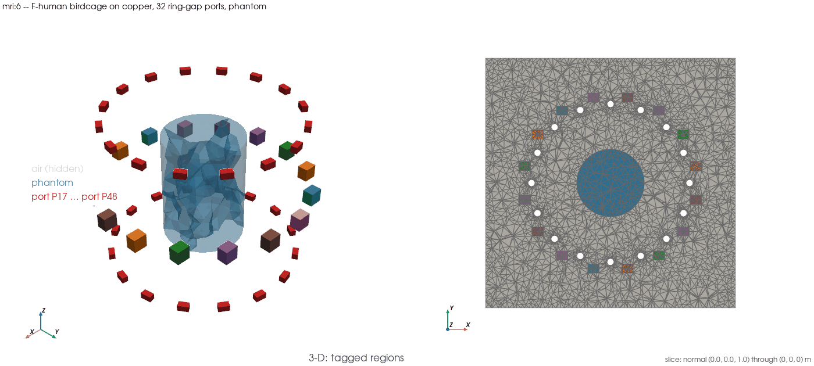

# `-e mri:6` — the F-human 32×32 on copper: where each drive's power goes

Script: `examples/mri/06_f_human_copper_loss_partition.py` (`EX-80`)
Gate: `tests/validation/test_wf12_f_human_copper_matrix.py` (`WF-12` step 2)

## 1. What this demonstrates

The 32-port F-human birdcage on the hole mesh (369 387 cells, degree 1,
64 MHz, every ring gap terminated at 50 Ω) with `TH-14`'s Leontovich copper wall
(σ = 5.8e7), 32 drives (one factorising solve, 31 back-substitutions) and one
PEC column. The example re-executes the gate's own body (`_run_step2`, lifted
to module level with an optional `field_hook`) and reproduces its records.

- P17's partition of P_src: 99.97 % in the 32 terminated sheets, 2.10e-4 in the
  phantom, 1.24e-4 in the copper wall. Of what the sheets do not take, the
  coil's share P_surf / (P_src − ΣP_sheet) is 0.3699–0.3737 over the 32 drives,
  against 0.9945 at σ = 800. Never read this share against P_src.
- The 32×32 is reciprocal to round-off (≈ 7e-15), passive (σ_max 0.999993339099,
  column Σ|S|² 0.993097–0.993680) and falls in 18 symmetry classes (worst
  spread 3.2748 %).
- Copper is not PEC: ΔΣ|S_i,17|² = 3.3903e-4 and max |ΔS| = 2.2094e-4; the PEC
  field puts 2.8e-23 × the copper P_surf on the wall.
- Maps: |E|, phantom loss density and copper loss per adjacent cell, Cu against
  PEC, in one XDMF.

Asserted (every band and record imported from the gate modules, nothing
restated; each printed beside `20261002T094751Z_WF-12-step2-W2.log:6352-6414`):
(A0), (R), (P) over 32 drives, (ii), (iii), (iv′), (PEC), plus the
deterministic digits above. Round-off-level quantities (reciprocity, PEC
identity) are asserted only against their bands.

**Example-side identities (asserted, true by construction):** the owned sums of
the Cu phantom map, the Cu coil-loss map and the PEC phantom map equal the
gate's P_phantom / P_surf to ≤ 3e-15 (band 1e-6): a DG0 partition of unity.

**Negative control (asserted):** the energy identity with P_surf dropped
misses by ≥ 10× the identity band on every Cu drive. Measured minimum 123.3×
(ceiling ≈ 124×); P17 with the map-sum P_phantom 123.6×.

Not claimed: |B₁⁺| or the hotspot, `C_mode`, a PEC 32×32, degree 2, loss
against AED, absolute loss. The wall-loss band is the weekly's.

## 2. How to run it

```
./run_examples.sh -e mri:6 -n 8 -t 480
```

Needs the complex DolfinX build, which the runner sources for the `mri:`
group. Tier: **heavy**, `-n 8` only. The run takes ≈ 270–280 s wall (mesh
≈ 110 s), ≈ 10 GiB summed RSS. Verification runs go through the logging
harness with the runner's emitted command (`./scripts/run_examples.sh -e mri:6
-n 8 -t 480 --dry-run`). Add `-e FEM_EM_SETUP_FIGURES=1` after `exec -T` to
re-render the setup figure.

## Setup figure



`examples/mri/figures/mri_06_f_human_copper_loss_partition_setup.png`. The
figure shows the hole mesh with air hidden, the phantom translucent, the
copper conductor and the 32 ring-gap port boxes, and the z-slice through the
coil mid-plane.

## 3. How to analyze it, step by step

**Step 1 — the anchors.** `[anchor]` lines print each reading beside its W2
record; every one is asserted.

**Step 2 — the class table.** `[classes]` lists the 18 symmetry classes with
mean |S| and spread.

**Step 3 — the control.** `[control]` shows the P_surf-blind identity missing
by 123.3× the band; `[map]` shows the three map sums closing.

**Step 4 — the partition.** `[printed]` gives P17's fractions of P_src, the
coil share and Cu against PEC.

**Step 5 — ParaView.** Open
`examples/mri/paraview_output/mri_06_f_human_copper_loss_partition_combined.xdmf`.
It holds DG0 `E_magnitude_cu_P17`, `phantom_loss_density_cu_P17`,
`coil_surface_loss_per_cell_W_cu_P17` (W per adjacent cell, not a density),
`E_magnitude_pec_P17`, `phantom_loss_density_pec_P17` and `CellTags`.
Threshold `CellTags` to the phantom and colour by loss density, Cu against
PEC; threshold the coil loss > 0 to see it crowd at the driven gap.

## Related

- `examples/mri/04_f_human_sar10g_hotspot.md` (`mri:4`) and
  `examples/mri/05_birdcage_q_loaded_unloaded.md` (`mri:5`).
- `examples/ports/18_birdcage_copper_leontovich.md` (`ports:18`).
- `examples/ansys_benchmarks/ans8_f_human_quadrature_mode_content_64MHz/` (`ans:8`).
- The gate: `tests/validation/test_wf12_f_human_copper_matrix.py`.
