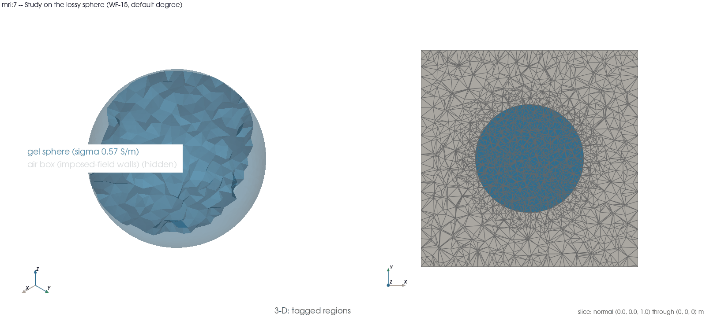

# `-e mri:7` — a `Study` on the lossy sphere at the default degree

Guide for `examples/mri/07_study_lossy_sphere.py`.
Written to be followed without the source open.

## 1. What this demonstrates

**The first study through the installed API.** `WF-15`'s `Study` composes a
geometry generator, a gelled-saline material, an imposed uniform field, a solve
and a SAR result. This example builds one on `MAT-4` step 1's lossy sphere —
the sphere and the imposed 1 V/m uniform field at 64 MHz, σ = 0.57 S/m,
εᵣ = 78 — and reads its mean SAR against two references:

* `WF-15`'s degree-2 record, 8.0116577245e-08 W/kg, to `L0_BAND` (1e-9);
* `MAT-4`'s closed form, 8.008354e-08 W/kg, to `MAT4_BAND` (10 %).

The example states no σ, εᵣ, frequency, field or radius of its own: every
constant is imported from the gate modules (`tests/package/test_wf15_study_lossy_sphere.py`,
`tests/package/test_wf17_first_study_tutorial.py`,
`tests/validation/test_mat5_em_coupled_sphere.py`,
`tests/materials/test_phantom_material_model.py`) and the physics numbers are read
from the built `Study`.

**Why the default degree.** The `Study` is built with no `degree=` keyword, so
it solves at degree 2. `degree=1` reproduces `MAT-4`'s older figure but is
3.4 % low against the degree-2 record; negative control (c2) shows the (R)
comparator tells the two apart.

On record (`WF-15` W2a, `20261005T170537Z_WF-15-r2-W2a-deg2-study.log`;
`WF-17` W2, `20261006T004709Z_WF-17-W2-first-study-deg2.log`):

| Quantity | Reference | Record | Bound |
| --- | --- | --- | --- |
| (Deg) solved space | degree 2 | 2 | exact |
| (R) SAR vs `WF-15` record | 8.0116577245e-08 W/kg | 2.007e-11 off (`WF-17`) | `L0_BAND` 1e-9 |
| (G) SAR vs closed form | 8.008354e-08 W/kg | 0.0413 % | `MAT4_BAND` 10 % |
| (c1) `"mid"` preset (σ 0.75, degree 1) vs closed(0.57) | — | 14.05 % off | must exceed 10 % |
| (c2) `MAT4_DEG1_RECORD` vs degree-2 record | — | ≈ 3.5 % | must exceed 1e-9 |
| Mesh | — | 74 020 cells, 482 158 N1curl dofs (printed, version-tagged) | — |

The run of record for this example is in the harness logs `EX-91` and
`EX-91-control` (flagged and unflagged runs; equal inside `L0_BAND`, not
digit-equal — the degree-2 SAR differs at the tenth digit between the two
`-n 2` runs, 9.512e-11 / 1.207e-11 from the record).

**Not claimed:** anything `WF-15` does not claim — no coil, no convergence or
h-statement, no local or 10 g SAR accuracy, no degree-1 production use.

## Setup figure



`examples/mri/figures/mri_07_study_lossy_sphere_setup.png`. Rendered right
after the `Study` is solved, from `study.result.mesh` and `cell_tags`
(`FEM_EM_SETUP_FIGURES=1`). The sphere ("gel sphere (sigma 0.57 S/m)") is
translucent; the air box ("air box (imposed-field walls)") is hidden. The slice
is normal to `z` through the origin. The figure is geometry only.

## 2. How to run it

```
./scripts/run_examples.sh -e mri:7 -n 2 -t 590
```

**Complex build required** — the `mri:` group sources it automatically.
Tier: **heavy** (`-n 2`, container `timeout -k 30 590`). One degree-2 solve
(≈ 280 s on record) plus one degree-1 solve for (c1) (≈ 15 s). Summed RSS
≈ 20–22 GiB.

## 3. How to analyze it, step by step

**Step 1 — the study and its degree.**

```
[study] ... Study.degree = 2, result.degree = 2, space degree 2
[mesh] 74020 cells, 482158 N1curl dofs (printed; version-tagged ...)
```

Cells and dofs are printed, not asserted: they belong to the mesher/image
version. The degree is asserted three ways (the `Study`, its result, the
solved N1curl space).

**Step 2 — (R) and (G).**

```
[(R)] SAR = ... (8.0116577245e-08); record 8.0116577245e-08; rel ... (band L0_BAND 1e-09)
[(G)] closed form 8.008354e-08; rel 0.04...% (band MAT4_BAND 0.1)
```

(R) says the example path reproduces `WF-15`'s record to the digits; (G) says
the figure sits inside `MAT-4`'s band of the lossy-sphere closed form. A miss
on either is an example/test divergence finding: report and stop, never widen.

**Step 3 — the negative controls.**

```
[(c1)] mid preset (sigma 0.75, degree 1): SAR = 6.88...e-08 ('6.8832e-08' vs MAT-1 '6.8832e-08'); rel to closed(0.57) 14.05...%
[(c2)] |MAT4_DEG1_RECORD/WF15_DEG2_RECORD - 1| = 3.5...e-02 (must exceed L0_BAND 1e-09 ...)
```

(c1) runs the same `Study` with a different material: the answer must move by
more than `MAT4_BAND`, so the (G) comparator is not blind to σ. (c2) compares
two imported constants: the (R) comparator separates degree 1 from degree 2.

**Step 4 — open it in ParaView.**
`File → Open → examples/mri/paraview_output/mri_07_study_lossy_sphere_combined.xdmf`.
It holds `E_abs` (|E| in P1), `SAR` (DG0, W/kg), `sigma` (DG0, S/m) and
`CellTags`.

1. **Threshold** on `CellTags` (`1` = the gel sphere) and colour by `SAR`.
   Outside the sphere σ = 0, so SAR is identically zero.
2. **Plot Over Line** along x on `E_abs`: |E| is the imposed field outside and
   the (smaller) interior field across the sphere.

**Step 5 — what a deviation means.** (Deg) fails → the default changed. (R)
fails with (G) fine → the `Study` path or the solver changed at the 1e-9
level: a `WF-15` regression. (G) fails → read it as evidence about the setup
before the code. (c1) or (c2) fails → the comparators are blind. Any of these:
report and stop.

## Related

- `docs/guide/first_study.md` — the tutorial this example reproduces.
- `examples/mri/02_mass_averaged_sar.py` (`mri:2`) — the same sphere with an
  imposed field and no solve, gating the averaging operator.
- `tests/package/test_wf15_study_lossy_sphere.py` — the `WF-15` gate.
