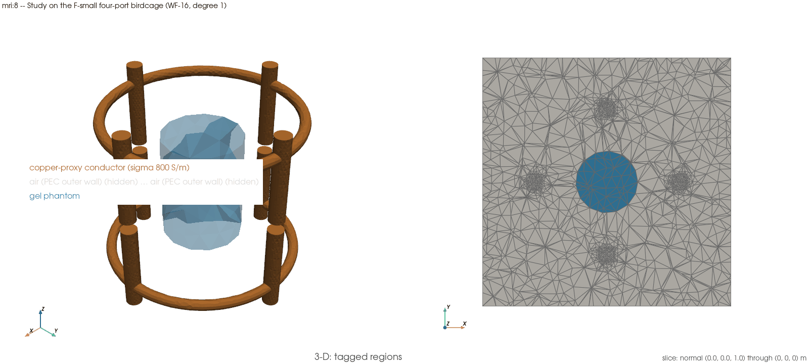

# `-e mri:8` — four-port S from one `Study`: the F-small birdcage

Guide for `examples/mri/08_study_four_port_birdcage.py`.
Written to be followed without the source open.

## 1. What this demonstrates

**One `Study`, four ports, a Touchstone file.** `WF-16`'s `Study` composes
`FourPortBirdcageGeometry.f_small()` (the F-small 4-leg birdcage), a gelled-saline
phantom and a `LumpedPortDrive`, solves the four drives at 64 MHz and returns
the 4×4 S and Z. This example builds it at **degree 1 on `-n 2`**, writes the
`.s4p`, reads it back through `scikit-rf`, and holds all of it to item 192's
registered record (`ANS4_EXACT_STRIP_S_P1_RECORDS["64"]`, called `P1`).

**Exact rectangles, κ off.** The four port sheets are exact CAD rectangles; the κ
width correction is not applied to them (operator ruling 2026-10-02), and
`FourPortBirdcageGeometry` refuses κ and ragged sheets. The example passes no
`strip_fraction` and no κ keyword.

**Degree.** Degree 2 is the `Study` default; `P2_X1`, the degree-2 record, is held
at `-n 8` by `WF-16`. This example uses `degree=1`, the row's letter and the
cheaper leg: the Study takes ≈ 37 s here against 268 s for the degree-2 leg. The
`P1` record holds at `-n 2` only (`OPS-41`), and the script asserts the width.

**What S means here.** S is a **self-consistency record** (reciprocity,
passivity, C4 symmetry, a registered number reproduced), **not an
absolute-accuracy claim** (PROJECT_PLAN §2.2): no tuning, resonance or absolute
`S₁₁` / `Z_in` figure is claimed.

Every constant, band and helper is imported from the gate modules; the example
states no σ, εᵣ, frequency, geometry dimension or impedance of its own.

Readings of record (flagged run, harness log `EX-92`; the control run `EX-92-control`
reproduces them inside the band, not bitwise):

| Anchor | Reference | Reading | Bound |
| --- | --- | --- | --- |
| (W) rank width | `ANS4_EXACT_STRIP_RECORD_RANK_WIDTH` | 2 == 2 | exact |
| (R) S vs `P1` | item 192 record | 9.557e-11 | `LEG_D0_REPRODUCTION_BAND` 1e-9 |
| (G) reciprocity | `RECIPROCITY_BAND` | 4.377e-16 | 1e-3 |
| (G) σ_max / max column power | 1 + `PASSIVITY_SIGMA_TOLERANCE` | 0.999760093664 / 0.820520164533 | ≤ 1 + 1e-9 |
| (G) class spreads (self / adjacent / opposite) | `ADJACENT_SPREAD_BAND` | 0.0747 / 0.0691 / 0.0897 % | 0.5 % |
| (G) pooled separation | `POOLED_SEPARATION_FLOOR` | 451.71× | ≥ 10× |
| (T) `.s4p` via `skrf` vs S | `ANCHOR_TOL` | 6.855e-14 | 1e-12 |
| (T) file vs `P1` | `LEG_D0_REPRODUCTION_BAND` | 9.556e-11 | 1e-9 |
| (c1) S vs degree-2 record | must exceed the band | 4.910e-02 (4.9e7× the band) | > 1e-9 |
| (c2) P1↔P2 swap vs `P1` | must exceed the band | 0.2492 | > 1e-9 |
| (X) `keep_fields` sweep S vs Study S | `LEG_D0_REPRODUCTION_BAND` | 0 (same process, same solve) | 1e-9 |
| Mesh | — | 117 206 cells (printed; version-tagged) | — |

A cyclic port rotation against `P1` reads only 6.185e-04 because of C4 symmetry,
which is why the control is the P1↔P2 **swap**, not a rotation.

**Not claimed:** degree 2, tuning or resonance, an absolute `S₁₁` / `Z_in`, a
frequency sweep (that is a separate example), anything `WF-16` does not claim.

## Setup figure



`examples/mri/figures/mri_08_study_four_port_birdcage_setup.png`. Rendered right
after the `Study` is solved, from `study.result.mesh` and `cell_tags`
(`FEM_EM_SETUP_FIGURES=1`). Regions: "copper-proxy conductor (sigma 800 S/m)"
(legs and rings), "gel phantom" (translucent) and "air (PEC outer wall)"
(hidden; the generator carries more than one such tag, so the legend repeats the
label). The slice is normal to `z` through the origin and cuts the phantom. The
renderer takes cell tags only, so the four port sheets (facet tags P1–P4) are not
drawn: they are the exact rectangles in the four leg gaps. The figure is geometry only.

## 2. How to run it

```
./scripts/run_examples.sh -e mri:8 -n 2 -t 300
```

**Complex build required** — the `mri:` group sources it automatically. Tier:
**standard by prediction** (`-n 2`, container `timeout -k 30 300`). One degree-1
Study (≈ 37 s: mesh ≈ 28 s, four drives ≈ 8 s) plus one `keep_fields` sweep
(≈ 8 s), the whole script ≈ 50 s.

## 3. How to analyze it, step by step

**Step 1 — the study and its mesh.**

```
[study] degree 1, -n 2, f = 6.400000e+07 Hz, z0 = 50 ohm, terminated port impedance 50 ohm
[mesh] 117206 cells (printed; version-tagged 117206); Study ... s (mesh ... s, sweep ... s); ...
[(W)] comm.size 2 == record width 2
```

Cells are printed, not asserted: they belong to the mesher/image version. (W) is
asserted before any S comparison.

**Step 2 — (R) and (G).**

```
[(R)] ||S - P1||/||P1|| 9.557e-11 (band LEG_D0_REPRODUCTION_BAND 1e-09)
[(G)] reciprocity 4.4e-16 ...; sigma_max 0.9997600...; max column power 0.8205...; spreads self 0.0747%, ...; separation 451.71x
```

(R) says the example path reproduces the registered S to the digits; (G) is
`PORT-11`'s identities on this Study's own S and Z. A miss on either is an
example/test divergence finding: report and stop, never widen.

**Step 3 — the Touchstone file.** The `.s4p` is written by
`res.write_touchstone` (rank 0, then a barrier) and read back by `skrf` on rank 0:

```
! FEM-EM Solver Touchstone export
! port_order: P1,P2,P3,P4
! frequency_points_hz: 6.400000000e+07
! z0_ohm: 50.000000
# Hz S RI R 50.000000
6.400000000e+07 4.157171199843e-02 5.886182509877e-01 3.684563461254e-01 -2.077504867619e-01 ...
```

```
[(T)] max|S_skrf - S| 6.855e-14 (ANCHOR_TOL 1e-12); |df| 0.000e+00 Hz ...; nports 4; z0 [50.0, 50.0, 50.0, 50.0]; ||S_file - P1||/||P1|| 9.556e-11
```

**Step 4 — the negative controls.**

```
[(c1)] ||S - degree-2 record||/||.|| 4.9103e-02 (4.9e+07x the band; must exceed it)
[(c2)] P1<->P2 swap vs P1 0.2492 (must exceed 1e-09); printed: cyclic rotation 6.185e-04 ...
```

(c1): the record comparator tells degree 1 from degree 2. (c2): it sees a port
relabelling. Neither costs a solve.

**Step 5 — the field (X).** `PortStudyResult.fields` is `None`: the `Study` keeps
no field. The example runs one `run_n_port_sparameter_sweep(..., keep_fields=True)`
on the Study's own problem and mesh and draws the **P1-drive** field from it.
`[(X)]` asserts that sweep's S equals the Study's inside the band, so the drawn
field belongs to the gated S. The S is printed, not a record.

**Step 6 — open it in ParaView.**
`File → Open → examples/mri/paraview_output/mri_08_study_four_port_birdcage_combined.xdmf`
(and the `.s4p` beside it in any Touchstone viewer). The XDMF holds `E_abs` (|E| of
the P1 drive, P1 Lagrange), `sigma` (DG0, S/m) and `CellTags`. The mesh is affine,
so the N1curl field is interpolated, not written directly.

1. **Threshold** on `CellTags` (`3` = the gel phantom) and colour by `E_abs`.
2. **Slice** at z = 0 (normal `z`, origin 0) to see the field in the phantom
   mid-plane.

**Step 7 — what a deviation means.** (W) fails → the run is not at `-n 2`. (R)
fails with (G) fine → the Study path or solver moved at the 1e-9 level: a `WF-16`
regression. (G) fails → read it as evidence about the setup before the code. (T)
fails → the Touchstone writer or reader changed. (c1) or (c2) fails → the
comparator is blind. Any of these: report and stop.

## Related

- `examples/mri/07_study_lossy_sphere.py` (`mri:7`) — the first `Study` example, on
  the lossy sphere, with an imposed field.
- `examples/mri/09_study_from_yaml.py` (`mri:9`) — the same studies driven from YAML.
- `tests/package/test_wf16_study_four_port.py` — the `WF-16` gate this example reproduces.
- `docs/guide/first_study.md` — the `Study` tutorial.
