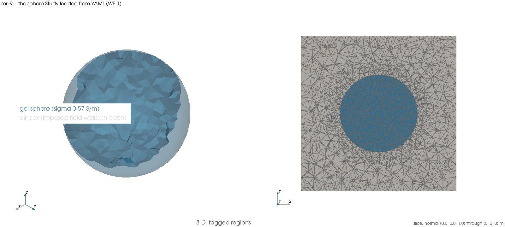

# `-e mri:9` — the same studies from YAML

Guide for `examples/mri/09_study_from_yaml.py`.
Written to be followed without the source open.

## 1. What this demonstrates

**`femem run` on a YAML file gives the Python route's study and outputs.**
`WF-1`'s `fem_em_solver.cli` reads a study from a YAML file, runs it and writes
a JSON summary (plus a Touchstone file for the four-port). This example drives
`cli.main(["run", <yaml>, "--output-dir", <dir>])` in-process on two YAML files
beside it, at degree 1 and `-n 2`, and reads the outputs against the Python
route's records:

* `09_study_from_yaml_sphere.yaml` — `MAT-4` step 1's lossy sphere (σ = 0.57 S/m,
  εᵣ = 78, 64 MHz, imposed 1 V/m field);
* `09_study_from_yaml_four_port.yaml` — `WF-16`'s F-small four-port birdcage
  (exact-rectangle ports, κ off).

The two files are copies of `tests/package/wf1/sphere_mat4.yaml` and
`tests/package/wf1/f_small_four_port.yaml` with **only the first (comment) line
changed**. The script asserts each is spec-equal to its original, so neither file
can drift silently. Every constant, band and helper is imported from the gate
modules (`tests/package/test_wf1_study_yaml.py`, `test_wf15_…`, `test_wf16_…`,
`tests/validation/…`); the example restates none.

The sphere YAML:

```yaml
femem: 1
study:
  frequency_hz: 64000000.0
  degree: 1
  density_kg_m3: 1000.0
geometry:
  kind: sphere_in_box
  sphere_radius: 0.01
  box_half_width: 0.02
  resolution_sphere: 0.001
  resolution_far: 0.002
  sphere_tag: 1
material:
  sigma: 0.57
  epsilon_r: 78.0
excitation:
  kind: quasi_static_sphere_field
  e0: 1.0
```

The four-port YAML:

```yaml
femem: 1
study:
  frequency_hz: 64000000.0
  degree: 1
geometry:
  kind: four_port_birdcage
  preset: f_small
material:
  sigma: 0.5
  epsilon_r: 78.0
excitation:
  kind: lumped_port_drive
```

**The command line.** The same files from a shell:

```
femem check examples/mri/09_study_from_yaml_sphere.yaml
femem run   examples/mri/09_study_from_yaml_sphere.yaml --output-dir out/sphere
femem check examples/mri/09_study_from_yaml_four_port.yaml
femem run   examples/mri/09_study_from_yaml_four_port.yaml --output-dir out/four_port
```

Exit-code contract: **0** on success, **2** on a configuration error (and a
config error writes nothing, not even the output directory). `check` parses and
validates without solving.

On record (`WF-1` `20261006T003504Z_WF-1-W1-parse-sphere.log`,
`20261006T003650Z_WF-1-W2-f-small.log`; this example `EX-93`, `EX-93-control`):

| Quantity | Reference | Record | Bound |
| --- | --- | --- | --- |
| (K) specs by `float.hex` | originals and Python `Study` | all four diffs `[]` | exact |
| (R-sphere) SAR | `MAT4_DEG1_RECORD` 8.2915581280e-08 W/kg | 6.222e-11 off (control 6.348e-11) | `L0_BAND` 1e-9 |
| (R-S) F-small S matrix | `P1 = _record(1)` | 9.557e-11 (both runs) | `LEG_D0_REPRODUCTION_BAND` 1e-9 |
| (X) unknown-key file | `geometry.sphere_raduis` named | `run` rc (2, 2), no output dir | exact |
| (c3) S vs `_record(2)` | — | 0.0491 | must exceed 1e-9 |
| Mesh | — | 74 020 sphere cells, 117 206 F-small cells (printed, version-tagged) | — |

The sphere SAR agrees between the flagged and control runs at the `.10e` print
(8.2915581285e-08) but not beyond it (8.291558128515863e-08 against
8.291558128526377e-08, residuals 6.222e-11 / 6.348e-11): the `-n 2` MUMPS floor,
as on `mri:7`. The S matrix residual agrees to all printed digits.

**Not claimed:** a stable YAML schema, degree 2, the installed-wheel `femem`
entry point (`WF-1` W5), Touchstone accuracy (the read-back is `EX-92`'s angle),
or anything `WF-1` / `WF-15` / `WF-16` do not claim.

## Setup figure



`examples/mri/figures/mri_09_study_from_yaml_setup.png`. Rendered after the
sphere `Study` loaded from `09_study_from_yaml_sphere.yaml` is solved
(`FEM_EM_SETUP_FIGURES=1`). The sphere is translucent, the air box is hidden,
and the slice is normal to `z` through the origin. The figure is geometry only.

## 2. How to run it

```
./scripts/run_examples.sh -e mri:9 -n 2 -t 300
```

**Complex build required** — the `mri:` group sources it automatically.
Tier: **standard** by measurement (`-n 2`, container `timeout -k 30 300`):
73 s on the flagged run. One sphere `cli` run (≈ 15 s), one F-small `cli` run
(≈ 35 s) and one solve of the loaded sphere `Study` for the XDMF (≈ 15 s).

## 3. How to analyze it, step by step

**Step 1 — (K), the specs.**

```
[(K)] sphere vs original []; F-small vs original []; sphere vs Python []; F-small vs Python []
```

Each list holds the dotted names of fields that differ (floats compared by
`float.hex`). A non-empty list names the drifted field: that is the finding.

**Step 2 — (R-sphere).**

```
[(R-sphere)] run rc (min, max) (0, 0), ...; SAR = 8.29155812...e-08; record 8.2915581280e-08; rel 6.2e-11 (band L0_BAND 1e-09)
[(R-sphere)] summary degree 1, ranks 2, cells 74020 / solved 74020 ...
```

`cli.main` is collective and returns the exit code on every rank; the script
reads the JSON summary after a barrier. Cells are printed, not gated against a
constant: the assertion is that the CLI's mesh equals the loaded `Study`'s.

**Step 3 — (R-S).**

```
[(R-S)] run rc (min, max) (0, 0), ...; ||S_yaml - P1||/||P1|| 9.557e-11 (band LEG_D0_REPRODUCTION_BAND 1e-09); cells 117206 ...
[(R-S)] touchstone .../09_study_from_yaml_four_port.s4p
```

`P1` is recorded at `-n 2`; the script asserts the rank count first.

**Step 4 — the negative controls.**

```
[(X)] field 'geometry.sphere_raduis' (expected 'geometry.sphere_raduis'); message: ...: geometry.sphere_raduis: unknown key (allowed: box_half_width, kind, ...)
[(X)] run rc (min, max) (2, 2); output dir exists False
[(c3)] ||S_yaml - _record(2)||/||_record(2)|| = 0.0491 (must exceed band 1e-09)
```

(X) feeds `tests/package/wf1/malformed_unknown_key.yaml` (the sphere file with
`sphere_radius` misspelled) to `load_study` and to `run`: the error names the
field, the exit code is 2 on every rank, and nothing is written. The message is
quoted as illustration, not as a record. (c3) shows the S comparator separates
the F-small response from a different record without a solve.

**Step 5 — open it in ParaView.**
`File → Open → examples/mri/paraview_output/mri_09_study_from_yaml_combined.xdmf`.
It holds `E_abs` (|E| in P1), `SAR` (DG0, W/kg) and `CellTags`. Threshold on
`CellTags` = 1 (the gel sphere) and colour by `SAR`; outside the sphere σ = 0,
so SAR is zero. The two `cli` runs write their JSON summaries (and the
Touchstone file) into the directories `mri_09_study_from_yaml_sphere/` and
`mri_09_study_from_yaml_four_port/` under `examples/mri/paraview_output/`.

**Step 6 — what a deviation means.** (K) fails → the YAML parser or the file
drifted. (R-sphere) or (R-S) fails → the CLI route no longer reproduces the
`WF-15` / `WF-16` records at the 1e-9 level: a `WF-1` regression. (X) or (c3)
fails → the control is blind. Any of these: report and stop, never widen a band.

## Related

- `examples/mri/07_study_lossy_sphere.py` (`mri:7`) — the same sphere through the
  Python `Study` API.
- `mri:8` — `EX-92`'s example (the Touchstone read-back angle).
- `tests/package/test_wf1_study_yaml.py` — the `WF-1` gate this example re-reads.
- `src/fem_em_solver/study_yaml.py` — the loader (`load_study`).
