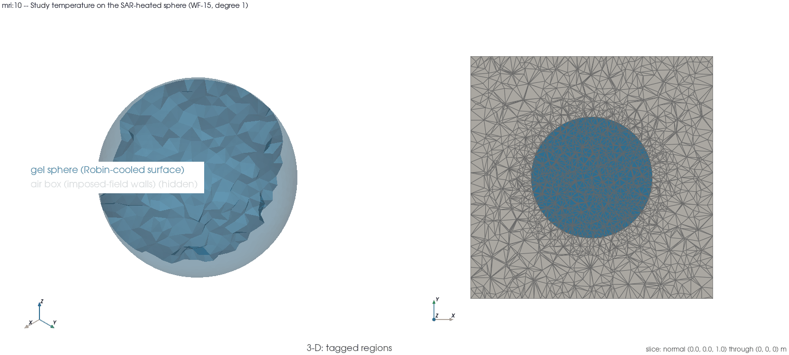

# `-e mri:10` — a temperature from one `Study`: steady conduction on the SAR-heated sphere

Guide for `examples/mri/10_study_temperature.py`.
Written to be followed without the source open.

## 1. What this demonstrates

**Two calls, one electromagnetic solve.** `WF-15`'s `Study` solves the lossy
sphere (`MAT-4` step 1: the imposed 1 V/m field at 64 MHz, gel σ = 0.57 S/m,
εᵣ = 78). A second call, `study.temperature(RobinCooling(k, h, T∞, source_scale=G))`,
hands that solved field to `MAT-10`'s steady Robin-cooled conduction: the DG0
heat source q = G · σ|E|²/2 on the sphere submesh, conduction k inside, convection
h to ambient T∞ at the surface.

```python
study = _study(degree=1)
res = study.solve(comm)                                     # the one EM solve
th = study.temperature(RobinCooling(K, H, T_INF, source_scale=G))
```

* `source_scale` (`G`) is a plain linear factor on q. The EM problem is solved
  with the 1 V/m imposed field; `G` lifts it to the 5 kV/m of `MAT-10`'s
  heating case (q scales with E², so G = (5 kV/m ÷ 1 V/m)²).
* `th` is a `ThermalStudyResult`: `temperature`, `submesh`, `facet_tags`,
  `heat_source`, `source_power`, `convected_power`. Every `temperature()` call
  builds **its own** submesh, so any comparison of θ against a closed form must
  be built on that call's `th.submesh`.
* `study.result` is the same object before and after: asking for a temperature,
  or for `mean_sar()`, never triggers a second EM solve — asserted as (Once).

**Why degree 1 here.** The row's reproduced digits are `MAT-10`'s record, and
that record is degree 1. The degree-1 leg is also the cheaper window (EM solve
and mesh ≈ 15 s, against ≈ 284 s at degree 2). The `Study` default is degree 2;
its (A) is 2.5901e-03 (the `WF-15` row), which is why degree 2 is the default.
That leg is quoted, not re-run, here.

The example states no k, h, T∞, G, σ, ρ or R of its own: every constant, band and
helper is imported from `tests/package/test_wf15_study_temperature.py`,
`tests/validation/test_mat10_sar_to_heat_sphere.py` and
`tests/validation/test_lossy_sphere_sar.py`, and the radius is read from
`study.geometry`. The only literals are the control's factor 10 and the 2 of (c1).

On record (flagged run `EX-94`, `20261007T094810Z_EX-94.log`; unflagged
`EX-94-control`; EM solve and mesh ≈ 15 s, each thermal call ≈ 0.4 s):

| Quantity | Reference | Record | Bound |
| --- | --- | --- | --- |
| (R) (A) at `.4e` | `MAT-10`'s print 3.2464e-02 | 3.2464e-02 | exact digits |
| (R) (P) at `.4e` | `MAT-10`'s print 3.1923e-03 | 3.1923e-03 | exact digits |
| (G) (A) interior rel L2 vs closed form | closed form | 3.2464e-02 | `A_BAND` 0.11 |
| (G) (P) pure conduction solve | closed form | 3.1923e-03 | `P_BAND` 1e-2 |
| (G) (B) source power vs mean SAR | identity | 8.02e-16 | `B_BAND` 1e-10 |
| (G) (C) convected vs source power | identity | 9.48e-14 | `C_BAND` 1e-9 |
| (Once) | `study.result is res` | true after each call | exact |
| (Sub) sphere submesh cells | 19 496 (version-tagged) | 19 496 | exact |
| Surface-mean θ / θ(R) | 1.033687 (printed) | 1.033687 | — |
| (c-h) h → 10 h, (A) comparator | must exceed `A_BAND` | 6.0941e-01 | > 0.11 |
| (c-h′) surface-rise ratio, FEM vs closed form | printed | 0.100000 / 0.100000 | — |
| (c1) `source_scale = 2G` | `MAT-10`'s print 1.0649e+00 | 1.0649e+00 | > 0.11 |

(A) compares the Study's θ with `MAT-10`'s closed form on the interior
r < 0.9 R (where the +3.5 % degree-1 electromagnetic bias, not the surface
layer, dominates); (P) feeds the closed-form source to the conduction solver
alone; (B) and (C) are conservation identities (integral of q equals the parent
dissipated power times G; convected equals source power).

**Not claimed:** transient heating, perfusion, tissue or a coil; degree-2
thermal accuracy; a gate on the h-scaling ratio (printed only); anything
`WF-15` / `MAT-10` do not claim.

## Setup figure



`examples/mri/figures/mri_10_study_temperature_setup.png`. Rendered right after
the `Study` is solved and its temperature taken, from `study.result.mesh` and
`cell_tags` (`FEM_EM_SETUP_FIGURES=1`). The sphere ("gel sphere (Robin-cooled
surface)") is translucent; the air box ("air box (imposed-field walls)") is
hidden. The slice is normal to `z` through the origin. The figure is geometry only.

## 2. How to run it

```
./scripts/run_examples.sh -e mri:10 -n 2 -t 180
```

**Complex build required** — the `mri:` group sources it automatically.
Tier: **standard** (`-n 2`, container `timeout -k 30 180`). One degree-1 EM
solve (≈ 15 s), three thermal calls (≈ 0.4 s each) and one conduction solve for
(P); about 20 s in all, summed RSS ≈ 2.4 GiB.

## 3. How to analyze it, step by step

**Step 1 — the study and the one EM solve.**

```
[study] degree 1, -n 2, k 0.6, h 100, T_inf 20, source_scale G 2.5e+07, R 0.01 m; ...
[(Sub)] sphere submesh 19496 cells (record 19496)
[(Once)] after temperature True; after mean_sar True
```

The submesh count is printed beside, and asserted against, `MAT-10`'s record; it
is version-tagged (mesher). (Once) says no second EM solve happened.

**Step 2 — (R) and (G).**

```
[(R)] (A) 3.2464e-02 vs 3.2464e-02; (P) 3.1923e-03 vs 3.1923e-03
[(G)] (A) = ... (band 0.11); (P) = ... (band 1e-02); (B) = ... (band 1e-10); (C) = ... (band 1e-09)
```

(R) says the example path reproduces `MAT-10`'s recorded digits; (G) says the
four gates hold. A miss on either is an example/test divergence finding: report
and stop, never widen a band.

**Step 3 — the negative controls.**

```
[(c-h)] h -> 10 h (...): (A) comparator = 6.09...e-01 (must exceed A_BAND 0.11; ...)
[(c-h')] FEM surface-rise ratio 0.100000; closed-form factor 0.100000; rel diff ...
[(c1)] source_scale = 2G: (A) comparator = 1.0649e+00 (MAT-10 record 1.0649e+00; ...)
```

* (c-h) cools ten times harder. The closed form still carries H, so the (A)
  comparator must now disagree: the surface term drops by a uniform amount
  against which the centre-to-edge conduction rise is comparable, and the
  comparator reads 0.61 against a band of 0.11. A comparator blind to the
  boundary condition would not move.
* (c-h′) is printed, not asserted: the surface mean of θ falls by the closed
  form's factor 1/10 (at r = R the closed form is q R / 3h), and FEM and
  closed form agree to round-off here because the same source scales both. A
  later item may gate it.
* (c1) doubles the source scale (the "missing ½" of σ|E|²/2): the (A)
  comparator reads `MAT-10`'s recorded 1.0649e+00.

**Step 4 — open it in ParaView.**
`File → Open → examples/mri/paraview_output/mri_10_study_temperature_combined.xdmf`.
It lives on the sphere submesh (the air box is not in the file) and holds
`theta` (P1, K above ambient T∞), `SAR` (DG0, W/kg, the source the conduction
actually saw) and `q` (DG0, W/m³, G × the physical source).

1. Colour by `theta`: the centre is hottest and the surface coolest.
2. **Plot Over Line** along x through the centre on `theta`. The closed form is
   a parabola in r, peaked at the centre, sitting on a uniform offset equal to
   the surface rise set by the convection coefficient; the FEM profile follows it
   to the (A) figure above.

**Step 5 — what a deviation means.** (Sub) or (R) fails → the mesher or the
`Study` path changed: a `WF-15` / `MAT-10` regression, with the version tag the
first suspect. (G) fails → read it as evidence about the setup before the code.
(c-h) or (c1) fails → the comparator is blind. Any of these: report and stop.

## Related

- `examples/mri/07_study_lossy_sphere.py` (`mri:7`) — the same `Study` on the same
  sphere, reading mean SAR at the default degree.
- `docs/guide/first_study.md` — the tutorial for the `Study` API.
- `tests/package/test_wf15_study_temperature.py` — the `WF-15` temperature gate
  this example reproduces.
- `tests/validation/test_mat10_sar_to_heat_sphere.py` — `MAT-10`, the closed-form
  gate and the helper chain.
