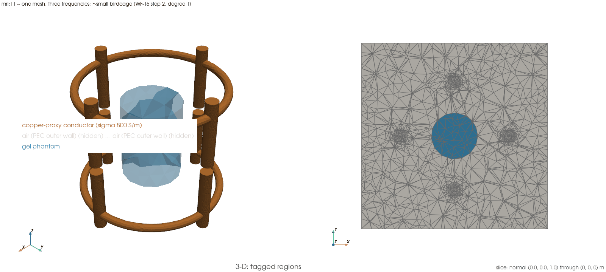

# `-e mri:11` — a frequency sweep from one `Study`: 10 / 64 / 128 MHz, one mesh, one Touchstone

Guide for `examples/mri/11_study_frequency_sweep.py`.
Written to be followed without the source open.

## 1. What this demonstrates

**`Study.solve_sweep`: one mesh, three frequencies, one file.** `WF-16` step 2 gives
the F-small four-port birdcage `Study` a `solve_sweep(frequencies, comm)` method. It
meshes **once**, then solves the four port drives at each frequency on that mesh and
returns a result per frequency; `write_touchstone` writes **one** multi-frequency
`.s4p`. The alternative is three separate `Study` objects, each with its own
`solve()`: three meshes (≈ 28 s each here) and three one-block files.

| | `solve_sweep` (this example) | three `Study` objects |
| --- | --- | --- |
| meshes | 1 (117 206 cells) | 3 |
| Touchstone | one `.s4p`, three `# Hz` blocks | three one-block files |
| wall | mesh 27.65 s + sweeps 8.38 / 8.08 / 8.47 s | ≈ 3 × (28 + 8) s |

**What it is held to.** The example builds the Study at **degree 1 on `-n 2`** — the
width and degree of item 192's registered records (`ANS4_EXACT_STRIP_S_P1_RECORDS`,
called `P1`) — and holds every block, in memory and read back through `scikit-rf`,
to the record at its frequency. The three frequencies come from `FREQUENCIES`; the
script types no number.

**No dispersion.** The gel is constant-property across the sweep: the phantom
material is built once at 64 MHz and `solve_sweep` takes no per-frequency materials.
The three points differ by frequency only. Do not read the 10 → 128 MHz change in S
as a gel-dispersion result.

**Three points are not a resonance curve.** Ten, 64 and 128 MHz are the registered
anchors, far too sparse to locate or shape a resonance. No tuning, resonance,
degree-2, absolute `S₁₁` / `Z_in` or dispersion figure is claimed (PROJECT_PLAN
§2.2): S here is a **self-consistency record**.

Readings of record (flagged run, harness log `EX-95`; the control run `EX-95-control`
reproduces them inside the band, not bitwise — the last digits of the (T') and (R′)
128 MHz readings differ):

| Anchor | Reference | 10 / 64 / 128 MHz | Bound |
| --- | --- | --- | --- |
| (W) rank width | `ANS4_EXACT_STRIP_RECORD_RANK_WIDTH` | 2 == 2 | exact |
| (R′) S vs `P1` | item 192 records | 6.601e-11 / 9.557e-11 / 9.447e-11 | `LEG_D0_REPRODUCTION_BAND` 1e-9 |
| (T′) `.s4p` via `skrf` vs S | `ANCHOR_TOL` | 5.541e-14 / 6.855e-14 / 4.913e-14 | 1e-12 |
| (T′) file vs `P1` | `LEG_D0_REPRODUCTION_BAND` | 6.604e-11 / 9.556e-11 / 9.445e-11 | 1e-9 |
| (G′) reciprocity | `RECIPROCITY_BAND` | 4.593e-15 / 4.377e-16 / 7.442e-16 | 1e-3 |
| (G′) σ_max | 1 + `PASSIVITY_SIGMA_TOLERANCE` | 0.999993740606 / 0.999760093664 / 0.999136167640 | ≤ 1 + 1e-9 |
| (G′) max column power | same | 0.8172 / 0.8205 / 0.8703 | ≤ 1 + 1e-9 |
| (G′) pooled separation | `POOLED_SEPARATION_FLOOR` | 113.78× / 451.71× / 351.38× | ≥ 10× |
| (M) one mesh | `results[i].mesh is results[0].mesh` | True; 117 206 cells (printed; version-tagged) | exact |
| (X) `keep_fields` sweep S vs 64 MHz S | `LEG_D0_REPRODUCTION_BAND` | 0 (flagged) / 1.2e-15 (control) | 1e-9 |
| (c4) frequency mix-up, minimum off-diagonal | must exceed the band | 0.5524 (64 → 128), 5.5e8× the band | > 1e-9 |
| (c5) 10 ↔ 128 blocks swapped | must exceed the band | 1.2763 / 1.2367 (64 unmoved: 0) | > 1e-9 |
| (c1′) block vs degree-2 record (printed) | — | 0.0102 / 0.0491 / 0.0555 | — |

**Why (c1′) is printed.** At 10 MHz the degree-1 and degree-2 solutions differ by only
≈ 1 % — a comparator at a loose band would not see it. The 1e-9 band does.

**Not claimed:** resonance, tuning, degree 2, frequency dispersion, an absolute S at
any frequency, anything `WF-16` does not claim.

## Setup figure



`examples/mri/figures/mri_11_study_frequency_sweep_setup.png`. Rendered right after
`solve_sweep`, from the shared mesh (`sweep.results[0].mesh`) and its `cell_tags`
(`FEM_EM_SETUP_FIGURES=1`). Regions: "copper-proxy conductor (sigma 800 S/m)" (legs
and rings), "gel phantom" (translucent) and "air (PEC outer wall)" (hidden). The slice
is normal to `z` through the origin and cuts the phantom. The four port sheets are
the exact rectangles in the four leg gaps, not drawn. The figure is geometry only,
and it is the one geometry all three frequencies share.

## 2. How to run it

```
./scripts/run_examples.sh -e mri:11 -n 2 -t 300
```

**Complex build required** — the `mri:` group sources it automatically. Tier:
**standard** (`-n 2`, container `timeout -k 30 300`). One mesh (≈ 28 s), three sweeps
(≈ 8 s each), one extra `keep_fields` 64 MHz sweep (≈ 8 s); the whole script ≈ 65 s.

## 3. How to analyze it, step by step

**Step 1 — the sweep and its mesh.**

```
[study] degree 1, -n 2, frequencies 10 MHz = 1.000000e+07 Hz / 64 MHz = 6.400000e+07 Hz / 128 MHz = 1.280000e+08 Hz
[(M)] one mesh True; 117206 cells (printed; version-tagged); solve_sweep 53.03 s (mesh 27.65 s; sweeps 10 MHz 8.38 s / 64 MHz 8.08 s / 128 MHz 8.47 s); ...
[(W)] comm.size 2 == record width 2
```

Cells are printed, not asserted: they belong to the mesher/image version. (W) is
asserted before any S comparison; the records hold at `-n 2` only (`OPS-41`).

**Step 2 — (R′) and (G′), per frequency.**

```
[(R')] 10 MHz ||S - P1||/||P1|| 6.601e-11 (band LEG_D0_REPRODUCTION_BAND 1e-09)
[(G')] 10 MHz reciprocity 4.593e-15 ...; separation 113.78x (floor 10)
[(G')] minimum separation over the sweep 113.78x
```

(R′) says the sweep path reproduces each registered S to the digits; (G′) is
`PORT-11`'s identities on each frequency's own S and Z. The worst separation is at
10 MHz, 113.78× against a floor of 10×. A miss on either is an example/test
divergence finding: report and stop, never widen.

**Step 3 — the Touchstone file.** One file, three blocks, written by
`sweep.write_touchstone` (rank 0, then a barrier):

```
! FEM-EM Solver Touchstone export
! port_order: P1,P2,P3,P4
! frequency_points_hz: 1.000000000e+07,6.400000000e+07,1.280000000e+08
! z0_ohm: 50.000000
# Hz S RI R 50.000000
1.000000000e+07 -3.842800723470e-01 1.446742899819e-01 ...   (four rows, one block)
6.400000000e+07 4.157171199843e-02 5.886182509877e-01 ...
1.280000000e+08 4.767733777108e-01 5.851948382723e-01 ...
```

Read it back and plot |S11| over the three points (a snippet to adapt, not run by
the example):

```python
import numpy as np
import skrf

ntw = skrf.Network("examples/mri/paraview_output/mri_11_study_frequency_sweep.s4p")
print(len(ntw.f), ntw.nports)             # 3 4
s11_db = 20 * np.log10(np.abs(ntw.s[:, 0, 0]))
ntw.plot_s_db(m=0, n=0, marker="o")        # three markers, not a resonance curve
```

```
[(T')] 3 points, nports 4; |df| 0.000e+00 / 0.000e+00 / 0.000e+00 Hz ...; max|S_skrf - S| 5.541e-14 / 6.855e-14 / 4.913e-14 ...; ||S_file - P1||/||P1|| 6.604e-11 / 9.556e-11 / 9.445e-11
```

**Step 4 — the negative controls.** Both read data already in memory or on disk; no
solve.

```
[(c4)] frequency mix-up, file block i vs record j (must exceed 1e-09): 10->64 0.8103, 10->128 1.2367, 64->10 0.8120, 64->128 0.5524, 128->10 1.2763, 128->64 0.5689; minimum 0.5524
[(c5)] block order, file with 10 and 128 swapped vs records (10 / 64 / 128, 64 unmoved): 1.2763 / 0.0000 / 1.2367
[(c1')] each block vs the degree-2 record at its frequency (printed): 10 MHz 0.0102 / 64 MHz 0.0491 / 128 MHz 0.0555
```

(c4): the comparator sees any pair of frequencies confused; the smallest gap, 64 vs
128 MHz, is still 5.5e8× the band. (c5): the failure a writer that sorted or reversed
its frequencies would show.

**Step 5 — the field (X).** `PortStudyResult.fields` is `None`: the `Study` keeps no
field. The example runs one `run_n_port_sparameter_sweep(..., keep_fields=True)` on
the 64 MHz result's own problem and mesh and draws the **P1-drive** field from it.
`[(X)]` asserts that sweep's S equals the result's inside the band. This is the only
solve beside `solve_sweep`; the example never calls `solve()` per frequency.

**Step 6 — open it in ParaView.**
`File → Open → examples/mri/paraview_output/mri_11_study_frequency_sweep_combined.xdmf`
(and `examples/mri/paraview_output/mri_11_study_frequency_sweep.s4p` beside it in any
Touchstone viewer). The XDMF holds `E_abs` (|E| of the 64 MHz P1 drive, P1 Lagrange),
`sigma` (DG0, S/m) and `CellTags`. The mesh is affine, so the N1curl field is
interpolated, not written directly.

1. **Threshold** on `CellTags` (`3` = the gel phantom) and colour by `E_abs`.
2. **Slice** at z = 0 (normal `z`, origin 0).

**Step 7 — what a deviation means.** (W) fails → the run is not at `-n 2`. (R′) fails
with (G′) fine → the Study path or solver moved at the 1e-9 level: a `WF-16`
regression. (G′) fails → read it as evidence about the setup before the code. (T′)
fails → the Touchstone writer or reader changed. (M) fails → `solve_sweep` rebuilt a
mesh. (c4) or (c5) fails → the comparator is blind. Any of these: report and stop.

## Related

- `examples/mri/08_study_four_port_birdcage.py` (`mri:8`) — the same Study at one
  frequency, with its own `.s4p`.
- `tests/package/test_wf16_study_sweep.py` — the `WF-16` step-2 gate this example reproduces.
- `docs/guide/first_study.md` — the `Study` tutorial.
