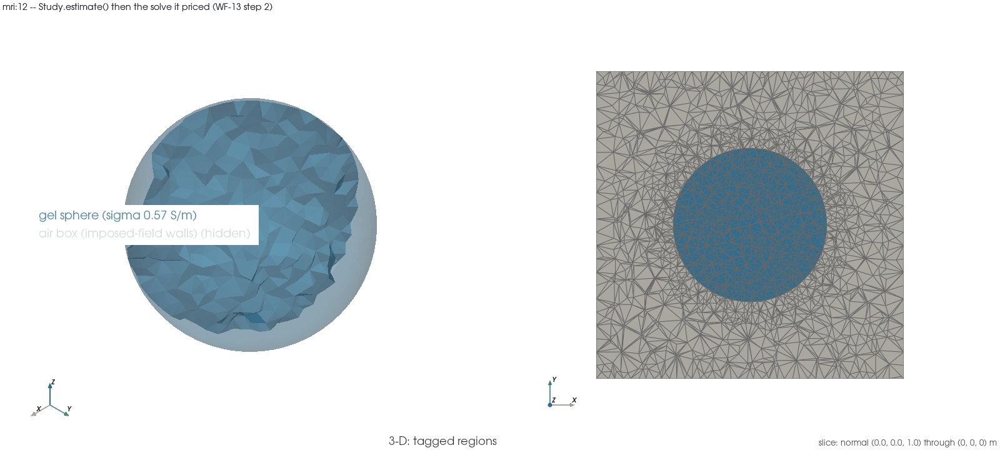

# `-e mri:12` — price a `Study` before you solve it

Guide for `examples/mri/12_study_estimate.py`.
Written to be followed without the source open.

## 1. What this demonstrates

**`Study.estimate()`, then the solve it priced.** `WF-13` step 2 gave the `Study`
an `estimate(comm)` call. It builds the mesh and the N1curl space — and nothing
else, no assembly and no solve — and returns a `ResourceEstimate`. This example
builds `WF-15`'s lossy-sphere `Study` at the default degree (no `degree=`
keyword, so 2), calls `est = study.estimate(comm)`, prints it, then calls
`study.solve(comm)` on the same `Study` and compares.

The two-call pattern:

```
est = study.estimate(comm)     # builds mesh + space, solves nothing
res = study.solve(comm)        # the solve that was priced
```

Reading the fields of the estimate, in words:

* `cells` — the global tetrahedron count of the mesh the `Study` builds.
* `unknowns` — the **exact** global N1curl unknown count at the `Study`'s degree.
* `degree` — the element degree (2 here).
* `ranks` — the MPI size the price is for (2 here).
* `predicted_peak_gib` — the priced peak memory, **summed over ranks**, in GiB.
* `predicted_seconds` — the priced wall time of the solve, in seconds.
* `rows_used` — the names of the `PRICE_TABLE` rows the price was fitted on.

**The unknown count is exact; the price is a factor of 2.** The count is not
fitted: the example asserts that the estimate's unknowns and cells equal the
solve's global N1curl unknowns and cells, integer for integer (`WF-13` step 2's
identity). The memory and time are a power-law fit per degree to
`PRICE_TABLE`'s nine degree-2 rows (`fem_em_solver.study.PRICE_TABLE`), and the
claim the project gates is the leave-one-out bracket: pricing a recorded row
from the other rows lands inside a factor of 2 (`BRACKET`).

**On this fixture the printed price is in-sample.** The sphere at degree 2 and
`-n 2` *is* `PRICE_TABLE` row P2, so the fit includes it. The honest
out-of-sample figure on this fixture is the leave-one-out ratio for P2, which the
example recomputes from the committed table (memory 0.635, time 0.795 on record — FH2, §9 item 585)
and asserts inside the bracket.

**Degree 1 on a P1-only table is refused.** Since item 471a the full price table
carries several degree-1 rows (P1, P3, and T49 since item 479), so
`Study(degree=1).estimate()` prices degree 1 instead of raising (degree-1 priced
since 471a, in-sample on its own rows; the example prints that price, not
asserts it). The refusal survives where it can still be exercised: restricted to
the P1-only table, a degree-1 price has one row and raises
`ValueError("fewer than two priced rows at degree 1")`. The example asserts that
raise (control c2); the P1-only versus full-table pair is the separation, by
construction.

**Scope** (`WF-13`'s): not memory or time as a function of N alone, not new
geometry classes, not ranks outside {2, 8, 12, 16}, not `xl` admission. The
printed measured/estimate ratios are readings on this machine; no gate asserts a
live run against its estimate.

The example states no σ, εᵣ, frequency, field, radius, unknown count or price of
its own: constants are imported from `tests/package/test_wf13_study_estimate.py`,
`tests/package/test_wf15_study_lossy_sphere.py`,
`tests/package/test_wf17_first_study_tutorial.py`,
`tests/validation/test_mat5_em_coupled_sphere.py` and
`tests/materials/test_phantom_material_model.py`; the price rows come from
`fem_em_solver.study.PRICE_TABLE`.

| Anchor | Reference | Record | Bound |
| --- | --- | --- | --- |
| (K) estimate does not solve | `study.result is None` | — | exact |
| (U) unknowns / cells | the solve's global counts | 482 158 / 74 020 (version-tagged) | integer `==` |
| (In) P2 in `rows_used` | `PRICE_TABLE` row P2 | — | exact |
| (R) SAR vs `WF-15` record | 8.0116577245e-08 W/kg | see logs `EX-96`, `EX-96-control` | `L0_BAND` 1e-9 |
| (G) SAR vs closed form | 8.008354e-08 W/kg | 0.0413 % on `WF-15` | `MAT4_BAND` 10 % |
| (B-P2) leave-one-out P2 | `WF-13` record 0.635 / 0.795 (FH2, §9 item 585) | arithmetic on the table | inside ×2 |
| (c1) degree-1 space count | P1 row, 90 209 | ratio 5.3449 on `WF-13` | ≠ `est.unknowns` |
| (c2) degree-1 price on a P1-only table | raises `ValueError` | full table prices degree 1 since 471a (printed) | asserted by construction |
| (c3) `MAT4_DEG1_RECORD` vs degree-2 record | — | ≈ 3.5 % on `EX-91` | must exceed 1e-9 |

The run of record is in the harness logs `EX-96` (flagged) and `EX-96-control`
(unflagged); they agree inside `L0_BAND`, not bitwise (the degree-2 SAR differs at
the tenth digit between `-n 2` runs).

## Setup figure



`examples/mri/figures/mri_12_study_estimate_setup.png`. Rendered right after the
`Study` is solved, from `res.mesh` and `res.cell_tags`
(`FEM_EM_SETUP_FIGURES=1`). The sphere ("gel sphere (sigma 0.57 S/m)") is
translucent; the air box ("air box (imposed-field walls)") is hidden. The slice
is normal to `z` through the origin. The figure is geometry only.

## 2. How to run it

```
./scripts/run_examples.sh -e mri:12 -n 2 -t 590
```

**Complex build required** — the `mri:` group sources it automatically.
Tier: **heavy** (`-n 2`, container `timeout -k 30 590`). One degree-2 solve is
most of the window; the estimate itself costs one mesh and one space build.
Summed RSS is of the order of 20 GiB. The seconds and GiB the run prints are this
machine's readings, not a property of the method.

## 3. How to analyze it, step by step

**Step 1 — the estimate.**

```
[estimate] cells=74020 unknowns=482158 degree=2 ranks=2 pred_peak=... GiB (summed over ranks) pred_s=... rows=('P2', ...)
[estimate] the call took ... s (mesh + space, no solve)
```

Read the count as exact and the two predictions as a factor-of-2 price. The call
time beside the solve time is the point of the method, as a reading.

**Step 2 — the solve it priced, and the identity (U).**

```
[solve] cells=74020 unknowns=482158; Study solve+mesh ... s; summed ru_maxrss ... GiB
[(U)] est.unknowns 482158 == solve 482158 (record 482158); est.cells 74020 == solve 74020 (record 74020)
```

Cells and unknowns are asserted equal between estimate and solve, and against the
records. The estimate and the solve each build their own mesh, so global counts
are compared, never mesh objects. A mismatch between estimate and solve is a
defect in the estimator; a mismatch against the records only is a mesher/version
event. Either way: report and stop.

**Step 3 — measured against estimate (printed).**

```
[printed] measured/estimate: memory ..., time ... (this machine; in-sample on row P2; not asserted)
```

Not asserted: the box's load moves wall time, and a ×2 gate on an in-sample row
would be a new, unregistered claim.

**Step 4 — (R), (G), (B-P2).**

```
[(R)] SAR = ... ; record 8.0116577245e-08; rel ...e-1x (band L0_BAND 1e-09)
[(G)] closed form 8.008354e-08; rel 0.04...% (band MAT4_BAND 0.1)
[(B-P2)] leave-one-out P2: mem 0.635, time 0.795 (inside 1/2..2: True, True; WF-13 record 0.635 / 0.795 (FH2, §9 item 585))
```

(R) says the solve the estimate priced is `WF-15`'s record; (G) that it sits
inside `MAT-4`'s band of the closed form; (B-P2) is the gated leave-one-out
figure on this fixture's row. A miss on any: report and stop, never widen.

**Step 5 — the negative controls.**

```
[(c1)] degree-1 N1curl on the solved mesh: 90209 unknowns (P1 row 90209); deg2/deg1 ratio 5.3449 ...
[(c2)] P1-only table, degree-1 price raised ValueError: 'fewer than two priced rows at degree 1'
[(c3)] |MAT4_DEG1_RECORD/WF15_DEG2_RECORD - 1| = 3.49...e-02 (must exceed L0_BAND 1e-09 ...)
```

(c1): an estimator that ignored degree would read 90 209 and fail (U). (c2): a table
with one degree-1 row refuses to price degree 1 (the full table prices it, printed). (c3): the (R) comparator separates
degree 1 from degree 2.

**Step 6 — open it in ParaView.**
`File → Open → examples/mri/paraview_output/mri_12_study_estimate_combined.xdmf`.
It holds `E_abs` (|E| in P1), `SAR` (DG0, W/kg), `rank` (DG0, the MPI rank that
owns each cell) and `CellTags`.

1. Colour by `rank` to see the two-way partition the estimate's `ranks=2` priced.
2. **Threshold** on `CellTags` (`1` = the gel sphere) and colour by `SAR`.
   Outside the sphere σ = 0, so SAR is identically zero.

## Related

- `examples/mri/07_study_lossy_sphere.py` (`mri:7`) — the same `Study` solved
  without pricing it first.
- `docs/guide/first_study.md` — the tutorial this builds on.
- `docs/guide/api/Study.md` — the `Study` API reference.
- `tests/package/test_wf13_study_estimate.py` — the `WF-13` step 2 gate.
