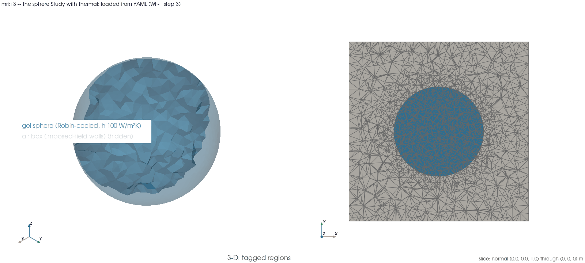

# `-e mri:13` — a temperature from a config file: `femem run` on a YAML with `thermal:`

Guide for `examples/mri/13_temperature_from_yaml.py`.
Written to be followed without the source open.

## 1. What this demonstrates

**A heated sphere described entirely in a text file.** `WF-1`'s `femem run`
reads a study from a YAML file and runs it. Since step 3 the file may carry a
`thermal:` section, and `femem run` then also takes the temperature: the solved
field goes to `MAT-10`'s steady Robin-cooled conduction, exactly as
`study.temperature(RobinCooling(...))` does in Python (`mri:10`'s route).
The example's sphere file, `examples/mri/13_temperature_from_yaml_sphere.yaml`, is
`MAT-4` step 1's lossy gel sphere (imposed 1 V/m field at 64 MHz, σ = 0.57 S/m,
εᵣ = 78, degree 1) plus this block (units are in the key names):

```yaml
thermal:
  k_w_per_m_k: 0.6
  h_w_per_m2_k: 100.0
  t_inf_c: 20.0
  source_scale: 25000000.0
```

* `source_scale` is a plain linear factor on the heat source q; the EM solve uses
  the 1 V/m imposed field and the factor lifts it to `MAT-10`'s heating case
  (q scales with E²). Omitted `source_scale` and `degree` take `RobinCooling`'s
  own defaults (1.0 and 1); no loader default exists.
* The two YAML files beside the script are byte copies of
  `tests/package/wf1/sphere_mat10_thermal.yaml` and
  `tests/package/wf1/sphere_mat10_thermal_control_2g.yaml`, with **only the first
  (comment) line changed**. The script asserts each copy against its original, by
  spec and by cooling, so neither can drift silently. The control file differs in
  one value, `source_scale` doubled (the missing ½ of σ|E|²/2).

**Two routes to the same field.** `cli.main(["run", <file>, "--output-dir", <dir>])`
returns an exit code and writes a JSON summary; it keeps no field. The example
therefore also calls the exported `run_study_file`, the function `femem run`
calls, which returns the temperature field. That is a second EM solve of the same
file, by design.

The JSON summary's `temperature` block has exactly three keys: `source_power_w`
(the integral of q over the sphere), `convected_power_w` (the Robin-surface heat
loss) and `theta_max_k` (the maximum of T − T∞ over owned dofs, `MPI.MAX`-reduced
across ranks). `femem check` does not echo the `thermal:` section (`cli.py`
prints the study spec only).

**Exit-code contract.** 0 on success, 2 on a config error. A `thermal:` section on
a port geometry is refused at load time; the message reads, as illustration (not a
record):

```
.../malformed_thermal_on_port.yaml: thermal: temperature is not defined on a port Study (four_port_birdcage)
```

The example states no k, h, T∞, G, σ, ρ or R of its own: every constant, band and
helper is imported from `tests/package/test_wf1_yaml_thermal.py`,
`tests/package/test_wf15_study_temperature.py`,
`tests/validation/test_mat10_sar_to_heat_sphere.py` and the other gate modules,
and the script has no numeric literal of its own beyond the exit code 2.

On record (flagged run `EX-97`, `20261007T111919Z_EX-97.log`; total 47.8 s;
one `cli.main` run 14.9 s, one `run_study_file` 14.4 s, the Python Study plus
thermal 15.6 s):

| Quantity | Reference | Record | Bound |
| --- | --- | --- | --- |
| (K) spec / cooling vs the originals and the Python Study | `float.hex` equality | `[]` / `[]` (three pairs) | exact |
| (R-cli) rc on every rank | exit contract | (0, 0) | exact |
| (R-cli) JSON vs `run_study_file`, three values | two EM solves of one file | rel 0 (bitwise here) | `L0_BAND` 1e-9 |
| (R) sphere submesh cells | 19 496 (version-tagged) | 19 496 | exact |
| (R) (A) at `.4e` | `MAT-10`'s print 3.2464e-02 | 3.2464e-02 (3.2463961444e-02) | exact digits, `A_BAND` 0.11 |
| (R) (P) at `.4e` | `MAT-10`'s print 3.1923e-03 | 3.1923e-03 (3.1923343273e-03) | exact digits, `P_BAND` 1e-2 |
| (R) (B) / (C) conservation identities | identities | 6.817e-15 / 1.309e-13 | 1e-10 / 1e-9 |
| (IT) YAML θ vs independent Python Study | owned dofs | 4.874e-12 | `L0_BAND` 1e-9 |
| (c1) control file, (A) comparator | `MAT-10`'s print 1.0649e+00 | 1.0649e+00 (1.0648959931e+00) | > `A_BAND` 0.11 |
| (c1′) control / file source power | linearity (printed) | 2.0 | — |
| (X) thermal on a port geometry | `StudyConfigError.field` | `thermal`; run / check rc (2, 2); no output dir | exact |

Printed beside the readings, not asserted: the JSON values source power
0.008651525642063975 W, convected power 0.008651525642062842 W and θ max
0.12682242431550605 K.

**Not claimed:** degree 2 through YAML; transient heating, Pennes or duty cycle;
thermal on a port Study; tissue or a coil; a stable schema; the installed-wheel
`femem` with a solve, or `femem run --ranks`; anything `WF-1` / `WF-15` /
`MAT-10` do not claim.

## Setup figure



`examples/mri/figures/mri_13_temperature_from_yaml_setup.png`. Rendered right after
`run_study_file` returns (`FEM_EM_SETUP_FIGURES=1`), from the run's mesh and cell
tags. The sphere ("gel sphere (Robin-cooled, h 100 W/m²K)", the h read from the
parsed `thermal:` block) is translucent; the air box is hidden. The slice is
normal to `z` through the origin. The figure is geometry only.

## 2. How to run it

```
./scripts/run_examples.sh -e mri:13 -n 2 -t 180
```

The same study from the command line, as a user would:

```
femem run examples/mri/13_temperature_from_yaml_sphere.yaml --output-dir <dir>
```

**Complex build required** — the `mri:` group sources it automatically.
Tier: **standard** (`-n 2`, container `timeout -k 30 180`). Three degree-1 EM
solves (two YAML runs and the independent Python Study, ≈ 15 s each) and two thermal
calls; about 50 s in all.

## 3. How to analyze it, step by step

**Step 1 — (K), the copies.**

```
[(K)] sphere vs original spec [] cooling []; control vs original spec [] cooling []; sphere vs Python spec [] cooling []
```

Empty lists mean no field differs. A named field is itself the finding.

**Step 2 — (R-cli), `femem run` writes the temperature.**

```
[(R-cli)] run rc (min, max) (0, 0), ... family 'sphere_in_box', degree 1, ranks 2; keys [...]
[(R-cli)] source_power_w: cli ...; api ...; rel ... (band L0_BAND 1e-09)
```

The CLI's JSON summary agrees with `run_study_file`'s within `L0_BAND` (a band, not
bitwise, because two EM solves of one file are compared).

**Step 3 — (R) and (IT), `MAT-10`'s records on the YAML temperature.**

```
[(R)] ... sub cells 19496 (record 19496); (A) 3.2464e-02 vs 3.2464e-02; (P) 3.1923e-03 vs 3.1923e-03
[(IT)] owned max|dT| / max|T - Tinf| = ... (band L0_BAND 1e-09); ...
```

(A) compares θ with `MAT-10`'s closed form on the interior r < 0.9 R; (P) feeds the
closed-form source to the conduction solver alone; (B) and (C) are conservation
identities. A miss on any is an example/test divergence: report and stop, never
widen a band.

**Step 4 — the negative controls.**

```
[(c1)] control file source_scale 50000000.0: (A) comparator 1.0649e+00 = ... (MAT-10 record 1.0649e+00; ...)
[(c1')] source power control / file = 2.0 (printed, not asserted)
[(X)] field 'thermal' (expected 'thermal'); message: ...
[(X)] run rc (min, max) (2, 2), check rc (2, 2); output dir exists False
```

(c1) applies the control file's cooling to the already-solved Study (no second EM
solve): the closed form still carries G, so the comparator must disagree, and it
reads about 1.06 against a band of 0.11. (X) shows a bad file is refused with exit
code 2 before any solve and leaves no output directory.

**Step 5 — open it in ParaView.**
`File → Open → examples/mri/paraview_output/mri_13_temperature_from_yaml_combined.xdmf`.
`run_study_file` writes no field file, so the example writes this one from the
returned temperature on the sphere submesh (the air box is not in the file): `theta`
(P1, K above ambient T∞) and `q` (DG0, W/m³), with the Robin surface as a facet
block.

1. Colour by `theta`: the centre is hottest and the surface coolest.
2. **Plot Over Line** along x through the centre on `theta`. The closed form is a
   parabola in r, peaked at the centre, sitting on a uniform offset equal to the
   surface rise set by the convection coefficient; the FEM profile follows it to
   the (A) figure above.

**Step 6 — what a deviation means.** (K) red → the copy differs from its original.
(R) or (IT) red with (K) green → a `WF-1` step-3 regression, not an example fix.
(R-cli) red with (R) and (IT) green → the CLI path assembles something
`run_study_file` does not. (c1) at or below the band → the comparator is blind.
Any of these: report and stop.

## Related

- `examples/mri/09_study_from_yaml.py` (`mri:9`) — the EM-only YAML route.
- `docs/guide/first_study.md` — the tutorial for the `Study` API.
- `tests/package/test_wf1_yaml_thermal.py` — the `WF-1` step-3 gate this example
  reproduces.
- `tests/validation/test_mat10_sar_to_heat_sphere.py` — `MAT-10`, the closed-form
  gate and the helper chain.
- `src/fem_em_solver/study_yaml.py` — the loader and `run_study_file`.
