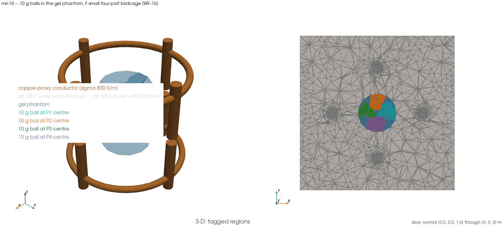

# `-e mri:14` — 10 g SAR and |B₁⁺| from one `Study`: the F-small birdcage

Guide for `examples/mri/14_study_sar_and_b1.py`.
Written to be followed without the source open.

## 1. What this demonstrates

**The Phase 9 (9a) user's question: "how do I get B₁⁺ and 10 g SAR out of my
`Study`?"** `mri:8` answers it for S only. This example builds the same `Study`
as `mri:8` (`FourPortBirdcageGeometry.f_small()`, exact CAD port rectangles, κ off,
operator ruling 2026-10-02; a gelled-saline phantom; `LumpedPortDrive`; 64 MHz;
**degree 1 on `-n 2`**) and asks it for two results through its public methods:

```
maps = study.b1_plus(comm=comm)                                  # CG1 B per drive; runs the one solve
vals, valid = study.b1_plus_at(points, drives=["P1"], comm=comm)["P1"]   # |B1+| at points
out = study.sar(mass_g=10.0, centres=[c], drives=["P1"], comm=comm)     # 10 g mass-averaged SAR
fr = study.fields_result                                         # the cached field-keeping solve
```

**One solve, two results.** `b1_plus()` triggers the field-keeping solve and caches
it on `study.fields_result`; `sar()` finds the cache and reuses it. The script
asserts `study.fields_result is fr` and `study.result is None` after the SAR calls
(`solve()` was never called), and the times show it: the first call (solve plus four
CG1 projections) takes ≈ 42 s, the nine operator calls ≈ 22 s with no mesh and no
sweep among them.

**Why `b1_plus()` returns a CG1 vector and not |B₁⁺|.** |·| is not linear, so the
estimator projects the complex `B` into CG1 first and forms
`|B_x + jB_y|/2` only after point evaluation (`b1_plus_at`), the order `WF-6`
gated. The DG0 curl operator is not the gated estimator.

**`sar` defaults.** `mass_g=10.0` is the default (the ball radius is
`averaging_ball_radius(mass_g/1000, ρ)`); `radius_m=` is the alternative and is
refused together with an explicit `mass_g`. The operator is pinned at
`SAR_QUADRATURE_DEGREE` (16).

**What the numbers mean.** Both results are **symmetry identities on one fixture**,
per 1 V single-port drives: the 10 g SAR of the four drives at their own balls
agree under the C4 quadrant rotation, and the |B₁⁺| maps of the rotated drives
agree under the rotated sample set. They are **not accuracy claims**. Not claimed:
an absolute SAR, a C95.3 / IEC compliance figure or limit, a spatial-peak search,
1 g SAR, |B₁⁺| homogeneity or CV, an absolute or closed-form |B₁⁺|, a quadrature
drive, tuning or resonance, degree 2, h-convergence, copper, human scale.

**The margin, stated plainly.** At degree 1 the worst 10 g pair (P4 → P1) reads
**4.5024 %**, which is 0.90× the 5 % band: thin. The reasons are mesh, not code:
`a_10g / h = 0.891` (the 10 g ball radius, 13.3650 mm, is smaller than one mesh
edge, 15 mm), the phantom carries only 537 cells, and the mesh is not C4-congruent.
The same pair at degree 2 on the same mesh reads 0.5961 % (the `WF-16` gate at
`-n 8`; this example does not run degree 2). Both are symmetry identities, not
convergence evidence.

Every band, constant and helper is imported from the gate modules; the example
states no σ, εᵣ, frequency, radius, band or tolerance of its own. The gate modules
export no SAR or |B₁⁺| record constant, so the record digits sit in the script's
`REC` dict, each with its gate-log `file:line`, and are asserted at the printed
precision.

Readings of record (flagged run, harness log `20261009T050323Z_EX-106.log`; the
unflagged control `20261009T050445Z_EX-106-control.log` reproduces every record digit):

| Anchor | Reference (gate log line) | Reading | Bound |
| --- | --- | --- | --- |
| (W) rank width | `ANS4_EXACT_STRIP_RECORD_RANK_WIDTH` | 2 == 2 | exact |
| (R) S vs `P1` | `20261008T184215Z_WF-16-s4-W1-deg1.log:1884`, 9.557e-11 | 9.557e-11 | `LEG_D0_REPRODUCTION_BAND` 1e-9 |
| (One) one solve | the example's own check | `fields_result is fr`, `result is None` | exact |
| (iv) r₀ + a₁₀g | `…184215Z_WF-16-s4-W1-deg1.log:66` | 28.3650 mm < 30.0 mm | containment |
| (i) ball power vs `mean_sar` | `…184215Z…:1888`, 1.210e-14 | 1.066e-14 (round-off) | `EXACT_IDENTITY_RTOL` 1e-10 |
| (i) ball mass vs ρ·V | `…184215Z…:1888`, 3.997e-15 | 3.997e-15 | 1e-10 |
| (ii) 10 g pairs 0→1 / 1→2 / 2→3 / 3→0 | `…184215Z…:1897` | 0.8702 / 3.5284 / 2.0337 / 4.5024 % | `C4_COVARIANCE_BAND` 5 % |
| (ii) 10 g SAR diagonal, W/kg (printed) | `…184215Z…:1893–1896` | 1.980612231e-05 / 1.963377184e-05 / 2.032653726e-05 / 2.073991516e-05 | — |
| (ii) max over 4 evaluated centres | `…184215Z…:1898` | 2.073991516e-05 W/kg (P4), at 1 V drive, NOT a spatial search, NOT a C95.3 compliance figure | — |
| (c1) far-side ball, k = 0…3 | `…184215Z…:1906` | 88.1162 / 87.9366 / 88.6600 / 88.9315 % | sign only: > 5 % |
| (B3) valid points | `20261008T185141Z_WF-16-s5-W1-deg1.log:1880` | 51 of 51 on each of five images | full |
| (B1) P2@+Δ / P4@−Δ / P3@2Δ vs P1 | `…185141Z…:1884` | 1.8695 / 1.9494 / 1.6405 % | `C4_COVARIANCE_BAND` 5 % |
| \|B₁⁺\| at the centre, P1…P4 (printed) | `…185141Z…:1885` | 1.667281487e-08 / 1.700738851e-08 / 1.665270745e-08 / 1.674331925e-08 T | a record, not absolute, not homogeneity |
| (cB) P2 at −Δ vs P1 | `…185141Z…:1892` | 35.0040 % | sign only: > 5 % |
| Mesh | `…184215Z…:1881` | 117 206 cells (printed; version-tagged), 537 phantom cells | — |

(i)'s power residual is round-off (1.066e-14 here, 1.210e-14 in the gate); it is
held at the band, not at the digit. Every other row above is asserted at its
printed digits.

**Negative controls (both asserted in sign, no solve).** (c1) pairs the SAR of
drive k with the ball at c₍ₖ₊₂₎ (the far side): the miss is ≈ 88 %, 17.6× the band;
it was predicted ≈ 90 % and is bounded by 100 % (a non-negative SAR cannot fall
more than 100 %), so no factor is asserted. (cB) reads P2 at the counter-rotated
points: 35.0040 %, 7× the band; the ratio of two non-negative maps has no tight
ceiling below 2, so no factor is asserted and none is predicted here.

## Setup figure



`examples/mri/figures/mri_14_study_sar_and_b1_setup.png`, rendered right after the
sheets and centres are read off the solve (`FEM_EM_SETUP_FIGURES=1`). The slice is
normal to `z` through the origin and cuts all four balls. The figure is drawn from a
**figure-only** mesh tagging that is never passed to a solve: the script checks that
the four extra tag values (901–904) are absent from the mesh's global tag set, then
re-tags the cells whose midpoints lie inside each 10 g ball. The ball cells are a
picture of where the averaging ball sits, not the operator's quadrature ball: the
operator integrates the exact sphere at quadrature degree 16. Regions: copper-proxy
conductor (σ = 800 S/m), gel phantom (translucent), air (PEC outer wall, hidden), and
the four balls.

## 2. How to run it

```
./scripts/run_examples.sh -e mri:14 -n 2 -t 300
```

**Complex build required** — the `mri:` group sources it automatically (the script
raises in a real build). Tier: **standard by prediction** (`-n 2`, container
`timeout -k 30 300`). The solve takes ≈ 42 s with its projections (mesh ≈ 29 s),
the nine operator calls ≈ 22 s; the whole script ≈ 70 s, summed RSS ≈ 1.9 GiB.
Run it only at `-n 2`: the `P1` record holds at that width (`OPS-41`).

## 3. How to analyze it, step by step

**Step 1 — the Study and its mesh.**

```
[study] degree 1, -n 2, f = 6.400000e+07 Hz, quadrature_degree 16
[mesh] 117206 cells (printed; version-tagged 117206), 537 phantom (tag 3) cells; resolution 0.015 m, a_10g = 13.3650 mm, a_10g / h = 0.8910
[(W)] comm.size 2 == record width 2
```

Cells are printed against their record; (W) is asserted before anything else.

**Step 2 — (R) and (One).**

```
[(R)] ||S_keep - P1||/||P1|| 9.557e-11 (band LEG_D0_REPRODUCTION_BAND 1e-09; ...)
[(One)] study.fields_result is fr: True; study.result is None: True (solve() never called; ...)
```

(R) says the field-keeping solve reproduces item 192's S record. (One) says the SAR
calls did not re-solve.

**Step 3 — the 10 g SAR.**

```
[(ii)] 10 g diagonal (gate ...:1893-1896):
    k=0 (P1 at c_0): SAR_10g = 1.980612231e-05 W/kg, mass 1.000012094e-02 kg vs rho*4/3*pi*a^3 1.000000000e-02 kg
    ...
    cyclic pairs ...: 0->1 0.8702%, 1->2 3.5284%, 2->3 2.0337%, 3->0 4.5024% (ASSERTED <= 5.0%; ...)
```

The ball is centred at r₀ = `CENTRE_RADIUS_M` along each drive's azimuth. The mass of
the discretised ball differs from the kernel mass by up to 0.7 % (the P4 ball), one
more face of the same coarse mesh. (i) checks the whole-phantom ball against
`mean_sar` and ρ·V at round-off.

**Step 4 — the |B₁⁺| identity.**

```
[(B1)] ||B1+(image) - B1+(P1)||_2 / ||B1+(P1)||_2: P2@+D 1.8695%, P4@-D 1.9494%, P3@2D 1.6405% (ASSERTED <= 5.0%; ...)
```

Each drive is read at the correspondingly rotated image of the P1 sample set (the
drive rotation Δ = 90.000000°, read off the sheets, never chosen), on the common
valid mask; (B3) asserts every point valid.

**Step 5 — the negative controls.**

```
[(c1)] ... k=0 88.1162%, k=1 87.9366%, k=2 88.6600%, k=3 88.9315% (sign ASSERTED > 5.0%; ...)
[(cB)] control P2@-D vs P1: 35.0040% (sign ASSERTED > 5.0%; ...)
```

**Step 6 — `REC`.** `[REC] 42 record digits compared at print precision; 0 differ`.
A difference is an example/test divergence finding: report and stop, never
re-record from here.

**Step 7 — open it in ParaView.**
`File → Open → examples/mri/paraview_output/mri_14_study_sar_and_b1_combined.xdmf`.
The XDMF holds `B1plus_abs_P1` … `B1plus_abs_P4` (P1 Lagrange, the nodal values of the
formula `b1_plus_at` applies; visual, not asserted), `E_abs_P1`, `power_density_P1`
(½σ|E|², DG0, W/m³ per 1 V; not divided by ρ, which is 0 outside the phantom),
`sigma`, `ball10g_mask` (DG0: k + 1 inside the ball at c_k, 0 elsewhere; a picture of
the balls, not the operator's quadrature ball) and `CellTags`.

1. **Threshold** `CellTags` = 3 and colour by `B1plus_abs_P1`.
2. **Slice** at z = 0 and colour by `power_density_P1`.
3. **Threshold** `ball10g_mask` ≥ 1 to see the four balls.
4. Compare `B1plus_abs_P2` with `B1plus_abs_P1` rotated by 90° about z (Transform filter).

**Step 8 — what a deviation means.** (W) fails → not at `-n 2`. (R) fails → the
solve moved: a `WF-16` finding. (One) fails → the Study re-solved: an API finding.
(ii) above 5 % → the fixture or the pairing moved (the pair is deterministic to
round-off at fixed mesh, width and degree); compare cells, phantom cells, (R) and
the diagonal with the gate log, then re-run the gate once. (c1) or (cB) at or below
the band → the comparator is blind. Any of these: report and stop; never widen a band,
switch degree or re-mesh.

## Related

- `examples/mri/08_study_four_port_birdcage.py` (`mri:8`) — the same `Study`, S and Touchstone.
- `examples/mri/03_birdcage_mass_averaged_sar.py` (`mri:3`) — the hand-built `MAT-4` 10 g SAR on the birdcage.
- `examples/ports/06_birdcage_b1_plus_map.py` (`ports:6`) — the hand-built `WF-6` |B₁⁺| map.
- `examples/mri/07_study_lossy_sphere.py` (`mri:7`) — the first `Study` example.
- `tests/package/test_wf16_study_sar.py` and `tests/package/test_wf16_study_b1.py` — the `WF-16` step 4 and 5 gates this example reproduces.
- `docs/guide/api/Study.md` and `docs/guide/first_study.md` — the `Study` reference and tutorial.
