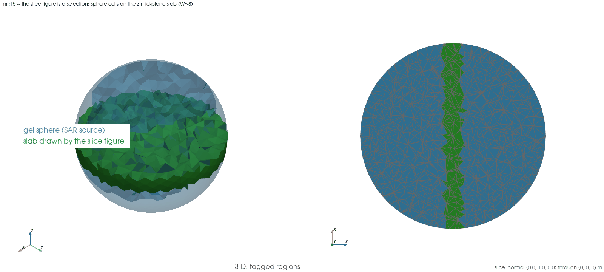

# `-e mri:15` — figures that equal their records

Guide for `examples/mri/15_figures_from_records.py`.
Written to be followed without the source open.

## 1. What this demonstrates

**Write the records, draw them, and prove the drawing is the record.** A `Study`
user ends up with three kinds of record: an S-parameter Touchstone file, a
cell-centred field in an XDMF/HDF5 bundle, and a probe-series CSV. `WF-8`
(`src/fem_em_solver/post/figures.py` and `femem figure`) draws each with no
transform of the values it plots. This example writes all three records itself,
under its own file stem, through the same gated fixtures `mri:11`, `mri:10` and
`mat:13` call, draws each, reads every plotted array back from the figure object
and asserts it bitwise equal (float64, `np.array_equal`) to the record parsed
independently from disk.

The recipe is three calls, or the same through the command line:

```python
plot_sparameters(s4p, out)                                  # |S| and arg S against f
plot_xdmf_slice(xdmf, "real_SAR", out, axis="z")            # one cell = one dot
plot_probe_series(csv, "probe_c0_K", out)                   # one column against t_s
```

```
femem figure sparams examples/mri/paraview_output/mri_15_figures_from_records.s4p examples/mri/paraview_output/mri_15_figures_from_records_cli_sparams.png
femem figure slice   examples/mri/paraview_output/mri_15_figures_from_records_sar_combined.xdmf examples/mri/paraview_output/mri_15_figures_from_records_cli_slice.png --name real_SAR
femem figure probe   examples/mri/paraview_output/mri_15_figures_from_records_probe_series.csv examples/mri/paraview_output/mri_15_figures_from_records_cli_probe.png --column probe_c0_K
```

**Three reading rules.**

* The S figure is **linear `|S|` and degrees exactly as scikit-rf gives them**:
  no dB, no unwrap. A phase that jumps by 360° is the file's, not the plot's.
* The slice is a **selection, not an interpolation**. Each dot is one cell, at
  its centroid, coloured by that cell's stored value; the slab is
  `|z − z_mid| ≤ 5 %` of the centroid range. A smoother picture would no longer
  be the record.
* A complex-build XDMF stores `real_<name>` / `imag_<name>`, so ask for
  `real_SAR`, not `SAR`.

**How a reader checks a figure themselves.** Three read-back calls and one
comparator: a line's data through `line.get_xdata(orig=True)` /
`line.get_ydata(orig=True)`, a scatter's colours through
`collection.get_array().data` (a masked array: assert no mask) and its points
through `collection.get_offsets()`; then
`post.figures.mismatch_indices(plotted, source)`, which lists the flat indices
where the two differ. The worked example is the (c1) control below: one value
multiplied by `1 + 1e-6` is caught at exactly one index.

The three sources are regenerated in-process (no example reads another's output):

| Source | Built by | File written |
| --- | --- | --- |
| S, three frequencies | `_port_study(1)` + `solve_sweep` at `FREQUENCIES` + `write_touchstone` (`WF-16`, as `mri:11`) | `mri_15_figures_from_records.s4p` |
| SAR on the gel sphere | `_study(degree=1)` + `temperature(RobinCooling(...))` (`WF-15` / `MAT-10`, as `mri:10`) | `mri_15_figures_from_records_sar_combined.xdmf` + `mri_15_figures_from_records_sar_combined.h5` |
| a probe series | `MAT-19`'s `_build_run()` (as `mat:13`) | `mri_15_figures_from_records_probe_series.csv` |

Every helper and constant is imported (the ANS-1 rule); `WF-8`'s three
independent source parsers now take a path keyword (additive, defaults unchanged)
so they read this example's files. Cited inputs, not records or bands: the plant
indices `[1, 0, 0]` and `5`, the factor `1 + 1e-6`, the slice's "first non-zero
selected value" rule and the wrong field name `real_q`, each from
`tests/post/test_wf8_figures.py`.

On record (flagged run `EX-107`, `20261009T051318Z_EX-107.log`; every value
below equals `WF-8`'s, `20261008T202057Z_WF-8-W0.log`, except the sha256s and
times):

| Quantity | `WF-8` record | This run | Bound |
| --- | --- | --- | --- |
| (S) bitwise-equal (i, j) pairs | 16 / 16 at 10 / 64 / 128 MHz | 16 / 16 | exact |
| (X) cells / selected | 19 496 / 2 772 | 19 496 / 2 772 | printed; selection exact |
| (X) display slab owned cells | — | 2 772 (= selected) | printed |
| (P) rows | 41 | 41 | exact |
| (c1) planted 1e-6, S / slice / probe | [1] / [0] / [5] | [1] / [0] / [5] | exactly one index |
| (c2) wrong column, S / slice / probe | 3 / 2 772 / 40 | 3 / 2 772 / 40 | > 0 |
| (F) PNG sizes, bytes | 55 191 / 203 048 / 20 060 | 55 191 / 203 048 / 20 060 (unflagged control: 203 047 for the slice, the regenerated HDF5 differing bytewise) | non-empty |
| (CLI) return codes | [0, 0, 0] | [0, 0, 0] | exact |

**Not claimed:** that the sources are correct (they are records of other gates,
none re-asserted here); any S, SAR or temperature accuracy; resonance or tuning;
degree 2; a `|B₁⁺|` slice or an interpolated slice; style, colour maps or
publication quality; ParaView opening the XDMF (the operator's check); anything
`WF-8` does not claim.

## Setup figure



`examples/mri/figures/mri_15_figures_from_records_setup.png`. Rendered right after
the SAR source is written, on the sphere submesh, with **display-only** cell tags
that no assertion reads: tag 2 marks the cells whose centroid lies in the slab the
slice figure draws (centre and half-width from the global centroid z range,
`select_slab`'s own defaults made global), tag 1 the rest. The sphere is
translucent; the slice is normal to `y` through the origin, so the slab shows as
a band. The printed owned-cell count of the display slab (2 772) equals `len(idx)`
of (X).

## 2. How to run it

```
./scripts/run_examples.sh -e mri:15 -n 2 -t 300
```

**Complex build required** — the `mri:` group sources it automatically. Tier:
**heavy** by ceiling (`-n 2`, container `timeout -k 30 300`). Measured ≈ 110 s: the
three-frequency sweep ≈ 55 s, the sphere ≈ 16 s, the `MAT-19` fixture ≈ 35 s, the
six figures ≈ 1 s. Set `FEM_EM_SETUP_FIGURES=1` in the container command to
re-render the setup figure.

## 3. How to analyze it, step by step

**Step 1 — the sources.** Each is written, then its path, size and sha256 are
printed (an audit trail: the sources are gitignored build products).

```
[source] build wall: S ... s, SAR ... s, probe ... s
[source] examples/mri/paraview_output/mri_15_figures_from_records.s4p bytes=2123 sha256=...
```

**Step 2 — (S), (X), (P): the drawing is the record.**

```
[(S)] frequencies=[10000000.0, 64000000.0, 128000000.0] ports=4; bitwise-equal (i,j) pairs 16/16
[(X)] cells=19496 selected len(idx)=2772 first=[137, 228, 258, 263, 423] ...
[(P)] rows=41 (N_MAIN + 1 = 41)
```

(S) says every one of 16 × 2 lines equals the file's `|S|` / `arg S` exactly;
(X) says the dots are the slab's cells at their centroids with their stored
values; (P) says the line is the CSV column. A miss is an example/test
divergence finding: report and stop, never relax the check to `allclose`.

**Step 3 — the negative controls.**

```
[(c1)] planted (1+1e-6) mismatch indices: S [1] ...; slice [0] ...; probe [5] ...
[(c2)] wrong column mismatching: S12 vs S11 3 ...; real_q vs real_SAR 2772 ...; probe_c1_K vs probe_c0_K 40 ...
```

* (c1) feeds each drawer a copy with one non-zero value multiplied by `1 + 1e-6`.
  The comparator must name exactly that one index. A blind comparator
  (`array_equal(x, x)` on the figure's own data) would return none.
* (c2) draws the wrong column under the right label: S12 under the S11 label,
  `real_q` for `real_SAR`, `probe_c1_K` for `probe_c0_K`. Each must differ
  somewhere (3 of 3, 2 772 of 2 772, 40 of 41 — the probe's row 0 is 0 in both).

**Step 4 — (F) and (CLI).** The three PNGs exist and are non-empty on rank 0 and
every other rank's `plot_*` returned `None`; `femem figure` returns `[0, 0, 0]` on
every rank and writes the same three figures (the same byte counts) under
`mri_15_figures_from_records_cli_sparams.png`,
`mri_15_figures_from_records_cli_slice.png` and
`mri_15_figures_from_records_cli_probe.png`.

**Step 5 — look at them, and open it in ParaView.** The figures are in
`examples/mri/paraview_output/`: `mri_15_figures_from_records_sparams.png`,
`mri_15_figures_from_records_slice.png` and
`mri_15_figures_from_records_probe.png`. For the slice, in ParaView open
`examples/mri/paraview_output/mri_15_figures_from_records_sar_combined.xdmf`,
colour by `real_SAR`, apply a Clip to a z slab about the mid-plane and compare it
with `mri_15_figures_from_records_slice.png`. Whether ParaView opens the file is
the operator's check.

**Step 6 — what a deviation means.** A source build fails → a regression under a
gated example's fixture, not this example's. (S), (X) or (P) fails while the
`WF-8` gate is green → the plotter transforms *this* source and not `WF-8`'s:
divergence finding. (c1) not exactly one index, or (c2) empty → the comparator is
blind on this source. Any of these: report and stop.

## Related

- `examples/mri/10_study_temperature.md` — the SAR / temperature source's example.
- `examples/mri/11_study_frequency_sweep.md` — the three-frequency S source's example.
- `examples/materials/13_virtual_probe_in_gel_ball.md` — the probe-series source's example.
- `tests/post/test_wf8_figures.py` — the `WF-8` gate whose parsers and read-back
  helpers this example imports.
- `src/fem_em_solver/post/figures.py` — the three figure kinds and `mismatch_indices`.
- `src/fem_em_solver/cli.py` — `femem figure`.
