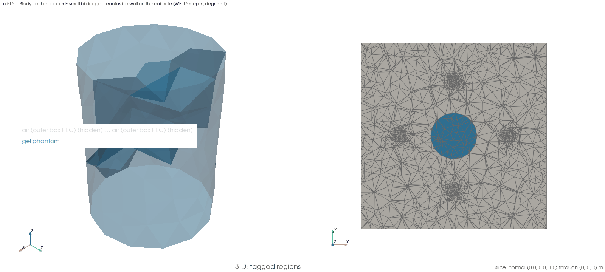

# `-e mri:16` — the `Study` on a copper birdcage

Guide for `examples/mri/16_study_copper_birdcage.py`.
Written to be followed without the source open.

## 1. What this demonstrates

**A copper coil through the `Study` API, in a few lines of user code.** `WF-16`
step 7 added `LeontovichWall` and `FourPortBirdcageGeometry(as_hole=True,
strip_fraction=…)` to the `Study`. This example builds the F-small four-port
birdcage on exact port rectangles (κ off) twice at 64 MHz, degree 1, `-n 2`: once on
copper and once with `conductor=None` (the coil-hole wall left as natural PEC):

```python
phantom = GelledSalinePhantomMaterial(SALINE_SIGMA, SALINE_EPSILON_R, FREQUENCY_64_HZ)
geometry = FourPortBirdcageGeometry(as_hole=True, strip_fraction=GATED_WIDTH_FRACTION)
cu = Study(geometry, phantom, LumpedPortDrive(), frequency_hz=FREQUENCY_64_HZ,
           degree=1, conductor=LeontovichWall(COPPER_SIGMA)).solve(comm)
pec = Study(geometry, phantom, LumpedPortDrive(), frequency_hz=FREQUENCY_64_HZ,
            degree=1, conductor=None).solve(comm)
```

(The script builds a fresh geometry for each `Study`.) **The user rule:** a
`LeontovichWall` needs `as_hole=True`, the hole geometry whose coil is an empty
cavity with a surface condition on facet tag 401; on the solid conductor the API
refuses it (`WF-16`'s own gate, `tests/package/test_wf16_study_copper.py`, holds that
refusal; this example stays on the public API and does not re-test it).

The example then reads the **loss partition** of the copper `Study` (sheets / phantom
/ copper) and writes where on the coil the copper loss sits.

Every record, band and helper is imported from the gate modules; the example states
no σ, ε<sub>r</sub>, frequency, band, power or cell count of its own.

Readings of record (flagged run, harness log `EX-108`, file
`docs/testing/logs/20261009T052039Z_EX-108.log`; the unflagged control
`EX-108-control`, `docs/testing/logs/20261009T052203Z_EX-108-control.log`, reproduces
them inside the bands):

| Anchor | Reference | Reading (log line) | Bound |
| --- | --- | --- | --- |
| (W) rank width | `ANS6_EXACT_STRIP_RECORD_RANK_WIDTH` | 2 == 2 (`:1797`) | exact |
| (M) cells, copper and PEC | `ANS6_EXACT_STRIP_HOLE_CELL_RECORD` | 80 798 and 80 798 (`:1796`) | equal |
| (R) copper vs `ANS-6` step 4 record, self / adjacent / opposite | `LEG_D0_REPRODUCTION_BAND` | 4.093e-11 / 8.673e-11 / 1.376e-10 (`:1800`) | 1e-9 |
| (R) PEC vs record | `LEG_D0_REPRODUCTION_BAND` | 5.052e-11 / 3.878e-11 / 5.875e-11 (`:1800`) | 1e-9 |
| (b) copper power identity | `DISCRETE_IDENTITY_RTOL` | `p_surf` 1.5168731494522984e-06 W, residual 8.507e-13 (`:1805`) | 1e-6 |
| (g) reciprocity, copper / PEC | `RECIPROCITY_BAND` | 6.478e-16 / 6.556e-16 (`:1803`, `:1804`) | 1e-3 |
| (g) σ<sub>max</sub>, copper / PEC | 1 + `PASSIVITY_SIGMA_TOLERANCE` | 0.999851545099 / 0.999904317474 | ≤ 1 + 1e-9 |
| (g) class spreads, copper | `ADJACENT_SPREAD_BAND` | 0.0657 / 0.0612 / 0.0524 % | 0.5 % |
| (L) per-cell loss sum vs `p_surf` | `DISCRETE_IDENTITY_RTOL` | 3.211e-15 (`:1808`) | 1e-6 |
| (c1) PEC Study vs the **copper** record | `NEGATIVE_CONTROL_FLOOR` | 6.422e-04 / 2.812e-04 / 4.863e-04 (`:1802`) | > 1e-5 |

The (g) values have no registered record: they are new printed readings, held to the
imported bands only.

**Copper against PEC, class means (10 digits, `:1798`, `:1799`):**

| class | copper | PEC | \|cu − pec\| / \|pec\| |
| --- | --- | --- | --- |
| self | −3.894212853e-02 + 6.590775812e-01j | −3.933329848e-02 + 6.592411299e-01j | 6.420e-04 |
| adjacent | +3.977072490e-01 − 2.222710707e-01j | +3.978340023e-01 − 2.222897411e-01j | 2.811e-04 |
| opposite | +2.397020121e-01 − 3.002075581e-01j | +2.398399832e-01 − 3.003335088e-01j | 4.861e-04 |

The last column is the form the `WF-16` gate prints; the asserted control (c1) is
relative to the copper record instead, which differs by a factor 1 + O(6e-4)
(`:1801`, `:1802`).

**The loss partition** (copper `Study`, one P1 drive; `:1806`, `:1807`):

| quantity | value |
| --- | --- |
| `p_src` | 4.806472101e-03 W |
| `p_sheets` | 4.803085178e-03 W |
| `p_phantom` | 1.870050049e-06 W |
| `p_non_phantom` | 0 W (the hole route has no conductor cells; the air is lossless) |
| `p_surf` (copper) | 1.516873149e-06 W |
| `P_in = p_src − p_sheets` | 3.386923e-06 W |
| `P_coil / P_in` | 0.4478617 |
| `P_phantom / P_in` | 0.5521383 |

On this fixture, at 64 MHz, degree 1, copper takes ≈ 45 % of the power delivered
past the port sheets and the gel takes ≈ 55 %. This is a record of one fixture and
one degree, not an accuracy figure: `ANS-6` checked the copper loss partition
externally (public verdict AGREE, no number) and stays 🟡.

**Not claimed:** an absolute S₁₁ / Z<sub>in</sub>, a resonance, tuning or Q figure
(`ANS-6` / `ANS-7` stay 🟡); degree 2; 10 / 128 MHz; F-human; κ; a surface loss
*density*; an accuracy statement on the copper loss; anything `WF-16` step 7 does not
claim.

## Setup figure



`examples/mri/figures/mri_16_study_copper_birdcage_setup.png`. Rendered right after
the copper `Study` is solved, from its mesh and cell tags
(`FEM_EM_SETUP_FIGURES=1`). Regions: "gel phantom" (translucent) and "air (outer box
PEC)" (hidden; the generator carries more than one such tag, so the legend repeats
the label). The slice is normal to `z` through the origin and cuts the phantom. **The
coil is drawn as a void:** the renderer takes cell tags only, and the copper is a
facet condition on tag 401 of the coil-hole wall. The four port sheets are facet tags
and are not drawn either. The figure is geometry only.

## 2. How to run it

```
./scripts/run_examples.sh -e mri:16 -n 2 -t 300
```

**Complex build required** — the `mri:` group sources it automatically. Tier:
**standard** (`-n 2`, container `timeout -k 30 300`). `-n 2` is the record's own
width and the script asserts it. Two degree-1 `Study` solves (≈ 31 s each, mesh
≈ 24 s), the identity solve (≈ 5 s) and one more P1 field solve (≈ 5 s) for the
XDMF: the whole script ≈ 73 s.

## 3. How to analyze it, step by step

**Step 1 — the studies and their mesh.**

```
[study] degree 1, -n 2, f = 6.400000e+07 Hz, copper sigma = 5.8e+07 S/m, Z_s = 2.087161e-03+2.087161e-03j ohm
[mesh] copper 80798 cells, PEC 80798 cells (record 80798); ...
[(W)] comm.size 2 == record width 2
```

Cells are asserted equal to `ANS6_EXACT_STRIP_HOLE_CELL_RECORD`. A different count
with everything else sane is a mesher-version event, not an example fault. `Z_s` is
the Leontovich surface impedance of copper at 64 MHz: R<sub>s</sub> = X<sub>s</sub>.

**Step 2 — (R): both `Study` columns reproduce `ANS-6` step 4's record.**

```
[(R)] cu vs record, relative: self 4.093e-11  adjacent 8.673e-11  opposite 1.376e-10; pec vs record: ... (band 1e-09)
```

The example path equals the registered class means to ≈ 1e-10. A miss is an
example/test divergence finding: report it, never widen the band.

**Step 3 — (c1): S alone barely shows copper.**

```
[gap] |cu-pec|/|pec| (the gate's form): self 6.420e-04  adjacent 2.811e-04  opposite 4.861e-04; ...
[(c1)] PEC Study vs the Cu record, relative (asserted form): self 6.422e-04 ... (floor 1e-05, 28.1x; 2.8e+05x the record band)
```

The copper − PEC shift in S is ≈ 3e-4 to 6e-4 relative. It is 28× the control's
floor and 2.8e5× the reproduction band, so the comparator tells the two columns
apart cleanly, but a reader of S alone would barely see the copper. The PEC `Study`
cannot stand in for copper; that is the asserted negative control.

**Step 4 — (b) and (g): the identity and the gates.**

```
[(b)] copper power identity: p_surf 1.5168731494522984e-06 W, residual 8.507e-13 (DISCRETE_IDENTITY_RTOL 1e-06)
[(g)] cu: reciprocity 6.478e-16 (band 0.001); sigma_max 0.999851545099 ...
```

The identity `p_src − p_sheets = p_phantom + p_non_phantom + p_surf` closes to
≈ 1e-12, and `TH-14`'s reciprocity, passivity and spread gates hold on both columns.
These are self-consistency identities on one fixture.

**Step 5 — the partition, which does show copper.**

```
[partition] P_in = p_src - p_sheets = 3.386923e-06 W; P_coil/P_in 0.4478617; P_phantom/P_in 0.5521383
```

Where S moves by a few parts in 10⁴, the loss partition says ≈ 45 % of the delivered
power is dissipated in the copper wall. The same reading is `ANS-6` step 4's 64 MHz
exact-route reading, reproduced here through the `Study`.

**Step 6 — (L): the per-cell field is the same `p_surf`.**

```
[(L)] sum of coil_surface_loss_per_cell_W over owned dofs 1.5168731494522935e-06 W (facet-integrated loss per adjacent cell, not a density); vs p_surf relative 3.211e-15 ...
```

`coil_surface_loss_per_cell_W` is the facet-integrated loss ½ Re(1/Z<sub>s</sub>)
\|n × E\|² per cell adjacent to facet tag 401, in **watts, not a density**. A DG0 test
function is inserted into the same integrand as the scalar `p_surf`, so the field is
a partition of that one number, not a second estimator. The agreement is a
consistency check by construction, on a second solve of the same system.

**Step 7 — open it in ParaView.**
`File → Open → examples/mri/paraview_output/mri_16_study_copper_birdcage_combined.xdmf`.
The file holds the cell grid with `E_abs` (|E| of the P1 drive, P1 Lagrange),
`coil_surface_loss_per_cell_W` (DG0, watts per cell) and `CellTags`, plus a facet
block carrying the facet tags.

1. Select the facet block, **Threshold** on tag `401` (the copper wall), and colour
   by `coil_surface_loss_per_cell_W` on a **log scale** to see where on the legs and
   rings the copper loss concentrates.
2. On the cell grid, **Slice** at z = 0 (normal `z`, origin 0) and colour `E_abs`
   to see the field through the phantom mid-plane.

**Step 8 — what a deviation means.** (W) fails → the run is not at `-n 2`. (M) or (R)
fails → compare against `WF-16` step 7's own gate at the same width: a mismatch is a
divergence finding. (b) or (g) fails → read it as evidence about the setup before
the code. (L) fails with (b) green → the example's DG0 form differs from the gate's
scalar form. (c1) fails → the PEC column no longer differs from copper: the
`LeontovichWall` term is not reaching the system. Any of these: report and stop.

## Related

- `examples/mri/08_study_four_port_birdcage.md` — the same fixture on the
  σ = 800 S/m solid conductor.
- `examples/ports/18_birdcage_copper_leontovich.md` — copper off the API, on the
  ragged sheet, at 10 MHz.
- `examples/mri/06_f_human_copper_loss_partition.md` — the F-human copper loss
  partition.
- `tests/package/test_wf16_study_copper.py` — the `WF-16` gate this example
  reproduces.
- `tests/validation/test_ans6_exact_strip.py` — `ANS-6` step 4's registered records.
- `tests/validation/test_th14_birdcage_copper.py` — `TH-14`'s gates and helpers.
- `src/fem_em_solver/study.py` — `Study`, `LeontovichWall`, `GATED_WIDTH_FRACTION`,
  `COPPER_SIGMA`.
