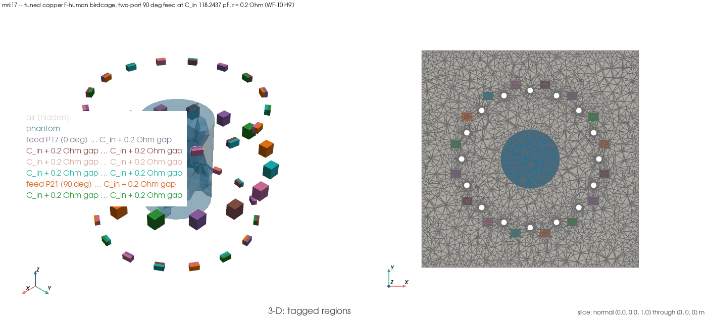

# `-e mri:17` — the tuned copper F-human birdcage under the two-port 90° drive: |B₁⁺| and the 10 g hotspot

Script: `examples/mri/17_f_human_tuned_quadrature_b1_sar.py` (`EX-109`)
Gates: `tests/validation/test_wf10_f_human_tuned_b1_sar.py` (`WF-10` step 2, item 358) and `tests/validation/test_wf10_f_human_tuned_sar10g.py` (item 359)

## 1. What this demonstrates

One build of the copper F-human hole mesh (369 387 cells, Leontovich wall,
κ off, degree 1, 64 MHz, phantom at 0.015 m), one node pair at
C_in,F-human = 118.2437 pF with r = 0.2 Ω ESR on all 32 ring gaps (the two
feed gaps are driven across r + C; the other thirty carry r + C), and two sense
superpositions of the P17 / P21 fields. Both readings come from those fields:
the |B₁⁺| sample and the 18-point 10 g lattice.

- The drive sense is code, not a choice made after reading |B₁⁺|: `ccw` =
  (1, −1j) at slots 0 / 4 is the co-rotating sense (`cw` = (1, +1j)). Under
  `ccw` the mean |B₁⁺| / mean |B₁⁻| is 21.5155; under `cw` the roles swap
  (22.2551). Over the 41-point sample (all 41 valid on every image) the mean
  |B₁⁺| is 2.884091e-7 T (per √W of P_src 9.803471e-7 T/√W), CV 7.3397e-3: a
  reading, not a homogeneity claim.
- A two-feed drive keeps one mirror only: the feed-bisector plane at
  az₁₇ + 45° = 56.25°. It pairs the counter-rotating component of the opposite
  sense with the co-rotating one: |B₁⁻|_cw(M x) against |B₁⁺|_ccw(x) misses by
  1.9647e-3 (band `C4_COVARIANCE_BAND` = 5 %). C16 is a reading, not an
  identity (worst 8.0260e-3 at m = 8, printed, never asserted).
- The 10 g hotspot: 18 lattice balls (≈ 1.8 phantom cells across a 10 g ball),
  c* = r = 45 mm, z = z_c, az₁₇: SAR₁₀g(c*) = 4.852895959e-3 W/kg for the
  drive normalised as the gate does (per watt of P_src 5.607159e-2 W/kg/W).
  c* is a lattice argmax, not a global maximum. The mirror at c* is 0.6413 %
  and the lattice relative L2 1.2789 % (band 5 %).
- Power: the phantom takes P_phantom/P_src = 9.472043e-2; the sheets
  carry the rest, copper wall 6.09e-4 W of 8.65e-2 W.

Asserted (every band imported from the gate modules): (A0) cells, (S_rep) the
node reproduces the stored 358 record (4.28e-13), (P_RC) / (P_w) / (Lin) / Y_in
at their identity bands, (Σ_P), (Sense) > 1, (M_B), (i) coverage, (iii-a),
(iii-b), (iv) containment (worst −4.8813 mm over 39 balls), plus the
example-side identity **(X1)**: the per-cell phantom loss vector written to the
map sums to P_phantom (4.4e-16). The map's `SAR_local_ccw` is the cell-averaged
local SAR (loss / (ρ V_cell)) on phantom cells, so Σ SAR·ρ·V = P_phantom by
construction. It is not a 10 g value.

**Negative controls (asserted):**

- (N1) the mis-paired sense: |B₁⁺|_cw(M x) against |B₁⁺|_ccw(x) misses by
  9.5476e-1 (19.1× the band). The mirror pairs B₁⁺ with B₁⁻; pairing the
  wrong rotating component fails.
- (N2) the single feed P17 without the partner swap: SAR₁₀g(Mc*) against
  SAR₁₀g(c*) misses by 3674.7755 % (735× the band).
- The node P_surf-blind identity misses by 7012.5× the band (asserted inside
  the builder).

**Records, not failures** (printed): the exact M-partner P21(Mc*) against
P17(c*) is 7.3845 %, and the azimuthal spread of the z_c rows is 16.7 / 21.0 /
18.6 %. Both sit outside item 359's predictions (5 % and 10 %). Neither is
asserted.

The printed rows equal the two W1 logs at the printed digits, 18 / 18 lattice
rows included, with one exception: the imaginary part of Y_in for P17 under
`cw`, a 2.8e-6 S reading whose last digits move at round-off (2.783852942e-6,
2.783852943e-6 in the control, against 2.783852939e-6). It is reported by the
script, not asserted.

Not claimed: the four-port quadrature drive (`EX-75`, not shown here);
f₀, Q, a match, S₁₁ / Z_in or any tuning accuracy (C_in is a record at 0.10 pF
resolution); homogeneity; an absolute |B₁⁺| or SAR against anything external;
C16 invariance; a global SAR maximum; compliance with any limit; degree 2
from this script (the degree-2 column below is entry 41's record); a tissue
model. `WF-10` is ✅ on its degree-1 steps.

**Degree-2 column at the degree-2 root (a labelled record; not produced by
this script).** `xl` entry 41 ran the two gate modules at degree 2 with the
node knob at C_in(d2) = 115.5209 pF (2 570 024 unknowns, `-n 16`, every gate
green; `docs/testing/logs/20261022T070008Z_WF-10-step4-H28.log`). This script
stays degree 1 at 118.2437 pF.

| Quantity | degree 1, 118.2437 pF | degree 2, 115.5209 pF | entry-41 line |
|---|---|---|---|
| mean \|B₁⁺\|_ccw [T] | 2.884091e-07 | 2.792653e-07 (−3.17 %) | `:6852` |
| per √W of P_src [T/√W] | 9.803471e-07 | 9.626052e-07 | `:6852` |
| (Sense) | 21.5155 | 21.6573 | `:6845` |
| (M_B) | 1.9647e-03 | 1.7093e-03 | `:6847` |
| SAR₁₀g(c\*) [W/kg] | 4.852895959e-03 | 4.547175546e-03 (−6.30 %) | `:13586` |
| per W of P_src [W/kg/W] | 5.607159e-02 | 5.402616e-02 | `:13597` |
| per W of P_phantom [W/kg/W] | 5.919694e-01 | 5.986819e-01 (+1.13 %) | `:13597` |
| P_phantom/P_src | 9.472043e-02 | 9.024185e-02 (−4.73 %) | `:13597` |
| (iii-a) / (iii-b) [%] | 0.6413 / 1.2789 | 0.3052 / 0.3277 | `:13587–13588` |
| z_c spread r = 15 / 30 / 45 mm [%] | 16.7267 / 20.9986 / 18.6041 | 13.9071 / 17.4457 / 18.1684 | `:13589` |
| c\* | r = 45 mm, z_c, az₁₇ | r = 45 mm, z_c, az₁₇ | `:13586` |

The degree-1 values come from `20261017T170443Z_WF-10-H28-W2-regate.log`
(`:6336`, `:6338`, `:6343`) and `20261013T111006Z_WF-10-step4b-W1-regate.log`
(`:6390–6393`, `:6401`).

The pre-registered rule (`docs/testing/xl-pending.md`, entry 41) fires its
second branch, read literally by the 10-22 03:00 review: a move above 5 %
means the tuned figures are quoted at degree 2 only, at C_in(d2), and the
degree-1 column is a record. Per phantom watt the moves are +0.60 %
(\|B₁⁺\|) and +1.13 % (SAR₁₀g). The 10-24 weekly rules.

## 2. How to run it

```
./run_examples.sh -e mri:17 -n 8 -t 590
```

Needs the complex DolfinX build, which the runner sources for the `mri:`
group, and two gitignored inputs: `logs/wf12/h12c-cu-s32-a2.npz` and
item 358's stored node record under `logs/wf10/` (written by
`tests/validation/test_wf10_f_human_tuned_b1_sar.py`). Tier: **heavy**, `-n 8` only. The run takes
≈ 235–240 s wall (mesh ≈ 110 s), ≈ 10 GiB summed RSS. Verification runs go
through the logging harness with the runner's emitted command
(`./scripts/run_examples.sh -e mri:17 -n 8 -t 590 --dry-run`). Add
`-e FEM_EM_SETUP_FIGURES=1` after `exec -T` to re-render the setup figure.

## Setup figure



`examples/mri/figures/mri_17_f_human_tuned_quadrature_b1_sar_setup.png`. The
figure shows the hole mesh with air hidden, the phantom translucent, the 32
ring-gap port boxes (feeds P17 at 0° and P21 at 90° named apart from the
thirty "C_in + 0.2 Ω gap" boxes) and the z-slice through z_c. The hole route
has no conductor cells: the coil is drawn as a void.

## 3. How to analyze it, step by step

**Step 1 — the anchors.** `[anchor]` lines print (A0), (S_rep), (P_w), (Lin)
and (P_RC) at their bands, each beside its W1 value.

**Step 2 — the node.** `[Y_in]` and `[k]` print the four admittance readings
and the signed k spectrum of the ring currents: under `ccw` the lag share is
0.996 on the + ring.

**Step 3 — |B₁⁺|.** `[B1+]` lines: (Sense), centre purity, (M_B), (N1), the
wrong-plane mirror, C16 and the mean.

**Step 4 — the hotspot.** `[10 g]` prints the 18-row table (ccw against cw at
the mirror image), c*, (iii-a), (iii-b), (N2), the two OUT records and
(i) / (iv). With ≈ 1.8 cells per ball c* is a lattice argmax, asserted
pointwise, and the lattice is asserted as a relative L2.

**Step 5 — records.** `[records]` counts printed rows that differ from the W1
digits.

**Step 6 — ParaView.** Open
`examples/mri/paraview_output/mri_17_f_human_tuned_quadrature_b1_sar_combined.xdmf`.
It holds DG0 `B1_plus_ccw`, `B1_minus_ccw`, `B1_minus_cw`, `B1_purity_ccw`,
`E_magnitude_ccw`, `phantom_loss_per_cell_W_ccw`, `SAR_local_ccw` (phantom
only, W/kg), `LatticeBall` (k + 1 inside lattice ball k, from cell midpoints),
`CStar`, `MirrorSide` (± by the side of the feed-bisector plane) and
`CellTags`. Slice z = z_c on `B1_plus_ccw`; Threshold `LatticeBall` ≥ 1 and
colour by `SAR_local_ccw`; compare `B1_plus_ccw` with `B1_minus_cw` across
`MirrorSide`. The lattice itself is in
`examples/mri/paraview_output/mri_17_f_human_tuned_quadrature_b1_sar_lattice.csv`.

## Related

- `examples/mri/04_f_human_sar10g_hotspot.md` (`mri:4`, the untuned σ = 800 S/m coil).
- `examples/mri/06_f_human_copper_loss_partition.md` (`mri:6`, the same hole mesh at 50 Ω).
- `tests/validation/test_wf10_f_human_tuned_b1_sar.py` and
  `tests/validation/test_wf10_f_human_tuned_sar10g.py`: the gates.
- `tests/validation/test_wf10_f_human_copper_esr_root.py`: the C_in node.
- `EX-75` is the four-port side branch, not shown here.
