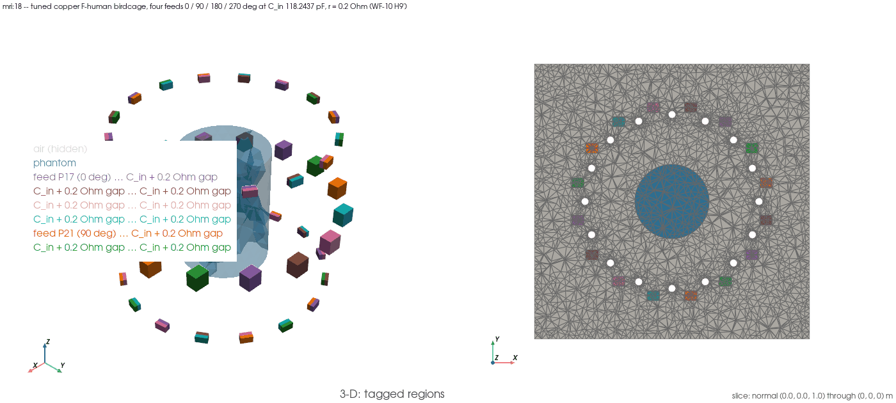

# `-e mri:18` — the tuned copper F-human birdcage under the four-port 0 / 90 / 180 / 270° quadrature drive, beside the two-port drive

Script: `examples/mri/18_f_human_four_port_quadrature.py` (`EX-75`)
Gates: `tests/validation/test_wf10_f_human_tuned_b1_sar.py` (`WF-10` step 2, item 358) and the helper modules it imports

## 1. What this demonstrates

One build of the copper F-human hole mesh (369 387 cells, Leontovich wall,
κ off, degree 1, 64 MHz, phantom at 0.015 m) at C_in,F-human = 118.2437 pF with
r = 0.2 Ω ESR on all 32 ring gaps. Two loadings of that one coil at the same C:

- **two-port** (the clinical drive, `mri:17`): feeds P17 / P21 at slots 0 / 4,
  weights `ccw` = (1, −1j); the other 30 gaps carry r + C.
- **four-port** (this example): feeds P17 / P21 / P25 / P29 at slots
  0 / 4 / 8 / 12 (azimuths 11.25 / 101.25 / 191.25 / 281.25°, successive
  spacings 90.000000° each), the other 28 gaps r + C; one factorising solve and
  three held solves, superposed with the `ccw` weights (1, −1j, −1, +1j).

**The four-port drive is untuned.** C is the two-port root; it was not
re-rooted for four Thévenin loads. Its figures are printed, not gated, and
no tuning, match, f₀, Q, S₁₁ or Z_in statement is made from it. The clinical
fixture stays two-port (operator, 2026-10-01); this is a side branch.

Readings, per drive (feed-ring k-spectrum, power shares):

| drive | k = 0 | k = +1 (lead) | k = −1 (lag, bin 15) |
|---|---|---|---|
| two-port | 4.7394e-3 | 2.173e-3 | 0.991672 |
| four-port | 4.5411e-7 | 6e-6 | 0.999450 |

The two-port drive feeds a k = 0 component because its weights do not sum to
zero (FFT bin 0 = √2, asserted); the four-port weights do sum to zero (bin 0 =
1.7e-16, bin 1 = 1.2e-16, bin 15 = 4, asserted) and the loading is
C4-symmetric, so only the k = −1 alias family (bins 3 / 7 / 11 / 15) is
driven, plus mesh-asymmetry leakage (4.5e-7). The four-port k = −1 share
(0.999450) is above the two-port's (0.996265 on the + ring, 0.991672 on the
feed ring): predicted, printed.

|B₁⁺| (41 sample points, all valid on every image): two-port mean
2.884091e-7 T (per √W of P_src 9.803471e-7 T/√W); four-port mean 3.500758e-7 T
(per √W 7.635593e-7 T/√W, P_src 0.2102 W against 0.08655 W). Four-port /
two-port in T/√W is 0.7789, outside the ±10 % that was predicted: a reading
that follows from the untuned loading (the four Thévenin feeds see different
admittances from the two-port pair), not a defect. The four-port |B₁⁺|
at 90° rotations differs by 1.6835e-3 / 1.6992e-3 / 1.5741e-3 (C4,
predicted ≤ 1 %); its worst C16 reading is 1.7287e-3 at m = 13, the two-port's
8.0260e-3 at m = 8. Mean |B₁⁺| / mean |B₁⁻| is 152.4 for the four-port drive
against 21.5155 for the two-port.

Asserted (every band imported from the gate modules): (A0) cells, (S_rep) the
node reproduces the stored record (5.03e-13), (P_RC) / (P_w) / (Lin) / Y_in at
their identity bands, (Σ_P), (Sense) > 1, (M_B) = 1.9647e-3 against the 5 %
band; and, example-side, the three construction identities of the script's own
four-port solve: **(X4-P)** the power partition of the superposed field
(3.3e-13), **(X4-L)** the 32 terminal currents off the superposed field against
Σ wᵢ Iᵢ (4.2e-16), **(X4-K)** the solve kinds `solve, held, held, held`. These
check the construction; they gate no physics claim.

**Negative controls (asserted):**

- (N1) the mis-paired sense on the two-port drive: |B₁⁺|_cw(M x) against
  |B₁⁺|_ccw(x) misses by 9.5476e-1 (19.1× the band).
- (W0) the two-port weights feed k = 0 (bin 0 = √2 ≠ 0) where the four-port
  weights do not.
- The node P_surf-blind identity misses by 7012.5× the band (asserted inside
  the builder).

The printed two-port rows equal the W1 log at the printed digits except the
imaginary part of Y_in for P17 under `cw`, a 2.8e-6 S reading whose last digit
moves at round-off (2.783852943e-6 in both windows against 2.783852939e-6);
`mri:17` shows the same row. It is reported by the script, not asserted.

Not claimed: a four-port tuning; f₀, Q, a match, S₁₁ / Z_in or tuning accuracy;
homogeneity; an absolute |B₁⁺|; C16 or C4 invariance as a gate; 10 g SAR
(`mri:17` has it); degree 2; compliance; a tissue model. `WF-10` stays 🟡.

## 2. How to run it

```
./run_examples.sh -e mri:18 -n 8 -t 590
```

Needs the complex DolfinX build, which the runner sources for the `mri:`
group, and two gitignored inputs: the stored 32×32 matrix under `logs/wf12/`
and item 358's stored node record under `logs/wf10/` (written by
`tests/validation/test_wf10_f_human_tuned_b1_sar.py`). Tier: **heavy**,
`-n 8` only. The run takes ≈ 195–210 s wall (mesh ≈ 114 s, four-port solves
≈ 30 s), ≈ 10.4 GiB summed RSS. Verification runs go through the logging
harness with the runner's emitted command
(`./scripts/run_examples.sh -e mri:18 -n 8 -t 590 --dry-run`). Add
`-e FEM_EM_SETUP_FIGURES=1` after `exec -T` to re-render the setup figure.

## Setup figure



`examples/mri/figures/mri_18_f_human_four_port_quadrature_setup.png`. The
figure shows the hole mesh with air hidden, the phantom translucent, the 32
ring-gap port boxes (feeds P17 / P21 / P25 / P29 at 0 / 90 / 180 / 270° named
apart from the twenty-eight "C_in + 0.2 Ω gap" boxes) and the z-slice through
z_c. The hole route has no conductor cells: the coil is drawn as a void.

## 3. How to analyze it, step by step

**Step 1 — the drive code.** `[W0]` prints the FFT bins of the two weight
sets: four-port bins 0 and 1 vanish and bin 15 is 4; two-port bin 0 is √2.

**Step 2 — the anchors.** `[anchor]` lines print (A0), the four feed azimuths,
(S_rep), (P_w), (Lin) and (P_RC) at their bands, each beside its W1 value.

**Step 3 — the two-port drive.** `[Y_in]`, `[k]`, `[B1+]` and `[SAR]` repeat
`mri:17`'s two-port rows (Sense, purity, (M_B), (N1), C16, mean, (Σ_P)).

**Step 4 — the four-port solve.** `[four-port]` prints the loads, the solve
kinds and times, (X4-P), (X4-L), (X4-K) and the four feeds' Y_in at the
untuned C.

**Step 5 — the k-spectra.** `[k] feed ring` prints k = 0, k = +1 and k = −1
shares per drive; the CSV
`examples/mri/paraview_output/mri_18_f_human_four_port_quadrature_kspectrum.csv`
has all 16 bins per drive and ring.

**Step 6 — four-port |B₁⁺|.** The second `[B1+]` block prints the C4 spread at
90° rotations, the C16 readings and |B₁⁺|/√P_src for both drives with their
ratio.

**Step 7 — ParaView, one colour scale.** Open
`examples/mri/paraview_output/mri_18_f_human_four_port_quadrature_combined.xdmf`.
It holds DG0 `B1_plus_2port`, `B1_minus_2port`, `B1_plus_4port`,
`B1_minus_4port`, `E_magnitude_2port`, `E_magnitude_4port`, `FeedMarker`
(1–4 on the four feeds' port-box cells), `FeedMarker2` (1–2 for the two-port
feeds) and `CellTags`. Slice z = z_c on `B1_plus_2port` and `B1_plus_4port`
and set both colour maps to the printed `[paraview]` range
[1.931607e-10, 4.544279e-06] T (the common min / max of the two fields over
owned cells).

## Related

- `examples/mri/17_f_human_tuned_quadrature_b1_sar.md` (`mri:17`, the two-port drive with the 10 g hotspot).
- `tests/validation/test_wf10_f_human_tuned_b1_sar.py`: the builder and the gates.
- `tests/validation/test_wf10_f_human_copper_esr_root.py`: the C_in node and the Thévenin helpers.
