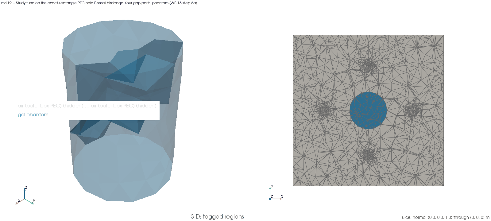

# `-e mri:19` — `Study.tune`: C from Im z_k, the C₁ closure, the mode fields

Guide for `examples/mri/19_study_tune_mode_capacitance.py`.
Written to be followed without the source open.

## 1. What this demonstrates

**What `Study.tune` reads, what it ignores, and which mode it tuned.** `WF-16` step 6(a)
added `Study.tune(k)` to the `Study`: it forms `Z = s_to_z(S, z0)` from the Study's own
4×4 S, the modal impedances `z_k = diag(F Z Fᴴ)` with `F` the unitary 4-point DFT, and
returns `C_k = 1/(ω Im z_k)`. No example called it. This one runs the gate's two Studies
through the public API at 64 MHz, degree 1, `-n 2`, κ off:

```python
pec = Study(FourPortBirdcageGeometry(as_hole=True, strip_fraction=GATED_WIDTH_FRACTION),
            phantom, LumpedPortDrive(), frequency_hz=FREQUENCY_64_HZ, degree=1,
            conductor=None)          # the gate's _py_copper("pec")
pec.solve(comm)
t1 = pec.tune(k=1, comm=comm)        # z_k, C_1, off-diagonal residual
```

and the gate's solid σ = 800 S/m control. Every record, band and helper is imported from
`tests/package/test_wf16_study_tune.py` (the ANS-1 rule); the example states no band.

**z_k and the degenerate pair.** `diag(F Z Fᴴ)` is the eigenvalue of the circulant `Z` for
mode k. The coil is four-fold symmetric, so `z_1` and `z_3` are the same mode (counter- and
co-rotating); the gap `|z_1 − z_3|` is the reciprocity residual. `Im z_0` is large and
negative (the common mode sees the ring capacitance), `Im z_1, z_3, z_2` are positive.

Three readings no example had. The first two are exact circuit identities (asserted); the
third is a field picture (printed).

1. **C comes from Im z_k only.** A uniform series resistance r on all four ports gives
   `Z′ = Z + r·I`; `F·I·Fᴴ = I`, so every `z_k` shifts by exactly r and `C_1` does not
   move. A uniform series reactance jX shifts `Im z_1` and does move `C_1`.
2. **What C₁ tunes.** The series capacitor `1/(jωC_1)` on every port cancels `Im z_1` (and
   `Im z_3`) exactly, and leaves mode 2 with `Im z_2 − 1/(ωC_1) < 0`. This is a
   circuit-layer statement on one degree-1 fixture at 64 MHz. **It is not a resonance, f₀,
   Q or tuning-accuracy claim** (`ANS-7` stays 🟡).
3. **The mode fields.** `Study.b1_plus()` returns one CG1 `B` per port drive; superposing
   them with the DFT weights `v_p = conj(F[k, p])` gives the incident-wave mode-k field
   (S is near-circulant, off-diagonal residual 3.8e-05).

Readings of record (flagged run, harness log `EX-113`, file
`docs/testing/logs/20261014T111653Z_EX-113.log`; the unflagged control `EX-113-control`,
`docs/testing/logs/20261014T111841Z_EX-113-control.log`, reproduces them). The gate's run
of record is `docs/testing/logs/20261014T004318Z_WF-16-s6-W1.log`:

| Anchor | Reference | Reading (log line) | Bound |
| --- | --- | --- | --- |
| (W) rank width | `ANS6_EXACT_STRIP_RECORD_RANK_WIDTH` | 2 == 2 (`:3607`) | exact |
| (R0) cells; class means vs `"pec"` record | `ANS6_EXACT_STRIP_HOLE_CELL_RECORD`; `LEG_D0_REPRODUCTION_BAND` | 80 798; 5.052e-11 / 3.878e-11 / 5.875e-11 (`:3608`, `:3610`) | 1e-9 |
| (I) API vs `TH-17` modal route; C₁ closure | `EXACT_IDENTITY_RTOL` | 0 / 0 / 0 (`:3611`) | 1e-10 |
| (a) C₁ vs `TH17_STEP3_C_MODE_RECORD_F` | `REDUCTION_BAND` | gap −2.976552e-04 (`:3617`) | 1e-3 |
| (ESR) uniform r = 0.2 / 1 Ω: C₁ shift; z_k shift − r | `EXACT_IDENTITY_RTOL` | 5.6e-16, 1.6e-15 / 4.4e-16, 1.3e-15 (`:3620`, `:3621`) | 1e-10 |
| (Tuned) C₁ cancels Im z₁ / Im z₃ | `EXACT_IDENTITY_RTOL` | 1.1e-16 / 6.5e-16 (`:3623`) | 1e-10 |
| (c1) k = 2 misses the record | `REDUCTION_BAND` | gap +4.894874e-01, 489× band (`:3618`) | > 1e-3 |
| (c2) solid ties to its record, then misses `TH-17`'s | `LEG_D0_REPRODUCTION_BAND`; `REDUCTION_BAND` | tie 9.557e-11; gap −6.980694e-02 (`:3619`) | tie ≤ 1e-9; miss > 1e-3 |
| (ESR-c) jX = 1 Ω moves C₁ | `EXACT_IDENTITY_RTOL` | 0.025956 (predicted 0.02596; `:3622`) | > 1e-10 |
| (Tuned-c) the C₂ capacitor does not cancel Im z₁ | `EXACT_IDENTITY_RTOL` | 0.32883 (predicted 0.3288; `:3625`) | > 1e-10 |

The example-local inputs r ∈ {0.2, 1.0} Ω and X = 1.0 Ω are inputs, not records
(0.2 Ω is the F-human ESR the gate's refusal test uses).

**Printed only (no band):**

| quantity | value (log line) |
| --- | --- |
| pec z_k (Re, Im, Ω), k = 0…3 | 2.0146 − 1164.92j; 0.0250035 + 37.5264j; 0.00299922 + 25.1866j; 0.0250035 + 37.5264j (`:3612`) |
| solid z_k | 3.25511 − 1163.68j; 5.96878 + 40.3305j; 3.9531 + 27.1832j; 5.96878 + 40.3305j (`:3613`) |
| Re z₁ solid / pec; C₁ solid / pec | 238.72 (predicted 239); 0.93047 (predicted 0.9305) (`:3614`) |
| Im z_2 after the C₁ capacitor | −12.34 Ω (predicted −12.3; `:3624`) |
| plain vs field-keeping sweep, S max difference | 1.7e-15 flagged, 0 control (predicted ≤ 1e-12; `:3626`) |
| centre \|B₁⁺\|, \|B₁⁻\|, k = 1 | 3.33666e-10, 3.68784e-08 T (`:3627`) |
| centre \|B₁⁺\|, \|B₁⁻\|, k = 3 | 3.68741e-08, 2.73442e-10 T (`:3629`) |
| centre \|B₁⁺\|, \|B₁⁻\|, k = 2 | 2.67675e-10, 2.63168e-10 T (`:3628`) |
| \|B₂(0)\| / \|B₁(0)\| | 1.0277e-02 (predicted ≲ 1e-2: **just above**, reported; `:3630`) |

Mode fields are per unit incident-wave mode excitation: a record, not an absolute field.
Which of k = 1 / 3 is co-rotating is the e^{jωt} convention; the example prints it and
does not claim it. The new values here are the printed ≤ 6 significant digits; the C
records at nine digits are the gate's own, already tracked.

**Not claimed:** a resonance, f₀, Q, S₁₁ / Z_in or tuning-accuracy figure; copper
(`LeontovichWall`) tuning; degree 2; 10 / 128 MHz; F-human (`tune` refuses it); an
external check. `WF-16` does not move.

## Setup figure



`examples/mri/figures/mri_19_study_tune_mode_capacitance_setup.png`. Rendered right after
the PEC `Study` is solved, from its mesh and cell tags (`FEM_EM_SETUP_FIGURES=1`).
Regions: "gel phantom" (translucent) and "air (outer box PEC)" (hidden). The slice is
normal to `z` through the origin and cuts the phantom. **The coil is drawn as a void:**
the hole route has no conductor cells, and the four port sheets are facet tags, which the
renderer does not draw. The figure is geometry only.

## 2. How to run it

```
./scripts/run_examples.sh -e mri:19 -n 2 -t 420
```

**Complex build required** — the `mri:` group sources it automatically. Tier: **heavy**
(`-n 2`, container `timeout -k 30 420`). `-n 2` is the record's own width and the script
asserts it. Two degree-1 `Study` solves (PEC ≈ 28 s, solid ≈ 34 s), then `b1_plus()` runs a
second field-keeping sweep of the PEC Study (≈ 31 s): the whole script ≈ 96 s wall
(98 s with start-up, flagged; 99 s control). Add `FEM_EM_SETUP_FIGURES=1` to re-render the
figure.

## 3. How to analyze it, step by step

**Step 1 — the anchor.**

```
[(R0)] pec class-mean rel vs 'pec' record: self 5.052e-11  adjacent 3.878e-11  opposite 5.875e-11 (band 1e-09)
[(I)] max rel |z_k(api) - z_k(TH-17 route)| 0.000e+00; ... |C_1 omega Im z_1 - 1| 0.000e+00 (band 1e-10)
[(a)] C_1 vs TH17_STEP3_C_MODE_RECORD_F gap -2.976552e-04 (gate record -2.976552e-04); band 1.0e-03
```

The example path equals the gate's values to every printed digit. A miss is an
example/test divergence finding: report it, never widen a band or re-record from here.

**Step 2 — the z_k tables.** `Im z_1 = Im z_3 = 37.5` Ω, `Im z_2 = 25.2` Ω: C₁ = 66.27 pF,
C₂ = 98.73 pF. `Re z_1` is 0.025 Ω on the PEC hole and 5.97 Ω on the solid σ = 800 S/m
conductor (≈ 239×, the solid conductor's loss) while C₁ moves only −6.95 % (ratio 0.93047).
The capacitance is the reactive read; the loss is the real read.

**Step 3 — (ESR) and (ESR-c).** A uniform r moves every `z_k` by r to 1.6e-15 and `C_1`
by 5.6e-16; a uniform jX = 1 Ω moves `C_1` by 0.025956 (≈ 2.6e8× the band), matching
`X/(Im z_1 + X) = 1/38.53`. A tune that reads Im z_k only cannot see a capacitor's ESR.

**Step 4 — (Tuned) and (Tuned-c).** `Z + I/(jωC_1)` has `|Im z_1| / Im z_1 = 1.1e-16`
(and 6.5e-16 for k = 3), `Re` untouched, and `Im z_2 = −12.34` Ω. Tuning with C₂ instead
leaves 32.9 % of `Im z_1` uncancelled, the negative control. This is the circuit-layer
statement that C₁ is the mode-1 capacitance, not a statement that the coil resonates at
64 MHz or is tuned.

**Step 5 — the controls.** (c1) k = 2 on the same Study misses the `TH-17` record by 489×
the band; (c2) the solid Study ties to its own record (9.557e-11) and misses `TH-17`'s by
69.8× the band. A control inside its band would be a mislabelled variant.

**Step 6 — the mode fields.** At the coil centre, mode 1 is dominated by `|B₁⁻|`
(3.69e-08 T vs 3.34e-10 T), mode 3 by `|B₁⁺|` (3.69e-08 T vs 2.73e-10 T): the degenerate
pair are the two circular polarisations, and `S` near-circulant means a mode-k incident
vector excites mode k. Mode 2 has no transverse centre field of its own:
`|B_2(0)|/|B_1(0)| = 1.0277e-2`, a hair above the brief's ≲ 1e-2, reported with no
status effect.

**Step 7 — open it in ParaView.**
`File → Open → examples/mri/paraview_output/mri_19_study_tune_mode_capacitance_combined.xdmf`.
The file holds the cell grid with `B_mode1_real`, `B_mode2_real` (vector CG1, real copies
of the superposed phasor), nodal scalars `B_mode1_abs`, `B_mode2_abs`, `B1_plus_mode1`,
`B1_minus_mode1`, `B1_plus_mode3` (nodal \|·\|, not a point-evaluated \|B₁⁺\|), and
`CellTags`. The per-mode impedances are in
`examples/mri/paraview_output/mri_19_study_tune_mode_capacitance_modes.csv`: one row per
(study, k, variant ∈ base, r=0.2, r=1, X=1, tuned_C1, tuned_C2), with `Re_zk_ohm`,
`Im_zk_ohm`, `C_k_F` (blank when Im ≤ 0).

1. **Slice** at z = 0 and colour by `B_mode1_abs` and `B_mode2_abs` side by side.
2. **Glyph** `B_mode1_real` on the slice.
3. Compare `B1_plus_mode1` with `B1_plus_mode3`.

**Step 8 — what a deviation means.** (W) fails → not `-n 2`. (R0), (I) or (a) fails →
compare with `WF-16` step 6(a)'s own gate at the same width: a divergence finding.
(ESR) or (Tuned) fails → the z0 convention or circuit algebra is not what this guide
says. A control inside its band → a mislabelled variant.

## Related

- `examples/mri/16_study_copper_birdcage.md` — the copper Study on the same hole fixture.
- `examples/mri/08_study_four_port_birdcage.md` — the four-port Study and its S.
- `tests/package/test_wf16_study_tune.py` — the gate this example imports.
- `tests/validation/test_th17_birdcage_eigenmodes.py` — `TH-17`, the modal route and the
  DFT helper.
