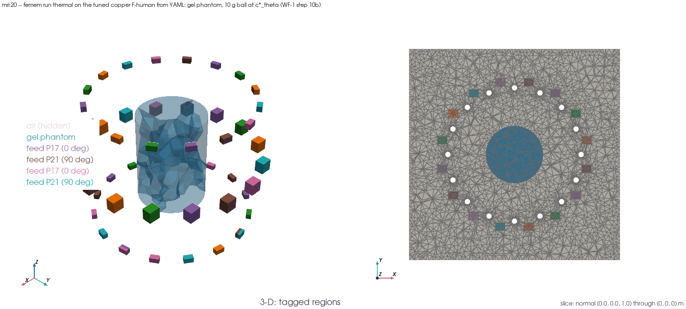

# `-e mri:20` — `femem run` thermal on the tuned copper F-human from a YAML file: one EM solve, the file's thermal knobs, and the temperature field the API does not return

Guide for `examples/mri/20_f_human_thermal_from_yaml.py`.
Written to be followed without the source open.

## 1. What this demonstrates

**A transient heating run on the human-scale birdcage, described in a text file.**
`femem run <file>` calls `run_study_file`; for the tracked file
`tests/package/wf1/f_human_tuned_copper_thermal.yaml` that is one degree-1 complex
EM solve of the tuned copper F-human (369 387-cell Leontovich hole mesh, 64 MHz,
ccw drive) followed by the file's `thermal:` block. The example calls
`run_study_file` on the file in place (the console script itself is not exercised
here, as in the gate). It then keeps the one solved Study and asks it what a user
editing the file would ask, with no second EM solve (counted: the solve count reads
1 after every read).

The `thermal:` block, key by key:

* `k_w_per_m_k: 0.6`, `h_w_per_m2_k: 10.0`, `t_inf_c: 20.0` — the gel's
  conductivity, the Robin film coefficient and the ambient; all temperatures in the
  example are θ = T − T∞.
* `source_scale` — a plain linear factor on the heat source q = ½σ|E|² (the file's
  value is the 1 W-normalised record, not a calibration).
* `transient:` — `dt_s: 31.35`, `n_steps: 40`, `rho_c_j_per_m3_k: 4180000.0`,
  Crank–Nicolson (`theta: 0.5`) with two start-up half steps: 41 snapshots to
  t\* = 1254 s.
* `balls:` — a 10 g ball at the centre c\*_θ (the gate's record) and `window_s: 360.0`
  for the six-minute running average.

**Inputs of the example, not records:** h = 1 and 100 W/m²K beside the file's 10, and
the mirror ball centre M(c\*_θ) (the gate's control).

**What it asserts** (every band and helper imported from
`tests/package/test_wf1_yaml_f_human_thermal_solve.py`; nothing restated):

* the gate's own anchors re-asserted through the same call: (A0) cells, (V) V_sub and
  n_sub, (B) source power, (E) balance residual, (T\*) the ball θ̄ at t\*, (Ser) the
  41-sample series, (6min) the six-minute peak; each is also compared with the gate
  log's printed digits at `max(10^-(d-2), REUSE_REPRODUCTION_RTOL)`;
* (Lin) doubling `source_scale` doubles the ball θ̄, the six-minute peak and the
  volume mean (θ starts at T∞ and the CN step is linear);
* (Balls) a two-ball call's ball 0 equals the one-ball series; ball 1, the mirror,
  is the gate's control (N1) and misses (T\*);
* (Copy) a copy of the API's thermal set-up reproduces the API's volume-mean series
  and source power, and (Copy-c) the same series shifted one sample misses;
* the controls (N1), (N2) one sample short of the window, (N3) the 2G θ̄ all miss.

**Printed, not asserted:** the h table (h = 1 / 10 / 100 against the adiabatic line
P·t\*/(ρc·V_sub)) and the hottest vertex's six-minute peak against the 10 g ball.

**Not claimed:** the installed console script, cw, CEM43, any absolute temperature
or compliance figure, tissue, perfusion, degree 2, or any external check.

## 2. How to run it

```
./scripts/run_examples.sh -e mri:20 -n 8 -t 590
```

**Complex build required** (the `mri:` group sources it). Tier: **heavy**, `-n 8`
(asserted equal to the gate's record width), container `timeout -k 30 590`. Measured
wall time 154 s flagged and 143 s unflagged (the build is 111 s of it).

## Setup figure



`examples/mri/figures/mri_20_f_human_thermal_from_yaml_setup.png`. Rendered once with
`FEM_EM_SETUP_FIGURES=1` right after `run_study_file` returns, from the run's mesh and
cell tags; air hidden, the gel phantom translucent. Geometry only.

## 3. How to analyze it, step by step

**Step 1 — the anchors.** `[anchor]` lines carry the gate log line beside each
record, e.g. `20261014T020254Z_WF-1-s10b-W1.log:6283` for (A0) and `:6297` for (T\*).
`[record]` lines compare against the gate's printed digits. A miss beyond the
imported band is an example/gate divergence: report and stop.

**Step 2 — linearity and several balls.** `[Lin]` and `[Balls]` residuals sit near
1e-13; the bands are the imported `REUSE_REPRODUCTION_RTOL`. The 2G run doubles θ
exactly because q enters the CN step linearly.

**Step 3 — what `h` buys.** On record (flagged run `20261015T004827Z_EX-114.log`):

| h (W/m²K) | ball θ̄(t\*) (K) | ball six-minute peak (K) | volume mean (t\*) (K) | mean / adiabatic |
| --- | --- | --- | --- | --- |
| 1 | 0.0512136 | 0.044145 | 0.0379753 | 0.991865 |
| 10 (the file) | 0.0492611 | 0.0427701 | 0.0355302 | 0.928003 |
| 100 | 0.0404886 | 0.0361952 | 0.0258842 | 0.676062 |

The adiabatic line at t\* reads 0.0382868 K. h = 1 is nearly adiabatic; the 10 g ball
deep in the gel is only weakly cooled by the surface film over 21 minutes (the ball
peak moves 18 % between h = 1 and 100, the volume mean 32 %, the surface layer
carrying the difference). The h = 10 volume mean sits at 0.928 of the adiabatic
line (predicted in [0.86, 1.0]). Printed readings, no band.

**Step 4 — the copy and its control.** `[Copy]` ties the copied thermal set-up to the
API's series (≈ 6e-14); `[control] (Copy-c)` shows a one-sample shift misses by
0.0268 (predicted 0.025–0.05), so (Copy) is not vacuous. The XDMF below is
therefore the API's field.

**Step 5 — the hottest vertex.** The per-vertex six-minute peak maximum is
0.056091 K at x = 0.0642857 m, y ≈ z ≈ 0, against the 10 g ball's 0.0427701 K
(ratio 1.31145). A pointwise value exceeds a 10 g average by construction; no
compliance claim.

**Step 6 — open it in ParaView.**
`examples/mri/paraview_output/mri_20_f_human_thermal_from_yaml_combined.xdmf` is on the
phantom submesh: `theta_tstar_K`, `theta_six_minute_peak_K` (CG1), `q_source_W_per_m3`,
`ball10g_cstar`, `ball10g_mirror` (DG0).

1. Colour by `theta_six_minute_peak_K`.
2. Threshold on `ball10g_cstar` to isolate the 10 g ball and compare with the
   surrounding field.
3. Colour by `q_source_W_per_m3` to see where the heat is deposited.
4. Open `examples/mri/paraview_output/mri_20_f_human_thermal_from_yaml_series.csv` in a
   Line Chart View: ball, mirror ball, volume means at h = 1 / 10 / 100 against time,
   and the adiabatic line.

**Step 7 — what a deviation means.** An anchor red → the example and the gate
diverge (or `main` drifted). (Once) reading 2 → a read re-solved the EM. (Lin),
(Balls) or (Copy) red → the API is not linear / ball-independent, or the copy
diverged. A control at or below its band → the comparator is blind. Any of these:
report and stop.

## Related

- `examples/mri/13_temperature_from_yaml.md` — the steady sphere YAML route.
- `examples/mri/17_f_human_tuned_quadrature_b1_sar.md` — B₁⁺ / SAR on this fixture.
- `examples/materials/18_six_minute_window_coil_heating.md` — the six-minute window
  on the same family, read from logs.
- `tests/package/wf1/f_human_tuned_copper_thermal.yaml` — the file run in place.
- `tests/package/test_wf1_yaml_f_human_thermal_solve.py` — the gate this reproduces.
- `tests/package/test_wf1_yaml_f_human_thermal.py` — the loader gate.
- `tests/validation/test_mat15_f_human_tuned_heating.py` — `MAT-15`, the series
  comparand.
- `tests/validation/test_mat20_running_average.py` — `MAT-20`, the running average.
