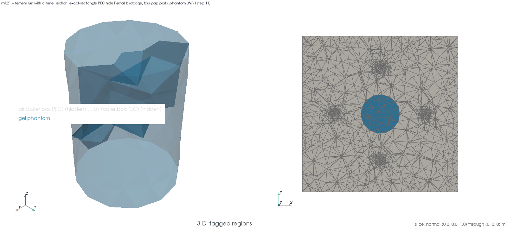

# `-e mri:21` — `femem run` with a `tune:` section: one solve, the summary's `tune` block, the `.s4p` alone, the tuned mode's field

Guide for `examples/mri/21_femem_run_tune_section.py`.
Written to be followed without the source open.

## 1. What this demonstrates

**What `femem run` does with a top-level `tune:` section.** `WF-1` step 11 let a YAML file
carry `tune: {k: 1}`. `run_study_file` then solves the Study once, calls `Study.tune(k)` on
the *solved* Study (it reads `study.result`, so there is no second solve) and writes the
result into the run's JSON summary beside the Touchstone file. No example ran such a file. This one
reads the tracked `tests/package/wf1/f_small_hole_pec_tune.yaml` in place (the
exact-rectangle PEC hole F-small birdcage, degree 1, 64 MHz, κ off, `-n 2`) and runs it
through `cli.main(["run", …])` in-process, the `mri:9` pattern. A call-through wrapper on
`fem_em_solver.study_yaml.run_study_file`, restored in `finally`, captures the returned
`StudyRun`; it changes nothing about what runs. The YAML's one extra section is

```yaml
tune:
  k: 1
```

and the parsed outputs are `{"tune": {"k": 1}}`. Every record, band and helper is imported
from `tests/package/test_wf1_yaml_tune.py` (the ANS-1 rule); the example states no band.

**Anchors of the gate, re-asserted.** (R0) cells and class means against the `"pec"` record;
(I=) the summary's `tune` block equals the same Study's `tune(k=1)` by `float.hex`, in
memory and read back from the run's JSON summary; (a) `C_mode` against `TH17_STEP3_C_MODE_RECORD_F`
within `REDUCTION_BAND`; and one solve in all.

**Four readings no example had.**

1. **The keys tie together (Z).** From the summary alone, `C · 2π f · Im z_k = 1` with `k`
   read from the summary.
2. **An omitted `k` is the default (D).** `tune: {}` parses to `{}`, and the summary built
   from it equals the `k = 1` block bitwise.
3. **The `.s4p` alone gives the same C (T).** The written Touchstone is read back with
   scikit-rf, put on a fresh mesh-free Study from `load_study`, and `tune(k=1)` returns the
   summary's capacitance. No mesh, no solve.
4. **The field of the mode the file tuned.** `Study.b1_plus()` is a second, disclosed,
   field-keeping build and sweep, run after every `tune` read. Its per-port fields,
   superposed with the DFT weights of the summary's `k` and of `k = 2` for contrast, go to
   ParaView.

Negative controls, both asserted: (c1) `tune: {k: 2}` misses the record by 489.5× the
band; (cX) `malformed_tune_k_zero.yaml` refuses at `tune.k` (rc 2 for `run` and `check`) and
writes no directory.

Readings of record (flagged run, harness log `EX-115`, file
`docs/testing/logs/20261015T140113Z_EX-115.log`; the unflagged control `EX-115-control`,
`docs/testing/logs/20261015T140230Z_EX-115-control.log`, reproduces them). The gate's run of
record is `docs/testing/logs/20261014T110326Z_WF-1-s11-W1.log`:

| Anchor | Reference | Reading (log line) | Bound |
| --- | --- | --- | --- |
| (W) rank width | `ANS6_EXACT_STRIP_RECORD_RANK_WIDTH` | 2 == 2 (`:922`) | exact |
| (R0) cells; class means vs `"pec"` | `ANS6_EXACT_STRIP_HOLE_CELL_RECORD`; `LEG_D0_REPRODUCTION_BAND` | 80 798; 5.052e-11 / 3.878e-11 / 5.875e-11 (`:929`) | 1e-9 |
| (I=) summary = same Study's `tune()`, memory and disk | bitwise | True / True (`:930`) | exact |
| (a) C_mode vs `TH17_STEP3_C_MODE_RECORD_F` | `REDUCTION_BAND` | 6.626796421e-11 F, gap −2.976552e-04 (`:931`) | 1e-3 |
| (Z) C ω Im z_k = 1 | `EXACT_IDENTITY_RTOL` | 0.000e+00 (`:933`) | 1e-10 |
| (D) `tune: {}` = k = 1 block | bitwise | True (`:934`) | exact |
| (T) `.s4p` vs the run's S | `ANCHOR_TOL`, `FREQ_ATOL_HZ` | 5.824e-14; 0 Hz (`:935`) | 1e-12 |
| (T) C from the file's S alone | `LEG_D0_REPRODUCTION_BAND` | 1.088e-14 (`:936`) | 1e-9 |
| (Once) wrapper calls; `study.result` unchanged | exact | 1; True (`:937`) | exact |
| (c1) k = 2 misses | `REDUCTION_BAND` | 9.873468900e-11 F, gap +4.894874e-01, 489.5× band (`:932`) | > 1e-3 |
| (cX) malformed file | exact | field `tune.k`; rc (2, 2); no directory (`:925`, `:926`) | exact |

**Printed only (no band).** The run directory holds `f_small_hole_pec_tune.s4p` (819 B) and
the run's JSON summary (2715 B) (`:928`); `cli.main` took 29.0 s (`:927`). The `tune` block's
`z_k` (Ω), k = 0…3, at six digits (`:939`–`:943`): 2.0146 − 1164.92j;
0.0250035 + 37.5264j; 0.00299922 + 25.1866j; 0.0250035 + 37.5264j, with
C₁ = C₃ = 6.6268e-11 F, C₂ = 9.87347e-11 F, residual 3.798e-05. At the coil centre
(`:1820`–`:1822` of the flagged log) mode 1 has |B₁⁺| 3.33666e-10, |B₁⁻| 3.68784e-08 T;
mode 2 has 2.67675e-10, 2.63168e-10 T; |B₂(0)| / |B₁(0)| = 1.0277e-02. These equal
`mri:19`'s readings at every printed digit, as expected for the same fixture, code and
width. The plain and field-keeping sweeps agree to 1.681e-15 (`:1819`). Fields are per
unit incident-wave mode excitation: a record, not an absolute field.

**Not claimed:** the installed console script; `tune` at degree 2, on copper, on the solid
four-port or on F-human; `k = 2` as a gated mode; a tuned f₀, Q, match or any absolute
S₁₁ / Z_in / C figure (`ANS-7` stays 🟡); Touchstone accuracy beyond the round trip; a
stable summary schema; an external check. C is a lossless mode read at 64 MHz on one
degree-1 fixture: **not a tuning, resonance or f₀ claim.** `WF-1` does not move.

## Setup figure



`examples/mri/figures/mri_21_femem_run_tune_section_setup.png`. Rendered right after
`femem run` returns, from the run's mesh and cell tags (`FEM_EM_SETUP_FIGURES=1`).
Regions: "gel phantom" (translucent) and "air (outer box PEC)" (hidden). The slice is
normal to `z` through the origin and cuts the phantom. **The coil is drawn as a void:** the
hole route has no conductor cells, and the four port sheets are facet tags, which the
renderer does not draw. The figure is geometry only.

## 2. How to run it

```
./scripts/run_examples.sh -e mri:21 -n 2 -t 420
```

Heavy tier, `-n 2`, complex build (the `mri:` group sources it). Measured wall time
≈ 67 s flagged and ≈ 63 s unflagged (harness elapsed), of which the single Study solve is
≈ 29 s and the field-keeping build and sweep ≈ 31 s. Output goes to
`examples/mri/paraview_output/`, which is gitignored: `mri_21_run/` (the `femem run`
output directory with the run's JSON summary and `f_small_hole_pec_tune.s4p`),
`mri_21_femem_run_tune_section_combined.xdmf` with its `.h5`, and `mri_21_bad/` (which
must not exist). The setup figure is rendered only with `FEM_EM_SETUP_FIGURES=1`.

## 3. How to analyze it, step by step

**Step 1 — the YAML.** Open `tests/package/wf1/f_small_hole_pec_tune.yaml`. It is the
control file `f_small_hole_pec_control.yaml` plus the top-level `tune:` mapping. The
example asserts the parsed outputs are exactly `{"tune": {"k": 1}}` with `k` an `int`.
`femem check` on the file prints `family: four_port_birdcage` and returns 0; it reads
inputs only and builds nothing.

**Step 2 — the refusal first (cX).** `malformed_tune_k_zero.yaml` has `k: 0`. The
`StudyConfigError` carries `.field == "tune.k"` and the message `tune.k: must be 1 or 2,
got 0`; `run` and `check` both return 2 and no output directory appears. No mesh is built
for it. (A `StudyConfigError` is the user-facing refusal: nothing is solved.)

**Step 3 — one solve.** `femem run` returns rc 0. The wrapper saw exactly one
`run_study_file` call, and `run.study.result` is the same object after every later `tune`
read, so none of them re-solved. Note the order in the script: all `tune` reads first, then
`b1_plus()`.

**Step 4 — the `tune` block of the run's JSON summary, key by key.**
`k`: the mode index (1). `frequency_hz`: 64 MHz, equal by hex to `FREQUENCY_64_HZ`.
`z_k`: four `[Re, Im]` pairs, the modal impedances `diag(F Z Fᴴ)`, indexed by mode. Modes 1
and 3 are the degenerate pair. `c_mode_farad`: `C = 1/(ω Im z_k)`. `off_diagonal_residual`:
how far the S is from circulant (3.8e-05). The example checks that the summary's block
equals `run.study.tune(k=1)` bit for bit, and that the block read back from disk equals the
in-memory one: the on-disk JSON round-trips doubles exactly.

**Step 5 — how C follows from `z_k` (Z).** Take `t = summary["tune"]`,
`k = t["k"]`, then `C · 2π · t["frequency_hz"] · t["z_k"][k][1]` is 1 to the round-off
(read 0.000e+00). `tune` raises when `Im z_k ≤ 0`, so k = 0 (Im −1164.92 Ω) is not a valid
read; the example computes the table's `C_k` column in numpy and leaves it blank there.

**Step 6 — an omitted `k` (D).** With `tune: {}` the parse gives `{}` and the summary is
built by `Study.tune`'s default, k = 1: the block equals the `k = 1` one bitwise.

**Step 7 — the `.s4p` alone (T).** Read `f_small_hole_pec_tune.s4p` with
`skrf.Network(path)`: one frequency, four ports, `s` of shape `(1, 4, 4)`. It differs from
the run's S by 5.824e-14 (13-significant-digit text). Then
```python
st = load_study("tests/package/wf1/f_small_hole_pec_tune.yaml")
st.result = SimpleNamespace(s_matrix=S_file[0])     # no mesh is built, no solve
c = st.tune(k=1).c_mode_farad
```
returns the summary's C to 1.088e-14. The same recipe gives C from any four-port `.s4p` of
the same Study configuration (the `Study` supplies f and z0).

**Step 8 — the controls.** (c1) with `tune: {k: 2}` the same solved Study gives
C = 9.873468900e-11 F, +48.95 % from the record, 489.5× the band: a summary that ignored
`k` would have stayed at 6.6268e-11 F and been caught by (a) instead. A control inside its
band would be a mislabelled variant.

**Step 9 — open it in ParaView.**
`File → Open → examples/mri/paraview_output/mri_21_femem_run_tune_section_combined.xdmf`.
The file holds the cell grid with `B_tuned_mode_real` (vector CG1, the real copy of the
superposed phasor of the mode the file named), nodal scalars `B_tuned_mode_abs`,
`B1_plus_tuned_mode`, `B1_minus_tuned_mode` and `B_mode2_abs` (nodal \|·\|, not a
point-evaluated \|B₁⁺\|), and `CellTags`.

1. **Slice** at z = 0 and colour by `B_tuned_mode_abs` and `B_mode2_abs` side by side.
2. **Glyph** `B_tuned_mode_real` on the slice.
3. Compare `B1_plus_tuned_mode` with `B1_minus_tuned_mode`: the tuned mode is dominated by
   \|B₁⁻\| (3.68784e-08 T vs 3.33666e-10 T at the centre). Which of k = 1 / 3 is
   co-rotating is the e^{jωt} convention; the example prints it and does not claim it.

**Step 10 — what a deviation means.** (W) fails → not `-n 2`. (R0), (I=) or (a) fails →
an example/gate divergence, or `main` drifted: compare with the gate's own run. (Z) or (D)
fails → the summary's keys are not what `_tune_summary` says, or the default `k` is not 1.
(T) fails → the Touchstone round trip loses more than its band. (c1) inside the band →
the summary is blind to `k`. (cX) rc ≠ 2 or a directory written → the parser let the file
through.

## Related

- `examples/mri/09_study_from_yaml.md` — `cli.main(["run", …])` on a solid four-port YAML.
- `examples/mri/19_study_tune_mode_capacitance.md` — `Study.tune` from Python and the same mode fields.
- `examples/mri/11_study_frequency_sweep.md` — the scikit-rf reader and the Touchstone anchors.
- `tests/package/wf1/f_small_hole_pec_tune.yaml` — the YAML this example runs in place.
- `tests/package/wf1/malformed_tune_k_zero.yaml` — the refused file.
- `tests/package/test_wf1_yaml_tune.py` — the gate this example imports.
